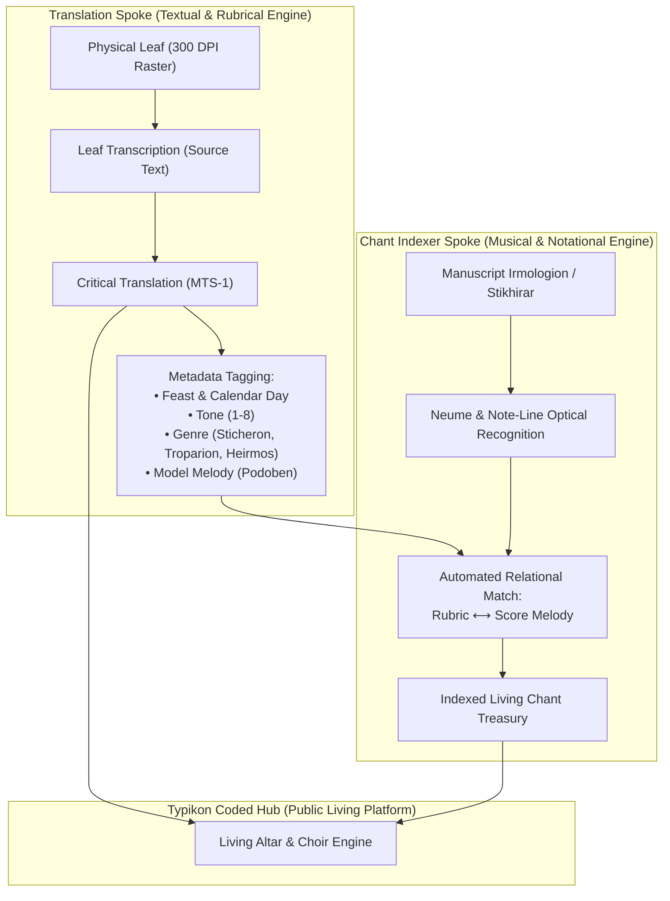

# Master Corpus of Eastern Liturgical Law, Service Books & Typika
## High-ROI Wave-Prioritized Transmission Chain for the Translation & Typikon Coded Spokes

> [!IMPORTANT]
> **Executive Architecture & High-ROI Wave Prioritization Mandate**  
> This specification codifies the **Master Liturgical Translation Canon** of the Byzantine-Ruthenian (Galician and Kyivan) liturgical tradition, spanning 1,200 years of liturgical history (8th century to 2010 AD).  
> Staff-notated musical score books (*1894 Dolnytsky Hlasopisnets*, *1902 Polotniuk Napivnyk Tserkovnyj*, and *1790 Pochayiv Bohohlasnyk*) are assigned exclusively to the **Chant Indexer / Kyivan Musicology** spokes and pruned from this textual translation queue.  
> Following the sealing of **Monuments 0–6** and the ongoing execution of **Monument 7** (`1895_dmitrievsky_vol1`), the translation queue from **Monument 8 onward** is structured into **Four Intelligent High-ROI Waves** prioritizing Galician and Kyivan Service Books (Octoechos, Lenten Triodion, Paschal Pentecostarion, Festal Anthologia, Horologion, Menaia) and Primary Typika ahead of large Sacerdotal Euchologia, Modern Rome Ordines/Liturgika, Muscovite *Oko Tserkovnoe* codices, Monastic Legislation, and Comparative Rites.

---

## 1. Five-Stage Execution & Paleographical Matrix

| Stage / Wave | Strategic Focus & Script Type | Monument Range | Leaf Volume & High-ROI Rationale |
|---|---|---|---|
| **Core Foundation (Sealed & Active)** | Modern & Scholarly Typika (1852–2010, Ukrainian, Church Slavonic, Polytonic Greek, Pre-Reform Russian) | **Monuments 0–7** (`2010_lviv_typikon` – `1895_dmitrievsky_vol1`) | Establishes the statutory rubrical, canonical, and critical-apparatus baseline across Ruthenian and Constantinopolitan Typika. |
| **Wave 1: High-ROI Compact Service Books** | Early Kyivan & Lviv Octoechoi (1629/1630), 1905 Lviv Nativity/Theophany Anthologion | **Monuments 8–10** (118–296 leaves each; **681 leaves total**) | Immediate high-impact bridge to core 8-tone Octoechos propers and festal Nativity/Theophany services at low leaf cost. |
| **Wave 2: Core Seasonal Service Books & Primary Typika** | Lviv Stauropegion Lenten Triodion & Paschal Pentecostarion, Great Sabbas Synodal Typikon, Slozka & Mohyla Triodia, Complete 1895 Lviv Octoechos, Dmitrievsky Vol. 3 | **Monuments 11–17** (441–1,029 leaves each; **5,174 leaves total**) | Completes the entire movable Paschal/Lenten cycle, the complete 8-tone hymnographic treasury, and the Sabbas/Dmitrievsky Typikon corpus. |
| **Wave 3: Great Anthologia, Horologion, Modularized 1761 Menaion & Pre-Nikonian Typika** | 1950 Rome *Chasoslov*, 1738 Pochayiv & 1619 Berynda Anthologia, 1901 Lviv Psalter, 12-Volume 1761 Pochayiv Menaion, Pre-Nikonian *Oko Tserkovnoe* (smallest-to-largest) | **Monuments 18–25** (222–2,367 leaves per unit) | Unlocks the fixed 12-month sanctoral cycle (modularized into 12 independent monthly sub-monuments), the unabridged Horologion/Psalter, and Pre-Nikonian comparative rubrics. |
| **Wave 4: Sacerdotal Liturgika/Euchologia, Rome Ordines, Juridical Synods, Lectionaries & Comparative Rites** | 1944/1955 Rome *Ordo Celebrationis*, UGCC & Mohyla Liturgika/Trebnyks, Dmitrievsky Vol. 2 (Euchologia), Zamość/Sheptytsky/Basilian Acts, Fedorov Apostolos, Ostroh Bible Tables, Akafistniki, Classical & Comparative Codices | **Monuments 26–47** (75–1,500 leaves each) | Completes sacerdotal euchologia, Rome synodal ordines, canonical legislation, early printed lectionary tables, and classical/comparative liturgical witnesses. |

---

## 2. Complete Codex Inventory

### Core Foundation: Sealed Monuments 0–6 & In-Progress Monument 7
*All physical facsimile leaves verified on Drive E: master vault.*

0. **Monument 0: 2010 Lviv Synodal Typikon** (`2010_lviv_typikon`)
   - *Title*: Typikon of the Ukrainian Greek-Catholic Church (*Типик УГКЦ*, Lviv, 2010)
   - *Scope*: 287 physical leaves | *Register*: Rubrical | *Status*: **100% Sealed & Ingested**
   - *Source*: `3. Modern Service Books and Typikons/03. Modern Typikons & Liturgical Ordines/01. Modern Typikons & Commentaries/2010 Lviv Typikon/Typyk UHKC(укр).pdf`
1. **Monument 1: 1891 Lviv Provincial Synod** (`1891_lviv_synod`)
   - *Title*: Acts and Decrees of the Ruthenian Provincial Synod of Lviv (1891)
   - *Scope*: 278 physical leaves | *Register*: Juridical | *Status*: **100% Sealed & Ingested**
   - *Source*: `2. Historical Liturgical Texts/Typikons_and_Ordines/1891-1896-Chynnosty-i-Rishenia-Lviv-Provincial-Synod.pdf`
2. **Monument 2: 1899 Dolnytsky Typikon** (`1899_dolnytsky_typikon`)
   - *Title*: Typik of the Ruthenian-Catholic Church (Fr. Isidore Dolnytsky, Lviv Stauropegion, 1899)
   - *Scope*: 591 physical leaves | *Register*: Rubrical | *Status*: **100% Sealed & Ingested**
   - *Source*: `2. Historical Liturgical Texts/Typikons_and_Ordines/1899-Typik-Dolnytsky-Church-Slavonic-Facsimile.pdf`
3. **Monument 3: 1901 Mikita Typikon** (`1901_mikita_typikon`)
   - *Title*: Typikon of the Ruthenian-Catholic Church (Fr. Alexander Mikita, Mukachevo-Uzhhorod, 1901)
   - *Scope*: 320 physical leaves | *Register*: Rubrical | *Status*: **100% Sealed & Ingested**
   - *Source*: `2. Historical Liturgical Texts/Typikons_and_Ordines/1901-Typikon-Alexander-Mikita-Mukachevo-Ruthenian.pdf`
4. **Monument 4: 1852 Doskovsky Typikon** (`1852_doskovsky_typikon`)
   - *Title*: Typikon of the Church or Order of Divine Worship (Fr. Jacob Doskovsky, Peremyshl, 1852)
   - *Scope*: 141 physical leaves | *Register*: Rubrical | *Status*: **100% Sealed & Ingested**
   - *Source*: `2. Historical Liturgical Texts/Typikons_and_Ordines/1852-Typikon-Doskovsky.pdf`
5. **Monument 5: 1888 Violakis Typikon** (`1888_violakis_typikon`)
   - *Title*: Typikon of the Great Church of Christ (George Violakis, Ecumenical Patriarchate, Constantinople, 1888)
   - *Scope*: 1,170 physical leaves | *Register*: Rubrical | *Status*: **100% Sealed & Ingested**
   - *Source*: `2. Historical Liturgical Texts/Typikons_and_Ordines/1888-Violakis-Typikon-Bilingual-Greek-English.pdf`
6. **Monument 6: 1910 Skaballanovich Typikon** (`1910_skaballanovich_typikon`)
   - *Title*: Tolkovy Typikon of Mikhail Skaballanovich (Kyiv Theological Academy, 1910–1915)
   - *Scope*: 1,022 physical leaves (2,834 critical footnotes) | *Register*: Scholarly Critical | *Status*: **100% Sealed & Ingested**
   - *Source*: `2. Historical Liturgical Texts/Typikons_and_Ordines/1910-1915-Skaballanovich-Tolkovy-Typikon-Complete.pdf`
7. **Monument 7: 1895 Dmitrievsky Opisanie Vol. 1: Typika** (`1895_dmitrievsky_vol1`)
   - *Title*: Description of Liturgical Manuscripts Vol. 1: Typika (Aleksei Dmitrievsky, Kyiv, 1895)
   - *Scope*: 1,090 physical leaves | *Register*: Scholarly Critical | *Status*: **In Progress (Cohorts 1–12 / 120 leaves completed)**
   - *Source*: `2. Historical Liturgical Texts/Typikons_and_Ordines/1895-Dmitrievsky-Opisanie-Vol1-Typika-Part1.pdf`

---

### WAVE 1: High-ROI Compact Service Books (Monuments 8–10)
*100% 300 DPI JPEG mirrors materialized and verified on Drive E: master vault (118–296 leaves each; 681 leaves total).*

8. **Monument 8: 1629 Kyiv-Pechersk Lavra Octoechos** (`1629_kyiv_octoechos`)
   - *Title*: Kyiv-Pechersk Lavra Octoechos (Kyiv, 1629)
   - *Scope*: 118 physical leaves | *Register*: Hymnographic / Rubrical | *Status*: **100% Mirrored & Primed**
   - *Source*: `2. Historical Liturgical Texts/Kyivan_Recension/Octoechos/Kyiv_1629_Octoechos/PDFs/Kyiv_1629_Octoechos.pdf`
9. **Monument 9: 1630 Lviv Printed Octoechos** (`1630_lviv_octoechos`)
   - *Title*: Lviv Printed Octoechos (Lviv Stauropegion, 1630)
   - *Scope*: 267 physical leaves | *Register*: Hymnographic / Rubrical | *Status*: **100% Mirrored & Primed**
   - *Source*: `2. Historical Liturgical Texts/Kyivan_Recension/Octoechos/Lviv_1630_Octoechos/PDFs/Lviv_1630_Octoechos.pdf`
10. **Monument 10: 1905 Lviv Divine Services for Nativity, Circumcision, and Theophany** (`1905_lviv_nativity_theophany`)
    - *Title*: Divine Services for Nativity, Circumcision, and Theophany (Galician Recension, Lviv, 1905)
    - *Scope*: 296 physical leaves | *Register*: Hymnographic / Rubrical | *Status*: **100% Mirrored & Primed**
    - *Source*: `2. Historical Liturgical Texts/Galician_Recension/Anthologia/1905 Divine Services for Nativity Circumcision Theophany/PDFs/Bohosluzhеnija_Rozhdestva_Obrizanija_Bohojavlenija_1905.pdf`

---

### WAVE 2: Core Seasonal Service Books (Triodia, Pentecostaria, Full Octoechos) & Primary Typika (Monuments 11–17)
*441–1,029 leaves each (5,174 leaves total).*

11. **Monument 11: 1906 Lviv Stauropegion Lenten Triodion** (`1906_lviv_triodion_lenten`)
    - *Title*: Lenten Triodion (*Triodion Postnaja*) (Lviv Stauropegion, 1906)
    - *Scope*: 532 physical leaves | *Register*: Hymnographic / Rubrical | *Status*: **100% Mirrored & Primed**
    - *Source*: `2. Historical Liturgical Texts/Ruthenian_Galician/Triodia/Lviv_1906_Lenten_Triodion/PDFs/1906 Lviv Triodion Postnaja.pdf`
12. **Monument 12: 1907 Lviv Stauropegion Paschal Pentecostarion** (`1907_lviv_pentecostarion`)
    - *Title*: Paschal Pentecostarion (*Pentikostarion*) (Lviv Stauropegion, 1907 — standalone monument)
    - *Scope*: 671 physical leaves | *Register*: Hymnographic / Rubrical | *Status*: **100% Mirrored & Primed**
    - *Source*: `2. Historical Liturgical Texts/Ruthenian_Galician/Triodia/Lviv_1907_Paschal_Triodion/PDFs/1907 Lviv Pentikostarion.pdf`
13. **Monument 13: Great Sabbas Synodal Typikon** (`great_sabbas_synodal`)
    - *Title*: Great Sabbas Synodal Typikon (Church Slavonic Edition)
    - *Scope*: 816 physical leaves | *Register*: Rubrical | *Status*: **100% Mirrored & Primed**
    - *Source*: `2. Historical Liturgical Texts/Typikons_and_Ordines/Great-Sabbas-Synodal-Typikon-Church-Slavonic/PDFs/Great-Sabbas-Synodal-Typikon-Church-Slavonic.pdf`
14. **Monument 14: 1642 Lviv Slozka Flowery Triodion (Pentecostarion)** (`1642_lviv_slozka_pentecostarion`)
    - *Title*: Lviv Flowery Triodion (*Triodion Tsvitnaja* / Pentecostarion) (Mykhailo Slozka, Lviv, 1642)
    - *Scope*: 441 physical leaves | *Register*: Hymnographic / Rubrical | *Status*: **100% Mirrored & Primed**
    - *Source*: `2. Historical Liturgical Texts/Kyivan_Recension/Triodia/Lviv_1642_Slozka_Flowery_Triodion/PDFs/Lviv_1642_Slozka_Flowery_Triodion.pdf`
15. **Monument 15: 1640 Kyiv-Pechersk Lenten Triodion** (`1640_kyiv_triodion`)
    - *Title*: Kyiv-Pechersk Lenten Triodion (Metropolitan Petro Mohyla, Kyiv, 1640)
    - *Scope*: 896 physical leaves | *Register*: Hymnographic / Rubrical | *Status*: **100% Mirrored & Primed**
    - *Source*: `2. Historical Liturgical Texts/Kyivan_Recension/Triodia/Kyiv_1640_Lenten_Triodion/PDFs/Kyiv_1640_Lenten_Triodion.pdf`
16. **Monument 16: 1895 Lviv Stauropegion Complete Octoechos** (`1895_lviv_octoechos`)
    - *Title*: Lviv Stauropegion Complete Octoechos (*Oktoikh*) (Lviv, 1895 — pure liturgical text edition, zero musical staves)
    - *Scope*: 1,029 physical leaves | *Register*: Hymnographic / Rubrical | *Status*: **100% Mirrored & Primed**
    - *Source*: `1. Music and Chant Monuments/Irmologia/3. Historical Printed Editions/1895 Lviv Oktoechos/PDFs/1895-Oktoix.pdf`
17. **Monument 17: 1917 Dmitrievsky Opisanie Vol. 3: Typika Part 2** (`1917_dmitrievsky_vol3`)
    - *Title*: Description of Liturgical Manuscripts Vol. 3: Typika Part 2 (Aleksei Dmitrievsky, Petrograd, 1917)
    - *Scope*: 789 physical leaves | *Register*: Scholarly Critical | *Status*: **100% Mirrored & Primed**
    - *Source*: `2. Historical Liturgical Texts/Typikons_and_Ordines/1917-Dmitrievsky-Opisanie-Vol3-Typika-Part2/PDFs/1917-Dmitrievsky-Opisanie-Vol3-Typika-Part2.pdf`

---

### WAVE 3: Great Anthologia, Horologion, Pre-Nikonian Typika & Modularized 1761 Pochayiv Menaion (Monuments 18–25)

18. **Monument 18: 1950 Rome Ruthenian Chasoslov (Horologion)** (`1950_rome_chasoslov`)
    - *Title*: Chasoslov: Book of Hours of the Ruthenian Recension (Sacra Congregatio pro Ecclesia Orientali, Rome, 1950)
    - *Scope*: 1,267 physical leaves | *Register*: Rubrical / Hymnographic | *Status*: **100% Mirrored & Primed**
    - *Source*: `2. Historical Liturgical Texts/Ruthenian_Galician/Horologia/Rome_1950_Chasoslov/PDFs/Rome_1950_Chasoslov.pdf`
19. **Monument 19: 1738 Pochayiv Anthologion (*Tsvitoslov*)** (`1738_pochaiv_anthologion`)
    - *Title*: Pochayiv Anthologion or Sbornik of Divine Services for Feasts (Pochayiv Lavra Press, 1738)
    - *Scope*: 1,213 physical leaves | *Register*: Hymnographic / Rubrical | *Status*: **100% Mirrored & Primed**
    - *Source*: `2. Historical Liturgical Texts/Kyivan_Recension/Anthologia/Pochaiv_1738_Anthologion/PDFs/Pochaiv_1738_Anthologion.pdf`
20. **Monument 20: 1619 Kyiv-Pechersk Anthologion (Pamvo Berynda)** (`1619_berynda_anthologion`)
    - *Title*: Kyiv-Pechersk Lavra Anthologion (Pamvo Berynda, Kyiv, 1619)
    - *Scope*: 1,066 physical leaves | *Register*: Hymnographic / Rubrical | *Status*: **100% Mirrored & Primed**
    - *Source*: `2. Historical Liturgical Texts/Kyivan_Recension/Anthologia/Kyiv_1619_Anthologion/PDFs/Kyiv_1619_Anthologion.pdf`
21. **Monument 21: 1901 Lviv Stauropegion Psalter with Kathismata Rubrics** (`1901_lviv_psalter`)
    - *Title*: Lviv Stauropegion Psalter (*Psaltyr*) with Kathismata Rubrics (Lviv, 1901)
    - *Scope*: 286 physical leaves | *Register*: Hymnographic / Rubrical | *Status*: **100% Mirrored & Primed**
    - *Source*: `2. Historical Liturgical Texts/Ruthenian_Galician/Psalteria/Lviv_1901_Psalter/PDFs/1901-Psaltyr-Lviv.pdf`
22. **Monument 22 (Modularized Vol. 1–12): 1761 Pochayiv Menaion** (`1761_pochaiv_minea_01_sep` through `1761_pochaiv_minea_12_aug`)
    - *Title*: Pochayiv Menaion: Complete 12-Month Sanctoral Services & Rubrical Directives (Pochayiv Lavra, 1761 — 3,904 total leaves across 12 independent monthly sub-monuments, 100% mirrored on Drive E):
      - **Monument 22.01**: `1761_pochaiv_minea_01_sep` — *September* (**365 leaves**) — `Pochaiv_1761_Menaion/Pochaiv_1761_Menaion_01_September/PDFs/01-MINEA Pochaiv-1761 September.pdf`
      - **Monument 22.02**: `1761_pochaiv_minea_02_oct` — *October* (**343 leaves**) — `Pochaiv_1761_Menaion/Pochaiv_1761_Menaion_02_October/PDFs/02-MINEA Pochaiv-1761 October.pdf`
      - **Monument 22.03**: `1761_pochaiv_minea_03_nov` — *November* (**371 leaves**) — `Pochaiv_1761_Menaion/Pochaiv_1761_Menaion_03_November/PDFs/03-MINEA Pochaiv-1761 November.pdf`
      - **Monument 22.04**: `1761_pochaiv_minea_04_dec` — *December* (**451 leaves**) — `Pochaiv_1761_Menaion/Pochaiv_1761_Menaion_04_December/PDFs/04-MINEA Pochaiv-1761 December.pdf`
      - **Monument 22.05**: `1761_pochaiv_minea_05_jan` — *January* (**450 leaves**) — `Pochaiv_1761_Menaion/Pochaiv_1761_Menaion_05_January/PDFs/05-MINEA Pochaiv-1761 January.pdf`
      - **Monument 22.06**: `1761_pochaiv_minea_06_feb` — *February* (**279 leaves**) — `Pochaiv_1761_Menaion/Pochaiv_1761_Menaion_06_February/PDFs/06-MINEA Pochaiv-1761 February.pdf`
      - **Monument 22.07**: `1761_pochaiv_minea_07_mar` — *March* (**230 leaves**) — `Pochaiv_1761_Menaion/Pochaiv_1761_Menaion_07_March/PDFs/07-MINEA Pochaiv-1761 March.pdf`
      - **Monument 22.08**: `1761_pochaiv_minea_08_apr` — *April* (**222 leaves**) — `Pochaiv_1761_Menaion/Pochaiv_1761_Menaion_08_April/PDFs/08-MINEA Pochaiv-1761 April.pdf`
      - **Monument 22.09**: `1761_pochaiv_minea_09_may` — *May* (**236 leaves**) — `Pochaiv_1761_Menaion/Pochaiv_1761_Menaion_09_May/PDFs/09-MINEA Pochaiv-1761 May.pdf`
      - **Monument 22.10**: `1761_pochaiv_minea_10_jun` — *June* (**269 leaves**) — `Pochaiv_1761_Menaion/Pochaiv_1761_Menaion_10_June/PDFs/10-MINEA Pochaiv-1761 June.pdf`
      - **Monument 22.11**: `1761_pochaiv_minea_11_jul` — *July* (**341 leaves**) — `Pochaiv_1761_Menaion/Pochaiv_1761_Menaion_11_July/PDFs/11-MINEA Pochaiv-1761 July.pdf`
      - **Monument 22.12**: `1761_pochaiv_minea_12_aug` — *August* (**347 leaves**) — `Pochaiv_1761_Menaion/Pochaiv_1761_Menaion_12_August/PDFs/12-MINEA Pochaiv-1761 August.pdf`
23. **Monument 23: 1633 Patriarch Philaret Typikon (*Oko Tserkovnoe*)** (`1633_oko_philaret`)
    - *Title*: Eye of the Church: Typikon of Patriarch Philaret Romanov (Moscow, 1633 — smallest Pre-Nikonian *Oko*)
    - *Scope*: 637 physical leaves | *Register*: Rubrical / Incunabula | *Status*: **100% Mirrored & Primed**
    - *Source*: `2. Historical Liturgical Texts/Pre-Nikonian_Typika/1633_Typikon_Patriarch_Philaret/PDFs/1633-Typikon-Patriarch-Philaret-Oko-Tserkovnoe.pdf`
24. **Monument 24: 1610 Onisim Radishevsky Typikon (*Oko Tserkovnoe*)** (`1610_oko_radishevsky`)
    - *Title*: Eye of the Church: Typikon of the Church Service (Onisim Radishevsky, Moscow, 1610)
    - *Scope*: 1,266 physical leaves | *Register*: Rubrical / Incunabula | *Status*: **100% Mirrored & Primed**
    - *Source*: `2. Historical Liturgical Texts/Pre-Nikonian_Typika/1610_Typikon_Onisim_Radishevsky/PDFs/1610-Typikon-Onisim-Radishevsky-Oko-Tserkovnoe-Facsimile-Scan.pdf`
25. **Monument 25: 1641 Pre-Nikonian Typikon (*Oko Tserkovnoe*)** (`1641_oko_prenikonian`)
    - *Title*: Eye of the Church: The Great Pre-Nikonian Typikon of Patriarch Joseph (Moscow, 1641)
    - *Scope*: 2,367 physical leaves | *Register*: Rubrical / Incunabula | *Status*: **100% Mirrored & Primed**
    - *Source*: `2. Historical Liturgical Texts/Pre-Nikonian_Typika/1641_Typikon_Patriarch_Joseph/PDFs/1641-Typikon-Pre-Nikonian-Oko-Tserkovnoe.pdf`

---

### WAVE 4: Sacerdotal Liturgika/Euchologia, Rome Ordines, Juridical Synods, Lectionaries & Comparative Rites (Monuments 26–47)

26. **Monument 26: 1944/1955 Ordo Celebrationis (Rome Ruthenian Editio Typica)** (`1944_ordo_celebrationis`)
    - *Title*: Ordo Celebrationis Vesperarum, Matutini et Divinae Liturgiae Iuxta Recensionem Ruthenam (Sacra Congregatio pro Ecclesia Orientali, Rome, 1944/1955)
    - *Scope*: 163 physical leaves | *Register*: Rubrical / Juridical | *Status*: **100% Mirrored & Primed**
    - *Source*: `3. Modern Service Books and Typikons/03. Modern Typikons & Liturgical Ordines/02. Ordines Celebrationis & Rubric Handbooks/Ordo Celebrationis 1955 (Rome Ruthenian Editio Typica).pdf`
27. **Monument 27: 1988 UGCC Synod Liturgikon** (`1988_ugcc_liturgikon`)
    - *Title*: Liturgikon: Divine Liturgies of St. John Chrysostom, St. Basil the Great, and Presanctified Gifts (UGCC Synod, Rome, 1988)
    - *Scope*: 322 physical leaves | *Register*: Sacerdotal / Rubrical | *Status*: **100% Mirrored & Primed**
    - *Source*: `3. Modern Service Books and Typikons/01. Landmark & Official Service Books/04. UGCC Synodal Standard/Liturgikon (UGCC Synod 1988 Bilingual).pdf`
28. **Monument 28: 1632 Petro Mohyla Archieratikon / Sluzhebnyk** (`1632_mohyla_archieratikon`)
    - *Title*: Hieratikon and Euchologion of Metropolitan Petro Mohyla (Kyiv-Pechersk Lavra, 1632)
    - *Scope*: 248 physical leaves | *Register*: Rubrical / Sacerdotal | *Status*: **100% Mirrored & Primed**
    - *Source*: `2. Historical Liturgical Texts/Kyivan_Recension/Liturgika_and_Euchologia/PDFs/Kyiv_1632_Petro_Mohyla_Archieratikon_Sluzhebnyk_Trebnyk.pdf`
29. **Monument 29: 1646 Petro Mohyla Great Trebnyk** (`1646_mohyla_trebnyk`)
    - *Title*: Evkhologion albo Molitvoslov (Metropolitan Petro Mohyla, Kyiv-Pechersk Lavra, 1646)
    - *Scope*: 1,500 physical leaves | *Register*: Sacerdotal / Ritual
30. **Monument 30: 1901 Dmitrievsky Opisanie Vol. 2: Euchologia** (`1901_dmitrievsky_vol2`)
    - *Title*: Description of Liturgical Manuscripts Vol. 2: Euchologia (Aleksei Dmitrievsky, Kyiv, 1901)
    - *Scope*: 1,103 physical leaves | *Register*: Scholarly Critical | *Status*: **100% Mirrored & Primed**
    - *Source*: `2. Historical Liturgical Texts/Typikons_and_Ordines/1901-Dmitrievsky-Opisanie-Vol2-Euchologia.pdf`
31. **Monument 31: 1720 Provincial Synod of Zamość** (`1720_zamoysky_fedoriv`)
    - *Title*: Acts and Decrees of the Provincial Synod of Zamość (1720, ed. Fedoriv, Rome, 1972)
    - *Scope*: 75 physical leaves | *Register*: Juridical | *Status*: **100% Mirrored & Primed**
    - *Source*: `2. Historical Liturgical Texts/Typikons_and_Ordines/1972-Fedoriv-Zamoysky-Synod-1720.pdf`
32. **Monument 32: 2004 Galadza Sheptytsky** (`2004_galadza_sheptytsky`)
    - *Title*: The Theology and Liturgical Work of Andrei Sheptytsky (Peter Galadza, Rome, 2004)
    - *Scope*: 537 physical leaves | *Register*: Scholarly Critical | *Status*: **100% Mirrored & Primed**
    - *Source*: `2. Historical Liturgical Texts/Typikons_and_Ordines/2004-Galadza-Theology-and-Liturgical-Work-of-Andrei-Sheptytsky.pdf`
33. **Monument 33: 1617–1636 Basilian General Chapters Acts & Rules** (`1617_basilian_rules`)
    - *Title*: Acts and Rules of the General Chapters of the Order of Saint Basil the Great (1617–1636, Analecta OSBM Vol. 55)
    - *Scope*: 512 physical leaves | *Register*: Juridical / Monastic | *Status*: **100% Mirrored & Primed**
    - *Source*: `2. Historical Liturgical Texts/Kyivan_Recension/Monastic_Legislation/PDFs/1617-1636-Basilian-General-Chapters-Acts-and-Rules-Analecta-OSBM-Vol55.pdf`
34. **Monument 34: 1574 Ivan Fedorov Lviv Apostolos** (`1574_fedorov_apostolos`)
    - *Title*: The Lviv Apostolos with Liturgical Calendar and Historical Afterword (Ivan Fedorov, Lviv, 1574)
    - *Scope*: 556 physical leaves | *Register*: Rubrical / Lectionary | *Status*: **100% Mirrored & Primed**
    - *Source*: `2. Historical Liturgical Texts/Kyivan_Recension/Apostolos/PDFs/Lviv_1574_Ivan_Fedorov_Apostolos.pdf`
35. **Monument 35: 1581 Ostroh Bible Liturgical Appendices** (`1581_ostroh_bible_tables`)
    - *Title*: The Ostroh Bible: Liturgical Lectionary Tables and Calendar Ordo (Prince K. Ostrozky, Ostroh, 1581)
    - *Scope*: 1,232 physical leaves | *Register*: Rubrical / Lectionary | *Status*: **100% Mirrored & Primed**
    - *Source*: `2. Historical Liturgical Texts/Kyivan_Recension/Bibles/PDFs/Ostroh_1581_Ivan_Fedorov_Ostroh_Bible.pdf`
36. **Monument 36: 1893 Lviv Basilian *Akafistnik* & Devotional Ordo** (`1893_lviv_akafistnik`)
    - *Title*: Lviv Basilian Akafistnik & Devotional Ordo (Lviv, 1893)
    - *Scope*: 460 physical leaves | *Register*: Hymnographic | *Status*: **100% Mirrored & Primed**
    - *Source*: `2. Historical Liturgical Texts/Galician_Recension/Akafistniki/Lviv_1893_Akafistnik/PDFs/Lviv_1893_Akafistnik.pdf`
37. **Monument 37: 1905 Zhovkva Basilian *Akafistnik*** (`1905_zhovkva_akafistnik`)
    - *Title*: Zhovkva Basilian Akafistnik (Zhovkva, 1905)
    - *Scope*: 425 physical leaves | *Register*: Hymnographic | *Status*: **100% Mirrored & Primed**
    - *Source*: `2. Historical Liturgical Texts/Galician_Recension/Akafistniki/Zhovkva_1905_Akafistnik/PDFs/Zhovkva_1905_Akafistnik.pdf`
38. **Monument 38: Typikon of the Great Church (Hagia Sophia, 10th c.)** (`10th_c_hagia_sophia`)
    - *Title*: Le Typicon de la Grande Église (Codex Patmos 266 & Jerusalem Stavrou 40, ed. Juan Mateos, Rome, 1962)
39. **Monument 39: Studite-Alexian Typikon (1034 AD)** (`1034_studite_alexian`)
    - *Title*: The Typikon of Patriarch Alexius the Studite for the Monastery of the Dormition (Synodal MS 330)
40. **Monument 40: Evergetis Typikon (11th c. Constantinople)** (`11th_c_evergetis`)
    - *Title*: The Hypotyposis and Synaxarion of the Monastery of the Theotokos Evergetis (ed. Robert Jordan)
41. **Monument 41: Pantokrator Monastery Typikon (1136 AD)** (`1136_pantokrator`)
    - *Title*: Imperial Typikon of Emperor John II Comnenus for the Pantokrator Monastery
42. **Monument 42: Diataxis of Patriarch Philotheus Kokkinos (14th c.)** (`14th_c_philotheus_diataxis`)
    - *Title*: Diataxis tes Theias Leitourgias kai tes Agrypnias (Philotheus Kokkinos, Patriarch of Constantinople)
43. **Monument 43: Barberini Euchologion gr. 336 (8th c.)** (`8th_c_barberini_336`)
    - *Title*: The Barberini Euchologion (Vatican Library, Barberini gr. 336, oldest Byzantine prayer codex)
44. **Monument 44: Jacques Goar’s *Euchologion sive Rituale Graecorum* (Paris, 1647)** (`1647_goar_euchologion`)
    - *Title*: Euchologion sive Rituale Graecorum complectens Ritus et Ordines Divinae Liturgiae (Jacques Goar, O.P.)
45. **Monument 45: F. E. Brightman’s *Liturgies Eastern and Western* (Oxford, 1896)** (`1896_brightman_liturgies`)
    - *Title*: Liturgies Eastern and Western, Vol. 1: Eastern Liturgies (Frank Edward Brightman, Clarendon Press)
46. **Monument 46: Armenian Jamagirk (1902 Vagharshapat Print)** (`1902_armenian_jamagirk`)
    - *Title*: The Armenian Book of Hours (Horologion) with Choral Directives
    - *Scope*: 363 physical leaves | *Register*: Comparative / Rubrical | *Status*: **100% Mirrored & Primed**
    - *Source*: `3. Modern Service Books and Typikons/07. Comparative & Historical Rites/Armenian_Rite/Armenian Jamagirk (1902 Vagharshapat Print).pdf`
47. **Monument 47: F. C. Conybeare’s *Rituale Armenorum* (Oxford, 1905)** (`1905_conybeare_rituale_armenorum`)
    - *Title*: Rituale Armenorum: Being the Administration of the Sacraments and the Breviary Rites of the Armenian Church
    - *Scope*: 97 physical leaves | *Register*: Comparative / Ritual | *Status*: **100% Mirrored & Primed**
    - *Source*: `3. Modern Service Books and Typikons/07. Comparative & Historical Rites/Armenian_Rite/Conybeare - Rituale Armenorum.pdf`

---

## 3. Data Flow to the Chant Indexer Spoke

Every completed cohort in the Translation spoke exports a structured JSON metadata sidecar directly into the Chant Indexer inbox, enabling automatic hymnographic discovery and melodic indexing across the entire Ruthenian musical treasury.
