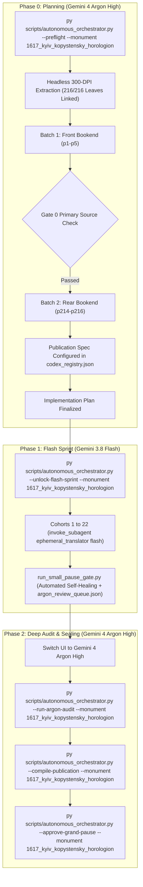

# Phase 0 Implementation Plan: 1616–1617 Kyiv-Pechersk Lavra Horologion of Zacharias Kopystensky (Часослов, Київ: Друкарня Києво-Печерської Лаври, 1616/1617)

## 1. Goal & Monument Identity

Translate, align, and canonically assemble the landmark historical Church Slavonic / Early Modern Ruthenian liturgical codex **1616–1617 Kyiv-Pechersk Lavra Horologion of Zacharias Kopystensky** (`1617_kyiv_kopystensky_horologion`), promulgated under Archimandrite Elisei Pletenetsky, edited with theological and scholarly prefaces by Zacharias Kopystensky, and issued from the newly founded Kyiv-Pechersk Lavra Printing House in 1616–1617.

- **Monument ID**: `1617_kyiv_kopystensky_horologion`
- **Full Title**: 1616–1617 Kyiv-Pechersk Lavra Horologion of Zacharias Kopystensky (Часослов, Київ: Друкарня Києво-Печерської Лаври, 1616/1617)
- **Historical Year**: 1616–1617 (begun 1616, completed 1617)
- **Printing Press**: Kyiv-Pechersk Lavra Typography (*Друкарня Києво-Печерської Лаври*)
- **Significance**: The celebrated "firstborn" (*первенец*) of the Kyiv Caves printing press, representing the inception of large-scale Orthodox printing in Kyiv and laying the foundation for 17th-century Kyivan liturgical book reform.
- **Physical Extent**: Exactly 216 physical leaves (`p1`–`p216`), partitioned into 22 cohorts (Cohorts 1–21: 10 leaves each; Cohort 22: 6 leaves: `p211`–`p216`).
- **Physical Geometry**: `Page_0001.jpg` (front cover) and `Page_0216.jpg` (back cover) are 1-up bindings; internal leaves feature 2-up facing book openings and single leaf spreads.
- **Genre Register**: `rubrical` (incorporating rubrics, monastic daily offices, liturgical hours, hymns, troparia, and menologion).
- **Concurrency & Lease**: Leased under the **Multi-Monument Sequestered Concurrency Protocol** (Rule 14) with explicit `--monument 1617_kyiv_kopystensky_horologion` CLI targeting and cross-process OS file locking.



---

## 2. Gate 0 Epigraphic Findings (Vision Budget: 8/8 Leaves, 2/2 Batches)

Inspected under the strict Phase 0 Vision Budget Contract (`max_vision_leaves = 8`, `max_vision_batches = 2`). Zero mid-codex visual searches were performed (`p6`–`p213` remained untouched).

### Batch 1: Front Bookend (`p1`–`p5`)
- **`Page_0001.jpg` (`p1`)**: Historical dark calf leather binding with blind-tooled border ornament and a printed 19th-century library label from the Trinity-Sergius Lavra Main Library (*Свято-Троицкой Сергіевой Лавры Главная Библіотека, Опись 1886 г., Отдѣлъ 4, № 131*).
- **`Page_0002.jpg` (`p2`)**: Inside front pastedown with manuscript shelfmark "Глава 4-я: № 684", pencil date "Киев 1616 1617", and initial paper flyleaf.
- **`Page_0003.jpg` (`p3`)**: Blank front flyleaf opening.
- **`Page_0004.jpg` (`p4`)**: `2-up` opening.
  - *Left Page*: Manuscript library accession and bibliographic notes in Russian cursive: *"Часослов. Киев, [1616-1617] ф 801-09 1241... 1795 года... Книга очень редкая первенец Киевской Типографии издана в 1616 году (см. конец послесловия Часослова). Недостает 1-го и 189-го листов. Принадлежит библиотеке Троицкой Серг. Лавры 1859 года."*
  - *Right Page* (folio 1r): Typographical dedication and epistle title printed in Church Slavonic / Early Modern Ruthenian: *"Елисей Плетенецкий, Архимандрит Печерский Киевский. Православному Роду Российскому, сыном Церкве Восточныя к любезнейшим, душеспасительнаго здравия:—"* with a grand historiated woodcut initial "П" (*Понеже убо по данной благодати к вверенным ми, яже в обители святыя Лавры Печерския...*).
- **`Page_0005.jpg` (`p5`)**: `2-up` opening (folios 1v–2r).
  - *Left Page*: Continuation of Archimandrite Elisei Pletenetsky's preface on publishing books, calling this prayer book by its Greek name *"ОРОЛОГІОН"* (Horologion) containing prayers for day and night, citing the ascetics and holy Caves fathers whose prayers flourished like flowers.
  - *Right Page*: Continuation on the power of prayer, referencing Hezekiah and the Prophet Isaiah crying to heaven, and King Manasseh praying in Babylon.

### Batch 2: Rear Bookend (`p214`–`p216`)
- **`Page_0214.jpg` (`p214`)**: `2-up` opening.
  - *Left Page*: Concluding section of the printed Table of Contents (*Оглавленіе книги сея*), listing the Sunday Triadics, Hypakoai, Troparia, Stichera, Theotokia, and hymns for Rus' saints (*Таже, и Россійским святым Трои и Кондаки*), crowned at the base by a Renaissance ornamental woodcut tailpiece vignette of a grotesque mask framed by laurel foliage.
  - *Right Page*: Blank rear flyleaf.
- **`Page_0215.jpg` (`p215`)**: Rear flyleaf opening showing early ink pen trials, shelfmark "4021", and brass clasp mount remnants.
- **`Page_0216.jpg` (`p216`)**: Rear outer cover with blind tooling and brass clasp hinge.

### Gate 0 Verification Outcome
- **Authenticity & Integrity**: Authentic 1616–1617 Kyiv-Pechersk Lavra printing. The text is crisp, legible, and completely preserved in the Trinity-Sergius Lavra exemplar (collection 801/09 № 1241). Gate 0 is fully passed.

---

## 3. Cohort Partition & Execution Plan

Partitioned into 22 monotonic cohorts according to the Closed Mathematical Leaf Conservation Law (Rule 15):

| Cohort | Physical Leaves | Leaf Count | Scope & Liturgical Contents |
| :---: | :---: | :---: | :--- |
| **Cohort 1** | `p1`–`p10` | 10 | Outer binding, flyleaves, Archimandrite Elisei Pletenetsky preface (*Орологіон*), introductory apparatus. |
| **Cohort 2** | `p11`–`p20` | 10 | Zacharias Kopystensky theological prefaces and opening of the Midnight Office (*Полунощница*). |
| **Cohort 3** | `p21`–`p30` | 10 | Midnight Office continuations and opening of Matins (*Утреня*). |
| **Cohort 4** | `p31`–`p40` | 10 | Matins Kathismata, Sessional Hymns, and Praises. |
| **Cohort 5** | `p41`–`p50` | 10 | First Hour (*Часъ Первый*) and Third Hour (*Часъ Третій*). |
| **Cohort 6** | `p51`–`p60` | 10 | Sixth Hour (*Часъ Шестый*) and Ninth Hour (*Часъ Девятый*). |
| **Cohort 7** | `p61`–`p70` | 10 | Typika (*Изобразительныя*) and Mealtime Prayers. |
| **Cohort 8** | `p71`–`p80` | 10 | Small Vespers and Great Vespers (*Вечерня*). |
| **Cohort 9** | `p81`–`p90` | 10 | Great Compline (*Повечеріе Великое*). |
| **Cohort 10** | `p91`–`p100` | 10 | Small Compline (*Повечеріе Малое*) and Evening Prayers. |
| **Cohort 11** | `p101`–`p110` | 10 | Canons of the Weekly Cycle (Sunday Resurrection / Monday Angels / Tuesday Forerunner). |
| **Cohort 12** | `p111`–`p120` | 10 | Weekly Canons continued (Wednesday Cross / Thursday Apostles & St. Nicholas / Friday Cross). |
| **Cohort 13** | `p121`–`p130` | 10 | Saturday Canon of All Saints and Departed. |
| **Cohort 14** | `p131`–`p140` | 10 | Akathist / Supplicatory Canons to the Most Holy Theotokos. |
| **Cohort 15** | `p141`–`p150` | 10 | Canon of Repentance to Our Lord Jesus Christ and Canon to the Guardian Angel. |
| **Cohort 16** | `p151`–`p160` | 10 | Communion Prayers and Preparation for the Holy Mysteries. |
| **Cohort 17** | `p161`–`p170` | 10 | Menologion (*Мѣсяцесловъ*): Autumn Cycle (September–November). |
| **Cohort 18** | `p171`–`p180` | 10 | Menologion: Winter Cycle (December–February). |
| **Cohort 19** | `p181`–`p190` | 10 | Menologion: Spring Cycle (March–May). |
| **Cohort 20** | `p191`–`p200` | 10 | Menologion: Summer Cycle (June–August) and General Troparia/Kontakia. |
| **Cohort 21** | `p201`–`p210` | 10 | Troparia and Kontakia to Rus' and Kyivan Caves Saints (*Россійским святым*). |
| **Cohort 22** | `p211`–`p216` | 6 | Concluding Paschalion tables, Table of Contents (*Оглавленіе*), tailpiece vignette, and rear covers. |

---

## 4. Publication Spec & Deliverable Structure

Canonical publication structure locked in `Liturgical Monuments/codex_registry.json`:
- **Hub Destination Folder**: `Typikon Coded/Data/Inbox/1616–1617_Kyiv-Pechersk_Lavra_Horologion_of_Zacharias_Kopystensky/`
- **Master Footnotes File**: `1617_kyiv_kopystensky_horologion_footnotes.md`
- **Publication Mode**: `universal_dynamic_h1` (automatically discovers and slices top-level `# <Heading>` divisions during Phase 2 `--compile-publication`).

| Part ID | Deliverable Filename | Title | Start Landmark Regex |
| :--- | :--- | :--- | :--- |
| `part0` | `1617_kyiv_kopystensky_horologion_part0_front_matter.md` | Front Matter, Title Page, and Introductory Apparatus | *Default Front Matter Opening* |
| `part1` | `1617_kyiv_kopystensky_horologion_part1_daily_cycle_hours.md` | PART I: THE DAILY CYCLE OF OFFICES AND HOURS | `^#+\s*(?:THE\s+)?(?:PART\s+I\b\|MIDNIGHT\s+OFFICE\|BOOK\s+OF\s+HOURS\|BEGINNING\s+OF)` |

*(Additional modular parts for Menologion, Canons, and Calendar Tables are dynamically sliced by `UniversalPublicationEngine` based on Phase 1 emitted H1 headings).*

---

## 5. Engine-Codified Decisions & Liturgical Guardrails

In strict accordance with the **Master Translation Standard (MTS-1)** and Translation Spoke Operational Standards:
1. **3-Layer Melodic Model (`Podoben`) Standard**: Always formatted as:
   `*Tone N, Podoben: "<Canonical English Incipit>" (<Slavonic Witness>):*`
2. **Heading & Rubric Hierarchy**: Reserve H1 (`#`) strictly for primary book and office divisions; reserve H2 (`##`) for major service headpieces; render all sub-services, hours, canons, odes, heirmoi, troparia, and rubrics as inline italics (`*...*`), never `###` or `####`.
3. **Structured Liturgical Stanzas**: Each Heirmos, Troparion, Theotokion, and Sticheron is set as a distinct paragraph preceded by its inline italic role tag (`*Ode N. Heirmos:*`, `*Troparion:*`, `*Theotokion:*`).
4. **Epigraphic Fidelity & Incipit Preservation (Rule 16)**: Never expand abbreviated Slavonic prayer cues (*Тр̃е*, *Ѻ̃че нашъ*, *Г̃и помилуй*) beyond their canonical English equivalent (`*Trisagion*`, `*Our Father*`, `*Lord, have mercy*`).
5. **Front-Matter Paratext & Titulature**: Translate Archimandrite Elisei Pletenetsky's and Zacharias Kopystensky's prefaces in elevated 17th-century theological prose, mapping marginalia to footnotes `[^N]`.
6. **Anti-Slop Linter Compliance**: Strictly reject pseudo-archaic AI filler (*verily, betwixt, twas, methinks, hearken, wherefore*) and 'shall'-bombing in rubrics.

---

## 6. Execution Protocol & Handoff

1. **User Review Gate**: Stop for review in Phase 0.
2. **Flash Sprint Unlock**: Upon user approval, execute:
   ```powershell
   py scripts/autonomous_orchestrator.py --unlock-flash-sprint --monument 1617_kyiv_kopystensky_horologion
   ```
3. **Cohort 1 Dispatch**: In the very same turn upon approval, define and dispatch Cohort 1 (`p1`–`p10`) via:
   `invoke_subagent(TypeName="ephemeral_translator", Model="flash", ...)` without asking for any second confirmation.
