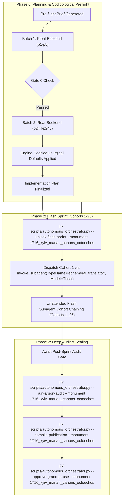

# Phase 0 Implementation Plan: 1716 Kyiv-Pechersk Lavra Theotokarion / Eight-Tone Marian Canons (`1716_kyiv_marian_canons_octoechos`)

## Goal Description
Translate, align, and canonically compile the complete historical Church Slavonic codex **1716 Kyiv-Pechersk Lavra Theotokarion / Eight-Tone Marian Canons (Богородичник / Канони Богородиці Осмогласні, Київ: Друкарня Лаври, 1716)** (`1716_kyiv_marian_canons_octoechos`).

- **Physical Extent**: 246 physical facsimile leaves (`p1`–`p246`), partitioned into 25 cohorts (Cohorts 1–24: 10 leaves each; Cohort 25: 6 leaves: `p241`–`p246`).
- **Opening Geometry & Foliation**: `2-up` opening spreads (each facsimile image captures a two-page open book spread).
  - Physical leaf `p1`: Left page blank flyleaf with 1795 ink accession numbers (`1795 года Но: 3`, `Но 4n`); Right page: Master Title Page in ornate architectural-iconographic woodcut border.
  - Physical leaf `p2`: Left page: Full-page woodcut engraving of the Dormition of the Mother of God (*Успеніе Пресвятыя Богородицы*, signed by Marko); Right page: Opening of the Preface (*ПРЕДИСЛОВІЕ*).
  - Physical leaf `p3`: Preface continued and concluded, signed by Archimandrite **Ioannikii [Sennutovych]** with the entire Pechersk monastic brotherhood.
  - Physical leaf `p4`: Left page: Full-page woodcut of Christ Pantocrator (*Азъ есмь дверь*); Right page: Beginning of Small Compline (*НАЧАЛО ПАВЕЧЕРНИЦЫ МАЛОЙ*).
  - Physical leaf `p5`: Small Compline continued (Trisagion prayers through Psalm 50).
  - Physical leaves `p244`–`p246` (Rear Bookend): Concluding prayers before sleep (*Млитвы на сонъ грядущымъ*), litany of monastic, hierarchic, and unmercenary saints (including Pechersk fathers Anthony, Theodosius, and Agapitus), Prayer to the Precious Cross (*Да воскреснетъ Богъ*), final printing colophon/doxology, and an 18th/19th-century cursive examination of conscience.
- **Historical Imprint & Ecclesial Context**: Printed at the Holy Miraculous Dormition Lavra of Kyiv-Pechersk in 1716 (*Въ Святои же Великой Чудотворной Лаврѣ Печерской Кіевской Типомъ Изданны. Року от Рождества Христова 1716*) under Archimandrite **Ioannikii Sennutovych** (Archimandrite of the Lavra 1715–1729).
- **Genre Register & Structure**: `hymnographic` register under the Master Translation Standard (MTS-1). Contains the complete Eight-Tone cycle of daily Supplicatory Canons to the Most Holy Theotokos authored by St. John of Damascus (*От Святаго Іѡанна Дамаскина написанны*), appointed for reading at Compline for every day of the week, framed by the Order of Small Compline and Evening Prayers.
- **Concurrency & Lease Architecture**: Operates under the **Multi-Monument Sequestered Concurrency Protocol** (Rule 14) with active lease acquired in `Liturgical Monuments/ACTIVE_ORCHESTRATOR_STATE.json` and explicit CLI targeting (`--monument 1716_kyiv_marian_canons_octoechos`) protected by OS cross-process file locking (`scripts/concurrency_lock.py`).

---

## User Review Required

> [!IMPORTANT]
> **Active Multi-Monument Lease State**:
> Monument `1716_kyiv_marian_canons_octoechos` is active and leased cleanly in `Liturgical Monuments/ACTIVE_ORCHESTRATOR_STATE.json` and `Liturgical Monuments/Monument - 1716_kyiv_marian_canons_octoechos/orchestrator_state.json`. All mutating orchestrator, gate, and publication CLI commands in this session will explicitly pass `--monument 1716_kyiv_marian_canons_octoechos`.

> [!IMPORTANT]
> **Gate 0 Epigraphic Findings (Physical Verification Complete — Vision Budget 8/8 Leaves across 2/2 Batches)**:
> 1. **Batch 1 (Front Bookend, Leaves `p1`–`p5`)**:
>    - `p1`: 2-up opening. Left: blank flyleaf with 1795 ink library accession marks (`1795 года Но: 3`, `Но 4n`). Right: Master Title Page in elaborate architectural engraving featuring Christ Pantocrator, Prince Vladimir, Princess Olga, SS. Boris and Gleb, Anthony and Theodosius of the Caves, Andrew the First-Called, and Lavra skyline:
>      $$\text{КАНОНЫ ПРЕСВЯТѢЙ БОГОРОДИЦѢ ОСМОГЛАСНІИ... 1716}$$
>    - `p2`: 2-up opening. Left: Full-page woodcut engraving of the Dormition of the Mother of God (*Успеніе Пресвятыя Богородицы*, engraver Marko) with troparion *В Рождествѣ дѣвство сохранила еси...* Right: Opening of the Preface (*ПРЕДИСЛОВІЕ*): *Матерь Божію пѣсньми возвеличимъ...*
>    - `p3`: 2-up opening. Left: Preface continued. Right: Conclusion of Preface, signed by Archimandrite Ioannikii [Sennutovych] and the entire Lavra brotherhood (*Архимандритъ Іоанникій со всею братіею*).
>    - `p4`: 2-up opening. Left: Full-page woodcut engraving of Christ Pantocrator (*Азъ есмь дверь*). Right: Opening of Small Compline (*НАЧАЛО ПАВЕЧЕРНИЦЫ МАЛОЙ*, *Благословившу іерею... Слава Тебѣ Боже нашъ, Слава Тебѣ. Царю Небесный...*).
>    - `p5`: 2-up opening. Left: Small Compline continued (Trisagion prayers, Our Father, Lord have mercy 12x, Come let us worship 3x). Right: Psalm 50 (*Помилуй мя, Боже...*).
> 2. **Batch 2 (Rear Bookend, Leaves `p244`–`p246`)**:
>    - `p244`: 2-up opening. Left & Right: Compline prayers before sleep (*Млитвы на сонъ грядущымъ*), intercessory litany invoking universal hierarchs and monastic fathers, including Pechersk saints Anthony, Theodosius, and Agapitus, unmercenary physicians, and holy women.
>    - `p245`: 2-up opening. Left: Prayers before sleep continued (*Просвѣти очи мои Христе Боже...*, *Заступникъ души моем буди Боже...*, *Преславную Христову Матерь...*). Right: Prayer to the Precious and Life-Giving Cross (*Да воскреснетъ Богъ... Радуйся, Пречестный и Животворящій Кресте Господень... во вѣки, Аминь*).
>    - `p246`: 2-up opening. Left: Concluding colophon and doxology in ornate woodcut frame with angelic tailpiece:
>      $$\text{Сотворшему Дѣвѣ Богоматери величіе Сильному Богу, сіе Канонное ублаженіе буди в честь и славу, чтущымъ же и слышащымъ в пользу душевную. Аминь.}$$
>      Right: 18th/19th-century cursive Cyrillic manuscript examination of conscience before sleep (*Прежде даже не возглажеши на одрѣ твоемъ, сіа вся помысли...*).
> 3. **Physical Completeness**: All 246 300-DPI leaves are verified intact in the canonical vault (`E:\Google Drive\Liturgical Library\2. Historical Liturgical Texts\Kyivan_Recension\Octoechos\Kyiv_1716_Lavra_Marian_Canons_Octoechos\JPGs`). Zero mid-codex visual binary searches were conducted during Phase 0 (`p6`..`p243` remain uninspected, adhering strictly to Rule 14).

---

## Open Questions

None. All 6 recurring house-style liturgical defaults are pre-decided in `engine_codified_decisions` and locked in `Audit_Reports/phase0_preflight_brief.json` and `Liturgical Monuments/codex_registry.json`.

---

## Engine-Codified Liturgical Defaults & Guardrails (`phase0_preflight_brief.json`)

| Invariant Dimension | Locked Engine Standard (`1716_kyiv_marian_canons_octoechos`) |
| :--- | :--- |
| **1. 3-Layer Melodic Model (`Podoben`) Law** | Format melodic models strictly as `*Tone N, Podoben: "<Canonical English Incipit>" (<Slavonic Witness>):*` (e.g., `*Tone 1, Podoben: "Joy of the Heavenly Ranks" (Nebesnykh chinov):*`). Never use transliterated-first or square-bracketed `[...]` Podoben formatting. |
| **2. Strict `H1` (`#`) Hierarchy (Zero `H3`/`H4` Headings)** | Emit `#` (`H1`) **exclusively** at the primary Part divisions defined in `publication_spec` (`# FRONT MATTER...`, `# TONE 1`, `# TONE 2`..`# TONE 8`, `# CONCLUDING PRAYERS OF COMPLINE AND COLOPHON`). Emit `##` (`H2`) **exclusively** at primary service/day headpieces (e.g. `## Sunday Compline: Canon to the Most Holy Theotokos`). **Never emit `###` or `####` headings**; render all sub-services, odes, heirmoi, troparia, and rubrics as inline italics (`*Ode 1. Heirmos:*`, `*Troparion:*`, `*Theotokion:*`). |
| **3. Structured Liturgical Stanzas** | Format each Heirmos, Troparion, and Theotokion as a distinct paragraph preceded by its inline italic role tag (`*Ode N. Heirmos:*`, `*Troparion:*`, `*Theotokion:*`). Format litany/dialogue speakers in bold (`**Priest:**`, `**Deacon:**`, `**Choir:**`). |
| **4. 2-Up Geometry & Leaf Delimiters** | Each image `Page_0001.jpg`..`Page_0246.jpg` is a physical 2-up book spread. Delimit physical leaves exclusively via `=== LEAF pN ===`. Inside the leaf block, translators may optionally indicate page halves via italic running markers (`*(Left page)*`, `*(Right page)*`), but must **never emit standalone `[Page N]` or `[Leaf pN]` bracket lines in body text** (which fail Gate 1). |
| **5. Epigraphic Fidelity & Incipit Preservation** | Translate the 1716 Kyiv print strictly as inked, preserving incipits without unwritten expansion (Rule 16) and rendering Archimandrite Ioannikii's preface, troparia, and colophon with 100% diplomatic fidelity. Document manuscript additions (e.g. `p246` right) in footnotes `[^N]`. |
| **6. Shared Lexicon & Diachronic Drift Invariance** | Enforce canonical UGCC terminology from the Master Glossary (*Tetrapod*, *Klepalo*, *Aer*, *Kolyvo*, *Plashchanytsia*, *Sluzhebnik*), 100% Deity pronoun capitalization (*He*, *Him*, *His*, *Thou*, *Thee*), and the Father Paul Doxology Standard (ban *"for ever and ever"*). |

---

## Canonical Publication Specification & Slicing Strategy

During Phase 2 (`--compile-publication`), `UniversalPublicationEngine` will dynamically bind top-level `#` landmarks and slice the translated markdown into canonical publication parts plus the master footnotes file in `Typikon Coded/Data/Inbox/1716_Kyiv-Pechersk_Lavra_Theotokarion_/_Eight-Tone_Marian_Canons/`:

| Part ID | Canonical Suffix | Title | Start Landmark Regex | Physical Scope |
| :--- | :--- | :--- | :--- | :--- |
| **`part0`** | `part0_front_matter.md` | Front Matter, Title Page, Dedicatory Preface, and Opening Order of Small Compline | `null` | `p1`–`p5`+ |
| **`part1`** | `part1_tone1.md` | TONE 1: MARIAN CANONS AT COMPLINE (SUNDAY THROUGH SATURDAY) | `^#+\s*(?:TONE\s+(?:1\|I\|FIRST)\|BEGINNING\s+OF\s+TONE\s+1)\b` | Dynamic |
| **`part2`** | `part2_tone2.md` | TONE 2: MARIAN CANONS AT COMPLINE (SUNDAY THROUGH SATURDAY) | `^#+\s*(?:TONE\s+(?:2\|II\|SECOND)\|BEGINNING\s+OF\s+TONE\s+2)\b` | Dynamic |
| **`part3`** | `part3_tone3.md` | TONE 3: MARIAN CANONS AT COMPLINE (SUNDAY THROUGH SATURDAY) | `^#+\s*(?:TONE\s+(?:3\|III\|THIRD)\|BEGINNING\s+OF\s+TONE\s+3)\b` | Dynamic |
| **`part4`** | `part4_tone4.md` | TONE 4: MARIAN CANONS AT COMPLINE (SUNDAY THROUGH SATURDAY) | `^#+\s*(?:TONE\s+(?:4\|IV\|FOURTH)\|BEGINNING\s+OF\s+TONE\s+4)\b` | Dynamic |
| **`part5`** | `part5_tone5.md` | TONE 5: MARIAN CANONS AT COMPLINE (SUNDAY THROUGH SATURDAY) | `^#+\s*(?:TONE\s+(?:5\|V\|FIFTH)\|BEGINNING\s+OF\s+TONE\s+5)\b` | Dynamic |
| **`part6`** | `part6_tone6.md` | TONE 6: MARIAN CANONS AT COMPLINE (SUNDAY THROUGH SATURDAY) | `^#+\s*(?:TONE\s+(?:6\|VI\|SIXTH)\|BEGINNING\s+OF\s+TONE\s+6)\b` | Dynamic |
| **`part7`** | `part7_tone7.md` | TONE 7: MARIAN CANONS AT COMPLINE (SUNDAY THROUGH SATURDAY) | `^#+\s*(?:TONE\s+(?:7\|VII\|SEVENTH)\|BEGINNING\s+OF\s+TONE\s+7)\b` | Dynamic |
| **`part8`** | `part8_tone8.md` | TONE 8: MARIAN CANONS AT COMPLINE (SUNDAY THROUGH SATURDAY) | `^#+\s*(?:TONE\s+(?:8\|VIII\|EIGHTH)\|BEGINNING\s+OF\s+TONE\s+8)\b` | Dynamic |
| **`part9`** | `part9_compline_prayers_and_colophon.md` | CONCLUDING PRAYERS OF COMPLINE, INTERCESSORY LITANY, AND COLOPHON | `^#+.*?(?:CONCLUDING\s+PRAYERS\|PRAYERS\s+BEFORE\s+SLEEP\|COLOPHON)\b` | Tail folios (`p244`–`p246`) |
| **Footnotes** | `1716_kyiv_marian_canons_octoechos_footnotes.md` | Master Footnotes and Epigraphic Commentary | N/A | Full Codex |

---

## Cohort Partition Table (Cohorts 1–25)

| Cohort | Physical Leaves | Leaf Count | Codicological Scope |
| :---: | :---: | :---: | :--- |
| **Cohort 1** | `p1`–`p10` | 10 | Front Flyleaf, Title Page, Dormition Engraving, Preface of Archimandrite Ioannikii, Christ Pantocrator Woodcut, Order of Small Compline, Opening of Tone 1 Canons |
| **Cohort 2** | `p11`–`p20` | 10 | Tone 1 Marian Canons continued |
| **Cohort 3** | `p21`–`p30` | 10 | Tone 1 / Tone 2 Marian Canons |
| **Cohort 4** | `p31`–`p40` | 10 | Tone 2 Marian Canons continued |
| **Cohort 5** | `p41`–`p50` | 10 | Tone 2 / Tone 3 Marian Canons |
| **Cohort 6** | `p51`–`p60` | 10 | Tone 3 Marian Canons continued |
| **Cohort 7** | `p61`–`p70` | 10 | Tone 3 / Tone 4 Marian Canons |
| **Cohort 8** | `p71`–`p80` | 10 | Tone 4 Marian Canons continued |
| **Cohort 9** | `p81`–`p90` | 10 | Tone 4 / Tone 5 Marian Canons |
| **Cohort 10** | `p91`–`p100` | 10 | Tone 5 Marian Canons continued |
| **Cohort 11** | `p101`–`p110` | 10 | Tone 5 Marian Canons continued |
| **Cohort 12** | `p111`–`p120` | 10 | Tone 5 / Tone 6 Marian Canons |
| **Cohort 13** | `p121`–`p130` | 10 | Tone 6 Marian Canons continued |
| **Cohort 14** | `p131`–`p140` | 10 | Tone 6 Marian Canons continued |
| **Cohort 15** | `p141`–`p150` | 10 | Tone 6 / Tone 7 Marian Canons |
| **Cohort 16** | `p151`–`p160` | 10 | Tone 7 Marian Canons continued |
| **Cohort 17** | `p161`–`p170` | 10 | Tone 7 Marian Canons continued |
| **Cohort 18** | `p171`–`p180` | 10 | Tone 7 / Tone 8 Marian Canons |
| **Cohort 19** | `p181`–`p190` | 10 | Tone 8 Marian Canons continued |
| **Cohort 20** | `p191`–`p200` | 10 | Tone 8 Marian Canons continued |
| **Cohort 21** | `p201`–`p210` | 10 | Tone 8 Marian Canons continued |
| **Cohort 22** | `p211`–`p220` | 10 | Tone 8 Marian Canons continued |
| **Cohort 23** | `p221`–`p230` | 10 | Tone 8 Marian Canons continued |
| **Cohort 24** | `p231`–`p240` | 10 | Tone 8 Marian Canons concluding offices |
| **Cohort 25** | `p241`–`p246` | 6 | Concluding Compline Hymns, Prayers before Sleep, Intercessory Litany to Saints, Prayer to the Cross, Lavra Printing Doxology/Colophon, Manuscript Cursive Appendix |
