# Phase 0 Implementation Plan: 1738 Univ Monastery Festal Offices / Vozslidovaniia Prazdnykom (Вослідованія праздником, Унів: Друкарня монастиря, 1738)

## 1. Goal & Monument Identity

Translate, align, and canonically assemble the complete historical Church Slavonic / Galician Ruthenian liturgical codex **1738 Univ Monastery Festal Offices / Vozslidovaniia Prazdnykom** (`1738_univ_festal_offices`), promulgated by Archbishop-Metropolitan Athanasius Sheptytsky and printed at the Univ Monastery Press of the Basilian Order of Saint Basil the Great in 1738.

- **Monument ID**: `1738_univ_festal_offices`
- **Short Title**: 1738 Univ Monastery Festal Offices / Vozslidovaniia Prazdnykom
- **Historical Year**: 1738
- **Printing Press**: Univ Holy Dormition Monastery Press, Order of Saint Basil the Great (*Типомъ издашася въ Манастырѣ Уневскомъ Чину Святаго Василіа Великаго*)
- **Promulgating Hierarch**: Archbishop-Metropolitan Athanasius Sheptytsky (*Аѳанасій на Шептичахъ Шептицкій, Милостію Божіею и Святаго Апостолскаго Ѳрону Архіепископъ Митрополита Кіевскій и всеа Россіи, Епископъ Лвовскій, Галицкій и Каменца Подолскаго, Архімандрита Кіево-Печерскій и Уневскій*)
- **Liturgical Context**: Contains the official offices of the three landmark feasts instituted by the 1720 Synod of Zamość (*Ѡ Святаго Собора Замойскаго преподаннымъ*):
  1. **Most Holy Mystery of the Eucharist (Corpus Christi)** (*Пресвятая Тайна Евхаристія*)
  2. **Compassion of the Most Holy Theotokos** (*Состраданіе Пресвятыя Богородицы*)
  3. **Blessed Hieromartyr Josaphat Kuntsevych** (*Блаженный Священномученикъ Іосафатъ*)
- **Physical Extent**: Exactly 23 physical leaves (`p1`–`p23`), partitioned into 3 cohorts (Cohorts 1–2: 10 leaves each; Cohort 3: 3 leaves).
- **Physical Geometry**: `Page_0001.jpg` (front cover) and `Page_0023.jpg` (back cover) are `1-up` bindings. Leaves `p2` through `p22` are `2-up` facing book openings.
- **Genre Register**: `hymnographic` (MTS-1 standard, elevated hymnography, canon heirmoi, podobny, stichera, synodal rubrics, and liturgical lectionary readings).
- **Concurrency & Lease**: Leased under the **Multi-Monument Sequestered Concurrency Protocol** (Rule 14) with explicit `--monument 1738_univ_festal_offices` CLI targeting and cross-process OS file locking.

```mermaid
flowchart TD
    subgraph Phase0 ["Phase 0: Planning (Gemini 4 Argon High)"]
        Preflight["py scripts/autonomous_orchestrator.py --preflight --monument 1738_univ_festal_offices"] --> Cache["Headless 300-DPI Extraction (23/23 Leaves Cached)"]
        Cache --> Batch1["Batch 1: Front Bookend (p1-p5)"]
        Batch1 --> Gate0{"Gate 0 Primary Source Check"}
        Gate0 -->|Passed| Batch2["Batch 2: Rear Bookend (p21-p23)"]
        Batch2 --> PubSpec["Publication Spec Configured in codex_registry.json"]
        PubSpec --> Plan["Implementation Plan Finalized"]
    end

    subgraph Phase1 ["Phase 1: Flash Sprint (Gemini 3.8 Flash)"]
        Plan --> Unlock["py scripts/autonomous_orchestrator.py --unlock-flash-sprint --monument 1738_univ_festal_offices"]
        Unlock --> C1["Cohort 1 (p1-p10): Front Matter, Decree & Corpus Christi"]
        C1 --> C2["Cohort 2 (p11-p20): Compassion of Theotokos & Josaphat Opening"]
        C2 --> C3["Cohort 3 (p21-p23): Josaphat Conclusion, Liturgy & Tailpiece"]
    end

    subgraph Phase2 ["Phase 2: Deep Audit & Sealing (Gemini 4 Argon High)"]
        C3 --> SwitchArgon["Switch UI to Gemini 4 Argon High"]
        SwitchArgon --> ArgonAudit["py scripts/autonomous_orchestrator.py --run-argon-audit --monument 1738_univ_festal_offices"]
        ArgonAudit --> LCPE["py scripts/autonomous_orchestrator.py --compile-publication --monument 1738_univ_festal_offices"]
        LCPE --> GrandPause["py scripts/autonomous_orchestrator.py --approve-grand-pause --monument 1738_univ_festal_offices"]
    end
```

---

## 2. Gate 0 Epigraphic Findings (Vision Budget: 8/8 Leaves, 2/2 Batches)

Inspected under the strict Phase 0 Vision Budget Contract (`max_vision_leaves = 8`, `max_vision_batches = 2`). Zero mid-codex visual searches were performed (`p6`–`p20` remained untouched).

### Batch 1: Front Bookend (`p1`–`p5`)
- **`Page_0001.jpg` (`p1`)**: Contemporary brown binding / outer front cover.
- **`Page_0002.jpg` (`p2`)**: `2-up` opening.
  - *Left Page*: Blank flyleaf bearing archival library pencil notation (`мкду КН-48906 СД-707`).
  - *Right Page*: Master Title Page printed within a Renaissance/Baroque ornamental border. Promulgates the offices of the Most Holy Mystery of the Eucharist, Compassion of the Most Holy Theotokos, and Blessed Hieromartyr Josaphat as decreed by the Synod of Zamość, printed at Univ Monastery in 1738.
- **`Page_0003.jpg` (`p3`)**: `2-up` opening.
  - *Left Page*: Formal Pastoral Decree / Encyclical Epistle of Archbishop-Metropolitan Athanasius Sheptytsky commanding all proto-presbyters, presbyters, and church clergy across all eparchies under his metropolitan and episcopal jurisdiction to announce and devoutly celebrate these three synod-mandated feasts with proper liturgical solemnity.
  - *Right Page*: Opening headpiece for the Feast of the Most Holy Mystery of the Eucharist (*Послѣдованіе Праздника Пресвятыя Тайны Евхаристіи*), celebrated on the Thursday after All Saints Sunday. Beginning with Great Vespers: Stichera on *Lord, I have cried* in Tone 5 (*Podoben: "Тридневно"*), Entrance, Prokeimenon, and First Old Testament Lection (*Exodus 24*).
- **`Page_0004.jpg` (`p4`)**: `2-up` opening.
  - *Left Page*: Second and Third Old Testament Lections (First Kings / 3 Kings 19), followed by Litiya Stichera in Tone 5.
  - *Right Page*: Aposticha Stichera in Tone 4 (*Podoben: "Небесных чинов"*), Glory... Both now... in Tone 8 (*"O surpassing miracle..."*).
- **`Page_0005.jpg` (`p5`)**: `2-up` opening.
  - *Left Page*: Troparion in Tone 6, Dismissal, and beginning of Matins (*God is the Lord*, Troparion, Kathisma Sessional Hymns in Tone 7 and Tone 3).
  - *Right Page*: Polyeleos Megalynarion, Sessional hymn after Polyeleos, Antiphon 1 of Tone 4, Prokeimenon, Matins Gospel (*John 6*), Post-Gospel Sticheron in Tone 6, and opening headpiece of the Festal Canon (*Канонъ*).

### Batch 2: Rear Bookend (`p21`–`p23`)
- **`Page_0021.jpg` (`p21`)**: `2-up` opening.
  - *Left Page*: Matins Praises (Ainoi) for the Blessed Hieromartyr Josaphat, culminating in Glory in Tone 5 (*"Loving Christ God from thine infancy..."*).
  - *Right Page*: Both now in Tone 8 (*"The Prophet David..."*), Great Doxology and Dismissal. Followed by ornamental woodcut headpiece for the Divine Liturgy (*На Литургіи*): Prokeimenon in Tone 7 (*"Precious in the sight of the Lord is the death of His holy one"*), Epistle to the Hebrews (pericope 318 / Heb. 4:14–5:10).
- **`Page_0022.jpg` (`p22`)**: `2-up` opening.
  - *Left Page*: Conclusion of the Epistle reading; Alleluia in Tone 1; Gospel according to John (pericope 36 / John 10:9–16, Good Shepherd); Kinonikon (Communion verse: *"In everlasting memory shall the righteous be"*); and an exquisite Univ Monastery woodcut tailpiece vignette of a floral urn with the official collection stamp of the Museum of the Book and Printing of Ukraine (`Музей книги і друкарства України КН-46906 СД-707`).
  - *Right Page*: Blank rear endpaper.
- **`Page_0023.jpg` (`p23`)**: Rear outer cover / binding leaf.

### Gate 0 Verification Outcome
- **Completeness**: 100% complete, authentic 1738 Univ Basilian printing. No missing folios, severe ink corrosion, or truncated leaves. Gate 0 is fully passed.

---

## 3. Cohort Partition & Execution Plan

| Cohort | Physical Leaves | Leaf Count | Primary Contents |
| :---: | :---: | :---: | :--- |
| **Cohort 1** | `p1`–`p10` | 10 | Outer Cover, Master Title Page (1738), Metropolitan Athanasius Sheptytsky Pastoral Decree, Feast of the Most Holy Mystery of the Eucharist (Vespers, Matins, Canon, and Liturgy). |
| **Cohort 2** | `p11`–`p20` | 10 | Feast of the Compassion of the Most Holy Theotokos (Vespers, Matins, Canon, Liturgy); Feast of the Blessed Hieromartyr Josaphat (Vespers, Litiya, Matins Canon). |
| **Cohort 3** | `p21`–`p23` | 3 | St. Josaphat Matins Praises, Divine Liturgy (Epistle & Gospel), Communion Verse, Univ Basilian Floral Tailpiece Vignette, and Rear Endpapers/Cover. |

---

## 4. Publication Spec & Deliverable Structure

Canonical publication structure locked in `Liturgical Monuments/codex_registry.json`:
- **Hub Destination Folder**: `Typikon Coded/Data/Inbox/1738_Univ_Monastery_Festal_Offices/`
- **Master Footnotes File**: `1738_univ_festal_offices_footnotes.md`
- **Publication Mode**: `universal_dynamic_h1` (slices dynamic `# <Heading>` landmarks):

| Part ID | Deliverable Filename | Title | Landmark Regex |
| :--- | :--- | :--- | :--- |
| **`part0`** | `1738_univ_festal_offices_part0_front_matter.md` | Front Matter, Univ Monastery Press Title Page (1738), and Pastoral Decree of Archbishop-Metropolitan Athanasius Sheptytsky | `null` (default opening, `p1`–`p3` left) |
| **`part1`** | `1738_univ_festal_offices_part1_eucharist.md` | PART I: OFFICE OF THE FEAST OF THE MOST HOLY MYSTERY OF THE EUCHARIST (CORPUS CHRISTI) | `^#+\s*(?:PART\s+I\b\|OFFICE\s+OF\s+THE\s+FEAST\s+OF\s+THE\s+MOST\s+HOLY\s+MYSTERY\s+OF\s+THE\s+EUCHARIST\|FEAST\s+OF\s+THE\s+MOST\s+HOLY\s+MYSTERY\s+OF\s+THE\s+EUCHARIST)` |
| **`part2`** | `1738_univ_festal_offices_part2_compassion_theotokos.md` | PART II: OFFICE OF THE FEAST OF THE COMPASSION OF THE MOST HOLY THEOTOKOS | `^#+\s*(?:PART\s+II\b\|OFFICE\s+OF\s+THE\s+FEAST\s+OF\s+THE\s+COMPASSION\|FEAST\s+OF\s+THE\s+COMPASSION\s+OF\s+THE\s+MOST\s+HOLY\s+THEOTOKOS)` |
| **`part3`** | `1738_univ_festal_offices_part3_hieromartyr_josaphat.md` | PART III: OFFICE AND DIVINE LITURGY OF THE FEAST OF THE BLESSED HIEROMARTYR JOSAPHAT | `^#+\s*(?:PART\s+III\b\|OFFICE\s+OF\s+THE\s+FEAST\s+OF\s+THE\s+BLESSED\s+HIEROMARTYR\s+JOSAPHAT\|FEAST\s+OF\s+THE\s+BLESSED\s+HIEROMARTYR\s+JOSAPHAT)` |

---

## 5. Engine-Codified Liturgical Standards & Invariants

| Dimension | Standard Specification |
| :--- | :--- |
| **3-Layer Melodic Model (`Podoben`) Law** | Strictly format as: `*Tone N, Podoben: "<Canonical English Incipit>" (<Slavonic Witness>):*` (e.g. `*Tone 5, Podoben: "On the Third Day" (Tridnevno):*`, `*Tone 4, Podoben: "O Ye Heavenly Ranks" (Nebesnykh chinov):*`). Never transliterated-first or square-bracketed. |
| **Heading & Rubric Hierarchy** | `#` (`H1`) reserved exclusively for the 3 primary Feast landmarks and Front Matter; `##` (`H2`) permitted for service divisions (*Great Vespers*, *Matins*, *Divine Liturgy*); all sub-services, canons, odes, heirmoi, troparia, and rubrics rendered in inline italics (`*...*`), never `###` or `####`. |
| **Stanza Typography** | Each Heirmos, Troparion, Theotokion, and Sticheron is a distinct paragraph preceded by its inline italic role tag (`*Ode N. Heirmos:*`, `*Troparion:*`, `*Theotokion:*`). Litany and dialogue speakers are bolded (`**Priest:**`, `**Deacon:**`, `**Choir:**`). |
| **Physical Delimiters** | Physical leaves use exact `=== LEAF pN ===` delimiters. 2-up scans flow sequentially across the spread. |
| **Epigraphic Fidelity (Rule 16)** | Inked Church Slavonic / Ruthenian text is translated strictly as printed without silent harmonization. Incipits are never expanded into unwritten full texts. Any editorial reconstructions are placed in `[...]` with explanatory footnotes `[^N]`. |
| **Pronouns & Doxology** | Deity Trinity pronouns capitalized 100% (*He, Him, His, Thou, Thee*). Father Paul Doxology Standard strictly enforced (*"unto ages of ages"*, never *"for ever and ever"*). |

---

## 6. Execution Roadmap & Next Actions

1. **User Plan Approval**: The user reviews and approves this implementation plan.
2. **Immediate Turn Action Upon Approval**:
   - Execute: `py scripts/autonomous_orchestrator.py --unlock-flash-sprint --monument 1738_univ_festal_offices`
   - Dispatch Cohort 1 via `invoke_subagent(TypeName="ephemeral_translator", Model="flash")` in the very same turn without pausing for a second confirmation.
3. **Cohort Progression**: Unattended chaining across Cohorts 1, 2, and 3.
4. **Phase 2 Transition**: Switch UI back to Gemini 4 Argon High, execute `--run-argon-audit`, compile publication edition via `--compile-publication`, verify ecosystem integrity, and seal via `--approve-grand-pause`.
