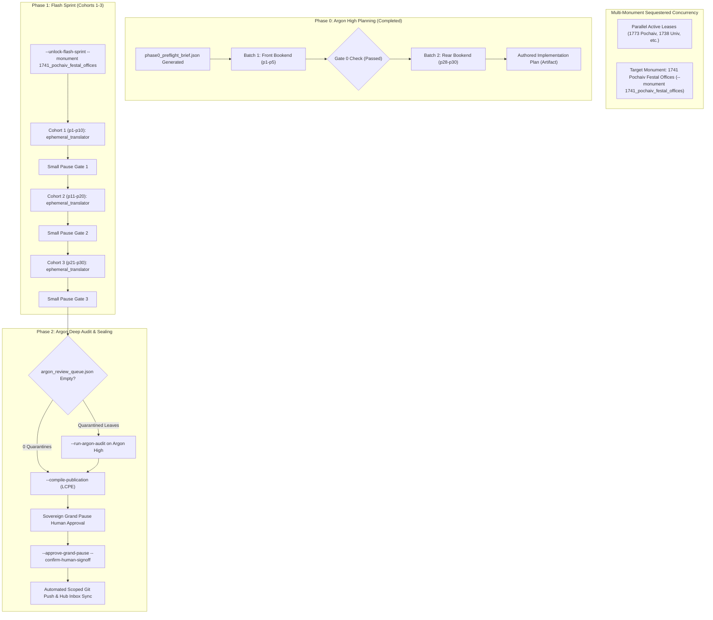

# Phase 0 Implementation Plan: 1741 Pochaiv Lavra Festal Offices / Vozslidovaniia Prazdnykom

## Goal Description
Translate, epigraphically align, and canonically compile the complete historical Church Slavonic liturgical codex:
**1741 Pochaiv Lavra Festal Offices / Vozslidovaniia Prazdnykom (*Возслідованія праздником*, Почаїв: Друкарня Лаври, 1741)** (`1741_pochaiv_festal_offices`).

- **Historical & Ecclesial Provenance**: Printed at the Pochaiv Monastery of the Order of Saint Basil the Great (OSBM / *Чин Святого Василія Великого*) in 1741 (`҂аѱма`). Implements the specific festal liturgical offices decreed for the Ruthenian Uniate Church by the landmark Provincial Synod of Zamość (1720 / *Святий Собор Замойський*):
  1. *Most Holy Mystery of the Eucharist* (*Пресвята Тайна Євхаристія* / Corpus Christi, Thursday after All Saints Sunday)
  2. *Compassion / Sorrows of the Most Holy Theotokos* (*Сострадання Пресвятої Богородиці* / Mater Dolorosa)
  3. *Blessed Hieromartyr Josaphat Kuntsevych* (*Блаженний Священномученик Йосафат*)
  4. Appended Festal Witness: *Commemoration of St. Peter, Metropolitan of Kyiv and All Rus, and Ven. Juliana* (Dec 21 / *рѕ҃і*)
- **Physical Extent**: Exactly 30 physical 300-DPI leaves (`p1`–`p30`), partitioned into 3 cohorts of 10 leaves each.
- **Physical Geometry**: 2-up book openings (facing pages per physical facsimile leaf), with single leaves for outer marble covers.
- **Genre Register**: Hymnographic (`MTS-1`), featuring festal stichera, sessional hymns, canonic odes, heirmoi, troparia, theotokia, litanies, and sacerdotal prayers.
- **Architecture**: Operates under the **Multi-Monument Sequestered Concurrency Protocol** (Rule 14) with explicit `--monument 1741_pochaiv_festal_offices` CLI bindings and cross-process OS file locks.

---

## Proposed Changes & Cohort Partition Table

### 1. Cohort Partition Topology (Closed Set Conservation: $\bigcup C_k = \{1 \dots 30\}$)

| Cohort | Physical Leaves | Leaf Count | Primary Liturgical Landmark & Content |
| :---: | :---: | :---: | :--- |
| **Cohort 1** | `p1`–`p10` | 10 | Outer marbled cover (`p1`), blank flyleaf with library call numbers (`p2`), woodcut engraved cartouche title page with 1741 Pochaiv imprint (`p3`), Great Vespers opening of Corpus Christi Feast (`p4`–`p5`), Old Testament readings, Litiya, and Matins through middle canonic odes. |
| **Cohort 2** | `p11`–`p20` | 10 | Conclusion of Feast of Corpus Christi / Divine Liturgy; Office of the Compassion of the Most Holy Theotokos (*Sostradaniia*); opening of the Feast of St. Josaphat Kuntsevych. |
| **Cohort 3** | `p21`–`p30` | 10 | Festal Office of St. Josaphat Kuntsevych (canons, sessional hymns, praises `p28`, Divine Liturgy with Basilian seal `p29` left), appended Dec 21 Feast leaf (St. Peter of Kyiv & St. Juliana `p29` right), and rear marbled cover (`p30`). |

---

## Codicological & Epigraphic Findings (From Phase 0 Bookends)

### 1. Front Bookend Inspection (`p1`–`p5`)
- **`p1`**: 18th-century half-leather binding over marbled paper boards.
- **`p2`**: Blank marbled flyleaf verso and recto bearing historical library acquisition pencil markings: `МКДУ КМ-2206 / СФ 255/1-2`.
- **`p3`**: Elaborate Late Baroque woodcut architectural cartouche supported by twin cherubim and crowned with a seraph:
  - Title: *ВОСЛѢДОВАНЇА ПРАЗДНИКѠМЪ ПР[Е]СТОЙ ТАЙНѢ ЕV́ХАРІСТЇИ. СОСТРАДАНЇА ПР[Е]СТЇА Б[ОГОРОДИ]ЦЫ. И БЛАЖЕННАГѠ СЩ[Е]ННОМꙊЧЕНИКА ІѠСАФАТА. Ѿ СВЯТАГО СОБОРА ЗАМОЙСКАГО ПРЕПОДАННЫМЪ.*
  - Imprint: *Тѵпомъ издашася в Монастырѣ Почаевскомъ. ЧинꙊ Святаго Василїа Великагѡ. РокꙊ Господня ҂аѱма [1741].*
  - Bottom margin: 18th-century Polish provenance inscription (*"Ta to Xięga... Soboru Zamojskiego wydana..."*) and acquisition ink stamp `1976-229 / р`.
- **`p4`**: Left: blank verso. Right: Fine ornamental headpiece and drop initial:
  - Heading: *ВОСЛѢДОВАНЇЕ ПРАЗДНИКА ПРЕСВЯТОЙ ТАЙНЫ ЕV́ХАРЇСТЇИ, Совершаемое в Четверъ по Недели Всѣхъ Святыхъ.*
  - Rubric: *В среду вечеря на Господи воззвахъ, Постави стиховъ и҃. Гласъ в҃.*
  - Opening sticheron: *Великое таинство твоего вочеловѣченія...*
- **`p5`**: Two-page liturgical spread:
  - Left: *Всходъ, и Прокименъ дне, тажъ Пареміи: Ѡ ИСХОДА ЧТЕНЇЄ...*
  - Right: *Пр[е]стои Таинѣ Еѵхаристїи. На Литии стихиры Гласъ ѕ҃. Преклоньшимъ ковчегомъ, скакаше играя...*

### 2. Rear Bookend Inspection (`p28`–`p30`)
- **`p28`**: Two-page hymnographic spread for the Blessed Hieromartyr Josaphat:
  - Left: Sessional hymns, Theotokion, and *На Хвалитехъ* Stichera, Tone 6 (*Всѣхъ во юности возложилъ еси себѣ Христѣ плоти кромѣ быти...*).
  - Right: Doxasticon, Tone 6 (*Ѡ младенства Христа Бога возлюбивъ, всеблаженне Іѡсафате...*).
- **`p29`**: Two-page spread containing liturgical conclusion and witness supplement:
  - Left: Conclusion of the Divine Liturgy for St. Josaphat (Prokeimenon Tone 7: *Честна пред Господемъ смерть...*, Epistle, Alleluia, Gospel of John, Communion Verse). Substantial Basilian ornamental cartouche engraving depicting the monastic seal.
  - Right: Appended printed leaf bound into the codex with folio signature `рѕ҃і` (167): *МѢСЯЦА ДЕКЕМВРЇА ВЪ К҃А. Преподобныя Матере нашея Іуліаніи. Въ тойже день, иже во стыхъ отца нашего Петра Митрополита Кіевскаго, и всея Россіи.*
- **`p30`**: Rear marbled board binding cover.

### 3. Gate 0 Verification Decision
> [!NOTE] Gate 0 Primary Source Suitability: **PASSED**
> The source is a pristine, authentic, complete 1741 Pochaiv Lavra imprint with intact title page, uncropped marginal typography, crisp rubrication, complete festal liturgical cycles, and genuine period bindings. No Gate 0 deferral (`--defer-monument`) is warranted.

---

## Liturgical Engine & Invariant Adherence

All subagents will be instructed to adhere strictly to the following six codified engine invariants:

1. **3-Layer Melodic Model (`Podoben`) Standard**:
   - Strictly format all model melodies as:
     `*Tone N, Podoben: "<Canonical English Incipit>" (<Slavonic Witness>):*`
   - Never use transliteration-first or bracketed formats.
2. **Heading & Rubric Hierarchy (`H1 & H2` Only)**:
   - Reserve `#` exclusively for top-level Part landmarks defined in `publication_spec` (e.g., `# PART I: OFFICE OF THE MOST HOLY MYSTERY OF THE EUCHARIST`).
   - Reserve `##` for primary service headpieces (e.g., `## AT GREAT VESPERS`, `## AT MATINS`, `## AT THE DIVINE LITURGY`).
   - Render all sub-services, hours, canons, odes, heirmoi, troparia, and rubrics in inline italics (`*...*`), never using `###` or `####`.
3. **Structured Liturgical Stanzas**:
   - Each Heirmos, Troparion, Theotokion, and Sticheron must form an independent paragraph preceded by its inline italic role tag (`*Ode 1. Heirmos:*`, `*Troparion:*`, `*Theotokion:*`).
   - Liturgical speakers in bold (`**Priest:**`, `**Deacon:**`, `**Choir:**`).
4. **Epigraphic Fidelity & Incipit Preservation (Rule 16)**:
   - Translate strictly as inked.
   - Strictly ban expanding unwritten incipits (e.g., `**"Lord, have mercy"**`, `**"Glory..."**`) into full prayers unless physically printed on the leaf.
   - Enclose editorial restorations or damaged text in square brackets `[...]` and document recensional variants in footnotes `[^N]`.
5. **Doxology & Deity Trinity Pronouns**:
   - 100% capitalization on Deity Trinity pronouns (*He, Him, His, Thou, Thee, Thy, Thine*).
   - Enforce Father Paul Doxology Standard (ban *"for ever and ever"*).
6. **Anti-Slop Linter Enforcement (Gate 1B)**:
   - Ban pseudo-archaic AI fantasy vocabulary (*peradventure, verily, betwixt, twas, methinks, hearken, wherefore, forsooth, haply, albeit*).
   - Use Active Present Indicative for all bodily ceremonial rubrics; reserve "shall" exclusively for juridical statutory mandates.

---

## Multi-Monument Sequestered Concurrency Protocol

- All CLI orchestrator commands and Gate validations **must** explicitly specify `--monument 1741_pochaiv_festal_offices`.
- Cross-process OS file locking is enforced via `scripts/concurrency_lock.py` to ensure parallel chat sessions on other monuments are isolated.
- The Git push at the Grand Pause will stage only the scoped files of this monument (`git commit --only ...`).

---

## Verification Plan

### Automated Gate Sequence
1. **Pre-flight Check**: Verified `Audit_Reports/phase0_preflight_brief.json` created cleanly; circuit breaker engaged (`PHASE_0_ARGON_PLANNING_LOCKED`).
2. **Phase 1 Flash Sprints**:
   - Cohort 1 (`p1`–`p10`): Prepare manifest, extract leaves, dispatch subagent `ephemeral_translator` on `Model="flash"`, execute `run_small_pause_gate.py`.
   - Cohort 2 (`p11`–`p20`): Autonomous progression via `--step`.
   - Cohort 3 (`p21`–`p30`): Final sprint cohort execution and verification.
3. **Phase 2 Argon Deep Audit**:
   - Audit all quarantined items collected in `argon_review_queue.json`.
   - Re-verify touched cohorts and confirm `unresolved_quarantines == 0`.
   - Compile LCPE canonical publication edition via `py scripts/autonomous_orchestrator.py --compile-publication --monument 1741_pochaiv_festal_offices`.
4. **Sovereign Grand Pause**:
   - Present final telemetry, publication dossier, and edition facts to the human operator for formal sign-off.
   - Execute `--approve-grand-pause --confirm-human-signoff --monument 1741_pochaiv_festal_offices`.
