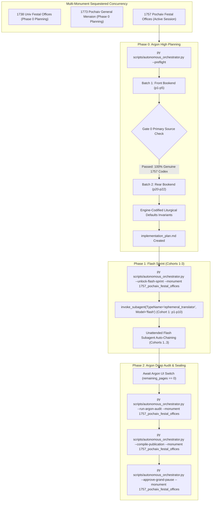

# Phase 0 Implementation Plan: 1757 Pochaiv Lavra Festal Offices / Vozsliduvaniia Prazdnykam (Почаїв, 1757)

## Goal Description
Translate, align, and canonically compile the complete historical Ruthenian Greek-Catholic liturgical codex **1757 Pochaiv Lavra Festal Offices / Vozsliduvaniia Prazdnykam (Возслідуванія праздникам, Почаїв: Друкарня Лаври, 1757)** (`1757_pochaiv_festal_offices`).
- **Physical Extent**: 22 physical leaves (`p1`–`p22`), partitioned into 3 cohorts (Cohorts 1–2: 10 leaves each; Cohort 3: 2 leaves: `p21`–`p22`).
- **Opening Geometry & Folio Layout**: `2-up` spread facsimile scans (verso and recto facing pages per physical leaf image). Printed folios run `а҃`–`к҃а` (1–21) across leaves `p3`–`p20`.
- **Source Language & Genre Register**: Church Slavonic with Ukrainian/Ruthenian recensional features, published by the Monastery of the Order of St. Basil the Great (OSBM) at the Pochaiv Lavra Press in 1757 (*Року Гдна, аѱнз*).
- **Liturgical Context**: Contains the three proper festal offices promulgated and mandated for the Kyivan Metropolitanate by the 1720 Provincial Synod of Zamość (*ѿ стагѡ собора замоискагѡ препода́нымъ*):
  1. Feast of the Most Holy Mystery of the Eucharist (Corpus Christi / *Престѣй Тайнѣ Еѵхарістіи*)
  2. Feast of the Compassion of the Most Holy Mother of God (Our Lady of Sorrows / *Состраданія Престыя Бцы*)
  3. Feast of the Blessed Hieromartyr Josaphat Kuncewicz (*Блаженнагѡ Священномученика Іѡсафата*)
- **Operational Architecture**: Conforms strictly to the **Translation Spoke Master Rules & Operational Standards** (Rule 14 & Rule 15). Operates under explicit CLI targeting (`--monument 1757_pochaiv_festal_offices`) and cross-process OS file locks.



---

## User Review Required

> [!IMPORTANT]
> **Active Multi-Monument Lease State**:
> Monument `1757_pochaiv_festal_offices` is successfully initialized and leased in `orchestrator_state.json` and `Liturgical Monuments/codex_registry.json`. All mutating orchestrator and gate CLI execution commands in this session explicitly pass `--monument 1757_pochaiv_festal_offices`.

> [!IMPORTANT]
> **Gate 0 Epigraphic Findings (Physical Verification Complete — Vision Budget 8/8 Leaves across 2/2 Batches)**:
> 1. **Batch 1 (Front Bookend, Leaves `p1`–`p5`)**:
>    - `p1`: Parchment outer cover / wrapper with 19th-century cursive Cyrillic/Polish inscription (*Wszystko dawniej...*).
>    - `p2`: Verso blank flyleaf with library accession stamp (`ЛНДУ 32621 СД-460`). Recto: Master Baroque title page with full-page woodcut floral architectural frame and arched cartouche:
>      $$\text{ВОСЛѢДОВАНІА ПРАЗДНИКѠМЪ Претыя Таинны Еѵхарістіи, Состраданія Претыя Бцы, И Блже: Сщенномчка Іѡсафата, ѿ стагѡ собора замоискагѡ, ПРЕПОДА́НЫМЪ.}$$
>      Colophon imprint: *Типомъ издашася въ Монастырѣ Почаевскомъ, Чина Стагѡ Василіа Великагѡ, Року Гдна, аѱнз [1757]*.
>    - `p3`: Verso: Pre-liturgical procession hymns and litanies before Divine Liturgy (*Здѣ полагается пѣніе, въ настоящій Пртыхъ Еѵхарістіи праздникъ, пре Літургіею ра́нно, или во ткою, бывающее... О Сп҃сителная жертва!* [O Salutaris Hostia]). Prayers for deliverance from pestilence, famine, fire, sword, and sudden death. Recto (printed fol. 1 / `а҃`): Opening headpiece vignette and rubric of the Feast of Corpus Christi (*ВОСЛѢДОВАНІЕ ПРАЗДНИКА ПРЕСТѢЙ ТАЙНѢ ЕѴХАРІСТІИ... Въ среду вечеръ на Гди воззвахъ...*), Great Vespers stichera in Tone 7 (*Великое таинство...*), and Paroemia 1 (Exodus 19:10–19).
>    - `p4`: Verso: Paroemias 2 (1 Kings [1 Sam] 21:1–6) and 3 (3 Kings [1 Kings] 17:8–16). Recto (printed fol. 2 / `в҃`): Litiya stichera in Tone 6 (*Пре сѣннымъ ковчегомъ скакаше иногда Богоотецъ Давыдъ...*).
>    - `p5`: Verso: Aposticha stichera in Tone 1, Podoben: *Небесныхъ чинѡвъ* (*Хлѣбъ нбный животный воспоимъ...*), Dismissal Troparion in Tone 7 (*Хлѣбъ преестественный...*), Matins Kathismata. Recto (printed fol. 3 / `г҃`): Polyeleos, Megalynarion, Tone 4 Gospel (Jn 6:48–54), and Canon Ode 1 Heirmos (*Грядите людіе, поимъ пѣснь Хр̄ту...*).
> 2. **Batch 2 (Rear Bookend, Leaves `p20`–`p22`)**:
>    - `p20`: Verso: Office of St. Josaphat (*Слꙋжба Сщенномчнку Іѡсафатꙋ*), Ode 9 concluding Troparia, Theotokion, Exapostilarion, and Stichera on the Praises in Tone 6 (*Вся ѿ юности возложилъ еси Хр̄ту...*). Recto (printed fol. 21 / `к҃а`): Praises completed, Great Doxology, Divine Liturgy Prokeimenon (Tone 7: *Честна пред Гдемъ смерть прпбныхъ его*), Epistle (Hebrews pericope 334), Alleluia (Tone 2), Gospel (John pericope 36), Communion Verse (*Въ память вѣчную будетъ праведникъ*), and concluding floral woodcut tailpiece vignette.
>    - `p21`: Verso blank endpaper leaf; recto blank flyleaf with library stamp (`Державна музей книги і друкарства... № 32621 І.Н. СД-460`).
>    - `p22`: Outer back binding cover.
> 3. **Gate 0 Conclusion**: The source PDF is confirmed 100% complete, authentic, undamaged, and strictly represents the physical 1757 Pochaiv Lavra print.

---

## Engine-Codified Liturgical Defaults & Invariants

Per Rule 14, the recurring liturgical translation invariants are pre-decided at the engine level:
1. **3-Layer Melodic Model (`Podoben`) Standard**: Always format as:
   `*Tone N, Podoben: "<Canonical English Incipit>" (<Slavonic Witness>):*`
   (e.g., `*Tone 1, Podoben: "O Ye Heavenly Ranks" (Небесныхъ чинѡвъ):*`).
2. **Heading & Rubric Hierarchy (`H1 & H2` Only)**:
   - `#` (H1) is strictly reserved for primary structural divisions in `publication_spec`:
     - `# FRONT MATTER AND INTRODUCTORY APPARATUS`
     - `# OFFICE OF THE FEAST OF THE MOST HOLY MYSTERY OF THE EUCHARIST`
     - `# OFFICE OF THE FEAST OF THE COMPASSION OF THE MOST HOLY MOTHER OF GOD`
     - `# OFFICE OF THE FEAST OF THE BLESSED HIEROMARTYR JOSAPHAT`
     - `# REAR MATTER AND ENDPAPERS`
   - `##` (H2) is reserved for primary service headpieces (e.g. `## AT GREAT VESPERS`, `## AT MATINS`, `## AT THE DIVINE LITURGY`).
   - All sub-services, hours, canons, odes, heirmoi, troparia, and rubrics are rendered as inline italics (`*...*`), never `###` or `####`.
3. **Structured Liturgical Stanzas**:
   - Each Heirmos, Troparion, Theotokion, and Sticheron is rendered as a distinct paragraph preceded by its inline italic role tag (`*Ode 1. Heirmos:*`, `*Troparion:*`, `*Theotokion:*`).
   - Litany and dialogue speakers appear in bold (`**Priest:**`, `**Deacon:**`, `**Choir:**`).
4. **Recensional Variants & Epigraphic Integrity (Rule 16)**:
   - Translate the physical printed text strictly as inked, preserving Ruthenian recensional specifics without silent harmonization to standard modern Nikonian editions.
   - Significant Greek, Roman, or pre-Nikonian variants are recorded in footnotes `[^N]`.
5. **Front-Matter Paratext & Titulature**:
   - Title page and colophon are rendered in 100% diplomatic translation, preserving date formulas (*Year of the Lord 1757* / *Року Гдна, аѱнз*), monastic titles (*Order of Saint Basil the Great*), and typography.
6. **Patristic Synaxarion & Hymnographic Diction**:
   - Elevated classical liturgical English prose. Strict prohibition of pseudo-archaic AI vocabulary (*peradventure, verily, betwixt, twas, methinks, hearken, wherefore, forsooth*) and 3rd-person *-eth* verbs across both body text and footnotes.

---

## Cohort Partition Plan (22 Physical Leaves / 3 Cohorts)

| Cohort | Physical Leaves | Leaf Count | Content Description |
| :---: | :---: | :---: | :--- |
| **Cohort 1** | `p1`–`p10` | 10 | Outer cover, Baroque title page, pre-liturgical procession prayers & litanies, Feast of the Most Holy Eucharist (complete: Vespers, Paroemias, Litiya, Matins, Canon, Liturgy), and opening of the Feast of the Compassion of the Mother of God. |
| **Cohort 2** | `p11`–`p20` | 10 | Feast of the Compassion of the Mother of God (conclusion) and Feast of the Blessed Hieromartyr Josaphat (complete: Vespers, Litiya, Matins, Canon, Praises, Liturgy, and concluding colophon vignette). |
| **Cohort 3** | `p21`–`p22` | 2 | Rear endpapers, flyleaves, library stamps, and outer binding wrapper. |

---

## Canonical Publication Spec Scaffold

```json
{
  "mode": "universal_dynamic_h1",
  "monument_id": "1757_pochaiv_festal_offices",
  "monument_type": "anthologion",
  "hub_inbox_folder": "1757_Pochaiv_Lavra_Festal_Offices_/_Vozsliduvaniia_Prazdnykam",
  "master_title": "1757 Pochaiv Lavra Festal Offices / Vozsliduvaniia Prazdnykam (Возслідуванія праздникам, Почаїв: Друкарня Лаври, 1757)",
  "parts_strategy": "Automatically slices top-level '# <Heading>' divisions discovered in translated Markdown during Phase 2 (--compile-publication).",
  "footnotes_filename": "1757_pochaiv_festal_offices_footnotes.md",
  "scaffold_parts_template": [
    {
      "id": "part0",
      "suffix": "part0_front_matter.md",
      "title": "Front Matter, Title Page, and Introductory Procession",
      "start_landmark": null
    },
    {
      "id": "part1",
      "suffix": "part1_eucharist_office.md",
      "title": "PART I: OFFICE OF THE FEAST OF THE MOST HOLY MYSTERY OF THE EUCHARIST",
      "start_landmark": "^#+\\s*(?:PART\\s+I\\b|OFFICE\\s+OF\\s+THE\\s+(?:FEAST\\s+OF\\s+THE\\s+)?MOST\\s+HOLY\\s+MYSTERY\\s+OF\\s+THE\\s+EUCHARIST|FEAST\\s+OF\\s+THE\\s+EUCHARIST)"
    },
    {
      "id": "part2",
      "suffix": "part2_compassion_theotokos.md",
      "title": "PART II: OFFICE OF THE FEAST OF THE COMPASSION OF THE MOST HOLY MOTHER OF GOD",
      "start_landmark": "^#+\\s*(?:PART\\s+II\\b|OFFICE\\s+OF\\s+THE\\s+(?:FEAST\\s+OF\\s+THE\\s+)?COMPASSION\\s+OF\\s+THE\\s+MOST\\s+HOLY\\s+MOTHER\\s+OF\\s+GOD)"
    },
    {
      "id": "part3",
      "suffix": "part3_hieromartyr_josaphat.md",
      "title": "PART III: OFFICE OF THE FEAST OF THE BLESSED HIEROMARTYR JOSAPHAT",
      "start_landmark": "^#+\\s*(?:PART\\s+III\\b|OFFICE\\s+OF\\s+THE\\s+(?:FEAST\\s+OF\\s+THE\\s+)?BLESSED\\s+HIEROMARTYR\\s+JOSAPHAT)"
    },
    {
      "id": "part4",
      "suffix": "part4_rear_matter.md",
      "title": "PART IV: REAR MATTER, ENDPAPERS, AND BINDING",
      "start_landmark": "^#+\\s*(?:PART\\s+IV\\b|REAR\\s+MATTER|ENDPAPERS|COLOPHON)"
    }
  ]
}
```

---

## Verification & Resilience Plan

1. **Deterministic Small Pause Gate Verification**:
   - Every cohort must pass `scripts/run_small_pause_gate.py --monument 1757_pochaiv_festal_offices --cohort <K>`.
   - Gate audits:
     - Exact leaf banner continuity: `=== LEAF pN ===`.
     - Footnote synchronization: Every `[^N]` in body text must have a corresponding definition at the bottom of the cohort draft.
     - Slop linting: Rejection of archaic fantasy filler and unwritten incipit expansions.
     - Deity pronoun capitalization (100% capitalized: *He, Him, His, Thou, Thee*).
     - Standard Doxology enforcement: Banning *"for ever and ever"* in favor of *"unto ages of ages"*.
2. **Unattended Flash Resilience & Quarantine**:
   - On Gate failure, the orchestrator applies deterministic self-healing (`attempt_deterministic_self_healing()`).
   - If a content anomaly persists after 1 targeted Flash retry, the leaf is logged to `Audit_Reports/argon_review_queue.json` (`status="QUARANTINED_FOR_ARGON"`), allowing Phase 1 auto-chaining to continue without blocking.
3. **Phase 2 Argon Deep Audit**:
   - Once all 22 leaves are translated, the orchestrator switches to Phase 2 for Argon review and LCPE compilation.

---

## Next Steps Upon User Approval
Once the user confirms approval of this implementation plan:
1. Run `py scripts/autonomous_orchestrator.py --unlock-flash-sprint --monument 1757_pochaiv_festal_offices` to transition from `PHASE_0_ARGON_PLANNING` to `PHASE_1_FLASH_SPRINT`.
2. Dispatch Cohort 1 via `invoke_subagent(TypeName="ephemeral_translator", Model="flash")` in the same turn without requesting further confirmation.
