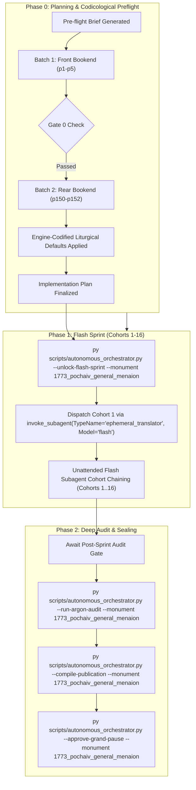

# Phase 0 Implementation Plan: 1773 Pochaiv Lavra General Menaion (`1773_pochaiv_general_menaion`)

## Goal Description
Translate, align, and canonically compile the complete historical Church Slavonic codex **1773 Pochaiv Lavra General Menaion / Mineia Zahalna (Мінея Загальна, Почаїв: Друкарня Почаївської Лаври, 1773)** (`1773_pochaiv_general_menaion`).

- **Physical Extent**: 152 physical leaves (`p1`–`p152`), partitioned into 16 cohorts (Cohorts 1–15: 10 leaves each; Cohort 16: 2 leaves: `p151`–`p152`).
- **Opening Geometry & Foliation**: `2-up` opening spreads (each facsimile leaf captures a two-page open book spread). Outer covers are `p1` (front cover) and `p152` (back cover). Internal printed Church Slavonic foliation begins on physical leaf `p3` (right side = Folio 1 / `Листъ а҃`), following the unnumbered title page (`p2` right) and Table of Contents (`p3` left).
- **Historical Imprint & Ecclesial Context**: Printed at the Holy Miraculous Lavra of Pochaiv in 1773 (Year 7281 from Creation / 1773 from the Incarnation) by the monastic printshop of the Order of Saint Basil the Great (Basilian Fathers: *Ч. С. В. В.* / *Chyn Sviatoho Vasyliia Velykoho*). Published under the formal archiepiscopal blessing of His Grace Kyr **Sylvester Lubieniecki-Rudnytsky** (*Киръ Сѵлвестръ Лубенецкій Рудницкій*), Basilian Archimandrite, Exarch of All Rus', Bishop of Lutsk and Ostroh.
- **Genre Register & Structure**: `hymnographic` register under the Master Translation Standard (MTS-1). Contains the complete common liturgical offices (*Службы Общія*) for all canonical ranks of saints (Prophets, Apostles, Hierarchs, Monastics, Martyrs, Hieromartyrs, Female Martyrs, Holy Women, Confessors, Unmercenaries, Fools-for-Christ), followed by the Theotokion Canons (*Каноны Бгородичны*) and the Resurrectional/Common Theotokia across the Eight Tones (*Бгородичны воскресны и общіи, осми гласѡвъ*).
- **Concurrency & Lease Architecture**: Operates under the **Multi-Monument Sequestered Concurrency Protocol** (Rule 14) with active lease acquired in `Liturgical Monuments/ACTIVE_ORCHESTRATOR_STATE.json` and explicit CLI targeting (`--monument 1773_pochaiv_general_menaion`) protected by OS cross-process file locking (`scripts/concurrency_lock.py`).



---

## User Review Required

> [!IMPORTANT]
> **Active Multi-Monument Lease State**:
> Monument `1773_pochaiv_general_menaion` is initialized and leased cleanly in `Liturgical Monuments/ACTIVE_ORCHESTRATOR_STATE.json` and `Liturgical Monuments/codex_registry.json`. All mutating orchestrator, gate, and publication CLI commands in this session will explicitly pass `--monument 1773_pochaiv_general_menaion`.

> [!IMPORTANT]
> **Gate 0 Epigraphic Findings (Physical Verification Complete — Vision Budget 8/8 Leaves across 2/2 Batches)**:
> 1. **Batch 1 (Front Bookend, Leaves `p1`–`p5`)**:
>    - `p1`: Full external binding: mottled historical leather cover.
>    - `p2`: 2-up opening. Left: inside front board with historical library cataloguing notations (`MA-1688`, `1495`, `Kn. 7017`, `op. 258`, `Z drukarni M. Dzikowskiego w Przemyślu 1870`). Right: Master Title Page in decorative woodcut floral border:
>      $$\text{МИНЕ́Я О́БЩАЯ сіе́сть Слу́жбы О́бщія еди́немъ же и мнѡ́ги, поє́мыя по оуста́вꙋ Ст҃ы̑мъ...}$$
>      Printed at the Miraculous Pochaiv Lavra (*Въ ст҃о́й чꙋдотво́рной Ла́ѵрѣ Поча́евской, Ч. С. В. В.*) in Year 7281 from Creation / 1773 from Christ (*лѣ́та ѿ созда́нія мі́ра... #зспа, ѿ Рождества́ же Хр̄то́ва #аѱог*), under the blessing of Bishop Sylvester Lubieniecki-Rudnytsky, Exarch of All Rus', Bishop of Lutsk and Ostroh.
>    - `p3`: 2-up opening. Left: Full Table of Contents (*Оглавле́ніе веще́й въ кни́зѣ се́й ѡбрѣта́ющихся:*), detailing all 23 common services and concluding Theotokia. Right: Opening of Common Service to a Single Prophet (*Слꙋ́жба О́бща, Прро́кꙋ єди́номꙋ*), Folio 1 (`Ли́стъ а҃`), under ornate Christ Pantocrator woodcut headpiece.
>    - `p4`: 2-up opening. Left: Folio 1 verso (Vespers stichera, *Lord, I Have Cried*, Theotokia, Old Testament Paremias from Wisdom of Solomon). Right: Folio 2 recto (`Ли́стъ в҃`, Paremias continuation, Aposticha opening).
>    - `p5`: 2-up opening. Left: Folio 2 verso (Aposticha stichera, Tone 2 Troparion to the Prophet, Matins Kathisma Sessional Hymns). Right: Folio 3 recto (`Ли́стъ г҃`, Matins Sessional Hymns continued).
> 2. **Batch 2 (Rear Bookend, Leaves `p150`–`p152`)**:
>    - `p150`: 2-up opening. Left: Resurrectional and Common Theotokia of Tone 7 and Tone 8. Right: Theotokia of Tone 8 continued (Folio 148 / `рмн`).
>    - `p151`: 2-up opening. Left: Final Sunday & weekday Theotokia of Tone 8 concluding the text (*Дѣ́во преч̄тая, спаси́ ны моли́твами твои́ми...*) with decorative cross tailpiece. Right: blank historical flyleaf with bookseller notation (`Z drukarni M. Dzikowskiego w Przemyślu 1870`).
>    - `p152`: Full external binding: rear mottled leather cover.
> 3. **Physical Completeness**: All 152 300-DPI leaves are verified intact in the canonical vault (`E:\Google Drive\Liturgical Library\2. Historical Liturgical Texts\Ruthenian_Galician\Menaia\Pochaiv_1773_Lavra_General_Menaion\JPGs`). Zero mid-codex visual binary searches were conducted during Phase 0 (`p6`..`p149` remain uninspected, adhering strictly to Rule 14).

---

## Open Questions

None. All 6 recurring house-style liturgical defaults are pre-decided in `engine_codified_decisions` and locked in `Audit_Reports/phase0_preflight_brief.json` and `Liturgical Monuments/codex_registry.json`.

---

## Engine-Codified Liturgical Defaults & Guardrails (`phase0_preflight_brief.json`)

| Invariant Dimension | Locked Engine Standard (`1773_pochaiv_general_menaion`) |
| :--- | :--- |
| **1. 3-Layer Melodic Model (`Podoben`) Law** | Format melodic models strictly as `*Tone N, Podoben: "<Canonical English Incipit>" (<Slavonic Witness>):*` (e.g., `*Tone 4, Podoben: "Called from on High" (Zvannyi svyshe):*`). Never use transliterated-first or square-bracketed `[...]` Podoben formatting. |
| **2. Strict `H1` (`#`) & `H2` (`##`) Hierarchy (Zero `H3`/`H4`)** | Emit `#` (`H1`) **exclusively** at the primary Part divisions defined in `publication_spec` (`# FRONT MATTER...`, `# PART I: COMMON SERVICES TO THE SAINTS`, `# PART II: THEOTOKION CANONS AND THEOTOKIA...`). Emit `##` (`H2`) **exclusively** at primary service headpieces (e.g. `## Common Service to a Single Prophet`, `## Common Service to an Apostle`). **Never emit `###` or `####` headings** (which fail Gate 4); render all sub-services, hours, canons, odes, heirmoi, troparia, and rubrics as inline italics (`*At Great Vespers:*`, `*Ode 1. Heirmos:*`, `*Troparion:*`). |
| **3. Structured Liturgical Stanzas** | Format each Heirmos, Troparion, Theotokion, and Sticheron as a distinct paragraph preceded by its inline italic role tag (`*Ode N. Heirmos:*`, `*Troparion:*`, `*Theotokion:*`). Format litany/dialogue speakers in bold (`**Priest:**`, `**Deacon:**`, `**Choir:**`). |
| **4. 2-Up Geometry & Leaf Delimiters** | Each image `Page_0001.jpg`..`Page_0152.jpg` is a physical 2-up book spread (except outer covers `p1` and `p152`). Delimit physical leaves exclusively via `=== LEAF pN ===`. Inside the leaf block, translators may optionally indicate page halves via italic running markers (`*(Left page — fol. N verso)*`, `*(Right page — fol. M recto)*`), but must **never emit standalone `[Page N]` or `[Leaf pN]` bracket lines in body text** (which fail Gate 1). |
| **5. Epigraphic Fidelity & Diplomatic Approbations** | Translate the 1773 Pochaiv print strictly as inked, preserving incipits without unwritten expansion (Rule 16) and rendering the title page, Basilian approbation, and episcopal blessing with 100% diplomatic fidelity. |
| **6. Shared Lexicon & Diachronic Drift Invariance** | Enforce canonical UGCC terminology from the Master Glossary (*Tetrapod*, *Klepalo*, *Aer*, *Kolyvo*, *Plashchanytsia*, *Sluzhebnik*), 100% Deity pronoun capitalization (*He*, *Him*, *His*, *Thou*, *Thee*), and the Father Paul Doxology Standard (ban *"for ever and ever"*). |

---

## Canonical Publication Specification & Slicing Strategy

During Phase 2 (`--compile-publication`), `UniversalPublicationEngine` will slice the translated markdown into the 3 canonical publication parts plus the master footnotes file in `Typikon Coded/Data/Inbox/1773_Pochaiv_Lavra_General_Menaion/`:

| Part ID | Canonical Filename | Title | Start Landmark Regex | Physical Scope |
| :--- | :--- | :--- | :--- | :--- |
| **`part0`** | `1773_pochaiv_general_menaion_part0_front_matter.md` | Front Matter, Pochaiv Title Page (1773), Basilian Approbation, and Table of Contents | `null` | `p1`–`p3` (left half) |
| **`part1`** | `1773_pochaiv_general_menaion_part1_common_services.md` | PART I: COMMON SERVICES TO THE SAINTS | `^#+\s*(?:PART\\s+I\\b\|COMMON\\s+SERVICES\|GENERAL\\s+MENAION)` | `p3` (right half)–`p128` |
| **`part2`** | `1773_pochaiv_general_menaion_part2_theotokia_and_canons.md` | PART II: THEOTOKION CANONS AND THEOTOKIA OF THE EIGHT TONES | `^#+\s*(?:PART\\s+II\\b\|THEOTOKION\\s+CANONS\|THEOTOKIA\\s+OF\\s+THE\\s+EIGHT\\s+TONES)` | `p129`–`p152` |
| **Footnotes** | `1773_pochaiv_general_menaion_footnotes.md` | Master Footnotes and Epigraphic Commentary | N/A | Full Codex |

---

## Cohort Partition Table (Cohorts 1–16)

| Cohort | Physical Leaves | Leaf Count | Codicological Scope |
| :---: | :---: | :---: | :--- |
| **Cohort 1** | `p1`–`p10` | 10 | Covers, Title Page, Table of Contents, Service to a Prophet (`Листъ 1`–`7v`) |
| **Cohort 2** | `p11`–`p20` | 10 | Service to a Single Apostle, Apostles Two & Many (`Листъ 8`–`17v`) |
| **Cohort 3** | `p21`–`p30` | 10 | Service to Apostles Two & Many (concl.), Single Hierarch (`Листъ 18`–`27v`) |
| **Cohort 4** | `p31`–`p40` | 10 | Service to Hierarchs Two & Many, Single Monastic (`Листъ 28`–`37v`) |
| **Cohort 5** | `p41`–`p50` | 10 | Service to Monastics Two & Many, Single Martyr (`Листъ 38`–`47v`) |
| **Cohort 6** | `p51`–`p60` | 10 | Service to Martyrs Two & Many, Single Hieromartyr (`Листъ 48`–`57v`) |
| **Cohort 7** | `p61`–`p70` | 10 | Service to Hieromartyrs Two & Many, Single Venerable-Martyr (`Листъ 58`–`67v`) |
| **Cohort 8** | `p71`–`p80` | 10 | Service to Venerable-Martyrs Two & Many, Single Female Martyr (`Листъ 68`–`77v`) |
| **Cohort 9** | `p81`–`p90` | 10 | Service to Female Martyrs Two & Many, Single Venerable Woman (`Листъ 78`–`87v`) |
| **Cohort 10** | `p91`–`p100` | 10 | Service to Venerable Women Two & Many, Single Venerable-Martyr Woman (`Листъ 88`–`97v`) |
| **Cohort 11** | `p101`–`p110` | 10 | Service to Venerable-Martyr Woman (concl.), Hieroconfessor (`Листъ 98`–`107v`) |
| **Cohort 12** | `p111`–`p120` | 10 | Confessors, Unmercenaries & Wonderworkers (`Листъ 108`–`117v`) |
| **Cohort 13** | `p121`–`p130` | 10 | Fools-for-Christ, Theotokion Canons Opening (`Листъ 118`–`127v`) |
| **Cohort 14** | `p131`–`p140` | 10 | Theotokion Canons (concl.), 8 Tones Theotokia Tones 1–4 (`Листъ 128`–`137v`) |
| **Cohort 15** | `p141`–`p150` | 10 | 8 Tones Theotokia Tones 5–8 (`Листъ 138`–`147v`) |
| **Cohort 16** | `p151`–`p152` | 2 | Conclusion of Tone 8 Theotokia, Colophon, Flyleaf, Rear Cover (`Листъ 148`–rear) |

---

## Execution Directives

Upon user approval of this plan:
1. Immediately execute:
   ```powershell
   py scripts/autonomous_orchestrator.py --unlock-flash-sprint --monument 1773_pochaiv_general_menaion
   ```
2. Dispatch Cohort 1 in the same turn via:
   ```python
   invoke_subagent(
       TypeName="ephemeral_translator",
       Model="flash",
       Role="Cohort 1 Translator",
       Prompt="Translate leaves p1 to p10 for 1773_pochaiv_general_menaion..."
   )
   ```
   without prompting for a second confirmation.
