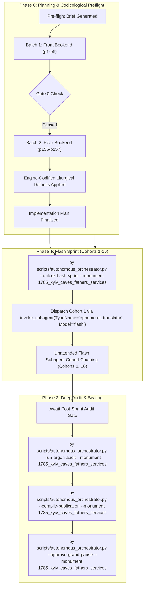

# Phase 0 Implementation Plan: 1785 Kyiv-Pechersk Lavra Expanded Services to the Venerable Fathers of the Kyiv Caves (`1785_kyiv_caves_fathers_services`)

## Goal Description
Translate, align, and canonically compile the complete historical Church Slavonic codex **1785 Kyiv-Pechersk Lavra Expanded Services to the Venerable Fathers of the Kyiv Caves (Служби преподобним Отцям Печерським, Київ: Друкарня Києво-Печерської Лаври, 1785)** (`1785_kyiv_caves_fathers_services`).

- **Physical Extent**: 157 physical leaves (`p1`–`p157`), partitioned into 16 cohorts (Cohorts 1–15: 10 leaves each; Cohort 16: 7 leaves: `p151`–`p157`).
- **Opening Geometry & Foliation**: `2-up` opening spreads (each facsimile leaf captures a two-page open book spread; outer covers `p1` and `p157` are single pages). Internal printed Church Slavonic foliation begins on physical leaf `p5` (recto = Folio 1 / `Листъ а҃`), following the antique front binding (`p1`), manuscript ownership endpapers (`p2`), imperial Synod title page (`p3`), Dormition icon and Table of Contents (`p4`), and Caves Fathers Synaxis icon (`p5` verso).
- **Historical Imprint & Ecclesial Context**: Printed at the Holy Kyiv-Pechersk Lavra in 1785 (Year 7293 from Creation / 1785 from the Incarnation, Indiction 3, August) by command of Empress Catherine II (*Екатерина Алексеевна*) and with the blessing of the Most Holy Governing Synod (*Святейший Правительствующий Синод*) during the archimandriteship of Zosima (*Архимандрит Зосима*).
- **Genre Register & Structure**: `hymnographic` register under the Master Translation Standard (MTS-1). Contains the full expanded liturgical services to the Synaxis of the Venerable Fathers resting in the Near Caves (St. Anthony), dedicated offices for individual Kyiv Caves saints and wonderworkers (St. Michael of Kyiv, Sts. Damian, Matthew & Jeremiah, St. Nikola Sviatosha, St. Nestor the Chronicler, St. Barlaam, St. Athanasius the Recluse, St. Nikon the Dry, Sts. Mark & Theophilus, St. Gregory, St. Ephraim of Pereyaslav, St. Prokhor, St. John the Recluse, Hieromartyr Eustratius, St. Niphont of Novgorod, St. Theodosius of the Caves, St. Simon of Suzdal, St. Agapitus the Physician, St. Anthony of the Caves, St. John the Long-Suffering, St. Moses the Hungarian, St. Pimen the Long-Ailing, Hieromartyrs Theodore & Basil, Translation of Relics of St. Theodosius, St. Alipius the Iconographer, Hieromartyr Kuksha & Pimen the Faster), the Synaxis of the Fathers resting in the Far Caves (St. Theodosius), the Common Service to a Single Venerable Father, and concluding Resurrectional and Dismissal Theotokia across the Eight Tones.
- **Concurrency & Lease Architecture**: Operates under the **Multi-Monument Sequestered Concurrency Protocol** (Rule 14) with active lease acquired in `Liturgical Monuments/ACTIVE_ORCHESTRATOR_STATE.json` and explicit CLI targeting (`--monument 1785_kyiv_caves_fathers_services`) protected by OS cross-process file locking (`scripts/concurrency_lock.py`).



---

## User Review Required

> [!IMPORTANT]
> **Active Multi-Monument Lease State**:
> Monument `1785_kyiv_caves_fathers_services` is initialized and leased cleanly in `Liturgical Monuments/ACTIVE_ORCHESTRATOR_STATE.json` and `Liturgical Monuments/codex_registry.json`. All mutating orchestrator, gate, and publication CLI commands in this session will explicitly pass `--monument 1785_kyiv_caves_fathers_services`.

> [!IMPORTANT]
> **Gate 0 Epigraphic Findings (Physical Verification Complete — Vision Budget 8/8 Leaves across 2/2 Batches)**:
> 1. **Batch 1 (Front Bookend, Leaves `p1`–`p5`)**:
>    - `p1`: Full external antique leather binding.
>    - `p2`: 2-up opening. Left & right flyleaves with 19th-century manuscript ownership inscriptions dated 1836 and 1843 (*"Сіѧ Книга получника Евстафія..."*).
>    - `p3`: 2-up opening. Left: 19th-century manuscript notations. Right: Master Title Page framed in an ornate Baroque floral woodcut border:
>      $$\text{Во славу ст҃ы́ѧ єдиносꙋ́щныѧ, животворѧ́щїѧ, и҆ нераздѣли́мыѧ Тр҃цы... Повелѣ́нїемъ... ЕКАТЕРІ́НЫ А̓ЛЕѮІ́ЕВНЫ... Кни́га сїѧ̀: СЛꙋ́ЖБЫ Прпб̑нымъ Ѻ҆тце́мъ Пече́рскимъ...}$$
>      Printed at the Holy Kyiv-Pechersk Lavra in 1785 (Creation 7293 / Christ 1785, Indiction 3, August) with the blessing of the Most Holy Governing Synod under Archimandrite Zosima.
>    - `p4`: 2-up opening. Left: Full-page woodcut engraving of the Dormition of the Theotokos. Right: Table of Contents (*ОГЛАВЛЕНІЕ ПОСЛѢДОВАНІЙ*), setting out all 27 services and concluding Theotokia from Folio 1 to Folio 151.
>    - `p5`: 2-up opening. Left: Full-page woodcut engraving of the Synaxis of the Kyiv Caves Fathers with Troparion (Tone 4) and Kontakion (Tone 2). Right: Folio 1 recto (`Ли́стъ а҃`), ornate woodcut headpiece: Month of September, Service to the Venerable Caves Fathers Resting in the Near Caves (*МѢСЯЦА СЕПТЕМВРІЯ, СЛУЖБА ПРПБНЫМЪ ОТЦЕМЪ ПЕЧЕРСКИМЪ, Ихже нетлѣнныя мощи в ближной Пещерѣ почиваютъ...*).
> 2. **Batch 2 (Rear Bookend, Leaves `p155`–`p157`)**:
>    - `p155`: 2-up opening. Left: Concluding Sticheron Theotokion with large Baroque floral tailpiece cartouche. Right: Folio 151 recto (`Ли́стъ рна҃`), woodcut headpiece: Resurrectional and Dismissal Theotokia across the Eight Tones (*БГОРОДИЧНЫ ВОСКРЕСНЫ, отпустителныя по тропарехъ стыхъ, осми гласовъ*).
>    - `p156`: 2-up opening. Left: Concluding Dismissal Theotokia of Tone 7 and Tone 8, colophon formula (*Конецъ и Бгу слава.*), with ornate cherub tailpiece cartouche. Right: rear endpaper with museum accession stamp (*Державний музей книги і друкарства ФОНД 30552*).
>    - `p157`: Full external rear antique leather binding.
> 3. **Physical Completeness**: All 157 300-DPI leaves are verified intact in the canonical vault (`E:\Google Drive\Liturgical Library\2. Historical Liturgical Texts\Kyivan_Recension\Anthologia\Kyiv_1785_Lavra_Services_to_Kyiv_Caves_Fathers\JPGs`). Zero mid-codex visual binary searches were conducted during Phase 0 (`p6`..`p154` remain uninspected, adhering strictly to Rule 14).

---

## Open Questions

None. All 6 recurring house-style liturgical defaults are pre-decided in `engine_codified_decisions` and locked in `Audit_Reports/phase0_preflight_brief.json` and `Liturgical Monuments/codex_registry.json`.

---

## Engine-Codified Liturgical Defaults & Guardrails (`phase0_preflight_brief.json`)

| Invariant Dimension | Locked Engine Standard (`1785_kyiv_caves_fathers_services`) |
| :--- | :--- |
| **1. 3-Layer Melodic Model (`Podoben`) Law** | Format melodic models strictly as `*Tone N, Podoben: "<Canonical English Incipit>" (<Slavonic Witness>):*` (e.g., `*Tone 6, Podoben: "Having Despaired" (Vse otlozhivshe):*`). Never use transliterated-first or square-bracketed `[...]` Podoben formatting. |
| **2. Strict `H1` (`#`) & `H2` (`##`) Hierarchy (Zero `H3`/`H4`)** | Emit `#` (`H1`) **exclusively** at the primary Part divisions defined in `publication_spec` (`# FRONT MATTER...`, `# PART I: SERVICES TO THE VENERABLE FATHERS OF THE NEAR CAVES...`, `# PART II: SERVICES TO THE VENERABLE FATHERS OF THE FAR CAVES...`). Emit `##` (`H2`) **exclusively** at primary service headpieces (e.g. `## Service to the Venerable Fathers of the Near Caves`, `## Service to Saint Anthony of the Caves`). **Never emit `###` or `####` headings**; render all sub-services, hours, canons, odes, heirmoi, troparia, and rubrics as inline italics (`*At Little Vespers:*`, `*Ode 1. Heirmos:*`, `*Troparion:*`). |
| **3. Structured Liturgical Stanzas** | Format each Heirmos, Troparion, Theotokion, and Sticheron as a distinct paragraph preceded by its inline italic role tag (`*Ode N. Heirmos:*`, `*Troparion:*`, `*Theotokion:*`). Format litany/dialogue speakers in bold (`**Priest:**`, `**Deacon:**`, `**Choir:**`). |
| **4. 2-Up Geometry & Leaf Delimiters** | Each image `Page_0001.jpg`..`Page_0157.jpg` is a physical 2-up book spread (except outer binding covers `p1` and `p157`). Delimit physical leaves exclusively via `=== LEAF pN ===`. Inside the leaf block, translators may optionally indicate page halves via italic running markers (`*(Left page — fol. N verso)*`, `*(Right page — fol. M recto)*`), but must **never emit standalone `[Page N]` or `[Leaf pN]` bracket lines in body text** (which fail Gate 1). |
| **5. Epigraphic Fidelity & Diplomatic Approbations** | Translate the 1785 Kyiv-Pechersk print strictly as inked, preserving incipits without unwritten expansion (Rule 16) and rendering the title page, imperial synodal decree, and Lavra colophon with 100% diplomatic fidelity. |
| **6. Shared Lexicon & Diachronic Drift Invariance** | Enforce canonical UGCC terminology from the Master Glossary (*Tetrapod*, *Klepalo*, *Aer*, *Kolyvo*, *Plashchanytsia*, *Sluzhebnik*), 100% Deity pronoun capitalization (*He*, *Him*, *His*, *Thou*, *Thee*), and the Father Paul Doxology Standard (ban *"for ever and ever"*). |

---

## Canonical Publication Specification & Slicing Strategy

During Phase 2 (`--compile-publication`), `UniversalPublicationEngine` will slice the translated markdown into the 3 canonical publication parts plus the master footnotes file in `Typikon Coded/Data/Inbox/1785_Kyiv-Pechersk_Lavra_Expanded_Services_to_the_Venerable_Fathers.../`:

| Part ID | Canonical Filename | Title | Start Landmark Regex | Physical Scope |
| :--- | :--- | :--- | :--- | :--- |
| **`part0`** | `1785_kyiv_caves_fathers_services_part0_front_matter.md` | Front Matter, Title Page, Engravings, and Table of Contents | `null` | `p1`–`p4` |
| **`part1`** | `1785_kyiv_caves_fathers_services_part1_near_caves_and_individual_fathers.md` | PART I: SERVICES TO THE VENERABLE FATHERS OF THE NEAR CAVES AND INDIVIDUAL CAVES SAINTS | `^#+\s*(?:PART\s+I\b\|MONTH\s+OF\s+SEPTEMBER\|SERVICES\s+TO\s+THE\s+VENERABLE\s+FATHERS\s+OF\s+THE\s+NEAR\s+CAVES)` | `p5`–`p146` |
| **`part2`** | `1785_kyiv_caves_fathers_services_part2_far_caves_common_service_and_theotokia.md` | PART II: SERVICES TO THE VENERABLE FATHERS OF THE FAR CAVES, COMMON SERVICE, AND THEOTOKIA | `^#+\s*(?:PART\s+II\b\|SERVICES\s+TO\s+THE\s+VENERABLE\s+FATHERS\s+OF\s+THE\s+FAR\s+CAVES\|COMMON\s+SERVICE\s+TO\s+A\s+VENERABLE\s+FATHER\|RESURRECTIONAL\s+THEOTOKIA)` | `p147`–`p157` |
| **Footnotes** | `1785_kyiv_caves_fathers_services_footnotes.md` | Master Footnotes and Epigraphic Commentary | N/A | Full Codex |

---

## Cohort Partition Table (Cohorts 1–16)

| Cohort | Physical Leaves | Leaf Count | Codicological Scope |
| :---: | :---: | :---: | :--- |
| **Cohort 1** | `p1`–`p10` | 10 | Covers, Title Page, Dormition Icon, Table of Contents, Caves Fathers Icon, Near Caves Synaxis Service Opening (`Листъ 1`–`6v`) |
| **Cohort 2** | `p11`–`p20` | 10 | Near Caves Synaxis (concl.), St. Michael of Kyiv (`Листъ 8`), Sts. Damian, Matthew & Jeremiah (`Листъ 12v`), St. Nikola Sviatosha (`Листъ 17`) |
| **Cohort 3** | `p21`–`p30` | 10 | St. Nikola Sviatosha (concl.), St. Nestor the Chronicler (`Листъ 22v`), St. Barlaam (`Листъ 27`) |
| **Cohort 4** | `p31`–`p40` | 10 | St. Barlaam (concl.), St. Athanasius the Recluse (`Листъ 32v`), St. Nikon the Dry (`Листъ 37v`), Sts. Mark & Theophilus (`Листъ 40`) |
| **Cohort 5** | `p41`–`p50` | 10 | Sts. Mark & Theophilus (concl.), St. Gregory the Wonderworker (`Листъ 46`), St. Ephraim of Pereyaslav (`Листъ 51v`), St. Prokhor (`Листъ 54`) |
| **Cohort 6** | `p51`–`p60` | 10 | St. Prokhor (concl.), St. John the Recluse (`Листъ 58`), Hieromartyr Eustratius (`Листъ 61v`) |
| **Cohort 7** | `p61`–`p70` | 10 | Hieromartyr Eustratius (concl.), St. Niphont of Novgorod (`Листъ 72`) |
| **Cohort 8** | `p71`–`p80` | 10 | St. Niphont (concl.), St. Theodosius Abbot of the Caves (`Листъ 76v`) |
| **Cohort 9** | `p81`–`p90` | 10 | St. Theodosius (concl.), St. Simon of Suzdal (`Листъ 84`), St. Agapitus Physician (`Листъ 84v`), St. Anthony of the Caves (`Листъ 94`) |
| **Cohort 10** | `p91`–`p100` | 10 | St. Anthony of the Caves (concl.), St. John the Long-Suffering (`Листъ 101v`) |
| **Cohort 11** | `p101`–`p110` | 10 | St. John the Long-Suffering (concl.), St. Moses the Hungarian (`Листъ 106v`), St. Pimen the Long-Ailing (`Листъ 113v`) |
| **Cohort 12** | `p111`–`p120` | 10 | St. Pimen (concl.), Hieromartyrs Theodore & Basil (`Листъ 118v`), Translation of Relics of St. Theodosius (`Листъ 125`) |
| **Cohort 13** | `p121`–`p130` | 10 | Translation of Relics of St. Theodosius (concl.), St. Alipius the Iconographer (`Листъ 134`) |
| **Cohort 14** | `p131`–`p140` | 10 | St. Alipius (concl.), Hieromartyr Kuksha & Pimen the Faster (`Листъ 141v`), Common Service to a Single Venerable Father (`Листъ 144`) |
| **Cohort 15** | `p141`–`p150` | 10 | Synaxis of the Venerable Fathers of the Far Caves (`Листъ 147v`), Resurrectional Theotokia of the Eight Tones (`Листъ 148`) |
| **Cohort 16** | `p151`–`p157` | 7 | Resurrectional & Dismissal Theotokia (concl.), Closing Colophon ("Конецъ и Бгу слава"), Endpapers, Rear Cover (`Листъ 151`–rear) |

---

## Execution Directives

Upon user approval of this plan:
1. Immediately execute:
   ```powershell
   py scripts/autonomous_orchestrator.py --unlock-flash-sprint --monument 1785_kyiv_caves_fathers_services
   ```
2. Dispatch Cohort 1 in the same turn via:
   ```python
   invoke_subagent(
       TypeName="ephemeral_translator",
       Model="flash",
       Role="Cohort 1 Translator",
       Prompt="Translate leaves p1 to p10 for 1785_kyiv_caves_fathers_services..."
   )
   ```
   without prompting for a second confirmation.
