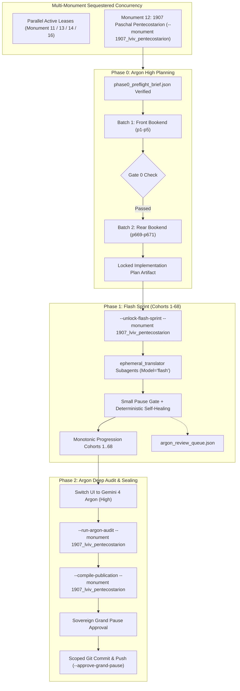

# Phase 0 Implementation Plan: Monument 12 — Lviv Stauropegion Paschal Pentecostarion (Lviv, 1907)

## Goal Description
Translate, align, and canonically compile the complete historical Church Slavonic codex **Monument 12: Lviv Stauropegion Paschal Pentecostarion (Lviv, 1907)** (`1907_lviv_pentecostarion`).
- **Physical Extent**: 671 leaves (`p1`–`p671`), partitioned monotonically into 68 cohorts (Cohorts 1–67: 10 leaves each; Cohort 68: 1 leaf).
- **Opening Geometry & Folio Offset**: `opening_geometry = "1-up"` (single-column printed liturgical folios), `folio_offset = 5` ($\mathbf{Physical\ Leaf} = \mathbf{Printed\ Folio} + 5$ across `p6`–`p671`; `p1`–`p5` are unnumbered front matter).
- **Genre Register**: Hymnographic (`MTS-1` hymnographic register, enriched with rubrical directives, sacerdotal prayers, and statutory Paschaltide Typikon chapters).
- **Architecture**: Operates under the **Multi-Monument Sequestered Concurrency Protocol** (Rule 14) alongside active parallel monuments, using strict explicit `--monument 1907_lviv_pentecostarion` CLI binding and cross-process OS file locking (`scripts/concurrency_lock.py`).



---

## User Review Required

> [!IMPORTANT]
> **Multi-Monument Sequestered Concurrency Binding (`--monument 1907_lviv_pentecostarion`)**:
> Because multiple monuments hold active leases concurrently across separate chat sessions, **100% of mutating orchestrator and gatekeeper CLI calls in this session must explicitly pass `--monument 1907_lviv_pentecostarion`** (or set `$env:ACTIVE_MONUMENT_ID="1907_lviv_pentecostarion"`). Calling mutating scripts without explicit monument disambiguation is programmatically blocked by the engine circuit-breaker.

> [!IMPORTANT]
> **Gate 0 Epigraphic Findings & Coordinate Calibration (`1-up`, `folio_offset = 5`)**:
> 1. **Batch 1 (Front Bookend, Leaves `p1`–`p5`)**:
>    - `p1`: *Preface to Readers* (`ОТВѢТЪ КЪ ЧИТАТЕЛЕМЪ`) from the Stauropegion Typography.
>    - `p2`: 1907 Stauropegion Master Title Page (`ТРІОДЬ ЦВѢТНАЯ Еллински ПЕНТИКОСТАРІОНЪ сіесть ПАТЬДЕСЯТНИЦЯ`), printed in Lviv by the Stauropegion Institute in the year 1907 (`,ацз`) at the Church of the Dormition of the Most Holy Mother of God.
>    - `p3`: Full-page plate engraving/photograph of the Dormition Church and Korniakt Bell Tower in Lviv (`СТАВРОПИГІЙСКІЙ ІНСТИТУТЪ ВО ЛЬВОВѢ`).
>    - `p4`–`p5`: Imperial, Papal, and Hierarchical approbations under Pope Pius X, Austrian Emperor Franz Joseph I, Metropolitan Andrey Count Sheptytsky (dated April 22, 1907), Bishop Konstantyn Chekhovych of Peremyshl, and Bishop Hryhoriy Khomyshyn of Stanyslaviv; Stauropegion Elders Roman Yminsky, Nicholas Hnylyakevych, Benedict Yanitsky; Editor Fr. Volodymyr Hurhula; Typographer Michael Reftsio.
> 2. **Batch 2 (Rear Bookend, Leaves `p669`–`p671` / Printed Fols. `333`–`335` / `хлг`–`хле`)**:
>    - `p669`–`p670` (fols. 333–334): Concluding Typikon rubrics (`(в) Седмицахъ Пятдесятницы`, `Уставъ о Субботахъ Пятдесятницы`) governing how the Pentecostarion is chanted with the Menaion across the weekdays and Saturdays from Thomas Sunday through the Leave-taking of Pentecost.
>    - `p671` (fol. 335): Concluding Typikon rubrics on the 11 Matins Resurrection Gospel Pillars (`Подобаетъ вѣдати и сіе...`), ending with the formal colophon: `Конецъ, и Бгу слава.` ("The End, and Glory to God.") and ornamental cross.
> 3. **Physical Coordinate Mapping**: Every scan `Page_0001.jpg`..`Page_0671.jpg` is a `1-up` single folio leaf (`folio_offset = 5`). Across `p6`..`p671`, $\mathbf{Physical\ Leaf\ pN} = \mathbf{Printed\ Folio} + 5$ (e.g., final leaf `p671` corresponds to printed folio `335` where recto/verso pagination or folio numbering concludes).

---

## Open Questions

All monument-specific design questions and engine-codified liturgical defaults (`Rule 14`) are locked:

1. **Paschal Catechetical Homily of St. John Chrysostom (`p1`–`p20`)**:
   - Translate with 100% epigraphic fidelity to the 1907 Church Slavonic print, preserving Ruthenian textual nuances while adopting classical ecclesiastical English cadences, and documenting notable divergences from Byzantine Greek or standard modern recensions in footnotes `[^N]`.
2. **Pentecost Kneeling Prayers (`Part VII`)**:
   - Render the three kneeling stations at Great Vespers of Pentecost as `H2` (`## ...`) headers (never `###` or `####`), with inline italic rubrical callouts (`*...*`) for kneeling postures and sacerdotal orientation, and bold speaker tags (`**Priest:**`, `**Deacon:**`, **Choir:**).
3. **Concluding Typikon Appendix (`p669`–`p671`)**:
   - Isolate leaves `p669`–`p671` into dedicated final publication part `Part VIII` (`1907_lviv_pentecostarion_part8_typikon_appendix_gospel_pillars.md`) triggered by `# PART VIII: TYPIKON APPENDIX — PASCHALTIDE MENAION COMBINATIONS AND THE ELEVEN MATINS RESURRECTION GOSPEL PILLARS`.
4. **Austro-Hungarian Imperial & Hierarchical Titulature (`p4`–`p5`)**:
   - Render all imperial, parliamentary, and academic dignities on `p4`–`p5` in full diplomatic English translation.

---

## Proposed Changes

### Component 1: Locked Publication Specification (`publication_spec`) & H1/H2 Landmark Discipline
In Phase 2 (`--compile-publication`), `UniversalPublicationEngine` slices the assembled monument into 9 canonical parts (`part0`..`part8`) plus the master footnotes apparatus (`1907_lviv_pentecostarion_footnotes.md`), delivered to Hub Inbox folder `1907_Lviv_Paschal_Pentecostarion`:

| Part ID | Target Filename | Title & Scope | Required `H1` (`#`) Start Landmark Regex |
| :--- | :--- | :--- | :--- |
| **`part0`** | `1907_lviv_pentecostarion_part0_front_matter.md` | Front Matter, Preface to Readers, Stauropegion Title Page, Dormition Engraving, and Imperial & Hierarchical Approbations (`p1`–`p5`) | `null` (begins at `p1`) |
| **`part1`** | `1907_lviv_pentecostarion_part1_pascha_bright_week.md` | PART I: GREAT AND HOLY PASCHA AND BRIGHT WEEK (Paschal Matins, Homily of St. John Chrysostom, Paschal Hours, Bright Monday–Saturday) | `^#+\s*(?:PART\s+I\b\|GREAT\s+AND\s+HOLY\s+PASCHA\|HOLY\s+AND\s+GREAT\s+SUNDAY\s+OF\s+PASCHA)` |
| **`part2`** | `1907_lviv_pentecostarion_part2_thomas_week.md` | PART II: SUNDAY OF SAINT THOMAS (ANTIPASCHA) AND SECOND WEEK AFTER PASCHA | `^#+\s*(?:PART\s+II\b\|SUNDAY\s+OF\s+(?:SAINT\|ST\.)\s+THOMAS\|ANTIPASCHA)` |
| **`part3`** | `1907_lviv_pentecostarion_part3_myrrhbearing_women.md` | PART III: SUNDAY OF THE HOLY MYRRH-BEARING WOMEN AND THIRD WEEK AFTER PASCHA | `^#+\s*(?:PART\s+III\b\|SUNDAY\s+OF\s+THE\s+(?:HOLY\s+)?MYRRH-?BEAR)` |
| **`part4`** | `1907_lviv_pentecostarion_part4_paralytic_mid_pentecost.md` | PART IV: SUNDAY OF THE PARALYTIC, FEAST OF MID-PENTECOST, AND FOURTH WEEK AFTER PASCHA | `^#+\s*(?:PART\s+IV\b\|SUNDAY\s+OF\s+THE\s+PARALYTIC)` |
| **`part5`** | `1907_lviv_pentecostarion_part5_samaritan_woman.md` | PART V: SUNDAY OF THE SAMARITAN WOMAN AND FIFTH WEEK AFTER PASCHA | `^#+\s*(?:PART\s+V\b\|SUNDAY\s+OF\s+THE\s+SAMARITAN\s+WOMAN)` |
| **`part6`** | `1907_lviv_pentecostarion_part6_blind_man_ascension_fathers.md` | PART VI: SUNDAY OF THE BLIND MAN, LEAVE-TAKING OF PASCHA, FEAST OF THE ASCENSION, AND SUNDAY OF THE HOLY FATHERS OF NICAEA | `^#+\s*(?:PART\s+VI\b\|SUNDAY\s+OF\s+THE\s+BLIND\s+MAN)` |
| **`part7`** | `1907_lviv_pentecostarion_part7_pentecost_kneeling_all_saints.md` | PART VII: MEMORIAL SATURDAY, GREAT FEAST OF HOLY PENTECOST, KNEELING PRAYERS AT VESPERS, AND SUNDAY OF ALL SAINTS | `^#+\s*(?:PART\s+VII\b\|MEMORIAL\s+SATURDAY\s+BEFORE\s+PENTECOST\|GREAT\s+FEAST\s+OF\s+(?:HOLY\s+)?PENTECOST)` |
| **`part8`** | `1907_lviv_pentecostarion_part8_typikon_appendix_gospel_pillars.md` | PART VIII: TYPIKON APPENDIX — PASCHALTIDE MENAION COMBINATIONS AND THE ELEVEN MATINS RESURRECTION GOSPEL PILLARS (`p669`–`p671`) | `^#+\s*(?:PART\s+VIII\b\|TYPIKON\s+APPENDIX)` |

---

### Component 2: Cohort Partition Table (68 Cohorts Across 671 Physical Leaves)
The codex will be processed in strictly monotonic ascending physical leaf order (`p1`..`p671`):
- **Cohorts 1–67**: 10 physical leaves per cohort (`p1`–`p670`).
- **Cohort 68**: 1 physical leaf (`p671`).

| Cohort Group | Physical Leaves | Primary Liturgical Contents |
| :--- | :--- | :--- |
| **Cohorts 1–5** | `p1`–`p50` | Front matter (`p1`–`p5`), Great and Holy Pascha (Nocturns, Paschal Matins, Paschal Canon, Homily of St. John Chrysostom, Paschal Hours, Liturgy, Vespers). |
| **Cohorts 6–10** | `p51`–`p100` | Bright Week (Bright Monday through Bright Saturday, Prayer for Breaking the Artos). |
| **Cohorts 11–18** | `p101`–`p180` | Part II: Sunday of Saint Thomas (Antipascha) and the Second Week after Pascha. |
| **Cohorts 19–26** | `p181`–`p260` | Part III: Sunday of the Holy Myrrh-Bearing Women, Righteous Joseph & Nicodemus, and Third Week after Pascha. |
| **Cohorts 27–34** | `p261`–`p340` | Part IV: Sunday of the Paralytic, Feast of Mid-Pentecost, and Fourth Week after Pascha. |
| **Cohorts 35–42** | `p341`–`p420` | Part V: Sunday of the Samaritan Woman and Fifth Week after Pascha. |
| **Cohorts 43–58** | `p421`–`p580` | Part VI: Sunday of the Blind Man, Leave-Taking of Pascha, Feast of the Ascension, Afterfeast, and Sunday of the Holy Fathers of Nicaea. |
| **Cohorts 59–67** | `p581`–`p670` | Part VII: Memorial Saturday before Pentecost, Great Feast of Holy Pentecost, Kneeling Prayers at Vespers, Day of the Holy Spirit, Sunday of All Saints, and opening of Part VIII (`p669`–`p670`). |
| **Cohort 68** | `p671` | Conclusion of Part VIII: Eleven Matins Resurrection Gospel Pillars and final colophon (`Конецъ, и Бгу слава`). |

---

### Component 3: Engine-Codified Liturgical Defaults & Flash Execution Guardrails (`Rule 14`)
Every `ephemeral_translator` subagent (`Model="flash"`) and deterministic self-healing pass must enforce all 5 monument-specific `flash_execution_guardrails` and 6 `engine_codified_decisions`:

1. **1-Up Geometry & Running Pagination Guardrail**:
   - Every image `Page_0001.jpg`..`Page_0671.jpg` is a `1-up` single folio leaf.
   - Never emit 2-up `[Left Page]` or `[Right Page]` tags, and never emit standalone `[Page N]` or `[Leaf pN]` bracket lines in Draft MD (which fail Gate 1). Only use the required `=== LEAF pN ===` delimiter banner per physical leaf.
2. **Strict `H1` (`#`) and `H2` (`##`) Heading Discipline (Zero `###` or `####`)**:
   - **H1 (`#`)**: Emit `# ...` exclusively at the 8 major Paschaltide Part divisions matching `publication_spec["parts"][*]["start_landmark"]`:
     - `# PART I: GREAT AND HOLY PASCHA AND BRIGHT WEEK`
     - `# PART II: SUNDAY OF SAINT THOMAS (ANTIPASCHA)`
     - `# PART III: SUNDAY OF THE HOLY MYRRH-BEARING WOMEN`
     - `# PART IV: SUNDAY OF THE PARALYTIC AND FEAST OF MID-PENTECOST`
     - `# PART V: SUNDAY OF THE SAMARITAN WOMAN`
     - `# PART VI: SUNDAY OF THE BLIND MAN AND FEAST OF THE ASCENSION`
     - `# PART VII: MEMORIAL SATURDAY, GREAT FEAST OF HOLY PENTECOST, AND SUNDAY OF ALL SAINTS`
     - `# PART VIII: TYPIKON APPENDIX — PASCHALTIDE MENAION COMBINATIONS AND THE ELEVEN MATINS RESURRECTION GOSPEL PILLARS`
   - **H2 (`##`)**: Use `## ...` only for primary weekday/liturgical day openings (`## On Bright Monday`, `## On Tuesday of the Second Week`, etc.) and the 3 Pentecost Kneeling Prayer stations.
   - **Inline Italic Rubrics (`*...*`)**: Render all sub-services, offices, hours, canons, odes, heirmoi, troparia, and stichera as inline italicized paragraphs (`*At Little Vespers:*`, `*At Great Vespers:*`, `*At Matins:*`, `*Ode 1. Heirmos:*`), **never** as `###` H3 or `####` H4 headings (which fail Gate 4 in `scripts/structural_audit.py`).
3. **Canonical 3-Layer `Podoben` & Stanza Discipline**:
   - Format all melodic model headings strictly using the canonical 3-layer format enforced by `hymnographic_gold_normalizer.py`:
     `*Tone N, Podoben: "<Canonical English Incipit>" (<Slavonic Witness>):*`
     (Never use square-bracketed `[...]` or transliterated-first `Podoben` formats).
   - Format each Heirmos, Troparion, Theotokion, and Sticheron as a distinct stanza/paragraph preceded by its inline italic role tag (`*Ode N. Heirmos:*`, `*Troparion:*`, `*Theotokion:*`). Format litany/dialogue speakers in bold (`**Priest:**`, `**Deacon:**`, `**Choir:**`).
4. **MTS-1 Register, Epigraphic Fidelity & Doxology**:
   - Enforce the Father Paul Doxology Standard (`"both now and for ever and unto ages of ages. Amen."`; strictly ban `"for ever and ever"`).
   - Capitalize 100% of Deity Trinity pronouns (`He, Him, His, Thou, Thee, Thy, Thine`).
   - Preserve printed incipits (`**"God is the Lord"**`, `**"Christ is risen..."**`) without silent expansion unless the full text is inked on the physical leaf (`Rule 16`, `PE-HSG-04`).
   - Use active present indicative for all bodily ceremonial rubrics; ban AI fantasy vocabulary and conversational clichés (`scripts/lint_liturgical_slop.py`).
5. **Gate-1-Safe Cross-References & Symmetric Paratext (`SGC-02` Protection)**:
   - Render internal folio cross-references in body prose as `(see fol. N)[^M]` without expanding unwritten incipits; place the physical leaf coordinate (`Physical Leaf pN = Printed Folio + 5`) in `[^M]:` inside `Final_footnotes.txt`.
   - On frontispiece/plate leaves (`p2`–`p3`), provide symmetric diplomatic descriptions in both `Source Text/` and `Draft/` so `SGC-02` length ratios remain strictly within `[0.80, 1.50]`.

---

### Component 4: 3-Phase Execution & Multi-Monument CLI Protocol
1. **Phase 0 $\rightarrow$ Phase 1 Handshake**:
   - Operator approves this plan and switches the Main Window UI dropdown from `Argon` $\rightarrow$ `Gemini 3.8 Flash`.
   - Orchestrator unlocks the Phase 1 Flash Sprint:
     ```powershell
     py scripts/autonomous_orchestrator.py --unlock-flash-sprint --monument 1907_lviv_pentecostarion
     ```
2. **Phase 1 Unattended Flash Sprint (Cohorts 1–68)**:
   - Define `ephemeral_translator` subagent (`EnableWriteTools=True`, `EnableSubagentTools=False`, `EnableMCPTools=False`) and invoke with `Model="flash"` across 100% of cohorts and retries.
   - Prepare each cohort work order:
     ```powershell
     py scripts/autonomous_orchestrator.py --step --monument 1907_lviv_pentecostarion
     ```
   - Audit each completed cohort via the Small Pause Gatekeeper (includes 4-part deterministic Python self-healing, 1 targeted `Flash` retry if needed, and automatic `argon_review_queue.json` quarantine fallback):
     ```powershell
     py scripts/run_small_pause_gate.py --cohort <N> --monument 1907_lviv_pentecostarion
     ```
3. **Phase 2 Argon Deep Audit, LCPE Compilation & Grand Pause Sealing**:
   - When `remaining_pages == 0`, halt at `AWAITING_ARGON_POST_SPRINT_AUDIT` for operator UI switch back to `Gemini 4 Argon (High)`.
   - Resolve queued/quarantined leaves in `argon_review_queue.json`:
     ```powershell
     py scripts/autonomous_orchestrator.py --run-argon-audit --monument 1907_lviv_pentecostarion
     ```
   - Compile the 9-part canonical publication edition (`part0`..`part8` + footnotes):
     ```powershell
     py scripts/autonomous_orchestrator.py --compile-publication --monument 1907_lviv_pentecostarion
     ```
   - Present Sovereign Grand Pause telemetry; upon operator approval, run scoped sealing & git push:
     ```powershell
     py scripts/autonomous_orchestrator.py --approve-grand-pause --monument 1907_lviv_pentecostarion
     ```

---

## Verification Plan

### Automated Tests & Gatekeeper Verification
- **Anti-Pattern Gate**:
  ```powershell
  python scratch/search_anti_patterns.py
  ```
- **Multi-Monument Telemetry Check**:
  ```powershell
  py scripts/autonomous_orchestrator.py --status --monument 1907_lviv_pentecostarion
  ```
- **Small Pause Gatekeeper (Per Cohort 1..68)**:
  ```powershell
  py scripts/run_small_pause_gate.py --cohort <N> --monument 1907_lviv_pentecostarion
  ```
- **Liturgical Slop Linter**:
  ```powershell
  py scripts/lint_liturgical_slop.py "Liturgical Monuments/Monument 12 - 1907 Lviv Pentecostarion/Draft/cohort_<N>_draft.md"
  ```
- **LCPE Publication Verification (Gates 1–6)**:
  ```powershell
  py scripts/autonomous_orchestrator.py --compile-publication --monument 1907_lviv_pentecostarion
  py scripts/verify_publication_edition.py --monument 1907_lviv_pentecostarion
  ```

### Manual Verification
- Verify front bookend leaves (`p1`–`p5`) diplomatic titulature and symmetric plate descriptions (`p2`–`p3`) against physical scans.
- Verify `Part VIII` (`p669`–`p671`) Typikon appendix slicing and colophon (`Конецъ, и Бгу слава`) conservation.
