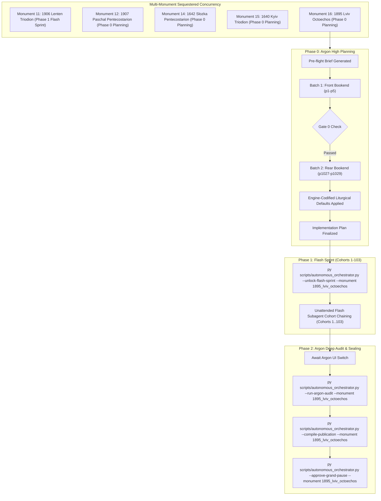

# Phase 0 Implementation Plan: Monument 16 — Lviv Stauropegion Complete Octoechos (Lviv, 1895)

## Goal Description
Translate, align, and canonically compile the complete historical Church Slavonic codex **Monument 16: Lviv Stauropegion Complete Octoechos (Lviv, 1895)** (`1895_lviv_octoechos`).
- **Physical Extent**: 1,029 leaves (`p1`–`p1029`), partitioned into 103 cohorts (Cohorts 1–102: 10 leaves each; Cohort 103: 9 leaves: `p1021`–`p1029`).
- **Opening Geometry & Folio Offset**: `1-up` single-column printed folios; `folio_offset = 2` (`Physical Leaf pN = Printed Folio + 2` starting at `p3` = Printed Folio 1; rear Parastas appendix uses independent pagination concluding with printed appendix p. 127 / `рк҃з` on `p1029`).
- **Source Language & Genre Register**: Church Slavonic / Galician Ruthenian (Lviv Stauropegion Press, 1895); `hymnographic` register (MTS-1 hymnographic standard, enriched with rubrical directives, troparia, kontakia, canons, and stichera across Tones 1–8, Resurrectional Exapostilaria/Eothina, and the General Parastas).
- **Architecture**: Operates under the **Multi-Monument Sequestered Concurrency Protocol** (Rule 14) alongside parallel active leases, using strict explicit `--monument 1895_lviv_octoechos` CLI targeting and cross-process OS file locking (`scripts/concurrency_lock.py`).



---

## User Review Required

> [!IMPORTANT]
> **Active Multi-Monument Lease State**:
> Monument 16 (`1895_lviv_octoechos`) is initialized and leased cleanly in `orchestrator_state.json` and `Liturgical Monuments/codex_registry.json`. All mutating orchestrator and gate CLI execution commands in this chat session will explicitly pass `--monument 1895_lviv_octoechos`.

> [!IMPORTANT]
> **Gate 0 Epigraphic Findings (Physical Verification Complete — Vision Budget 8/8 Leaves across 2/2 Batches)**:
> 1. **Batch 1 (Front Bookend, Leaves `p1`–`p5`)**:
>    - `p1`: Master Title Page (`Осмогласникъ еллински же Октѡихъ или Параклитіки... Твореніе Преподобнагw Отца нашегw Іwанна Дамаскина и иныхъ бгоговѣйныхъ Отецъ. Издадеся во Львовѣ, въ лѣто ѿ созданія міра 7393, ѿ Ржтва же Хр̄това 1895. Тѵпомъ и иждивеніемъ Ставропигійскаго Інстітута. Оуправитель типографіи Іωаннъ Пéхуръ.`). Features the Stauropegion Institute seal with Patriarchal cross and manuscript parish provenance inscriptions (`Власність Церкви св. Михаїла въ Підлипцях`, `22/I 1926 Куплена за 30 золотих зі скарбони за о. І. Кедринського пароха`).
>    - `p2`: Formal Hierarchic and Imperial Approbations: Pope Leo XIII (`Льва XIII`), Austrian Emperor Franz Joseph I (`Франца Іосифа I`), Metropolitan Sylvester Sembratovych (`Сільвестря Сембратовича`), Bishop Julian Pelesz of Peremyshl (`Іуліана Пелеша`), Bishop Julian Sas-Kuilovsky of Stanyslaviv (`Іуліана Куиловскаго`), Stauropegion Senior Isidore Sharanevych (`Ісидорѣ Шараневичи`), Printing Prefect Nicholas Syvulak (`Ніколаи Сивулякѣ`), and Editor Rev. Onuphry Lepky (`Іерей Онѵфрій Лепкій`).
>    - `p3` (printed fol. `1`): Engraved figurative headpiece and opening title banner (`Начало съ Бг҃омъ ст҃ымъ Октѡиха, сирѣчь Осмогласника. Въ Суббѡту въ вечеръ, на малѣй Вечерни.`) — Tone 1 (`Гласъ а҃`), Little Vespers on Saturday Evening.
>    - `p4` (printed fol. `2` / `в҃`): Tone 1 Little Vespers continued (Aposticha stichera, Theotokia under `*Tone 1, Podoben: "O Ye Heavenly Ranks" (Небесныхъ чинѡвъ):*`, Dogmatikon, Dismissal).
>    - `p5` (printed fol. `3`): Tone 1 Great Vespers on Saturday Evening (`Въ Суббѡту на велицѣй Вечерни. По предначинателномъ ѱалмѣ, обычное стїхословіе Ѱалти́ра. На Гд҃и воззва́хъ...`).
> 2. **Batch 2 (Rear Bookend, Leaves `p1027`–`p1029`)**:
>    - `p1027` (appendix printed fol. `125` / `рк҃е` — misnumbered `129` in bottom Arabic footer): General Parastas / Office for the Departed (`Парастасъ`), Evlogitaria/Troparia in Tone 5 (`Благословенъ еси Гд҃и...`, `Оупокой, Спасе нашъ...`), Sessional Hymn in Tone 6 (`Воистину суета всяческая...`), and Kontakion & Ikos in Tone 8 (`Съ Святыми оупокой Хр̄тѐ...`, `Самъ единъ еси Безсмертный...`).
>    - `p1028` (appendix printed fol. `126` / `рк҃ѕ`): Parastas continued: Troparia after Ode 9 in Tone 4 (`Со духи Праведныхъ...`), Litany for the Departed (`Помилуй насъ Бж҃е...`), Priest's Secret Prayer (`Бж҃е духѡ́въ и вся́кїя пло́ти...`), and Dismissal opening (`Воскресый изъ мертвыхъ...`).
>    - `p1029` (appendix printed fol. `127` / `рк҃з`): Parastas conclusion: Dismissal completion, "Eternal Memory" (`Вѣчная память`), concluding Friday Kolyvo rubric (`Сей Чинъ подобаетъ творити въ вся Пятки, въ нихже надъ Коливомъ творимъ память оусѡпшимъ отцемъ и братіямъ нашимъ.`), and formal closing colophon: `Конецъ, и Бг҃у Слава.` ("The End, and Glory to God.") with decorative tailpiece ornament.
> 3. **Physical Completeness**: All 1,029 300-DPI leaves are verified intact in `<canonical_mirror_dir>/JPGs` (`1. Music and Chant Monuments/Irmologia/3. Historical Printed Editions/1895 Lviv Oktoechos/JPGs`).

---

## Open Questions

None. All 6 house-style invariants are pre-decided in `engine_codified_decisions` and locked in `Audit_Reports/phase0_preflight_brief.json` and `Liturgical Monuments/codex_registry.json`.

---

## Engine-Codified Liturgical Defaults & Guardrails (`phase0_preflight_brief.json`)

| Invariant Dimension | Locked Engine Standard (`1895_lviv_octoechos`) |
| :--- | :--- |
| **1. 3-Layer Melodic Model (`Podoben`) Law** | Strictly format all melodic model headings as `*Tone N, Podoben: "<Canonical English Incipit>" (<Slavonic Witness>):*` (e.g., `*Tone 1, Podoben: "O Ye Heavenly Ranks" (Nebesnykh chinov):*`). Never use transliterated-first or square-bracketed `[...]` Podoben formatting. |
| **2. Strict `H1` (`#`) & `H2` (`##`) Hierarchy (Zero `H3`/`H4`)** | Emit `#` (`H1`) **exclusively** at the 10 major Part landmarks defined in `publication_spec` (`# TONE 1`..`# TONE 8`, `# EXAPOSTILARIA AND EVANGELICAL STICHERA`, `# GENERAL PARASTAS (OFFICE FOR THE DEPARTED)`). Emit `##` (`H2`) **exclusively** at primary Weekday/Day openings (e.g., `## Sunday: Resurrectional Services`, `## Monday: The Holy Bodiless Powers`). **Never emit `###` or `####` headings** (which fail Gate 4 in `scripts/structural_audit.py`); render all sub-services, offices, hours, canons, odes, heirmoi, troparia, and rubrics as inline italics (`*At Little Vespers:*`, `*At Great Vespers:*`, `*At Matins:*`, `*Ode N. Heirmos:*`). |
| **3. Structured Liturgical Stanzas** | Format each Heirmos, Troparion, Theotokion, and Sticheron as a distinct paragraph preceded by its inline italic role tag (`*Ode N. Heirmos:*`, `*Troparion:*`, `*Theotokion:*`). Format litany/dialogue speakers in bold (`**Priest:**`, `**Deacon:**`, `**Choir:**`). |
| **4. 1-Up Geometry & Running Pagination** | Every image `Page_0001.jpg`..`Page_1029.jpg` is a `1-up` single folio leaf. Never emit `2-up` `[Left Page]` / `[Right Page]` tags, and never emit standalone `[Page N]` or `[Leaf pN]` bracket lines in Draft MD (which fail Gate 1). Only use the required `=== LEAF pN ===` delimiter banner per physical leaf. |
| **5. Epigraphic Fidelity & Diplomatic Approbations** | Translate the 1895 Lviv Stauropegion print strictly as inked, preserving incipits without unwritten expansion (Rule 16) and rendering all Papal, Austro-Hungarian Imperial, and Archiepiscopal approbations on `p1`–`p2` with 100% diplomatic completeness. |
| **6. Gate-1-Safe Cross-References (`SGC-02` Protection)** | Render internal folio cross-references in body prose as `(see fol. N)[^M]`; place the physical leaf coordinate (`Physical Leaf pN = Printed Folio + 2`) in `[^M]:`. |

---

## Proposed Changes

### Component 1: Canonical Publication Spec (`Part 0` through `Part 10`) & Cohort Partitions
During Phase 2 (`--compile-publication`), `UniversalPublicationEngine` will slice the 1,029 translated leaves into the 11 locked publication files (`Part 0` + `Part 1`..`Part 10`) plus the master footnotes file in `Typikon Coded/Data/Inbox/1895_Lviv_Complete_Octoechos/`:

| Part ID | Canonical Filename | Title | Start Landmark Regex |
| :--- | :--- | :--- | :--- |
| **`part0`** | `1895_lviv_octoechos_part0_front_matter.md` | Front Matter, Stauropegion Title Page (1895), Provenance Inscriptions, and Papal, Imperial & Archiepiscopal Approbations | `null` (`p1`–`p2`) |
| **`part1`** | `1895_lviv_octoechos_part1_tone1.md` | PART 01 — TONE 1: SUNDAY AND WEEKDAY OFFICES (SATURDAY VESPERS THROUGH SATURDAY MATINS) | `^#+\s*(?:TONE\s+(?:1|I|FIRST)\|BEGINNING\s+OF\s+TONE\s+1)\b` |
| **`part2`** | `1895_lviv_octoechos_part2_tone2.md` | PART 02 — TONE 2: SUNDAY AND WEEKDAY OFFICES (SATURDAY VESPERS THROUGH SATURDAY MATINS) | `^#+\s*(?:TONE\s+(?:2|II|SECOND)\|BEGINNING\s+OF\s+TONE\s+2)\b` |
| **`part3`** | `1895_lviv_octoechos_part3_tone3.md` | PART 03 — TONE 3: SUNDAY AND WEEKDAY OFFICES (SATURDAY VESPERS THROUGH SATURDAY MATINS) | `^#+\s*(?:TONE\s+(?:3|III|THIRD)\|BEGINNING\s+OF\s+TONE\s+3)\b` |
| **`part4`** | `1895_lviv_octoechos_part4_tone4.md` | PART 04 — TONE 4: SUNDAY AND WEEKDAY OFFICES (SATURDAY VESPERS THROUGH SATURDAY MATINS) | `^#+\s*(?:TONE\s+(?:4|IV|FOURTH)\|BEGINNING\s+OF\s+TONE\s+4)\b` |
| **`part5`** | `1895_lviv_octoechos_part5_tone5.md` | PART 05 — TONE 5: SUNDAY AND WEEKDAY OFFICES (SATURDAY VESPERS THROUGH SATURDAY MATINS) | `^#+\s*(?:TONE\s+(?:5|V|FIFTH)\|BEGINNING\s+OF\s+TONE\s+5)\b` |
| **`part6`** | `1895_lviv_octoechos_part6_tone6.md` | PART 06 — TONE 6: SUNDAY AND WEEKDAY OFFICES (SATURDAY VESPERS THROUGH SATURDAY MATINS) | `^#+\s*(?:TONE\s+(?:6|VI|SIXTH)\|BEGINNING\s+OF\s+TONE\s+6)\b` |
| **`part7`** | `1895_lviv_octoechos_part7_tone7.md` | PART 07 — TONE 7: SUNDAY AND WEEKDAY OFFICES (SATURDAY VESPERS THROUGH SATURDAY MATINS) | `^#+\s*(?:TONE\s+(?:7|VII|SEVENTH)\|BEGINNING\s+OF\s+TONE\s+7)\b` |
| **`part8`** | `1895_lviv_octoechos_part8_tone8.md` | PART 08 — TONE 8: SUNDAY AND WEEKDAY OFFICES (SATURDAY VESPERS THROUGH SATURDAY MATINS) | `^#+\s*(?:TONE\s+(?:8|VIII|EIGHTH)\|BEGINNING\s+OF\s+TONE\s+8)\b` |
| **`part9`** | `1895_lviv_octoechos_part9_resurrectional_appendices.md` | PART 09 — RESURRECTIONAL EXAPOSTILARIA AND ELEVEN EVANGELICAL STICHERA (EOTHINA) | `^#+.*?(?:EXAPOSTILARIA\|EVANGELICAL\s+STICHERA\|GOSPEL\s+STICHERA\|EOTHINA)\b` |
| **`part10`** | `1895_lviv_octoechos_part10_parastas.md` | PART 10 — GENERAL PARASTAS: OFFICE FOR THE DEPARTED, MEMORIAL CANON, SECRET PRAYERS, KOLYVO RUBRIC, AND COLOPHON | `^#+.*?(?:GENERAL\s+PARASTAS\|PARASTAS\|OFFICE\s+FOR\s+THE\s+DEPARTED)\b` |
| **Footnotes** | `1895_lviv_octoechos_footnotes.md` | Master Apparatus & Editorial Footnotes (`[^1]`..`[^N]`) | Bijective `[^N]` $\leftrightarrow$ `[^N]:` |

The 1,029 physical leaves are partitioned deterministically into 103 cohorts (`Cohort 1`: `p1`–`p10` through `Cohort 102`: `p1011`–`p1020`, and `Cohort 103`: `p1021`–`p1029`).

---

### Component 2: MTS-1 Translation & Hymnographic Standards
Every leaf translation will adhere strictly to:
1. **Master Translation Standard (MTS-1)**:
   - **Hymnographic Register**: Elevated, rhythmic, metered ecclesiastical English preserving the Ruthenian plainchant syntax and melodic divisions.
   - **Father Paul Doxology Standard**: Enforce `"both now and for ever and unto ages of ages. Amen."` (strictly ban `"for ever and ever"`).
   - **Deity Trinity Pronouns**: 100% capitalized (`He, Him, His, Thou, Thee, Thy, Thine, Who, Whom, Whose`).
   - **Rubrical Voice**: Active Present Indicative for ceremonial physical actions; reserve `"shall"` for statutory canonical mandates.
   - **Realia & Melodic Models**: Use canonical loanwords (*Heirmos, Katavasia, Theotokion, Stavrotheotokion, Sessional Hymn, Exapostilarion, Dogmatikon, Prokeimenon, Kolyvo, Parastas*) and the 3-Layer `Podoben` format (`*Tone N, Podoben: "<Canonical English Incipit>" (<Slavonic Witness>):*`).
2. **Epigraphic Grounding (`SGC-01`..`SGC-06`)**:
   - Strictly transcribed from 300 DPI leaf images (`Page_0001.jpg`..`Page_1029.jpg`).
   - Unwritten incipit expansions prohibited (Rule 16 / `PE-HSG-04`).
   - Lacunae or necessary restorations enclosed in brackets `[...]` and documented in `[^N]`.

---

### Component 3: Phase 1 Unattended Flash Execution & Sequestered Concurrency
- **Explicit Monument Binding**: Every CLI invocation passes `--monument 1895_lviv_octoechos`.
- **Model Lock**: Custom worker subagent (`ephemeral_translator`) strictly locked to `Model="flash"` via `invoke_subagent`.
- **Automated Review Queue**: Epigraphic uncertainties, complex tables, or borderline length ratios automatically routed to `Audit_Reports/argon_review_queue.json`.
- **Two-Tier Self-Healing**: Deterministic Python self-healing (`attempt_deterministic_self_healing()`) followed by at most 1 targeted `Flash` retry before quarantining persistent anomalies into `argon_review_queue.json` and continuing unattended cohort chaining.

---

## Verification Plan

### Automated Tests
1. **Unlock Phase 1 Flash Sprint (After Operator Approval & UI Switch to Flash)**:
   ```powershell
   py scripts/autonomous_orchestrator.py --unlock-flash-sprint --monument 1895_lviv_octoechos
   ```
2. **Cohort Preparation & Small Pause Gate Verification (Gates 1–4, SGC-02, Slop Linter, Pronoun Audit)**:
   ```powershell
   py scripts/autonomous_orchestrator.py --step --monument 1895_lviv_octoechos
   py scripts/run_small_pause_gate.py --monument 1895_lviv_octoechos --cohort <N>
   ```
3. **Phase 2 Post-Sprint Argon Deep Audit & Canonical Publication Compilation**:
   ```powershell
   py scripts/autonomous_orchestrator.py --run-argon-audit --monument 1895_lviv_octoechos
   py scripts/autonomous_orchestrator.py --compile-publication --monument 1895_lviv_octoechos
   ```
4. **Ecosystem & Anti-Pattern Check**:
   ```powershell
   python scratch/search_anti_patterns.py
   ```

### Manual Verification
- Review this updated `implementation_plan.md`.
- Switch the Main Window UI dropdown to **`Gemini 3.8 Flash`** and instruct me to unlock Phase 1 (`--unlock-flash-sprint --monument 1895_lviv_octoechos`).
