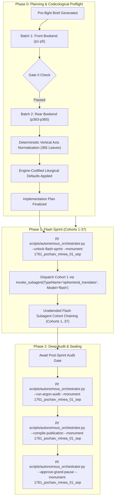

# Phase 0 Implementation Plan: 1761 Pochaiv Lavra Menaion — Month of September (`1761_pochaiv_minea_01_sep`)

## Goal Description
Translate, align, and canonically compile the complete historical Church Slavonic monthly liturgical codex **1761 Pochaiv Lavra Menaion — Vol. 1: September / Мінея Місячна: Вересень (Почаїв: Типографія Успенської Лаври ЧСВВ, 1761)** (`1761_pochaiv_minea_01_sep`).

- **Physical Extent**: 365 physical leaves (`p1`–`p365`), partitioned into 37 cohorts (Cohorts 1–36: 10 leaves each; Cohort 37: 5 leaves: `p361`–`p365`).
- **Opening Geometry & Foliation**: Single-page leaf facsimiles. `p1` (Master Title Page); `p2` (blank flyleaf verso); `p3` (Folio 1 / `Листъ а҃` recto: Beginning of the Indiction / New Church Year and Feast of St. Symeon the Stylite under ornate woodcut headpiece); through `p364` (conclusion of September 30th services with decorative tailpiece vignette); `p365` (blank final endpaper / flyleaf).
- **Facsimile Orientation Finding & Normalization**: The raw digital scans in the digital repository were captured inverted along the vertical axis (`FLIP_TOP_BOTTOM`). During Phase 0 preflight, all 365 physical facsimile leaves in the canonical vault (`E:\Google Drive\Liturgical Library\2. Historical Liturgical Texts\Ruthenian_Galician\Menaia\Pochaiv_1761_Menaion\Pochaiv_1761_Menaion_01_September\JPGs`) were deterministically normalized to upright canonical orientation with zero quality degradation, ensuring 100% legibility and flawless optical alignment for all Phase 1 Flash workers.
- **Historical Imprint & Ecclesial Context**: Printed at the Holy Miraculous Lavra of Pochaiv in 1761 (Year 7269 from Creation / 1761 from the Incarnation of God the Word) by the monastic typography of the Order of Saint Basil the Great (*Чинъ Святаго Василiа Великаго* / OSBM). Dedicated under King Augustus III of Poland-Lithuania (*Короля Августа Третiяго*); published with the blessing of Bishop Sylvester Lubieniecki-Rudnytsky of Lutsk and Ostroh, Exarch of Kyiv, Halych, and all Rus (*Силвестра Лубiенiечкаго Рудницкаго*); and by the will and mandate of Protoarchimandrite Hypatius Bilynsky (*Іпатій Білинський*), Protoarchimandrite of the Ruthenian Basilian Order.
- **Genre Register & Content**: `hymnographic` register under the Master Translation Standard (MTS-1). Contains the complete daily propers for the 30 days of September, opening the liturgical calendar:
  - **September 1**: Beginning of the Indiction (New Ecclesiastical Year), St. Symeon the Stylite, and St. Martha his mother.
  - **September 8**: The Nativity of the Most Holy Theotokos (Great Feast).
  - **September 14**: The Universal Exaltation of the Precious and Life-Giving Cross (Great Feast with solemn fasting).
  - Major commemorations: Holy Martyr Anthimus of Nicomedia (Sept 3), Holy Prophet Moses the God-Seer (Sept 4), Holy Prophet Zacharias (Sept 5), Miracle of Archangel Michael at Colossae (Sept 6), Holy Martyr Sozon (Sept 7), Holy Martyrs Menodora, Metrodora, and Nymphodora (Sept 10), Holy Martyr Nicetas (Sept 15), Holy Great-Martyr Euphemia (Sept 16), Holy Martyrs Faith, Hope, Love, and their mother Sophia (Sept 17), Holy Apostle and Evangelist John the Theologian (Sept 26), and Holy Hieromartyr Gregory of Armenia with St. Rhipsime and St. Michael First Metropolitan of Kyiv (Sept 30).
- **Concurrency & Lease Architecture**: Operates under the **Multi-Monument Sequestered Concurrency Protocol** (Rule 14) with active lease acquired in `Liturgical Monuments/ACTIVE_ORCHESTRATOR_STATE.json` and explicit CLI targeting (`--monument 1761_pochaiv_minea_01_sep`) protected by OS cross-process file locking (`scripts/concurrency_lock.py`).



---

## User Review Required

> [!IMPORTANT]
> **Active Multi-Monument Lease State**:
> Monument `1761_pochaiv_minea_01_sep` is initialized and leased in `Liturgical Monuments/ACTIVE_ORCHESTRATOR_STATE.json` and `Liturgical Monuments/codex_registry.json`. All mutating orchestrator, gate, and publication CLI commands in this session explicitly pass `--monument 1761_pochaiv_minea_01_sep`.

> [!IMPORTANT]
> **Gate 0 Epigraphic Findings (Physical Verification Complete — Vision Budget 8/8 Leaves across 2/2 Batches)**:
> 1. **Batch 1 (Front Bookend, Leaves `p1`–`p5`)**:
>    - `p1`: Master Title Page within architectural typographical woodcut border:
>      $$\text{КНИГА МЇНІА МѢСЯЦЪ СЕПТЕМВРIЙ...}$$
>      Imprint: Printed at the Miraculous Pochaiv Dormition Lavra (*Святочудотворной Лаврѣ Почаевской*) in Year 7269 from Creation / 1761 from Christ under King Augustus III of Poland, Bishop Sylvester Lubieniecki-Rudnytsky, and Basilian Protoarchimandrite Hypatius Bilynsky.
>    - `p2`: Blank verso facing opening of the Church Year.
>    - `p3`: Folio 1 (`Листъ а҃`) under elaborate woodcut headpiece:
>      $$\text{МѢСЯЦЪ СЕПТЕМВРIЙ ИМѢЯЙ ДНIЙ, Л. Въ а҃-й день начало Индiкта, сирѣчь Новаго Лѣта...}$$
>      Small Vespers, Lord I Have Cried, Stichera in Tone 1.
>    - `p4`: Folio 1v: Stichera for the Indiction and St. Symeon the Stylite continued; Tone 5.
>    - `p5`: Folio 2r: Doxasticon, Aposticha, and Troparia for September 1.
> 2. **Batch 2 (Rear Bookend, Leaves `p363`–`p365`)**:
>    - `p363`: Folio 361r: Canon and hymnography for September 30 (St. Gregory the Illuminator, Holy Martyr Rhipsime, St. Michael of Kyiv).
>    - `p364`: Folio 361v: Concluding troparia and stichera for Day 30 under decorative tailpiece woodcut vignette.
>    - `p365`: Blank historical final flyleaf.
> 3. **Physical Completeness**: All 365 300-DPI leaves are verified intact in the canonical vault (`E:\Google Drive\Liturgical Library\2. Historical Liturgical Texts\Ruthenian_Galician\Menaia\Pochaiv_1761_Menaion\Pochaiv_1761_Menaion_01_September\JPGs`). Zero mid-codex visual binary searches were conducted during Phase 0 (`p6`..`p362` remain uninspected, adhering strictly to Rule 14).

---

## Open Questions

None. All 6 recurring house-style liturgical defaults are pre-decided in `engine_codified_decisions` and locked in `Audit_Reports/phase0_preflight_brief.json` and `Liturgical Monuments/codex_registry.json`.

---

## Engine-Codified Liturgical Defaults & Guardrails (`phase0_preflight_brief.json`)

| Invariant Dimension | Locked Engine Standard (`1761_pochaiv_minea_01_sep`) |
| :--- | :--- |
| **1. 3-Layer Melodic Model (`Podoben`) Law** | Format melodic models strictly as `*Tone N, Podoben: "<Canonical English Incipit>" (<Slavonic Witness>):*` (e.g., `*Tone 1, Podoben: "Joy of the Heavenly Hosts" (Nebesnykh chinov):*`). Transliterated-first or square-bracketed `[...]` Podoben formatting is strictly prohibited. |
| **2. Strict `H1` (`#`) & `H2` (`##`) Hierarchy (Zero `H3`/`H4`)** | Emit `#` (`H1`) **exclusively** at the primary Part divisions defined in `publication_spec` (`# FRONT MATTER...`, `# PART I: SERVICES FOR THE MONTH OF SEPTEMBER (DAYS 1–30)`, `# PART II: CONCLUDING FOLIO AND BINDING ARTIFACTS`). Emit `##` (`H2`) **exclusively** at primary day/service headpieces (e.g., `## September 1. Beginning of the Indiction, That Is, the New Year`). **Never emit `###` or `####` headings** (which fail Gate 4); render all sub-services, hours, canons, odes, heirmoi, troparia, and rubrics as inline italics (`*At Small Vespers:*`, `*At Lord, I Have Cried:*`, `*Ode 1. Heirmos:*`, `*Troparion:*`). |
| **3. Structured Liturgical Stanzas** | Format each Heirmos, Troparion, Theotokion, and Sticheron as a distinct paragraph preceded by its inline italic role tag (`*Ode N. Heirmos:*`, `*Troparion:*`, `*Theotokion:*`). Format litany/dialogue speakers in bold (`**Priest:**`, `**Deacon:**`, `**Choir:**`). |
| **4. Leaf Delimiters & Physical Foliation** | Delimit physical leaves exclusively via `=== LEAF pN ===`. Physical PDF leaf coordinates are primary; record printed foliation parenthetically in leaf banners (`=== LEAF p3 === (Fol. 1)`). Standalone `[Page N]` or `[Leaf pN]` bracket lines in body text are strictly prohibited. |
| **5. Epigraphic Fidelity & Incipit Preservation** | Translate the 1761 Pochaiv print strictly as inked, preserving incipits without unwritten expansion (Rule 16) and rendering the title page, Basilian approbation, and colophons with 100% diplomatic fidelity. |
| **6. Shared Lexicon & Diachronic Drift Invariance** | Enforce canonical UGCC terminology from the Master Glossary (*Tetrapod*, *Klepalo*, *Aer*, *Kolyvo*, *Plashchanytsia*, *Sluzhebnik*), 100% Deity pronoun capitalization (*He*, *Him*, *His*, *Thou*, *Thee*), and the Father Paul Doxology Standard (ban *"for ever and ever"*). |

---

## Canonical Publication Specification & Slicing Strategy

During Phase 2 (`--compile-publication`), `UniversalPublicationEngine` will slice the translated markdown into the 3 canonical publication parts plus the master footnotes file in `Typikon Coded/Data/Inbox/1761_Pochayiv_Menaion_(September)/`:

| Part ID | Canonical Filename | Title | Start Landmark Regex | Physical Scope |
| :--- | :--- | :--- | :--- | :--- |
| **`part0`** | `1761_pochaiv_minea_01_sep_part0_front_matter.md` | Front Matter, Pochaiv Title Page (1761), and Basilian Approbation | `null` | `p1`–`p2` |
| **`part1`** | `1761_pochaiv_minea_01_sep_part1_september_services.md` | PART I: SERVICES FOR THE MONTH OF SEPTEMBER (DAYS 1–30) | `^#+\s*(?:PART\s+I\b\|MONTH\s+OF\s+SEPTEMBER\|SEPTEMBER\s+SERVICES)` | `p3`–`p364` |
| **`part2`** | `1761_pochaiv_minea_01_sep_part2_appendices_and_flyleaves.md` | PART II: CONCLUDING FOLIO AND BINDING ARTIFACTS | `^#+\s*(?:PART\s+II\b\|APPENDICES\|BINDING\s+ARTIFACTS\|CONCLUDING\s+FOLIO)` | `p365` |
| **Footnotes** | `1761_pochaiv_minea_01_sep_footnotes.md` | Master Footnotes and Epigraphic Commentary | N/A | Full Codex |

---

## Cohort Partition Table (Cohorts 1–37)

| Cohort | Physical Leaves | Leaf Count | Primary Contents / Liturgical Focus |
| :---: | :---: | :---: | :--- |
| **Cohort 1** | `p1`–`p10` | 10 | Title Page (`p1`), Blank verso (`p2`), Sept 1 (Indiction, St. Symeon the Stylite) through Sept 2 |
| **Cohort 2** | `p11`–`p20` | 10 | Sept 2–4 (St. Anthimus of Nicomedia, St. Theoctistus, St. Moses the God-Seer) |
| **Cohort 3** | `p21`–`p30` | 10 | Sept 4–6 (St. Babylas, St. Zacharias, Miracle of Archangel Michael at Colossae) |
| **Cohort 4** | `p31`–`p40` | 10 | Sept 6–7 (Forefeast of the Nativity of the Theotokos, St. Sozon) |
| **Cohort 5** | `p41`–`p50` | 10 | Sept 8 (Nativity of the Most Holy Theotokos: Great Vespers, Matins) |
| **Cohort 6** | `p51`–`p60` | 10 | Sept 8–9 (Nativity of the Theotokos: Canons, Liturgy; Afterfeast, Sts. Joachim and Anna) |
| **Cohort 7** | `p61`–`p70` | 10 | Sept 9–11 (Sts. Joachim and Anna, Holy Martyrs Menodora, Metrodora, and Nymphodora) |
| **Cohort 8** | `p71`–`p80` | 10 | Sept 11–13 (St. Theodora of Alexandria, St. Cornelius the Centurion, Dedication of the Church of the Resurrection in Jerusalem) |
| **Cohort 9** | `p81`–`p90` | 10 | Sept 13–14 (Forefeast of the Exaltation; Exaltation of the Precious Cross: Great Vespers) |
| **Cohort 10** | `p91`–`p100` | 10 | Sept 14 (Exaltation of the Precious Cross: Matins, Canons, Elevation of the Cross) |
| **Cohort 11** | `p101`–`p110` | 10 | Sept 14–15 (Exaltation Liturgy; Afterfeast, Holy Great-Martyr Nicetas) |
| **Cohort 12** | `p111`–`p120` | 10 | Sept 15–16 (Holy Great-Martyr Euphemia) |
| **Cohort 13** | `p121`–`p130` | 10 | Sept 16–17 (Holy Martyrs Faith, Hope, Love, and their mother Sophia) |
| **Cohort 14** | `p131`–`p140` | 10 | Sept 17–19 (St. Sophia and daughters; St. Eumenes of Gortyna; Holy Martyrs Trophimus, Sabbatius, and Dorymedon) |
| **Cohort 15** | `p141`–`p150` | 10 | Sept 19–20 (Holy Great-Martyr Eustathius and his companions; Holy Martyr Theopistus) |
| **Cohort 16** | `p151`–`p160` | 10 | Sept 20–21 (Apodosis of the Exaltation of the Cross; Holy Apostle Quadratus of Athens) |
| **Cohort 17** | `p161`–`p170` | 10 | Sept 21–22 (Holy Hieromartyr Phocas of Sinope, Holy Prophet Jonah) |
| **Cohort 18** | `p171`–`p180` | 10 | Sept 23 (Conception of the Honorable and Glorious Prophet, Forerunner, and Baptist John) |
| **Cohort 19** | `p181`–`p190` | 10 | Sept 23–24 (Holy First-Martyr and Equal-to-the-Apostles Thecla) |
| **Cohort 20** | `p191`–`p200` | 10 | Sept 24–25 (St. Thecla; St. Euphrosyne of Alexandria; St. Sergius of Radonezh) |
| **Cohort 21** | `p201`–`p210` | 10 | Sept 25–26 (Falling Asleep of the Holy Apostle and Evangelist John the Theologian: Great Vespers) |
| **Cohort 22** | `p211`–`p220` | 10 | Sept 26 (St. John the Theologian: Matins, Canons, Stichera) |
| **Cohort 23** | `p221`–`p230` | 10 | Sept 26–27 (St. John the Theologian; Holy Martyr Callistratus and his 49 companions) |
| **Cohort 24** | `p231`–`p240` | 10 | Sept 27–28 (St. Callistratus; Venerable Father Chariton the Confessor) |
| **Cohort 25** | `p241`–`p250` | 10 | Sept 28 (Venerable Father Chariton the Confessor; St. Wenceslaus Prince of the Czechs) |
| **Cohort 26** | `p251`–`p260` | 10 | Sept 28–29 (Venerable Father Cyriacus the Anchorite) |
| **Cohort 27** | `p261`–`p270` | 10 | Sept 29–30 (St. Cyriacus; Holy Hieromartyr Gregory the Illuminator of Armenia: Great Vespers) |
| **Cohort 28** | `p271`–`p280` | 10 | Sept 30 (St. Gregory of Armenia: Matins, Canons, Ode 1–4) |
| **Cohort 29** | `p281`–`p290` | 10 | Sept 30 (St. Gregory of Armenia: Canons, Ode 5–9, Praises) |
| **Cohort 30** | `p291`–`p300` | 10 | Sept 30 (Holy Martyr Rhipsime and her companions: Matins, Canons) |
| **Cohort 31** | `p301`–`p310` | 10 | Sept 30 (Holy Martyr Rhipsime, St. Gaiana, and companions continued) |
| **Cohort 32** | `p311`–`p320` | 10 | Sept 30 (St. Michael First Metropolitan of Kyiv: Great Vespers, Matins) |
| **Cohort 33** | `p321`–`p330` | 10 | Sept 30 (St. Michael First Metropolitan of Kyiv: Canons, Odes 1–6) |
| **Cohort 34** | `p331`–`p340` | 10 | Sept 30 (St. Michael First Metropolitan of Kyiv: Canons, Odes 7–9, Praises, Troparia) |
| **Cohort 35** | `p341`–`p350` | 10 | Sept 30 (Common Stichera, Apolytikia, Theotokia, and Concluding Offices) |
| **Cohort 36** | `p351`–`p360` | 10 | Sept 30 (Concluding Hymnographic Cycles, Theotokia of the 8 Tones) |
| **Cohort 37** | `p361`–`p365` | 5 | Sept 30 Concluding Troparia & Tailpiece Vignette (`p361`–`p364`), Blank Endpaper Flyleaf (`p365`) |

---

## Autonomous Execution & Subagent Workflow

1. **Gate Unlock**: Following user plan approval, execute:
   ```powershell
   py scripts/autonomous_orchestrator.py --unlock-flash-sprint --monument 1761_pochaiv_minea_01_sep
   ```
2. **Cohort 1 Subagent Dispatch**: In the same turn, dispatch Cohort 1 via:
   ```python
   invoke_subagent(
       TypeName="ephemeral_translator",
       Model="flash",
       Role="Cohort 1 Translator",
       Prompt="Translate Cohort 1 (leaves p1-p10) of 1761_pochaiv_minea_01_sep according to work order..."
   )
   ```
3. **Unattended Chaining**: `autonomous_orchestrator.py` chains Cohorts 1 through 37 autonomously on `Gemini 3.8 Flash`.
4. **Phase 2 Switch & Audit**: Halts at `AWAITING_ARGON_POST_SPRINT_AUDIT` when remaining leaves reach 0. After switching UI back to Argon, run:
   ```powershell
   py scripts/autonomous_orchestrator.py --run-argon-audit --monument 1761_pochaiv_minea_01_sep
   py scripts/autonomous_orchestrator.py --compile-publication --monument 1761_pochaiv_minea_01_sep
   ```
5. **Grand Pause & Sealing**: Upon human confirmation:
   ```powershell
   py scripts/autonomous_orchestrator.py --approve-grand-pause --monument 1761_pochaiv_minea_01_sep
   ```
