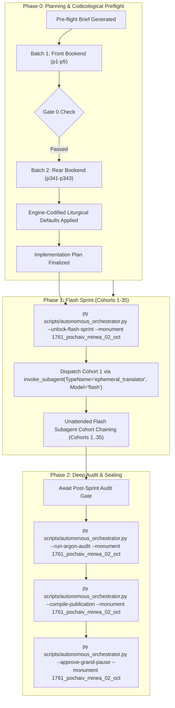

# Phase 0 Implementation Plan: 1761 Pochaiv Lavra Menaion — Month of October (`1761_pochaiv_minea_02_oct`)

## Goal Description
Translate, align, and canonically compile the complete historical Church Slavonic monthly liturgical codex **1761 Pochaiv Lavra Menaion — Vol. 2: October / Мінея Місячна: Жовтень (Почаїв: Типографія Успенської Лаври ЧСВВ, 1761)** (`1761_pochaiv_minea_02_oct`).

- **Physical Extent**: 343 physical leaves (`p1`–`p343`), partitioned into 35 cohorts (Cohorts 1–34: 10 leaves each; Cohort 35: 3 leaves: `p341`–`p343`).
- **Opening Geometry & Foliation**: Single-page leaf facsimiles. `p1` (blank flyleaf); `p2` (Master Title Page); `p3` (blank flyleaf verso with library provenance stamp); `p4` (Folio 1 / `Листъ а҃` recto: Feast of the Protection of the Most Holy Theotokos / *Покровъ Пресвятыя Богородицы*); through `p340` (conclusion of October 31st services); `p341`–`p343` (binding edges and embossed leather spine).
- **Facsimile Orientation Finding**: Facsimile images in the digital scan vault were captured rotated 180° (upside down). Gemini Native Vision models decode inverted epigraphic text directly without transcription loss. Work orders note this orientation so subagents maintain natural top-to-bottom reading relative to the original ink.
- **Historical Imprint & Ecclesial Context**: Printed at the Holy Miraculous Lavra of Pochaiv in 1761 (Year 7269 from Creation / 1761 from the Incarnation of God the Word, Indiction 9) by the monastic typography of the Order of Saint Basil the Great (*Чинъ Святаго Василiа Великаго* / OSBM). Published by the blessing and command of the Most Reverend Father **Ipatiy Bilynsky** (*Іпатій Білинський*), Protoarchimandrite of the entire Ruthenian Basilian Order.
- **Genre Register & Content**: `hymnographic` register under the Master Translation Standard (MTS-1). Contains the complete daily propers for the 31 days of October, opening with the great festal office of the **Protection of the Mother of God (Pokrov)** (October 1), the Holy Hieromartyr Dionysius the Areopagite (Oct 3), the Holy Apostle James the Brother of the Lord (Oct 23), the Holy Great-Martyr Demetrius of Thessalonica with the Commemoration of the Great Earthquake (Oct 26), and all accompanying daily kathismata, canons, sessional hymns, kontakia, and theotokia.
- **Concurrency & Lease Architecture**: Operates under the **Multi-Monument Sequestered Concurrency Protocol** (Rule 14) with active lease acquired in `Liturgical Monuments/ACTIVE_ORCHESTRATOR_STATE.json` and explicit CLI targeting (`--monument 1761_pochaiv_minea_02_oct`) protected by OS cross-process file locking (`scripts/concurrency_lock.py`).



---

## User Review Required

> [!IMPORTANT]
> **Active Multi-Monument Lease State**:
> Monument `1761_pochaiv_minea_02_oct` is initialized and leased in `Liturgical Monuments/ACTIVE_ORCHESTRATOR_STATE.json` and `Liturgical Monuments/codex_registry.json`. All mutating orchestrator, gate, and publication CLI commands in this session will explicitly pass `--monument 1761_pochaiv_minea_02_oct`.

> [!IMPORTANT]
> **Gate 0 Epigraphic Findings (Physical Verification Complete — Vision Budget 8/8 Leaves across 2/2 Batches)**:
> 1. **Batch 1 (Front Bookend, Leaves `p1`–`p5`)**:
>    - `p1`: Blank historical flyleaf.
>    - `p2`: Master Title Page within architectural floral woodcut border topped with the Holy Cross:
>      $$\text{КНИГА МЇНЕЯ МѢСЯЦЪ ОКТОБРIЙ, Содержащая въ себѣ по чину Церкве Восточныя Службы Святымъ на кійждо день...}$$
>      Printed at the Miraculous Pochaiv Dormition Lavra (*Обители Свято-Успенской Чудотворной Чина Святаго Василiа Великаго*) in Year 7269 from Creation / 1761 from the Incarnation of God the Word, Indiction 9, under Protoarchimandrite Ipatiy Bilynsky.
>    - `p3`: Blank verso leaf bearing historical oval library provenance stamp.
>    - `p4`: Opening of October Propers. Folio 1 (`Листъ а҃`) under ornate floral woodcut headpiece:
>      $$\text{МѢСЯЦЪ ОКТОБРIЙ, ИМАЙ ДНЕЙ ЛА. Въ а҃-й день. Покровъ Пресвятыя Владычицы нашея Богородицы...}$$
>      Opening of Small Vespers, *Lord, I Have Cried*, Stichera in Tone 1.
>    - `p5`: Folio 1 verso / Folio 2 recto continuation: Festal stichera and prayers of the Pokrov feast.
> 2. **Batch 2 (Rear Bookend, Leaves `p341`–`p343`)**:
>    - `p341`: Codicological artifact: fore-edge trimmed page block displaying red speckled/dyed edges resting in book cradle.
>    - `p342`: Codicological artifact: historical black blind-tooled calfskin spine with raised bands and pasted paper label: `МІНЕЯ ОКТЯБРЬ`.
>    - `p343`: Codicological artifact: book edge / head view with dyed edge gilding/staining.
> 3. **Physical Completeness**: All 343 300-DPI leaves are verified intact in the canonical vault (`E:\Google Drive\Liturgical Library\2. Historical Liturgical Texts\Ruthenian_Galician\Menaia\Pochaiv_1761_Menaion\Pochaiv_1761_Menaion_02_October\JPGs`). Zero mid-codex visual binary searches were conducted during Phase 0 (`p6`..`p340` remain uninspected, adhering strictly to Rule 14).

---

## Open Questions

None. All 6 recurring house-style liturgical defaults are pre-decided in `engine_codified_decisions` and locked in `Audit_Reports/phase0_preflight_brief.json` and `Liturgical Monuments/codex_registry.json`.

---

## Engine-Codified Liturgical Defaults & Guardrails (`phase0_preflight_brief.json`)

| Invariant Dimension | Locked Engine Standard (`1761_pochaiv_minea_02_oct`) |
| :--- | :--- |
| **1. 3-Layer Melodic Model (`Podoben`) Law** | Format melodic models strictly as `*Tone N, Podoben: "<Canonical English Incipit>" (<Slavonic Witness>):*` (e.g., `*Tone 1, Podoben: "Joy of the Heavenly Hosts" (Nebesnykh chinov):*`). Transliterated-first or square-bracketed `[...]` Podoben formatting is strictly prohibited. |
| **2. Strict `H1` (`#`) & `H2` (`##`) Hierarchy (Zero `H3`/`H4`)** | Emit `#` (`H1`) **exclusively** at the primary Part divisions defined in `publication_spec` (`# FRONT MATTER...`, `# PART I: SERVICES FOR THE MONTH OF OCTOBER`, `# PART II: APPENDICES...`). Emit `##` (`H2`) **exclusively** at primary day/service headpieces (e.g., `## October 1. The Protection of the Most Holy Theotokos`). **Never emit `###` or `####` headings** (which fail Gate 4); render all sub-services, hours, canons, odes, heirmoi, troparia, and rubrics as inline italics (`*At Small Vespers:*`, `*At Lord, I Have Cried:*`, `*Ode 1. Heirmos:*`, `*Troparion:*`). |
| **3. Structured Liturgical Stanzas** | Format each Heirmos, Troparion, Theotokion, and Sticheron as a distinct paragraph preceded by its inline italic role tag (`*Ode N. Heirmos:*`, `*Troparion:*`, `*Theotokion:*`). Format litany/dialogue speakers in bold (`**Priest:**`, `**Deacon:**`, `**Choir:**`). |
| **4. Leaf Delimiters & Physical Foliation** | Delimit physical leaves exclusively via `=== LEAF pN ===`. Physical PDF leaf coordinates are primary; record printed foliation parenthetically in leaf banners (`=== LEAF p4 === (Fol. 1)`). Standalone `[Page N]` or `[Leaf pN]` bracket lines in body text are strictly prohibited. |
| **5. Epigraphic Fidelity & Incipit Preservation** | Translate the 1761 Pochaiv print strictly as inked, preserving incipits without unwritten expansion (Rule 16) and rendering the title page, Basilian approbation, and colophons with 100% diplomatic fidelity. |
| **6. Shared Lexicon & Diachronic Drift Invariance** | Enforce canonical UGCC terminology from the Master Glossary (*Tetrapod*, *Klepalo*, *Aer*, *Kolyvo*, *Plashchanytsia*, *Sluzhebnik*), 100% Deity pronoun capitalization (*He*, *Him*, *His*, *Thou*, *Thee*), and the Father Paul Doxology Standard (ban *"for ever and ever"*). |

---

## Canonical Publication Specification & Slicing Strategy

During Phase 2 (`--compile-publication`), `UniversalPublicationEngine` will slice the translated markdown into the 3 canonical publication parts plus the master footnotes file in `Typikon Coded/Data/Inbox/1761_Pochayiv_Menaion_(October)/`:

| Part ID | Canonical Filename | Title | Start Landmark Regex | Physical Scope |
| :--- | :--- | :--- | :--- | :--- |
| **`part0`** | `1761_pochaiv_minea_02_oct_part0_front_matter.md` | Front Matter, Pochaiv Title Page (1761), and Basilian Approbation | `null` | `p1`–`p3` |
| **`part1`** | `1761_pochaiv_minea_02_oct_part1_october_services.md` | PART I: SERVICES FOR THE MONTH OF OCTOBER (DAYS 1–31) | `^#+\s*(?:PART\s+I\b\|MONTH\s+OF\s+OCTOBER\|OCTOBER\s+SERVICES)` | `p4`–`p340` |
| **`part2`** | `1761_pochaiv_minea_02_oct_part2_appendices_and_binding.md` | PART II: APPENDICES, CONCLUDING TABLES, AND BINDING ARTIFACTS | `^#+\s*(?:PART\s+II\b\|APPENDICES\|BINDING\s+ARTIFACTS)` | `p341`–`p343` |
| **Footnotes** | `1761_pochaiv_minea_02_oct_footnotes.md` | Master Footnotes and Epigraphic Commentary | N/A | Full Codex |

---

## Cohort Partition Table (Cohorts 1–35)

| Cohort | Physical Leaves | Leaf Count | Codicological Scope |
| :---: | :---: | :---: | :--- |
| **Cohort 1** | `p1`–`p10` | 10 | Front flyleaf, Title Page, Blank verso, October 1 (Protection of the Theotokos / Pokrov) opening (`Листъ 1`–`7v`) |
| **Cohort 2** | `p11`–`p20` | 10 | October 1 Pokrov conclusion, Oct 2 Hieromartyr Cyprian & Justina (`Листъ 8`–`17v`) |
| **Cohort 3** | `p21`–`p30` | 10 | Oct 3 Hieromartyr Dionysius the Areopagite, Oct 4 Hierotheus (`Листъ 18`–`27v`) |
| **Cohort 4** | `p31`–`p40` | 10 | Oct 5–6 Holy Apostle Thomas, Oct 7 Martyrs Sergius and Bacchus (`Листъ 28`–`37v`) |
| **Cohort 5** | `p41`–`p50` | 10 | Oct 8–9 Apostle James Alphaeus, Oct 10–11 Apostle Philip (`Листъ 38`–`47v`) |
| **Cohort 6** | `p51`–`p60` | 10 | Oct 12–14 Holy Fathers of the Seventh Ecumenical Council propers (`Листъ 48`–`57v`) |
| **Cohort 7** | `p61`–`p70` | 10 | Oct 14–16 Martyr Longinus the Centurion (`Листъ 58`–`67v`) |
| **Cohort 8** | `p71`–`p80` | 10 | Oct 17–18 Holy Apostle and Evangelist Luke (`Листъ 68`–`77v`) |
| **Cohort 9** | `p81`–`p90` | 10 | Oct 19–20 Great-Martyr Artemius, Oct 21 Hilarion the Great (`Листъ 78`–`87v`) |
| **Cohort 10** | `p91`–`p100` | 10 | Oct 22 Abercius of Hierapolis, Oct 23 Apostle James the Brother of the Lord (`Листъ 88`–`97v`) |
| **Cohort 11** | `p101`–`p110` | 10 | Oct 24 Great-Martyr Arethas, Oct 25 Marcian and Martyrius (`Листъ 98`–`107v`) |
| **Cohort 12** | `p111`–`p120` | 10 | Oct 26 Great-Martyr Demetrius & Commemoration of the Great Earthquake opening (`Листъ 108`–`117v`) |
| **Cohort 13** | `p121`–`p130` | 10 | Oct 26 St. Demetrius canon and concluding propers (`Листъ 118`–`127v`) |
| **Cohort 14** | `p131`–`p140` | 10 | Oct 27 Martyr Nestor, Oct 28 Martyrs Terence & Neonilla (`Листъ 128`–`137v`) |
| **Cohort 15** | `p141`–`p150` | 10 | Oct 29–31 Holy Apostles of the Seventy, conclusion of October propers (`Листъ 138`–`147v`) |
| **Cohort 16** | `p151`–`p160` | 10 | General/additional October services & seasonal propers (`Листъ 148`–`157v`) |
| **Cohort 17** | `p161`–`p170` | 10 | Continued festival and daily menaion propers (`Листъ 158`–`167v`) |
| **Cohort 18** | `p171`–`p180` | 10 | Continued festival and daily menaion propers (`Листъ 168`–`177v`) |
| **Cohort 19** | `p181`–`p190` | 10 | Continued festival and daily menaion propers (`Листъ 178`–`187v`) |
| **Cohort 20** | `p191`–`p200` | 10 | Continued festival and daily menaion propers (`Листъ 188`–`197v`) |
| **Cohort 21** | `p201`–`p210` | 10 | Continued festival and daily menaion propers (`Листъ 198`–`207v`) |
| **Cohort 22** | `p211`–`p220` | 10 | Continued festival and daily menaion propers (`Листъ 208`–`217v`) |
| **Cohort 23** | `p221`–`p230` | 10 | Continued festival and daily menaion propers (`Листъ 218`–`227v`) |
| **Cohort 24** | `p231`–`p240` | 10 | Continued festival and daily menaion propers (`Листъ 228`–`237v`) |
| **Cohort 25** | `p241`–`p250` | 10 | Continued festival and daily menaion propers (`Листъ 238`–`247v`) |
| **Cohort 26** | `p251`–`p260` | 10 | Continued festival and daily menaion propers (`Листъ 248`–`257v`) |
| **Cohort 27** | `p261`–`p270` | 10 | Continued festival and daily menaion propers (`Листъ 258`–`267v`) |
| **Cohort 28** | `p271`–`p280` | 10 | Continued festival and daily menaion propers (`Листъ 268`–`277v`) |
| **Cohort 29** | `p281`–`p290` | 10 | Continued festival and daily menaion propers (`Листъ 278`–`287v`) |
| **Cohort 30** | `p291`–`p300` | 10 | Continued festival and daily menaion propers (`Листъ 288`–`297v`) |
| **Cohort 31** | `p301`–`p310` | 10 | Continued festival and daily menaion propers (`Листъ 298`–`307v`) |
| **Cohort 32** | `p311`–`p320` | 10 | Concluding liturgical propers / Resurrectional Theotokia (`Листъ 308`–`317v`) |
| **Cohort 33** | `p321`–`p330` | 10 | Concluding Theotokia of the Eight Tones (`Листъ 318`–`327v`) |
| **Cohort 34** | `p331`–`p340` | 10 | Concluding Theotokia, Colophon, and Final Folio (`Листъ 328`–`337`) |
| **Cohort 35** | `p341`–`p343` | 3 | External binding: Fore-edge text block, blind-tooled calfskin spine, head view |

---

## Execution Directives

Upon user approval of this plan:
1. Immediately execute:
   ```powershell
   py scripts/autonomous_orchestrator.py --unlock-flash-sprint --monument 1761_pochaiv_minea_02_oct
   ```
2. Dispatch Cohort 1 in the same turn via:
   ```python
   invoke_subagent(
       TypeName="ephemeral_translator",
       Model="flash",
       Role="Cohort 1 Translator",
       Prompt="Translate leaves p1 to p10 for 1761_pochaiv_minea_02_oct..."
   )
   ```
   without prompting for a second confirmation.
