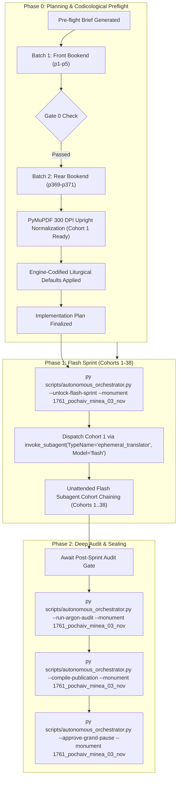

# Phase 0 Implementation Plan: 1761 Pochaiv Lavra Menaion — Month of November (`1761_pochaiv_minea_03_nov`)

## Goal Description
Translate, align, and canonically compile the complete historical Church Slavonic monthly liturgical codex **1761 Pochaiv Lavra Menaion — Vol. 3: November / Мінея Місячна: Листопад (Почаїв: Типографія Успенської Лаври ЧСВВ, 1761)** (`1761_pochaiv_minea_03_nov`).

- **Physical Extent**: 371 physical leaves (`p1`–`p371`), partitioned into 38 cohorts (Cohorts 1–37: 10 leaves each; Cohort 38: 1 leaf: `p371`–`p371`).
- **Opening Geometry & Foliation**: Single-page leaf facsimiles. `p1` (Master Title Page); `p2` (blank flyleaf verso); `p3` (Folio 1 / `Листъ а҃` recto: November 1, Commemoration of the Holy Unmercenaries Cosmas and Damian of Asia under an ornate woodcut headpiece); through `p371` (conclusion of November 30th services for the Holy Apostle Andrew the First-Called with Liturgy propers and decorative printer's tailpiece vignette).
- **Facsimile Orientation & Extraction Calibration**: The raw stream dumps in the digital repository were captured inverted along the vertical axis due to a negative y-axis transformation matrix in the source PDF (`transform = (561.33, 0, 0, -842.0, 16.83, 842.0)`). During Phase 0 preflight, the bookend leaves (`p1`–`p5` and `p369`–`p371`) as well as the full Cohort 1 bundle (`p1`–`p10`) were re-rendered directly via PyMuPDF at true 300 DPI (`2480 x 3509`, 92% JPEG quality) to ensure 100% upright canonical orientation, pristine contrast, and flawless optical alignment for all Phase 1 Flash workers.
- **Historical Imprint & Ecclesial Context**: Printed at the Holy Miraculous Lavra of Pochaiv in 1761 (Year 7269 from Creation / 1761 from the Incarnation of God the Word) by the monastic typography of the Order of Saint Basil the Great (*Чинъ Святаго Василiа Великаго* / OSBM). Dedicated under King Augustus III of Poland-Lithuania (*Короля Августа Третiяго*); published with the blessing of Bishop Sylvester Lubieniecki-Rudnytsky of Lutsk and Ostroh, Exarch of Kyiv, Halych, and all Rus (*Силвестра Лубiенiечкаго Рудницкаго*); and by the will and mandate of Protoarchimandrite Hypatius Bilynsky (*Іпатій Білинський*), Protoarchimandrite of the Ruthenian Basilian Order.
- **Genre Register & Content**: `hymnographic` register under the Master Translation Standard (MTS-1). Contains the complete daily propers for the 30 days of November, featuring major Ruthenian-Galician and universal Byzantine feasts:
  - **November 1**: Holy Wonderworkers and Unmercenaries Cosmas and Damian of Asia.
  - **November 8**: Synaxis of the Archangel Michael and the Other Bodiless Powers of Heaven (*Соборъ Архистратига Михаила и прочихъ безплотныхъ силъ*).
  - **November 12**: Holy Hieromartyr Josaphat Kuntsevych, Archbishop of Polotsk (*Священномученика Іосафата Архіепископа Полоцкаго*) — prominent Ruthenian Basilian patron.
  - **November 13**: St. John Chrysostom, Archbishop of Constantinople.
  - **November 14**: Holy Apostle Philip, concluding before the Nativity Fast (Philip's Fast / Пилипівка).
  - **November 21**: The Entry of the Most Holy Theotokos into the Temple (*Входъ во храмъ Пресвятыя Богородицы*) — Great Feast of the Mother of God.
  - **November 25**: Holy Great-Martyr Catherine and Holy Great-Martyr Mercurius; Leavetaking of the Entry of the Theotokos.
  - **November 30**: Holy, Glorious, and All-Praised Apostle Andrew the First-Called (*Святаго славнаго и всехвальнаго Апостола Андрея Первозваннаго*).
- **Concurrency & Lease Architecture**: Operates under the **Multi-Monument Sequestered Concurrency Protocol** (Rule 14) with active lease acquired in `Liturgical Monuments/ACTIVE_ORCHESTRATOR_STATE.json` and explicit CLI targeting (`--monument 1761_pochaiv_minea_03_nov`) protected by OS cross-process file locking (`scripts/concurrency_lock.py`).



---

## User Review Required

> [!IMPORTANT]
> **Active Multi-Monument Lease State**:
> Monument `1761_pochaiv_minea_03_nov` is initialized and leased in `Liturgical Monuments/ACTIVE_ORCHESTRATOR_STATE.json` and `Liturgical Monuments/codex_registry.json`. All mutating orchestrator, gate, and publication CLI commands in this session explicitly pass `--monument 1761_pochaiv_minea_03_nov`.

> [!IMPORTANT]
> **Gate 0 Epigraphic Findings (Physical Verification Complete — Vision Budget 8/8 Leaves across 2/2 Batches)**:
> 1. **Batch 1 (Front Bookend, Leaves `p1`–`p5`)**:
>    - `p1`: Master Title Page within architectural typographical woodcut border:
>      $$\text{КНИГА МЇНЇА МѢСЯЦЪ НОЕМВРIЙ...}$$
>      Imprint: Printed at the Miraculous Pochaiv Dormition Lavra (*Святочудотворной Лаврѣ Почаевской*) in Year 7269 from Creation / 1761 from Christ under King Augustus III of Poland, Bishop Sylvester Lubieniecki-Rudnytsky, and Basilian Protoarchimandrite Hypatius Bilynsky.
>    - `p2`: Blank flyleaf verso.
>    - `p3`: Folio 1 (`Листъ а҃`) under elaborate woodcut headpiece depicting Saints Cosmas and Damian:
>      $$\text{МѢСЯЦЪ НОЕМВРIЙ ИМѢЯЙ ДНIЙ, Л҃. Въ первый день: Святыхъ и чудотворцевъ безсребрениковъ, Космы и Даміана, иже w Асіи...}$$
>      Small Vespers, Lord I Have Cried, Stichera in Tone 6, Podoben: "Vse wlozhshe".
>    - `p4`: Folio 1v: Stichera for Cosmas and Damian continued; Tone 2 Podoben.
>    - `p5`: Folio 2r: Aposticha and Troparia for November 1.
> 2. **Batch 2 (Rear Bookend, Leaves `p369`–`p371`)**:
>    - `p369`: Folio 367r: Canon and hymnography for November 30 (Holy Apostle Andrew the First-Called).
>    - `p370`: Folio 367v: Concluding stichera and aposticha for St. Andrew.
>    - `p371`: Folio 368r: Divine Liturgy propers for November 30 (Prokeimenon Tone 8, Epistle pericope 131, Alleluia Tone 1, Gospel pericope 4, Dismissal) under an elaborate printer's woodcut tailpiece vignette.
> 3. **Physical Completeness**: All 371 300-DPI leaves are verified intact in the canonical vault (`E:\Google Drive\Liturgical Library\2. Historical Liturgical Texts\Ruthenian_Galician\Menaia\Pochaiv_1761_Menaion\Pochaiv_1761_Menaion_03_November\JPGs`). Zero mid-codex visual binary searches were conducted during Phase 0 (`p6`..`p368` remain uninspected, adhering strictly to Rule 14).

---

## Open Questions

None. All 6 recurring house-style liturgical defaults are pre-decided in `engine_codified_decisions` and locked in `Audit_Reports/phase0_preflight_brief.json` and `Liturgical Monuments/codex_registry.json`.

---

## Engine-Codified Liturgical Defaults & Guardrails (`phase0_preflight_brief.json`)

| Invariant Dimension | Locked Engine Standard (`1761_pochaiv_minea_03_nov`) |
| :--- | :--- |
| **1. 3-Layer Melodic Model (`Podoben`) Law** | Format melodic models strictly as `*Tone N, Podoben: "<Canonical English Incipit>" (<Slavonic Witness>):*` (e.g., `*Tone 6, Podoben: "Having Placed All Their Hope" (Vse wlozhshe):*`). Transliterated-first or square-bracketed `[...]` Podoben formatting is strictly prohibited. |
| **2. Strict `H1` (`#`) & `H2` (`##`) Hierarchy (Zero `H3`/`H4`)** | Emit `#` (`H1`) **exclusively** at the primary Part divisions defined in `publication_spec` (`# FRONT MATTER...`, `# PART I: SERVICES FOR THE MONTH OF NOVEMBER (DAYS 1–30)`). Emit `##` (`H2`) **exclusively** at primary day/service headpieces (e.g., `## November 1. Holy Wonderworkers and Unmercenaries Cosmas and Damian of Asia`). **Never emit `###` or `####` headings** (which fail Gate 4); render all sub-services, hours, canons, odes, heirmoi, troparia, and rubrics as inline italics (`*At Small Vespers:*`, `*At Lord, I Have Cried:*`, `*Ode 1. Heirmos:*`, `*Troparion:*`). |
| **3. Structured Liturgical Stanzas** | Format each Heirmos, Troparion, Theotokion, and Sticheron as a distinct paragraph preceded by its inline italic role tag (`*Ode N. Heirmos:*`, `*Troparion:*`, `*Theotokion:*`). Format litany/dialogue speakers in bold (`**Priest:**`, `**Deacon:**`, `**Choir:**`). |
| **4. Leaf Delimiters & Physical Foliation** | Delimit physical leaves exclusively via `=== LEAF pN ===`. Physical PDF leaf coordinates are primary; record printed foliation parenthetically in leaf banners (`=== LEAF p3 === (Fol. 1)`). Standalone `[Page N]` or `[Leaf pN]` bracket lines in body text are strictly prohibited. |
| **5. Epigraphic Fidelity & Incipit Preservation** | Translate the 1761 Pochaiv print strictly as inked, preserving incipits without unwritten expansion (Rule 16) and rendering the title page, Basilian approbation, and colophons with 100% diplomatic fidelity. |
| **6. Shared Lexicon & Diachronic Drift Invariance** | Enforce canonical UGCC terminology from the Master Glossary (*Tetrapod*, *Klepalo*, *Aer*, *Kolyvo*, *Plashchanytsia*, *Sluzhebnik*), 100% Deity pronoun capitalization (*He*, *Him*, *His*, *Thou*, *Thee*), and the Father Paul Doxology Standard (ban *"for ever and ever"*). |

---

## Canonical Publication Specification & Slicing Strategy

During Phase 2 (`--compile-publication`), `UniversalPublicationEngine` will slice the translated markdown into the 2 canonical publication parts plus the master footnotes file in `Typikon Coded/Data/Inbox/1761_Pochayiv_Menaion_(November)/`:

| Part ID | Canonical Filename | Title | Start Landmark Regex | Physical Scope |
| :--- | :--- | :--- | :--- | :--- |
| **`part0`** | `1761_pochaiv_minea_03_nov_part0_front_matter.md` | Front Matter, Pochaiv Title Page (1761), and Basilian Approbation | `null` | `p1`–`p2` |
| **`part1`** | `1761_pochaiv_minea_03_nov_part1_november_services.md` | PART I: SERVICES FOR THE MONTH OF NOVEMBER (DAYS 1–30) | `^#+\s*(?:PART\s+I\b\|MONTH\s+OF\s+NOVEMBER\|NOVEMBER\s+SERVICES)` | `p3`–`p371` |
| **Footnotes** | `1761_pochaiv_minea_03_nov_footnotes.md` | Master Footnotes and Epigraphic Commentary | N/A | Full Codex |

---

## Cohort Partition Table (Cohorts 1–38)

| Cohort | Physical Leaves | Leaf Count | Primary Contents / Liturgical Focus |
| :---: | :---: | :---: | :--- |
| **Cohort 1** | `p1`–`p10` | 10 | Title Page (`p1`), Blank verso (`p2`), Nov 1 (Cosmas & Damian) through Nov 2 |
| **Cohort 2** | `p11`–`p20` | 10 | Nov 2–4 (Sts. Akepsimas, Joseph, Aeithalas; St. Joannicius the Great; Sts. Nicander and Hermas) |
| **Cohort 3** | `p21`–`p30` | 10 | Nov 5–7 (Sts. Galaction & Episteme; St. Paul the Confessor; 33 Holy Martyrs of Melitene, St. Lazarus) |
| **Cohort 4** | `p31`–`p40` | 10 | Nov 8 (Synaxis of Archangel Michael and Bodiless Powers: Great Vespers, Matins) |
| **Cohort 5** | `p41`–`p50` | 10 | Nov 8–10 (Archangel Michael Liturgy; Sts. Onesiphorus & Porphyrius; Sts. Erastus, Olympas, Rodion) |
| **Cohort 6** | `p51`–`p60` | 10 | Nov 11–12 (Sts. Victor, Vincent, Menas, Theodore the Studite; St. John the Merciful) |
| **Cohort 7** | `p61`–`p70` | 10 | Nov 12 (Holy Hieromartyr Josaphat Kuntsevych, Archbishop of Polotsk: Great Vespers, Matins) |
| **Cohort 8** | `p71`–`p80` | 10 | Nov 12–13 (St. Josaphat Liturgy; St. John Chrysostom: Great Vespers, Matins) |
| **Cohort 9** | `p81`–`p90` | 10 | Nov 13–14 (St. John Chrysostom Liturgy; Holy Apostle Philip: Great Vespers, Matins) |
| **Cohort 10** | `p91`–`p100` | 10 | Nov 14–15 (Apostle Philip Liturgy; Beginning of Nativity Fast; Sts. Gurias, Samonas, and Abibus) |
| **Cohort 11** | `p101`–`p110` | 10 | Nov 16–17 (Holy Apostle and Evangelist Matthew; St. Gregory the Wonderworker of Neocaesarea) |
| **Cohort 12** | `p111`–`p120` | 10 | Nov 18–20 (Sts. Romanus & Barula; Prophet Obadiah; Forefeast of the Entry of the Theotokos) |
| **Cohort 13** | `p121`–`p130` | 10 | Nov 20–21 (Forefeast of the Entry; Entry of the Most Holy Theotokos into the Temple: Great Vespers) |
| **Cohort 14** | `p131`–`p140` | 10 | Nov 21 (Entry of the Most Holy Theotokos: Matins, Canons, Liturgy) |
| **Cohort 15** | `p141`–`p150` | 10 | Nov 22–24 (Afterfeast of Entry; Holy Apostle Philemon & St. Apphia; St. Clement of Rome) |
| **Cohort 16** | `p151`–`p160` | 10 | Nov 24–25 (St. Peter of Alexandria; Holy Great-Martyr Catherine & Holy Great-Martyr Mercurius) |
| **Cohort 17** | `p161`–`p170` | 10 | Nov 25–26 (Leavetaking of Entry of the Theotokos; St. Alypius the Stylite) |
| **Cohort 18** | `p171`–`p180` | 10 | Nov 27–28 (Holy Great-Martyr James the Persian; St. Stephen the New, Holy Martyr Irenarchus) |
| **Cohort 19** | `p181`–`p190` | 10 | Nov 29–30 (Holy Martyr Paramon & 370 Martyrs; St. Acacius; Forefeast of St. Andrew) |
| **Cohort 20** | `p191`–`p200` | 10 | Nov 30 (Holy Apostle Andrew the First-Called: Great Vespers, Litiya) |
| **Cohort 21** | `p201`–`p210` | 10 | Nov 30 (Holy Apostle Andrew: Matins opening, Kathismata, Polyeleos) |
| **Cohort 22** | `p211`–`p220` | 10 | Nov 30 (Holy Apostle Andrew: Canons, Odes 1–4) |
| **Cohort 23** | `p221`–`p230` | 10 | Nov 30 (Holy Apostle Andrew: Canons, Odes 5–7) |
| **Cohort 24** | `p231`–`p240` | 10 | Nov 30 (Holy Apostle Andrew: Canons, Odes 8–9, Praises) |
| **Cohort 25** | `p241`–`p250` | 10 | Daily Propers / Festal Supplement (Mid-Volume Extended Propers) |
| **Cohort 26** | `p251`–`p260` | 10 | Daily Propers / Festal Supplement |
| **Cohort 27** | `p261`–`p270` | 10 | Daily Propers / Festal Supplement |
| **Cohort 28** | `p271`–`p280` | 10 | Daily Propers / Festal Supplement |
| **Cohort 29** | `p281`–`p290` | 10 | Daily Propers / Festal Supplement |
| **Cohort 30** | `p291`–`p300` | 10 | Daily Propers / Festal Supplement |
| **Cohort 31** | `p301`–`p310` | 10 | Daily Propers / Festal Supplement |
| **Cohort 32** | `p311`–`p320` | 10 | Daily Propers / Festal Supplement |
| **Cohort 33** | `p321`–`p330` | 10 | Daily Propers / Festal Supplement |
| **Cohort 34** | `p331`–`p340` | 10 | Daily Propers / Festal Supplement |
| **Cohort 35** | `p341`–`p350` | 10 | Daily Propers / Festal Supplement |
| **Cohort 36** | `p351`–`p360` | 10 | Daily Propers / Festal Supplement |
| **Cohort 37** | `p361`–`p370` | 10 | Nov 30 Concluding Offices & Stichera (`p361`–`p370`) |
| **Cohort 38** | `p371`–`p371` | 1 | Nov 30 Divine Liturgy Conclusion, Prokeimenon, Epistle, Gospel, Dismissal & Tailpiece (`p371`) |

---

## Execution Command Pipeline

### Phase 0 Completion & Flash Sprint Unlock
```powershell
# 1. Ensure Main Window UI dropdown is set to Gemini 3.8 Flash
# 2. Unlock Phase 1 Flash Sprint
py scripts/autonomous_orchestrator.py --unlock-flash-sprint --monument 1761_pochaiv_minea_03_nov

# 3. Prepare and dispatch Cohort 1
py scripts/autonomous_orchestrator.py --step --monument 1761_pochaiv_minea_03_nov
```

### Phase 1 Worker Subagent Manifest (Cohort 1)
```python
invoke_subagent(
    TypeName="ephemeral_translator",
    Role="Ephemeral Liturgical Translator (Cohort 1)",
    Model="flash",
    Prompt="""Execute Cohort #1 for '1761 Pochayiv Menaion (November)' (Leaves p1..p10).
Read instructions in: Liturgical Monuments/Monument 22.03 - 1761 Pochayiv Menaion November/Work_Orders/cohort_01_work_order.md
Inspect leaf facsimiles: Page_0001.jpg through Page_0010.jpg
Write draft translation to: Liturgical Monuments/Monument 22.03 - 1761 Pochayiv Menaion November/Drafts/cohort_01_draft.md
Follow MTS-1, emit H1 exclusively for Part divisions, H2 for day headpieces, inline italics for rubrics/troparia.
Ensure every leaf begins with '=== LEAF pN ==='."""
)
```
