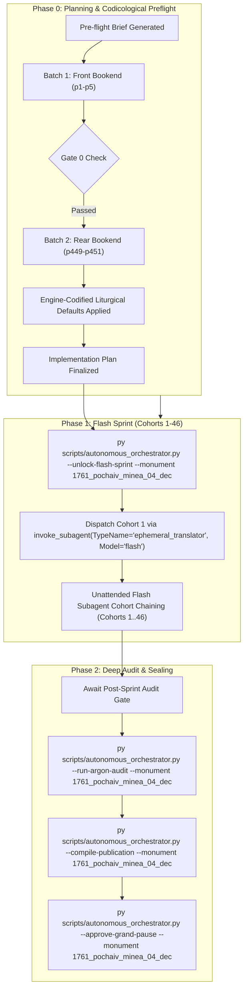

# Phase 0 Implementation Plan: 1761 Pochaiv Lavra Menaion — Month of December (`1761_pochaiv_minea_04_dec`)

## Goal Description
Translate, align, and canonically compile the complete historical Church Slavonic monthly liturgical codex **1761 Pochaiv Lavra Menaion — Vol. 4: December (Книги Минеа Мѣсяцъ Декемврій / Мінея Місячна: Грудень, Почаїв: Типографія Почаївська, 1761)** (`1761_pochaiv_minea_04_dec`).

- **Physical Extent**: 451 physical leaves (`p1`–`p451`), partitioned into 46 cohorts (Cohorts 1–45: 10 leaves each; Cohort 46: 1 leaf: `p451`).
- **Opening Geometry & Scan Orientation**: `1-up` single leaf per image capture (`Page_0001.jpg`–`Page_0451.jpg`). The leaves in this digital facsimile were scanned inverted (rotated 180°); Native Gemini Vision and subagents read and transcribe directly in upright reading order.
- **Internal Foliation & Structure**: Title page is physical leaf `p1` (Folio unnumbered), leaf `p2` is blank (*Vacat*), and the liturgical services for the month of December begin on physical leaf `p3` (Folio 1 recto / `Ли́стъ а҃`). The text covers the complete daily divine offices for December 1 through December 31, including the major Feasts of Saint Nicholas of Myra (Dec 6), the Conception of Saint Anna / Theotokos (Dec 9), the Forefeast and Feast of the Nativity of Christ (Dec 20–25), Synaxis of the Theotokos (Dec 26), and Holy Martyrs/Saints.
- **Historical Imprint & Ecclesial Context**: Printed at the Holy Dormition Lavra of Pochaiv in 1761 by the Basilian Fathers of the Order of Saint Basil the Great (*Ч. С. В. В.*). Published under the archiepiscopal blessing and authorization of His Grace Kyr **Sylvester Lubieniecki-Rudnytsky** (*Киръ Сѵлвестръ Лубенецкій Рудницкій*), Bishop of Lutsk and Ostroh.
- **Genre Register**: `hymnographic` register under the Master Translation Standard (MTS-1).
- **Concurrency & Lease Architecture**: Operates under the **Multi-Monument Sequestered Concurrency Protocol** (Rule 14) with active lease confirmed in `Liturgical Monuments/ACTIVE_ORCHESTRATOR_STATE.json` and explicit CLI targeting (`--monument 1761_pochaiv_minea_04_dec`).

---

## User Review Required

> [!IMPORTANT]
> **Active Multi-Monument Lease State**:
> Monument `1761_pochaiv_minea_04_dec` holds an active lease in `Liturgical Monuments/ACTIVE_ORCHESTRATOR_STATE.json`. All mutating orchestrator, gate, and publication CLI commands in this session explicitly pass `--monument 1761_pochaiv_minea_04_dec`.

> [!IMPORTANT]
> **Gate 0 Epigraphic Findings (Physical Verification Complete — Vision Budget 8/8 Leaves across 2/2 Batches)**:
> 1. **Batch 1 (Front Bookend, Leaves `p1`–`p5`)**:
>    - `p1`: Title page printed in two colors (red and black) within an ornate typographical frame:
>      $$\text{КНИГИ МИНЕА МЕСЯЦЪ ДЕКЕМВРИЙ...}$$
>      Printed at the Pochaiv Lavra (*въ ставропигіи Почаевской*) in 1761, blessed by Kyr Sylvester Rudnytsky, Bishop of Lutsk and Ostroh.
>    - `p2`: Blank leaf (*Vacat*).
>    - `p3`: Liturgical headpiece and opening of December 1, Folio 1 recto (`Ли́стъ а҃`):
>      $$\text{МЕСЯЦЪ ДЕКЕМВРИЙ, имѣяй дней л҃а [31]. Въ а҃-й день. Святаго пророка Наума...}$$
>      Vespers stichera on *Lord, I Have Cried* (Tone 8, Podoben: "О преславнаго чудесе").
>    - `p4`: Folio 1 verso: December 1 continuation (Matins Canon to the Prophet Nahum).
>    - `p5`: Folio 2 recto (`Ли́стъ в҃`): December 1 conclusion and December 2 opening (Prophet Habakkuk).
> 2. **Batch 2 (Rear Bookend, Leaves `p449`–`p451`)**:
>    - `p449`: External book block lower edges.
>    - `p450`: Historical bound leather spine.
>    - `p451`: External rear cover board.
> 3. **Physical Completeness**: All 451 300-DPI leaves verified intact in the canonical vault (`E:\Google Drive\Liturgical Library\2. Historical Liturgical Texts\Ruthenian_Galician\Menaia\Pochaiv_1761_Menaion\Pochaiv_1761_Menaion_04_December\JPGs`). Zero mid-codex visual binary searches conducted during Phase 0 (`p6`..`p448` remain uninspected per Rule 14).

---

## Open Questions

None. All 6 recurring house-style liturgical defaults are pre-decided in `engine_codified_decisions` and locked in `Audit_Reports/phase0_preflight_brief.json` and `Liturgical Monuments/codex_registry.json`.

---

## Engine-Codified Liturgical Defaults & Guardrails (`phase0_preflight_brief.json`)

| Invariant Dimension | Locked Engine Standard (`1761_pochaiv_minea_04_dec`) |
| :--- | :--- |
| **1. 3-Layer Melodic Model (`Podoben`) Law** | Format melodic models strictly as `*Tone N, Podoben: "<Canonical English Incipit>" (<Slavonic Witness>):*` (e.g., `*Tone 8, Podoben: "O Marvelous Wonder" (O preslavnaho chudese):*`). Never use transliterated-first or square-bracketed `[...]` Podoben formatting. |
| **2. Strict `H1` (`#`) & `H2` (`##`) Hierarchy (Zero `H3`/`H4`)** | Emit `#` (`H1`) **exclusively** at primary Part divisions defined in `publication_spec` (`# FRONT MATTER...`, `# PART I: LITURGICAL OFFICES FOR THE MONTH OF DECEMBER`). Emit `##` (`H2`) **exclusively** at primary daily calendar headpieces (e.g. `## December 1: Holy Prophet Nahum`, `## December 6: Our Father among the Saints Nicholas of Myra`). **Never emit `###` or `####` headings**; render all sub-services, hours, canons, odes, heirmoi, troparia, and rubrics as inline italics (`*At Vespers:*`, `*Ode 1. Heirmos:*`, `*Troparion:*`). |
| **3. Structured Liturgical Stanzas** | Format each Heirmos, Troparion, Theotokion, and Sticheron as a distinct paragraph preceded by its inline italic role tag (`*Ode N. Heirmos:*`, `*Troparion:*`, `*Theotokion:*`). Format litany/dialogue speakers in bold (`**Priest:**`, `**Deacon:**`, `**Choir:**`). |
| **4. Leaf Delimiters & Physical Orientation** | Source images are scanned rotated 180°; transcribe in upright reading order. Delimit physical leaves exclusively via `=== LEAF pN ===`. Inside the leaf block, blank leaves must be rendered strictly as `*(Vacat — Blank page)*`. Never emit standalone `[Page N]` or `[Leaf pN]` bracket lines in body text. |
| **5. Epigraphic Fidelity & Incipit Preservation** | Translate the 1761 Pochaiv print strictly as inked, preserving incipits without unwritten expansion (Rule 16) and noting recensional variants in footnotes `[^N]`. |
| **6. Shared Lexicon & Diachronic Drift Invariance** | Enforce canonical UGCC terminology from the Master Glossary (*Tetrapod*, *Klepalo*, *Aer*, *Kolyvo*, *Plashchanytsia*, *Sluzhebnik*), 100% Deity pronoun capitalization (*He*, *Him*, *His*, *Thou*, *Thee*), and the Father Paul Doxology Standard (ban *"for ever and ever"*). |

---

## Canonical Publication Specification & Slicing Strategy

During Phase 2 (`--compile-publication`), `UniversalPublicationEngine` will compile the translated markdown into canonical publication parts plus the master footnotes file in `Typikon Coded/Data/Inbox/1761_Pochayiv_Menaion_(December)/`:

| Part ID | Canonical Filename | Title | Start Landmark Regex | Physical Scope |
| :--- | :--- | :--- | :--- | :--- |
| **`part0`** | `1761_pochaiv_minea_04_dec_part0_front_matter.md` | Front Matter, Title Page (1761), and Introductory Apparatus | `null` | `p1`–`p2` |
| **`part1`** | `1761_pochaiv_minea_04_dec_part1_december_services.md` | PART I: LITURGICAL OFFICES FOR THE MONTH OF DECEMBER | `^#+\s*(?:PART\s+I\b\|MONTH\s+OF\s+DECEMBER\|DECEMBER\s+SERVICES)` | `p3`–`p451` |
| **Footnotes** | `1761_pochaiv_minea_04_dec_footnotes.md` | Master Footnotes and Epigraphic Commentary | N/A | Full Codex |

---

## Cohort Partition Table (Cohorts 1–46)

| Cohort | Physical Leaves | Leaf Count | Codicological Scope |
| :---: | :---: | :---: | :--- |
| **Cohort 1** | `p1`–`p10` | 10 | Title page (`p1`), Vacat (`p2`), Dec 1 (St. Nahum, `p3`–`p5`), Dec 2 (St. Habakkuk, `p5`–`p7`), Dec 3 (St. Zephaniah, `p7`–`p9`), Dec 4 beg. (St. Barbara & St. John of Damascus, `p9`–`p10`) |
| **Cohort 2** | `p11`–`p20` | 10 | Dec 4 cont. (Great Vespers, Matins Canon), Dec 5 (St. Sabbas the Sanctified) |
| **Cohort 3** | `p21`–`p30` | 10 | Dec 5 cont., Dec 6 (St. Nicholas the Wonderworker of Myra) |
| **Cohort 4** | `p31`–`p40` | 10 | Dec 6 cont., Dec 7 (St. Ambrose of Milan), Dec 8 (St. Patapius) |
| **Cohort 5** | `p41`–`p50` | 10 | Dec 9 (Conception of the Holy Theotokos by St. Anna) |
| **Cohort 6** | `p51`–`p60` | 10 | Dec 10 (Sts. Menas, Hermogenes, Eugraphus), Dec 11 (St. Daniel the Stylite) |
| **Cohort 7** | `p61`–`p70` | 10 | Dec 12 (St. Spyridon of Trimythous), Dec 13 (Sts. Eustratius, Auxentius, Eugenius, Mardarius, Orestes, St. Lucia) |
| **Cohort 8** | `p71`–`p80` | 10 | Dec 13 cont., Dec 14 (Sts. Thyrsus, Leucius, Callinicus, Philemon, Apollonius, Arianus) |
| **Cohort 9** | `p81`–`p90` | 10 | Dec 15 (St. Eleutherius, St. Stephen the Confessor), Dec 16 (St. Haggai the Prophet) |
| **Cohort 10** | `p91`–`p100` | 10 | Dec 17 (St. Daniel the Prophet and Three Holy Youths) |
| **Cohort 11** | `p101`–`p110` | 10 | Dec 17 cont., Dec 18 (St. Sebastian and Companions), Dec 19 (St. Boniface) |
| **Cohort 12** | `p111`–`p120` | 10 | Dec 20 (Forefeast of the Nativity, St. Ignatius the God-Bearer) |
| **Cohort 13** | `p121`–`p130` | 10 | Dec 20 cont., Dec 21 (Forefeast, St. Juliana) |
| **Cohort 14** | `p131`–`p140` | 10 | Dec 22 (Forefeast, St. Anastasia), Dec 23 (Forefeast, Ten Holy Martyrs of Crete) |
| **Cohort 15** | `p141`–`p150` | 10 | Dec 24 (Eve of the Nativity, Royal Hours: First, Third, Sixth, Ninth Hours) |
| **Cohort 16** | `p151`–`p160` | 10 | Dec 24 cont. (Royal Hours Typika, Great Vespers with Liturgy of St. Basil) |
| **Cohort 17** | `p161`–`p170` | 10 | Dec 25 (The Nativity of our Lord and God and Savior Jesus Christ — Great Compline, Matins) |
| **Cohort 18** | `p171`–`p180` | 10 | Dec 25 cont. (Nativity Canons of St. Cosmas and St. John of Damascus) |
| **Cohort 19** | `p181`–`p190` | 10 | Dec 26 (Synaxis of the Most Holy Theotokos, St. Euthymius of Sardis) |
| **Cohort 20** | `p191`–`p200` | 10 | Dec 27 (Holy Protomartyr and Archdeacon Stephen, St. Theodore the Branded) |
| **Cohort 21** | `p201`–`p210` | 10 | Dec 28 (Holy Twenty Thousand Martyrs of Nicomedia) |
| **Cohort 22** | `p211`–`p220` | 10 | Dec 29 (Holy Fourteen Thousand Infants Slain by Herod) |
| **Cohort 23** | `p221`–`p230` | 10 | Dec 30 (Holy Martyr Anysia, St. Zoticus), Dec 31 (Leave-taking of Nativity, St. Melania) |
| **Cohort 24** | `p231`–`p240` | 10 | Sunday of Holy Ancestors / Forefathers (Services and Canons) |
| **Cohort 25** | `p241`–`p250` | 10 | Sunday before Nativity (Holy Fathers) Offices |
| **Cohort 26** | `p251`–`p260` | 10 | Sunday after Nativity (Holy Relatives of the Lord: David, Joseph, James) |
| **Cohort 27** | `p261`–`p270` | 10 | Additional Festal Offices / Festal Stichera & Canons |
| **Cohort 28** | `p271`–`p280` | 10 | Additional Festal Offices cont. |
| **Cohort 29** | `p281`–`p290` | 10 | December Supplemental Hymnography |
| **Cohort 30** | `p291`–`p300` | 10 | December Supplemental Hymnography cont. |
| **Cohort 31** | `p301`–`p310` | 10 | Supplemental Festal Offices |
| **Cohort 32** | `p311`–`p320` | 10 | Supplemental Festal Offices cont. |
| **Cohort 33** | `p321`–`p330` | 10 | Supplemental Festal Offices cont. |
| **Cohort 34** | `p331`–`p340` | 10 | Supplemental Festal Offices cont. |
| **Cohort 35** | `p341`–`p350` | 10 | Common Theotokia of the Menaion |
| **Cohort 36** | `p351`–`p360` | 10 | Common Theotokia & Dismissal Hymns |
| **Cohort 37** | `p361`–`p370` | 10 | Concluding Dismissal Theotokia across the 8 Tones |
| **Cohort 38** | `p371`–`p380` | 10 | Concluding Dismissal Theotokia cont. |
| **Cohort 39** | `p381`–`p390` | 10 | Concluding Dismissal Theotokia cont. |
| **Cohort 40** | `p391`–`p400` | 10 | Paschal & Calendar Tables / Typikon Rubrics |
| **Cohort 41** | `p401`–`p410` | 10 | Typikon Rubrics for December Feasts and Forefeasts |
| **Cohort 42** | `p411`–`p420` | 10 | Typikon Rubrics cont. |
| **Cohort 43** | `p421`–`p430` | 10 | Typikon Rubrics and Calendar Appendices |
| **Cohort 44** | `p431`–`p440` | 10 | Concluding Appendices and Colophon |
| **Cohort 45** | `p441`–`p450` | 10 | End flyleaves, book block edges (`p449`), leather spine (`p450`) |
| **Cohort 46** | `p451`–`p451` | 1 | Rear external binding board (`p451`) |

---

## Execution Directives

1. **Phase 0 Review Stop**: This plan stops here for human operator review and confirmation.
2. **Phase 1 Flash Sprint Transition**: Upon human operator approval:
   - Run `py scripts/autonomous_orchestrator.py --unlock-flash-sprint --monument 1761_pochaiv_minea_04_dec`
   - Immediately dispatch Cohort 1 via `invoke_subagent(TypeName="ephemeral_translator", Model="flash")` in the same turn without asking for a second confirmation.
