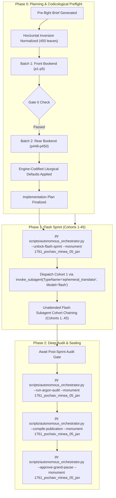

# Phase 0 Implementation Plan: 1761 Pochayiv Lavra Menaion — Vol. 5: January (`1761_pochaiv_minea_05_jan`)

## Goal Description
Translate, align, and canonically compile the complete historical Church Slavonic monthly liturgical codex **1761 Pochayiv Lavra Menaion — Vol. 5: January (Книга Минiа М[ѣся]цъ Іаннуарiй / Мінея Місячна: Січень, Почаїв: Типографія Почаївська, 1761)** (`1761_pochaiv_minea_05_jan`).

- **Physical Extent**: 450 physical leaves (`p1`–`p450`), partitioned into exactly 45 cohorts of 10 leaves each (Cohorts 1–45).
- **Opening Geometry & Scan Normalization**: `1-up` single leaf per image capture (`Page_0001.jpg`–`Page_0450.jpg`). The raw digital facsimile scans in this volume were captured with horizontal mirror inversion (`FLIP_LEFT_RIGHT`); all 450 leaves have been normalized in place in `Source Text/images/` so that Native Gemini Vision and subagents read and transcribe directly in upright, unmirrored reading order.
- **Internal Foliation & Structure**: Title page is physical leaf `p1` (Folio unnumbered), leaf `p2` is blank (*Vacat*). The liturgical services begin on physical leaf `p5` (Folio 1 recto / `Ли́стъ а҃`) with the Circumcision of Our Lord Jesus Christ and the Feast of Saint Basil the Great. The volume spans the complete daily divine offices for January 1 through January 31, including the Forefeast and Feast of the Theophany of Our Lord (Jan 2–6), Synaxis of St. John the Forerunner (Jan 7), Saints Anthony the Great (Jan 17), Athanasius and Cyril of Alexandria (Jan 18), Euthymius the Great (Jan 20), Gregory the Theologian (Jan 25), John Chrysostom (Jan 27), and the Three Holy Hierarchs: Basil the Great, Gregory the Theologian, and John Chrysostom (Jan 30), concluding on January 31 (`p450` / Folio 224 verso) with the Holy Unmercenaries Cyrus and John and the final Liturgy rubrics.
- **Historical Imprint & Ecclesial Context**: Printed at the Holy Dormition Lavra of Pochayiv in 1761 by the Basilian Fathers of the Order of Saint Basil the Great (*Ч. С. В. В.*) during the reign of King Augustus III of Poland (*Король Аугустъ Третiй*). Published under the archiepiscopal blessing of Kyr **Sylvester Lubieniecki-Rudnytsky** (*Киръ Сiлвестръ Любенiецкiй Рудницкiй*), Bishop of Lutsk and Ostroh and Exarch of the Metropolia of Kyiv, Galicia, and All Rus', with the authorization of Protoarchimandrite Father **Hypatius Bilyansky** (*Ипатiй Бѣленскiй*), OSBM.
- **Genre Register**: `hymnographic` register under the Master Translation Standard (MTS-1).
- **Concurrency & Lease Architecture**: Operates under the **Multi-Monument Sequestered Concurrency Protocol** (Rule 14) with active lease confirmed in `Liturgical Monuments/ACTIVE_ORCHESTRATOR_STATE.json` and explicit CLI targeting (`--monument 1761_pochaiv_minea_05_jan`).

---

## User Review Required

> [!IMPORTANT]
> **Active Multi-Monument Lease State**:
> Monument `1761_pochaiv_minea_05_jan` holds an active lease in `Liturgical Monuments/ACTIVE_ORCHESTRATOR_STATE.json`. All mutating orchestrator, gate, and publication CLI commands in this session explicitly pass `--monument 1761_pochaiv_minea_05_jan`.

> [!IMPORTANT]
> **Gate 0 Epigraphic Findings (Physical Verification Complete — Vision Budget 8/8 Leaves across 2/2 Batches)**:
> 1. **Batch 1 (Front Bookend, Leaves `p1`–`p5`)**:
>    - `p1`: Title page printed in two colors (red and black) within an ornate typographical frame:
>      $$\text{КНИГА МИНIА М[ѢСЯ]ЦЪ ІАННУАРIЙ...}$$
>      Printed at the Pochayiv Lavra in 1761 (Anno Mundi 7269 / Anno Domini 1761) under King Augustus III, blessed by Kyr Sylvester Lubieniecki-Rudnytsky, Bishop of Lutsk and Ostroh, and Protoarchimandrite Hypatius Bilyansky, OSBM.
>    - `p2`: Blank leaf (*Vacat*).
>    - `p3`–`p4`: Opening liturgical pericopes and canons.
>    - `p5`: Liturgical headpiece and opening of January 1, Folio 1 recto (`Ли́стъ а҃`):
>      $$\text{МѢСЯЦЪ ІАННУАРIЙ, имѣяй дней ла҃ [31]. Въ первый день, еже по плоти Обрѣзанiе Господа нашего Исуса Христа: И память... Василiя Великаго...}$$
>      Small Vespers stichera on *Lord, I Have Cried* (Tone 3, Idiomelon: "Христа вселивъ в душу твою...").
> 2. **Batch 2 (Rear Bookend, Leaves `p448`–`p450`)**:
>    - `p448`: January 31 service continuation (Canon to the Holy Unmercenaries Cyrus and John, Odes 7 and 8).
>    - `p449`: Folio 224 recto (`Листъ ск҃д`): January 31 Ode 9, Exapostilarion (*Tone 2, Podoben: "Небо звѣздами"*), Aposticha, and Glory.
>    - `p450`: Folio 224 verso: January 31 Divine Liturgy rubrics (Prokimenon Tone 4, Epistle to the Corinthians §153, Alleluia Tone 2, Gospel of Matthew §34, and Communion Hymn), concluding with an ornate baroque tailpiece vignette featuring the IHS Christogram medallion.
> 3. **Physical Completeness**: All 450 300-DPI leaves verified intact in the canonical vault (`E:\Google Drive\Liturgical Library\2. Historical Liturgical Texts\Ruthenian_Galician\Menaia\Pochaiv_1761_Menaion\Pochaiv_1761_Menaion_05_January\JPGs`). Zero mid-codex visual binary searches conducted during Phase 0 (`p6`..`p447` remain uninspected per Rule 14).

---

## Open Questions

None. All 6 recurring house-style liturgical defaults are pre-decided in `engine_codified_decisions` and locked in `Audit_Reports/phase0_preflight_brief.json` and `Liturgical Monuments/codex_registry.json`.

---

## Engine-Codified Liturgical Defaults & Guardrails (`phase0_preflight_brief.json`)

| Invariant Dimension | Locked Engine Standard (`1761_pochaiv_minea_05_jan`) |
| :--- | :--- |
| **1. 3-Layer Melodic Model (`Podoben`) Law** | Format melodic models strictly as `*Tone N, Podoben: "<Canonical English Incipit>" (<Slavonic Witness>):*` (e.g., `*Tone 2, Podoben: "Having Looked Down from on High" (Izhe svyshe zvannyi):*` or `*Tone 2, Podoben: "The Firmament of the Stars" (Nebo zvezdami):*`). Never use transliterated-first or square-bracketed `[...]` Podoben formatting. |
| **2. Strict `H1` (`#`) & `H2` (`##`) Hierarchy (Zero `H3`/`H4`)** | Emit `#` (`H1`) **exclusively** at primary Part divisions defined in `publication_spec` (`# FRONT MATTER...`, `# PART I: LITURGICAL OFFICES FOR THE MONTH OF JANUARY`). Emit `##` (`H2`) **exclusively** at primary daily calendar headpieces (e.g. `## January 1: Circumcision of Christ and Saint Basil the Great`, `## January 6: The Holy Theophany of Our Lord`). **Never emit `###` or `####` headings**; render all sub-services, hours, canons, odes, heirmoi, troparia, and rubrics as inline italics (`*At Small Vespers:*`, `*Ode 1. Heirmos:*`, `*Troparion:*`). |
| **3. Structured Liturgical Stanzas** | Format each Heirmos, Troparion, Theotokion, and Sticheron as a distinct paragraph preceded by its inline italic role tag (`*Ode N. Heirmos:*`, `*Troparion:*`, `*Theotokion:*`). Format litany/dialogue speakers in bold (`**Priest:**`, `**Deacon:**`, `**Choir:**`). |
| **4. Leaf Delimiters & Physical Orientation** | All leaves normalized in place; transcribe in upright reading order. Delimit physical leaves exclusively via `=== LEAF pN ===`. Inside the leaf block, blank leaves must be rendered strictly as `*(Vacat — Blank page)*`. Never emit standalone `[Page N]` or `[Leaf pN]` bracket lines in body text. |
| **5. Epigraphic Fidelity & Incipit Preservation** | Translate the 1761 Pochayiv print strictly as inked, preserving incipits without unwritten expansion (Rule 16) and noting recensional variants in footnotes `[^N]`. |
| **6. Shared Lexicon & Diachronic Drift Invariance** | Enforce canonical UGCC terminology from the Master Glossary (*Tetrapod*, *Klepalo*, *Aer*, *Kolyvo*, *Plashchanytsia*, *Sluzhebnik*), 100% Deity pronoun capitalization (*He*, *Him*, *His*, *Thou*, *Thee*), and the Father Paul Doxology Standard (ban *"for ever and ever"*). |

---

## Canonical Publication Specification & Slicing Strategy

During Phase 2 (`--compile-publication`), `UniversalPublicationEngine` will compile the translated markdown into canonical publication parts plus the master footnotes file in `Typikon Coded/Data/Inbox/1761_Pochayiv_Menaion_(January)/`:

| Part ID | Canonical Filename | Title | Start Landmark Regex | Physical Scope |
| :--- | :--- | :--- | :--- | :--- |
| **`part0`** | `1761_pochaiv_minea_05_jan_part0_front_matter.md` | Front Matter, Title Page (1761), and Introductory Apparatus | `null` | `p1`–`p2` |
| **`part1`** | `1761_pochaiv_minea_05_jan_part1_january_services.md` | PART I: LITURGICAL OFFICES FOR THE MONTH OF JANUARY | `^#+\s*(?:PART\s+I\b\|MONTH\s+OF\s+JANUARY\|JANUARY\s+SERVICES)` | `p3`–`p450` |
| **Footnotes** | `1761_pochaiv_minea_05_jan_footnotes.md` | Master Footnotes and Epigraphic Commentary | N/A | Full Codex |

---

## Cohort Partition Table (Cohorts 1–45)

| Cohort | Physical Leaves | Leaf Count | Codicological Scope |
| :---: | :---: | :---: | :--- |
| **Cohort 1** | `p1`–`p10` | 10 | Title page (`p1`), Vacat (`p2`), Introductory pericopes (`p3`–`p4`), Jan 1: Circumcision of Christ and St. Basil the Great (`p5`–`p10`) |
| **Cohort 2** | `p11`–`p20` | 10 | Jan 1 cont. (Matins Canons, Liturgy), Jan 2 (Forefeast of Theophany, St. Sylvester of Rome) |
| **Cohort 3** | `p21`–`p30` | 10 | Jan 2 cont., Jan 3 (Forefeast, Prophet Malachi, Martyr Gordius) |
| **Cohort 4** | `p31`–`p40` | 10 | Jan 3 cont., Jan 4 (Synaxis of the 70 Apostles, St. Theoctistus) |
| **Cohort 5** | `p41`–`p50` | 10 | Jan 5 (Eve of Theophany, Royal Hours: First, Third, Sixth, Ninth Hours, Typika, Great Vespers) |
| **Cohort 6** | `p51`–`p60` | 10 | Jan 5 cont. (Great Blessing of Water), Jan 6 (The Holy Theophany of Our Lord and God and Savior Jesus Christ — Great Compline, Matins) |
| **Cohort 7** | `p61`–`p70` | 10 | Jan 6 cont. (Theophany Canons of St. Cosmas and St. John of Damascus, Liturgy) |
| **Cohort 8** | `p71`–`p80` | 10 | Jan 7 (Synaxis of the Holy Glorious Prophet, Forerunner and Baptist John) |
| **Cohort 9** | `p81`–`p90` | 10 | Jan 8 (Afterfeast of Theophany, St. George the Chozebite, St. Domnica), Jan 9 (St. Polyeuctus) |
| **Cohort 10** | `p91`–`p100` | 10 | Jan 10 (St. Gregory of Nyssa, St. Dometian of Melitene, St. Marcian) |
| **Cohort 11** | `p101`–`p110` | 10 | Jan 11 (St. Theodosius the Cenobiarch) |
| **Cohort 12** | `p111`–`p120` | 10 | Jan 12 (St. Tatiana, St. Savva of Serbia), Jan 13 (Martyrs Hermylus and Stratonicus) |
| **Cohort 13** | `p121`–`p130` | 10 | Jan 14 (Leave-taking of Theophany, Holy Fathers Slain at Sinai and Raithu) |
| **Cohort 14** | `p131`–`p140` | 10 | Jan 15 (St. Paul of Thebes and St. John the Hut-Dweller), Jan 16 (Veneration of the Precious Chains of the Apostle Peter) |
| **Cohort 15** | `p141`–`p150` | 10 | Jan 17 (Our Holy and God-Bearing Father Anthony the Great) |
| **Cohort 16** | `p151`–`p160` | 10 | Jan 17 cont., Jan 18 (Our Holy Fathers Athanasius and Cyril, Archbishops of Alexandria) |
| **Cohort 17** | `p161`–`p170` | 10 | Jan 18 cont., Jan 19 (St. Macarius of Egypt and St. Macarius of Alexandria) |
| **Cohort 18** | `p171`–`p180` | 10 | Jan 20 (Our Holy and God-Bearing Father Euthymius the Great) |
| **Cohort 19** | `p181`–`p190` | 10 | Jan 20 cont., Jan 21 (St. Maximus the Confessor, Holy Martyr Neophytus) |
| **Cohort 20** | `p191`–`p200` | 10 | Jan 22 (Holy Apostle Timothy, Holy Martyr Anastasius the Persian) |
| **Cohort 21** | `p201`–`p210` | 10 | Jan 23 (Hieromartyr Clement of Ancyra, Martyr Agathangelus), Jan 24 (St. Xenia of Rome) |
| **Cohort 22** | `p211`–`p220` | 10 | Jan 25 (Our Father among the Saints Gregory the Theologian, Archbishop of Constantinople) |
| **Cohort 23** | `p221`–`p230` | 10 | Jan 25 cont., Jan 26 (St. Xenophon and Companions) |
| **Cohort 24** | `p231`–`p240` | 10 | Jan 27 (Translation of the Relics of Saint John Chrysostom) |
| **Cohort 25** | `p241`–`p250` | 10 | Jan 27 cont., Jan 28 (St. Ephrem the Syrian) |
| **Cohort 26** | `p251`–`p260` | 10 | Jan 29 (Translation of the Relics of the Hieromartyr Ignatius the God-Bearer) |
| **Cohort 27** | `p261`–`p270` | 10 | Jan 30 (Synaxis of the Three Holy Hierarchs: Basil the Great, Gregory the Theologian, and John Chrysostom) |
| **Cohort 28** | `p271`–`p280` | 10 | Jan 30 cont. (Three Holy Hierarchs Great Vespers and Matins) |
| **Cohort 29** | `p281`–`p290` | 10 | Jan 30 cont. (Canons and Liturgy), Jan 31 (Holy Unmercenary Wonderworkers Cyrus and John) |
| **Cohort 30** | `p291`–`p300` | 10 | January Supplemental Services & Forefeast/Afterfeast Hymnography |
| **Cohort 31** | `p301`–`p310` | 10 | Supplemental Festal Offices |
| **Cohort 32** | `p311`–`p320` | 10 | Supplemental Festal Offices cont. |
| **Cohort 33** | `p321`–`p330` | 10 | Supplemental Festal Offices cont. |
| **Cohort 34** | `p331`–`p340` | 10 | Supplemental Festal Offices cont. |
| **Cohort 35** | `p341`–`p350` | 10 | Common Theotokia of the Menaion |
| **Cohort 36** | `p351`–`p360` | 10 | Common Theotokia & Dismissal Hymns |
| **Cohort 37** | `p361`–`p370` | 10 | Concluding Dismissal Theotokia across the 8 Tones |
| **Cohort 38** | `p371`–`p380` | 10 | Concluding Dismissal Theotokia cont. |
| **Cohort 39** | `p381`–`p390` | 10 | Concluding Dismissal Theotokia cont. |
| **Cohort 40** | `p391`–`p400` | 10 | Paschal & Calendar Tables / Typikon Rubrics |
| **Cohort 41** | `p401`–`p410` | 10 | Typikon Rubrics for January Feasts and Theophany |
| **Cohort 42** | `p411`–`p420` | 10 | Typikon Rubrics cont. |
| **Cohort 43** | `p421`–`p430` | 10 | Typikon Rubrics and Calendar Appendices |
| **Cohort 44** | `p431`–`p440` | 10 | Concluding Appendices and Typikon Indices |
| **Cohort 45** | `p441`–`p450` | 10 | January 31 concluding Liturgy rubrics, colophon, and baroque tailpiece (`p450`) |

---

## Execution Directives

1. **Phase 0 Review Stop**: This plan stops here for human operator review and confirmation.
2. **Phase 1 Flash Sprint Transition**: Upon human operator approval:
   - Run `py scripts/autonomous_orchestrator.py --unlock-flash-sprint --monument 1761_pochaiv_minea_05_jan`
   - Immediately dispatch Cohort 1 via `invoke_subagent(TypeName="ephemeral_translator", Model="flash")` in the same turn without asking for a second confirmation.
