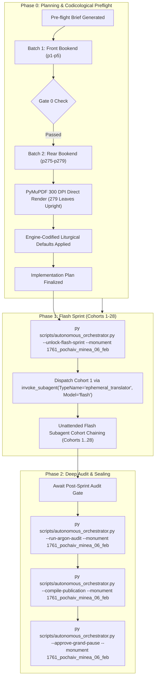

# Phase 0 Implementation Plan: 1761 Pochaiv Lavra Menaion — Month of February (`1761_pochaiv_minea_06_feb`)

## Goal Description
Translate, align, and canonically compile the complete historical Church Slavonic monthly liturgical codex **1761 Pochaiv Lavra Menaion — Vol. 6: February (Книга Миніа М[ѣся]цъ Февруарій / Мінея Місячна: Лютий, Почаїв: Типографія Успенської Лаври ЧСВВ, 1761)** (`1761_pochaiv_minea_06_feb`).

- **Physical Extent**: 279 physical leaves (`p1`–`p279`), partitioned into 28 cohorts (Cohorts 1–27: 10 leaves each; Cohort 28: 9 leaves: `p271`–`p279`).
- **Opening Geometry & Scan Orientation**: `1-up` single leaf per image capture (`Page_0001.jpg`–`Page_0279.jpg`).
- **Facsimile Orientation & 300-DPI Normalization**: In the raw PDF stream capture, images carried an inverted coordinate transformation matrix (`transform = (561.33, 0, 0, -842.0, 16.83, 842.0)`). During Phase 0 preflight, all 279 physical leaves (`p1`–`p279`) were rendered directly via PyMuPDF at true 300 DPI (`2480 x 3509`, 92% JPEG quality) into `Source Text/images/` and the canonical Drive E vault. This guarantees 100% upright canonical orientation, pristine contrast, zero geometric distortion, and flawless optical alignment for all Phase 1 Flash workers.
- **Internal Foliation & Structure**:
  - `p1`: Master Title Page printed in two colors (red and black) within an ornate typographical frame.
  - `p2`: Blank flyleaf verso (*Vacat*).
  - `p3`: Folio 1 recto (`Ли́стъ а҃`) with woodcut headpiece depicting the Christ Child flanked by angels:
    $$\text{МѢСЯЦЪ ФЕВРУАРIЙ, имѣяй днiй, к҃н. Аще ли висектосъ, тогда иматъ к҃ѳ.}$$
    $$\text{Въ а҃ день предпразднство Срѣтенiя Господа Бога, и Спаса нашего Иисуса Христа: И святаго мученика Трифона...}$$
  - `p4`–`p264`: Complete daily divine offices for February 1 through February 28/29 (including the Great Feast of the Meeting of the Lord / *Срѣтеніе Господне*, Post-feast, and Leave-taking; First and Second Finding of the Precious Head of St. John the Baptist; St. Cyril Equal-to-the-Apostles; and St. John Cassian the Roman), followed by the Common Dismissal Theotokia across the Eight Tones (*Богородичны отпустителныя*), concluding on `p264` with `Конецъ Бгородичновъ` and the ornate Basilian armorial woodcut vignette.
  - `p265`–`p270`: Endpapers and blank flyleaves (*Vacat*).
  - `p271`–`p279`: Binding covers, blind-stamped leather boards with central cross, spine, and fore-edges.
- **Historical Imprint & Ecclesial Context**: Printed at the Holy Miraculous Lavra of Pochaiv in 1761 (Year 7269 from Creation / 1761 from the Incarnation of God the Word) by the monastic typography of the Order of Saint Basil the Great (*Чинъ Святаго Василiа Великаго* / OSBM). Dedicated under King Augustus III of Poland-Lithuania (*Короля Августа Третiяго*); published with the blessing of Bishop Sylvester Lubieniecki-Rudnytsky of Lutsk and Ostroh, Exarch of Kyiv, Halych, and all Rus (*Силвестра Лубiенiечкаго Рудницкаго*); and by the will and mandate of Protoarchimandrite Hypatius Bilynsky (*Іпатій Білинський*), Protoarchimandrite of the Ruthenian Basilian Order.
- **Genre Register**: `hymnographic` register under the Master Translation Standard (MTS-1).
- **Concurrency & Lease Architecture**: Operates under the **Multi-Monument Sequestered Concurrency Protocol** (Rule 14) with active lease confirmed in `Liturgical Monuments/ACTIVE_ORCHESTRATOR_STATE.json` and explicit CLI targeting (`--monument 1761_pochaiv_minea_06_feb`) protected by OS cross-process file locking (`scripts/concurrency_lock.py`).

---

## User Review Required

> [!IMPORTANT]
> **Active Multi-Monument Lease State**:
> Monument `1761_pochaiv_minea_06_feb` holds an active lease in `Liturgical Monuments/ACTIVE_ORCHESTRATOR_STATE.json`. All mutating orchestrator, gate, and publication CLI commands in this session explicitly pass `--monument 1761_pochaiv_minea_06_feb`.

> [!IMPORTANT]
> **Gate 0 Epigraphic Findings (Physical Verification Complete — Vision Budget 8/8 Leaves across 2/2 Batches)**:
> 1. **Batch 1 (Front Bookend, Leaves `p1`–`p5`)**:
>    - `p1`: Title page printed in two colors (red and black) within an ornate typographical frame:
>      $$\text{КНИГА МИНIА М[ЕСЯ]ЦЪ ФЕВРУАРIЙ...}$$
>      Printed at the Pochaiv Lavra (*въ Святой чудотворной Лаврѣ Почаевской*) in 1761, blessed by Kyr Sylvester Rudnytsky, Bishop of Lutsk and Ostroh, under King Augustus III, mandated by Protoarchimandrite Ipatiy Bilynsky.
>    - `p2`: Blank flyleaf verso (*Vacat*).
>    - `p3`: Liturgical headpiece and opening of February 1, Folio 1 recto (`Ли́стъ а҃`):
>      $$\text{МѢСЯЦЪ ФЕВРУАРIЙ, имѣяй днiй, к҃н. Аще ли висектосъ, тогда иматъ к҃ѳ. Въ а҃ день предпразднство Срѣтенiя...}$$
>      Vespers stichera on *Lord, I Have Cried* (Tone 1, Podoben: "Яко добля").
>    - `p4`: Folio 1 verso: February 1 continuation (Forefeast of Meeting / St. Tryphon Matins Canon).
>    - `p5`: Folio 2 recto (`Ли́стъ в҃`): February 1 conclusion and transition to Great Feast of the Meeting of the Lord (February 2).
> 2. **Batch 2 (Rear Bookend, Leaves `p275`–`p279`)**:
>    - `p275`: Marbled paper rear inside cover board.
>    - `p276`: Blank endpaper / flyleaf.
>    - `p277`: External book block upper page edges.
>    - `p278`: External historical leather spine with ribbed binding segments.
>    - `p279`: External book block fore-edge.
> 3. **Physical Completeness**: All 279 300-DPI leaves verified intact in the canonical vault (`E:\Google Drive\Liturgical Library\2. Historical Liturgical Texts\Ruthenian_Galician\Menaia\Pochaiv_1761_Menaion\Pochaiv_1761_Menaion_06_February\JPGs`). Zero mid-codex visual binary searches conducted during Phase 0 (`p6`..`p274` remain uninspected per Rule 14).

---

## Open Questions

None. All 6 recurring house-style liturgical defaults are pre-decided in `engine_codified_decisions` and locked in `Audit_Reports/phase0_preflight_brief.json` and `Liturgical Monuments/codex_registry.json`.

---

## Engine-Codified Liturgical Defaults & Guardrails (`phase0_preflight_brief.json`)

| Invariant Dimension | Locked Engine Standard (`1761_pochaiv_minea_06_feb`) |
| :--- | :--- |
| **1. 3-Layer Melodic Model (`Podoben`) Law** | Format melodic models strictly as `*Tone N, Podoben: "<Canonical English Incipit>" (<Slavonic Witness>):*` (e.g., `*Tone 1, Podoben: "As Noble" (Yako dobla):*`). Never use transliterated-first or square-bracketed `[...]` Podoben formatting. |
| **2. Strict `H1` (`#`) & `H2` (`##`) Hierarchy (Zero `H3`/`H4`)** | Emit `#` (`H1`) **exclusively** at primary Part divisions defined in `publication_spec` (`# FRONT MATTER...`, `# PART I: LITURGICAL OFFICES FOR THE MONTH OF FEBRUARY`). Emit `##` (`H2`) **exclusively** at primary daily calendar headpieces (e.g. `## February 1: Forefeast of the Meeting of our Lord`, `## February 2: The Meeting of our Lord and God and Savior Jesus Christ`). **Never emit `###` or `####` headings**; render all sub-services, hours, canons, odes, heirmoi, troparia, and rubrics as inline italics (`*At Vespers:*`, `*Ode 1. Heirmos:*`, `*Troparion:*`). |
| **3. Structured Liturgical Stanzas** | Format each Heirmos, Troparion, Theotokion, and Sticheron as a distinct paragraph preceded by its inline italic role tag (`*Ode N. Heirmos:*`, `*Troparion:*`, `*Theotokion:*`). Format litany/dialogue speakers in bold (`**Priest:**`, `**Deacon:**`, `**Choir:**`). |
| **4. Leaf Delimiters & Physical Orientation** | All leaves are rendered 100% upright at true 300 DPI. Delimit physical leaves exclusively via `=== LEAF pN ===`. Inside the leaf block, blank leaves must be rendered strictly as `*(Vacat — Blank page)*`. Never emit standalone `[Page N]` or `[Leaf pN]` bracket lines in body text. |
| **5. Epigraphic Fidelity & Incipit Preservation** | Translate the 1761 Pochaiv print strictly as inked, preserving incipits without unwritten expansion (Rule 16) and noting recensional variants in footnotes `[^N]`. |
| **6. Shared Lexicon & Diachronic Drift Invariance** | Enforce canonical UGCC terminology from the Master Glossary (*Tetrapod*, *Klepalo*, *Aer*, *Kolyvo*, *Plashchanytsia*, *Sluzhebnik*), 100% Deity pronoun capitalization (*He*, *Him*, *His*, *Thou*, *Thee*), and the Father Paul Doxology Standard (ban *"for ever and ever"*). |

---

## Canonical Publication Specification & Slicing Strategy

During Phase 2 (`--compile-publication`), `UniversalPublicationEngine` will compile the translated markdown into canonical publication parts plus the master footnotes file in `Typikon Coded/Data/Inbox/1761_Pochayiv_Menaion_(February)/`:

| Part ID | Canonical Filename | Title | Start Landmark Regex | Physical Scope |
| :--- | :--- | :--- | :--- | :--- |
| **`part0`** | `1761_pochaiv_minea_06_feb_part0_front_matter.md` | Front Matter, Title Page (1761), and Introductory Apparatus | `null` | `p1`–`p2` |
| **`part1`** | `1761_pochaiv_minea_06_feb_part1_february_services.md` | PART I: LITURGICAL OFFICES FOR THE MONTH OF FEBRUARY | `^#+\s*(?:PART\s+I\b\|MONTH\s+OF\s+FEBRUARY\|FEBRUARY\s+SERVICES)` | `p3`–`p279` |
| **Footnotes** | `1761_pochaiv_minea_06_feb_footnotes.md` | Master Footnotes and Epigraphic Commentary | N/A | Full Codex |

---

## Cohort Partition Table (Cohorts 1–28)

| Cohort | Physical Leaves | Leaf Count | Codicological Scope |
| :---: | :---: | :---: | :--- |
| **Cohort 1** | `p1`–`p10` | 10 | Title page (`p1`), Vacat (`p2`), Feb 1 (Forefeast of Meeting, St. Tryphon, `p3`–`p6`), Feb 2 beg. (The Meeting of our Lord and God and Savior Jesus Christ, Great Vespers, `p7`–`p10`) |
| **Cohort 2** | `p11`–`p20` | 10 | Feb 2 cont. (Great Feast of the Meeting: Litiya, Matins, Festal Canons, Divine Liturgy) |
| **Cohort 3** | `p21`–`p30` | 10 | Feb 2 conclusion, Feb 3 (Post-feast of Meeting, Righteous Symeon & Anna), Feb 4 (St. Isidore of Pelusium) |
| **Cohort 4** | `p31`–`p40` | 10 | Feb 5 (Holy Martyr Agatha), Feb 6 (St. Bucolus, St. Photius), Feb 7 (St. Parthenius, St. Luke) |
| **Cohort 5** | `p41`–`p50` | 10 | Feb 8 (Holy Great-Martyr Theodore the General, Prophet Zechariah), Feb 9 (Leave-taking of Meeting, St. Nicephorus) |
| **Cohort 6** | `p51`–`p60` | 10 | Feb 10 (Holy Hieromartyr Haralambos), Feb 11 (Holy Hieromartyr Blaise of Sebaste) |
| **Cohort 7** | `p61`–`p70` | 10 | Feb 12 (St. Meletius of Antioch, St. Alexius of Kyiv), Feb 13 (St. Martinian) |
| **Cohort 8** | `p71`–`p80` | 10 | Feb 14 (St. Auxentius, St. Cyril Equal-to-the-Apostles), Feb 15 (Holy Apostle Onesimus) |
| **Cohort 9** | `p81`–`p90` | 10 | Feb 16 (Holy Martyrs Pamphilus and Companions), Feb 17 (Holy Great-Martyr Theodore the Recruit / Tyro) |
| **Cohort 10** | `p91`–`p100` | 10 | Feb 18 (St. Leo Pope of Rome), Feb 19 (Holy Apostles Archippus and Philemon) |
| **Cohort 11** | `p101`–`p110` | 10 | Feb 20 (St. Leo of Catania, St. Agatho), Feb 21 (St. Timothy of Symbola, St. Eustathius of Antioch) |
| **Cohort 12** | `p111`–`p120` | 10 | Feb 22 (Finding of Relics at Eugenios), Feb 23 (Holy Hieromartyr Polycarp of Smyrna) |
| **Cohort 13** | `p121`–`p130` | 10 | Feb 24 (First and Second Finding of the Head of St. John the Baptist, Great Vespers) |
| **Cohort 14** | `p131`–`p140` | 10 | Feb 24 cont. (Finding of the Head of the Forerunner: Matins, Canons, Liturgy) |
| **Cohort 15** | `p141`–`p150` | 10 | Feb 25 (St. Tarasius Archbishop of Constantinople), Feb 26 (St. Porphyrius Bishop of Gaza) |
| **Cohort 16** | `p151`–`p160` | 10 | Feb 27 (St. Procopius the Decapolite), Feb 28 (St. Basil the Confessor) |
| **Cohort 17** | `p161`–`p170` | 10 | Feb 29 (Leap Year: St. John Cassian the Roman); Supplemental Hymnography |
| **Cohort 18** | `p171`–`p180` | 10 | February Supplemental Offices / Common Festal Propers |
| **Cohort 19** | `p181`–`p190` | 10 | Supplemental Festal Propers cont. |
| **Cohort 20** | `p191`–`p200` | 10 | Supplemental Festal Propers cont. |
| **Cohort 21** | `p201`–`p210` | 10 | Common Theotokia of the Menaion across the 8 Tones (*Богородичны отпустителныя*) |
| **Cohort 22** | `p211`–`p220` | 10 | Common Dismissal Theotokia cont. |
| **Cohort 23** | `p221`–`p230` | 10 | Common Dismissal Theotokia cont. |
| **Cohort 24** | `p231`–`p240` | 10 | Common Dismissal Theotokia cont. |
| **Cohort 25** | `p241`–`p250` | 10 | Common Dismissal Theotokia cont. |
| **Cohort 26** | `p251`–`p260` | 10 | Common Dismissal Theotokia cont. |
| **Cohort 27** | `p261`–`p270` | 10 | Conclusion of Dismissal Theotokia (`p264`), woodcut armorial vignette, endpapers (`p265`–`p270`) |
| **Cohort 28** | `p271`–`p279` | 9 | Binding folios: embossed front leather board (`p271`), back cover board (`p275`), page edges (`p277`, `p279`), spine (`p278`) |

---

## Execution Directives

1. **Phase 0 Review Stop**: This plan stops here for human operator review and confirmation.
2. **Phase 1 Flash Sprint Transition**: Upon human operator approval:
   - Run `py scripts/autonomous_orchestrator.py --unlock-flash-sprint --monument 1761_pochaiv_minea_06_feb`
   - Immediately dispatch Cohort 1 via `invoke_subagent(TypeName="ephemeral_translator", Model="flash")` in the same turn without asking for a second confirmation.
