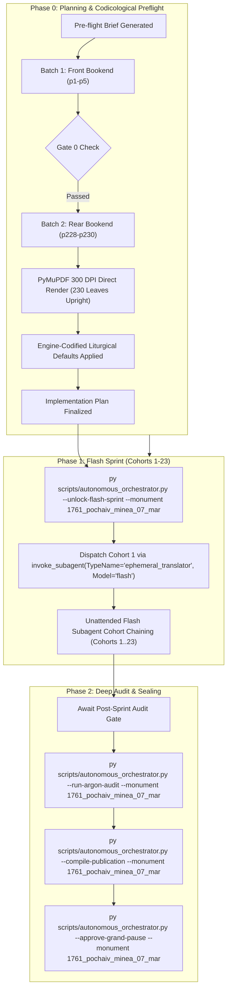

# Phase 0 Implementation Plan: 1761 Pochaiv Lavra Menaion — Month of March (`1761_pochaiv_minea_07_mar`)

## Goal Description
Translate, align, and canonically compile the complete historical Church Slavonic monthly liturgical codex **1761 Pochaiv Lavra Menaion — Vol. 7: March (Книга Миніа М[ѣся]цъ Мартъ / Мінея Місячна: Березень, Почаїв: Типографія Успенської Лаври ЧСВВ, 1761)** (`1761_pochaiv_minea_07_mar`).

- **Physical Extent**: 230 physical leaves (`p1`–`p230`), partitioned into 23 cohorts of 10 leaves each (Cohorts 1–23: `p1`–`p10`, `p11`–`p20`, ..., `p221`–`p230`).
- **Opening Geometry & Scan Orientation**: `1-up` single leaf per facsimile image (`Page_0001.jpg`–`Page_0230.jpg`).
- **Facsimile Orientation & 300-DPI Normalization**: In the raw archive directory, pre-existing JPEG scans were inverted. During Phase 0 preflight, all 230 physical leaves (`p1`–`p230`) were deterministically rendered directly from the canonical source PDF (`07-MINEA Pochaiv-1761 March.pdf`) via PyMuPDF at true 300 DPI (`2480 x 3509`, 92% JPEG quality) into `Source Text/images/` and the canonical Drive E vault (`E:\Google Drive\Liturgical Library\2. Historical Liturgical Texts\Ruthenian_Galician\Menaia\Pochaiv_1761_Menaion\Pochaiv_1761_Menaion_07_March\JPGs`). This guarantees 100% upright canonical orientation, pristine contrast, zero geometric distortion, and flawless optical alignment for all Phase 1 Flash workers.
- **Internal Foliation & Structure**:
  - `p1`: Master Title Page printed in two colors (red and black) within an ornate typographical frame:
    $$\text{КНИГА МИНIА М[ЕСЯ]ЦЪ МАРТЪ}$$
    $$\text{Во славу Святыя Единосущныя, Животворящiя, и Нераздѣлимыя Троицы, Отца, и Сына, и Святаго Духа...}$$
    Printed at the Pochaiv Lavra (*въ Стопѣ Чудотворной Лаврѣ Почаевской*) in 1761 (Anno Mundi 7269 / Anno Domini 1761), under King Augustus III of Poland-Lithuania, blessed by Kyr Sylvester Lubieniecki-Rudnytsky, Metropolitan of Kyiv, Halych, and all Rus, Bishop of Lutsk and Ostroh, by the will and mandate of Protoarchimandrite Hypatius Bilynsky of the Order of Saint Basil the Great (OSBM).
  - `p2`: Blank flyleaf verso (*Vacat*).
  - `p3`: Folio 1 recto (`Ли́стъ а҃`) with ornate woodcut headpiece depicting Christ and the Apostles, opening March 1:
    $$\text{МѢСЯЦЪ МАРТЪ, имѣяй днiй, л҃а. Въ а҃ день, святыя преподобномученицы Евдокiи.}$$
    Lord, I Have Cried stichera (Tone 4, Podoben: "Далъ еси знаменіе").
  - `p4`–`p227`: Complete daily divine offices for March 1 through March 30, including:
    - March 1: Holy Venerable-Martyr Eudokia
    - March 9: Holy Forty Martyrs of Sebaste
    - March 12: St. Theophanes the Confessor & St. Gregory the Dialogist Pope of Rome
    - March 17: St. Alexis the Man of God
    - March 19: Holy Martyrs Chrysanthus and Daria
    - March 24: Forefeast of the Annunciation
    - March 25: The Annunciation of the Most Holy Theotokos and Ever-Virgin Mary (Great Feast)
    - March 26: Synaxis of the Archangel Gabriel
    - March 30: St. John Climacus (of the Ladder)
  - `p228`–`p230`: Folio 113 verso (`ла҃ м[ѣся]цъ мартъ`) through Folio 114 verso (`Ли́стъ рді҃`, `ла҃ день`): March 31 (Holy Hieromartyr Hypatius Bishop of Gangra), concluding on `p230` with the final Theotokion of Ode 9 and an elaborate woodcut tailpiece vignette of a floral basket.
- **Historical Imprint & Ecclesial Context**: Printed at the Holy Miraculous Lavra of Pochaiv in 1761 by the monastic typography of the Order of Saint Basil the Great (*Чинъ Святаго Василiа Великаго* / OSBM). Dedicated under King Augustus III; blessed by Bishop Sylvester Lubieniecki-Rudnytsky; mandated by Protoarchimandrite Hypatius Bilynsky.
- **Genre Register**: `hymnographic` register under the Master Translation Standard (MTS-1).
- **Concurrency & Lease Architecture**: Operates under the **Multi-Monument Sequestered Concurrency Protocol** (Rule 14) with active lease confirmed in `Liturgical Monuments/ACTIVE_ORCHESTRATOR_STATE.json` and explicit CLI targeting (`--monument 1761_pochaiv_minea_07_mar`) protected by OS cross-process file locking (`scripts/concurrency_lock.py`).

---

## User Review Required

> [!IMPORTANT]
> **Active Multi-Monument Lease State**:
> Monument `1761_pochaiv_minea_07_mar` holds an active lease in `Liturgical Monuments/ACTIVE_ORCHESTRATOR_STATE.json`. All mutating orchestrator, gate, and publication CLI commands in this session explicitly pass `--monument 1761_pochaiv_minea_07_mar`.

> [!IMPORTANT]
> **Gate 0 Epigraphic Findings (Physical Verification Complete — Vision Budget 8/8 Leaves across 2/2 Batches)**:
> 1. **Batch 1 (Front Bookend, Leaves `p1`–`p5`)**:
>    - `p1`: Master Title Page printed in two colors (red and black) within an ornate typographical frame:
>      $$\text{КНИГА МИНIА М[ЕСЯ]ЦЪ МАРТЪ...}$$
>      Printed at the Pochaiv Lavra (*въ Стопѣ Чудотворной Лаврѣ Почаевской*) in 1761, blessed by Kyr Sylvester Rudnytsky, Bishop of Lutsk and Ostroh, under King Augustus III, mandated by Protoarchimandrite Ipatiy Bilynsky.
>    - `p2`: Blank flyleaf verso (*Vacat*).
>    - `p3`: Liturgical woodcut headpiece and opening of March 1, Folio 1 recto (`Ли́стъ а҃`):
>      $$\text{МѢСЯЦЪ МАРТЪ, имѣяй днiй, л҃а. Въ а҃ день, святыя преподобномученицы Евдокiи.}$$
>      Lord, I Have Cried stichera (Tone 4, Podoben: "Далъ еси знаменіе").
>    - `p4`: Folio 1 verso: March 1 continuation (Heirmos and Troparia of St. Eudokia Canon, Ode 1).
>    - `p5`: Folio 2 verso (`Ли́стъ в҃`, `а҃ день`): March 1 continuation (Ode 7 and Ode 8 of St. Eudokia Canon).
> 2. **Batch 2 (Rear Bookend, Leaves `p228`–`p230`)**:
>    - `p228`: March 31 continuation (St. Hypatius of Gangra), Folio 113 verso (`ла҃ м[ѣся]цъ мартъ`), Canon Ode 6, 7, 8.
>    - `p229`: March 31 continuation, Folio 114 recto (`Ли́стъ рді҃`, `ла҃ день`), Canon Ode 8 conclusion and Ode 9.
>    - `p230`: March 31 conclusion, Folio 114 verso (`ла҃ м[ѣся]цъ мартъ`), Canon Ode 9 completion, Theotokion, and large ornate woodcut tailpiece vignette of a floral basket.
> 3. **Physical Completeness**: All 230 300-DPI leaves verified intact in the canonical vault (`E:\Google Drive\Liturgical Library\2. Historical Liturgical Texts\Ruthenian_Galician\Menaia\Pochaiv_1761_Menaion\Pochaiv_1761_Menaion_07_March\JPGs`). Zero mid-codex visual binary searches conducted during Phase 0 (`p6`..`p227` remain uninspected per Rule 14).

---

## Open Questions

None. All 6 recurring house-style liturgical defaults are pre-decided in `engine_codified_decisions` and locked in `Audit_Reports/phase0_preflight_brief.json` and `Liturgical Monuments/codex_registry.json`.

---

## Engine-Codified Liturgical Defaults & Guardrails (`phase0_preflight_brief.json`)

| Invariant Dimension | Locked Engine Standard (`1761_pochaiv_minea_07_mar`) |
| :--- | :--- |
| **1. 3-Layer Melodic Model (`Podoben`) Law** | Format melodic models strictly as `*Tone N, Podoben: "<Canonical English Incipit>" (<Slavonic Witness>):*` (e.g., `*Tone 4, Podoben: "Thou Hast Given a Sign" (Dal yesi znameniye):*`). Never use transliterated-first or square-bracketed `[...]` Podoben formatting. |
| **2. Strict `H1` (`#`) & `H2` (`##`) Hierarchy (Zero `H3`/`H4`)** | Emit `#` (`H1`) **exclusively** at primary Part divisions defined in `publication_spec` (`# FRONT MATTER...`, `# PART I: LITURGICAL OFFICES FOR THE MONTH OF MARCH`). Emit `##` (`H2`) **exclusively** at primary daily calendar headpieces (e.g. `## March 1: Holy Venerable-Martyr Eudokia`, `## March 25: The Annunciation of the Most Holy Theotokos`). **Never emit `###` or `####` headings**; render all sub-services, hours, canons, odes, heirmoi, troparia, and rubrics as inline italics (`*At Vespers:*`, `*Ode 1. Heirmos:*`, `*Troparion:*`). |
| **3. Structured Liturgical Stanzas** | Format each Heirmos, Troparion, Theotokion, and Sticheron as a distinct paragraph preceded by its inline italic role tag (`*Ode N. Heirmos:*`, `*Troparion:*`, `*Theotokion:*`). Format litany/dialogue speakers in bold (`**Priest:**`, `**Deacon:**`, `**Choir:**`). |
| **4. Leaf Delimiters & Physical Orientation** | All leaves are rendered 100% upright at true 300 DPI. Delimit physical leaves exclusively via `=== LEAF pN ===`. Inside the leaf block, blank leaves must be rendered strictly as `*(Vacat — Blank page)*`. Never emit standalone `[Page N]` or `[Leaf pN]` bracket lines in body text. |
| **5. Epigraphic Fidelity & Incipit Preservation** | Translate the 1761 Pochaiv print strictly as inked, preserving incipits without unwritten expansion (Rule 16) and noting recensional variants in footnotes `[^N]`. |
| **6. Shared Lexicon & Diachronic Drift Invariance** | Enforce canonical UGCC terminology from the Master Glossary (*Tetrapod*, *Klepalo*, *Aer*, *Kolyvo*, *Plashchanytsia*, *Sluzhebnik*), 100% Deity pronoun capitalization (*He*, *Him*, *His*, *Thou*, *Thee*), and the Father Paul Doxology Standard (ban *"for ever and ever"*). |

---

## Canonical Publication Specification & Slicing Strategy

During Phase 2 (`--compile-publication`), `UniversalPublicationEngine` will compile the translated markdown into canonical publication parts plus the master footnotes file in `Typikon Coded/Data/Inbox/1761_Pochayiv_Menaion_(March)/`:

| Part ID | Canonical Filename | Title | Start Landmark Regex | Physical Scope |
| :--- | :--- | :--- | :--- | :--- |
| **`part0`** | `1761_pochaiv_minea_07_mar_part0_front_matter.md` | Front Matter, Title Page (1761), and Introductory Apparatus | `null` | `p1`–`p2` |
| **`part1`** | `1761_pochaiv_minea_07_mar_part1_march_services.md` | PART I: LITURGICAL OFFICES FOR THE MONTH OF MARCH | `^#+\s*(?:PART\s+I\b\|MONTH\s+OF\s+MARCH\|MARCH\s+SERVICES)` | `p3`–`p230` |
| **Footnotes** | `1761_pochaiv_minea_07_mar_footnotes.md` | Master Footnotes and Epigraphic Commentary | N/A | Full Codex |

---

## Cohort Partition Table (Cohorts 1–23)

| Cohort | Physical Leaves | Leaf Count | Codicological Scope |
| :---: | :---: | :---: | :--- |
| **Cohort 1** | `p1`–`p10` | 10 | Title page (`p1`), Vacat (`p2`), March 1 (St. Eudokia, `p3`–`p7`), March 2 (St. Theodotus of Cyrenia, `p8`–`p10`) |
| **Cohort 2** | `p11`–`p20` | 10 | March 2 conclusion, March 3 (Holy Martyrs Eutropius, Cleonicus, and Basiliscus), March 4 (St. Gerasimus of the Jordan) |
| **Cohort 3** | `p21`–`p30` | 10 | March 5 (Holy Martyr Eulampius), March 6 (Holy 42 Martyrs of Ammoria), March 7 (Holy Hieromartyrs of Cherson) |
| **Cohort 4** | `p31`–`p40` | 10 | March 8 (St. Theophylact of Nicomedia), March 9 beg. (Holy Forty Martyrs of Sebaste) |
| **Cohort 5** | `p41`–`p50` | 10 | March 9 cont. (Holy Forty Martyrs of Sebaste: Festal Matins, Canons, Liturgy) |
| **Cohort 6** | `p51`–`p60` | 10 | March 9 conclusion, March 10 (Holy Martyrs Codratus and Companions), March 11 (St. Sophronius Patriarch of Jerusalem) |
| **Cohort 7** | `p61`–`p70` | 10 | March 12 (St. Theophanes the Confessor & St. Gregory the Dialogist Pope of Rome), March 13 (Translation of Relics of St. Nicephorus Patriarch of Constantinople) |
| **Cohort 8** | `p71`–`p80` | 10 | March 14 (St. Benedict of Nursia), March 15 (Holy Martyr Agapius and Companions) |
| **Cohort 9** | `p81`–`p90` | 10 | March 16 (Holy Martyrs Sabinus and Papas), March 17 (St. Alexis the Man of God) |
| **Cohort 10** | `p91`–`p100` | 10 | March 17 conclusion, March 18 (St. Cyril Archbishop of Jerusalem), March 19 (Holy Martyrs Chrysanthus and Daria) |
| **Cohort 11** | `p101`–`p110` | 10 | March 19 conclusion, March 20 (Holy Fathers slain at the Monastery of St. Sabbas), March 21 (St. James the Confessor) |
| **Cohort 12** | `p111`–`p120` | 10 | March 22 (Holy Hieromartyr Basil of Ancyra), March 23 (Holy Martyr Nicon and 199 disciples) |
| **Cohort 13** | `p121`–`p130` | 10 | March 24 (Forefeast of the Annunciation, St. Zacharias), March 25 beg. (The Annunciation of the Most Holy Theotokos, Great Vespers) |
| **Cohort 14** | `p131`–`p140` | 10 | March 25 cont. (The Annunciation: Great Matins, Festal Canons) |
| **Cohort 15** | `p141`–`p150` | 10 | March 25 conclusion (The Annunciation: Divine Liturgy), March 26 beg. (Synaxis of Archangel Gabriel) |
| **Cohort 16** | `p151`–`p160` | 10 | March 26 conclusion (Synaxis of Archangel Gabriel), March 27 (Holy Martyr Matrona of Thessalonica) |
| **Cohort 17** | `p161`–`p170` | 10 | March 28 (St. Hilarion the New, St. Stephen the Wonderworker), March 29 (St. Mark Bishop of Arethusa) |
| **Cohort 18** | `p171`–`p180` | 10 | March 30 (St. John Climacus / of the Ladder) |
| **Cohort 19** | `p181`–`p190` | 10 | March 31 beg. (St. Hypatius Bishop of Gangra) |
| **Cohort 20** | `p191`–`p200` | 10 | March 31 cont. (St. Hypatius: Vespers and Matins Propers) |
| **Cohort 21** | `p201`–`p210` | 10 | March 31 cont. (St. Hypatius: Canons) |
| **Cohort 22** | `p211`–`p220` | 10 | March 31 cont. (St. Hypatius: Canons cont.) |
| **Cohort 23** | `p221`–`p230` | 10 | March 31 conclusion (St. Hypatius: Canons completion, Theotokia, woodcut tailpiece vignette `p230`) |

---

## Execution Directives

1. **Phase 0 Review Stop**: This plan stops here for human operator review and confirmation.
2. **Phase 1 Flash Sprint Transition**: Once the user approves the plan:
   - Immediately execute `py scripts/autonomous_orchestrator.py --unlock-flash-sprint --monument 1761_pochaiv_minea_07_mar`.
   - Dispatch Cohort 1 via `invoke_subagent(TypeName="ephemeral_translator", Model="flash")` in the same turn without asking for a second confirmation.
