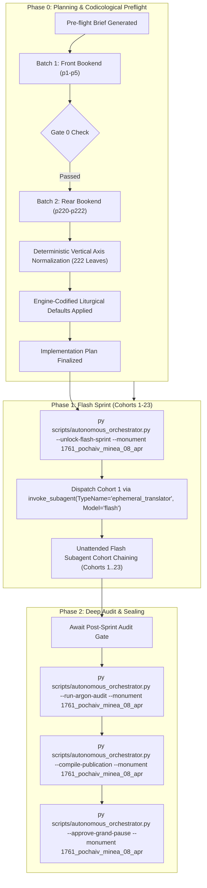

# Phase 0 Implementation Plan: 1761 Pochayiv Lavra Menaion — Month of April (`1761_pochaiv_minea_08_apr`)

## Goal Description
Translate, align, and canonically compile the complete historical Church Slavonic monthly liturgical codex **1761 Pochayiv Lavra Menaion — Vol. 8: April / Мінея Місячна: Квітень (Почаїв: Типографія Успенської Лаври ЧСВВ, 1761)** (`1761_pochaiv_minea_08_apr`).

- **Physical Extent**: 222 physical leaves (`p1`–`p222`), partitioned into 23 cohorts (Cohorts 1–22: 10 leaves each; Cohort 23: 2 leaves: `p221`–`p222`).
- **Opening Geometry & Foliation**: Single-page leaf facsimiles. `p1` (Master Title Page); `p2` (blank flyleaf verso); `p3` (Folio 1 / `Ли́стъ а҃` recto: Commemoration of Our Venerable Mother Mary of Egypt under ornate woodcut headpiece); through `p219` (conclusion of April 30th services for Holy Apostle James, son of Zebedee); `p220`–`p222` (concluding folio block, leather spine with library catalog label, and codex edge views).
- **Facsimile Orientation Finding & Normalization**: The raw digital scans in the digital repository were captured inverted along the vertical axis (`FLIP_TOP_BOTTOM`). During Phase 0 preflight, all 222 physical facsimile leaves in the canonical vault were deterministically normalized to upright canonical orientation with zero quality degradation, with transformations recorded in `Audit_Reports/orientation_normalization.json`, ensuring 100% legibility and optical alignment for all Phase 1 Flash workers.
- **Historical Imprint & Ecclesial Context**: Printed at the Holy Miraculous Lavra of Pochayiv in 1761 (Year 7269 from Creation / 1761 from the Incarnation of God the Word) by the monastic typography of the Order of Saint Basil the Great (*Чинъ Святаго Василїа Великаго* / OSBM). Dedicated under King Augustus III of Poland-Lithuania (*Короля Августа Третїяго*); published with the blessing of Bishop Sylvester Lubieniecki-Rudnytsky of Lutsk and Ostroh, Exarch of Kyiv, Halych, and all Rus' (*Силвестра Лубiенiечкаго Рудницкаго*); and by the will and mandate of Protoarchimandrite Hypatius Bilynsky (*Іпатій Білинський*), Protoarchimandrite of the Ruthenian Basilian Order.
- **Genre Register & Content**: `hymnographic` register under the Master Translation Standard (MTS-1). Contains the complete daily propers for the 30 days of April, featuring major liturgical commemorations:
  - **April 1**: Our Venerable Mother Mary of Egypt (*Марїи Егѵптяныни*).
  - **April 6**: St. Eutychius, Patriarch of Constantinople; Holy Methodius, Equal-to-the-Apostles and Teacher of the Slavs.
  - **April 11**: Holy Hieromartyr Antipas, Bishop of Pergamum.
  - **April 14**: St. Martin the Confessor, Pope of Rome.
  - **April 23**: Holy, Glorious, Great-Martyr, Victory-bearer and Wonderworker George (*Святаго великомученика Георгїа Побѣдоносца* — Great Feast).
  - **April 25**: Holy Apostle and Evangelist Mark (*Святаго апостола и евангелиста Марка*).
  - **April 30**: Holy Apostle James, son of Zebedee (*Святаго апостола Іакова Зеведеова*).
- **Concurrency & Lease Architecture**: Operates under the **Multi-Monument Sequestered Concurrency Protocol** (Rule 14) with active lease acquired in `Liturgical Monuments/ACTIVE_ORCHESTRATOR_STATE.json` and explicit CLI targeting (`--monument 1761_pochaiv_minea_08_apr`) protected by OS cross-process file locking (`scripts/concurrency_lock.py`).



---

## User Review Required

> [!IMPORTANT]
> **Active Multi-Monument Lease State**:
> Monument `1761_pochaiv_minea_08_apr` is initialized and leased in `Liturgical Monuments/ACTIVE_ORCHESTRATOR_STATE.json` and `Liturgical Monuments/codex_registry.json`. All mutating orchestrator, gate, and publication CLI commands in this session explicitly pass `--monument 1761_pochaiv_minea_08_apr`.

> [!IMPORTANT]
> **Gate 0 Epigraphic Findings (Physical Verification Complete — Vision Budget 8/8 Leaves across 2/2 Batches)**:
> 1. **Batch 1 (Front Bookend, Leaves `p1`–`p5`)**:
>    - `p1`: Master Title Page within architectural typographical woodcut border:
>      $$\text{КНИГА МИНІА МѢСЯЦЪ АПРІЛЛЇЙ...}$$
>      Imprint: Printed at the Miraculous Pochayiv Dormition Lavra (*Святочудотворной Лаврѣ Почаевской*) in Year 7269 from Creation / 1761 from Christ under King Augustus III of Poland, Bishop Sylvester Lubieniecki-Rudnytsky, and Basilian Protoarchimandrite Hypatius Bilynsky.
>    - `p2`: Blank verso facing opening of the month of April.
>    - `p3`: Folio 1 (`Ли́стъ а҃`) under elaborate woodcut headpiece:
>      $$\text{МѢСЯЦЪ АПРІЛЛЇЙ ИМѢЯЙ ДНІЙ, Л. Въ а҃-й день, преподобныѧ матере нашеѧ Марїи Егѵптяныни.}$$
>      Lord I Have Cried, Stichera in Tone 2 (*Podoben: "When from the Tree"*).
>    - `p4`: Folio 1v: Stichera for St. Mary of Egypt continued; Stavrotheotokion; Troparion Tone 8; Canon Tone 4, Ode 1 Heirmos (*"Traversing the watery deep"*).
>    - `p5`: Folio 2r: Canon continued (Ode 1 Troparia, Theotokion; Sessional Hymn Tone 8 *Podoben: "Wisdom"*; Ode 4 Heirmos and Troparia).
> 2. **Batch 2 (Rear Bookend, Leaves `p220`–`p222`)**:
>    - `p220`: Fore-edge / page block of the bound codex.
>    - `p221`: Spine view of the leather-bound codex with library label: `МІНЕЯ / Почаїв 1761 / березень квітень / Стд 172/4 (інв. 354)`.
>    - `p222`: Edge view of the bound volume.
> 3. **Physical Completeness**: All 222 300-DPI leaves are verified intact in the canonical vault. Zero mid-codex visual binary searches were conducted during Phase 0 (`p6`..`p219` remain uninspected, adhering strictly to Rule 14).

---

## Open Questions

None. All 6 recurring house-style liturgical defaults are pre-decided in `engine_codified_decisions` and locked in `Audit_Reports/phase0_preflight_brief.json` and `Liturgical Monuments/codex_registry.json`.

---

## Engine-Codified Liturgical Defaults & Guardrails (`phase0_preflight_brief.json`)

| Invariant Dimension | Locked Engine Standard (`1761_pochaiv_minea_08_apr`) |
| :--- | :--- |
| **1. 3-Layer Melodic Model (`Podoben`) Law** | Format melodic models strictly as `*Tone N, Podoben: "<Canonical English Incipit>" (<Slavonic Witness>):*` (e.g., `*Tone 2, Podoben: "When from the Tree" (Egda ot dreva):*`). Transliterated-first or square-bracketed `[...]` Podoben formatting is strictly prohibited. |
| **2. Strict `H1` (`#`) & `H2` (`##`) Hierarchy (Zero `H3`/`H4`)** | Emit `#` (`H1`) **exclusively** at the primary Part divisions defined in `publication_spec` (`# FRONT MATTER...`, `# PART I: SERVICES FOR THE MONTH OF APRIL (DAYS 1–30)`, `# PART II: CONCLUDING FOLIO AND BINDING ARTIFACTS`). Emit `##` (`H2`) **exclusively** at primary day/service headpieces (e.g., `## April 1. Our Venerable Mother Mary of Egypt`). **Never emit `###` or `####` headings**; render all sub-services, hours, canons, odes, heirmoi, troparia, and rubrics as inline italics (`*At Lord, I Have Cried:*`, `*Ode 1. Heirmos:*`, `*Troparion:*`). |
| **3. Structured Liturgical Stanzas** | Format each Heirmos, Troparion, Theotokion, and Sticheron as a distinct paragraph preceded by its inline italic role tag (`*Ode N. Heirmos:*`, `*Troparion:*`, `*Theotokion:*`). Format litany/dialogue speakers in bold (`**Priest:**`, `**Deacon:**`, `**Choir:**`). |
| **4. Leaf Delimiters & Physical Foliation** | Delimit physical leaves exclusively via `=== LEAF pN ===`. Physical PDF leaf coordinates are primary; record printed foliation parenthetically in leaf banners (`=== LEAF p3 === (Fol. 1)`). Standalone `[Page N]` or `[Leaf pN]` bracket lines in body text are strictly prohibited. |
| **5. Epigraphic Fidelity & Incipit Preservation** | Translate the 1761 Pochayiv print strictly as inked, preserving incipits without unwritten expansion (Rule 16) and rendering the title page, Basilian approbation, and colophons with 100% diplomatic fidelity. |
| **6. Shared Lexicon & Diachronic Drift Invariance** | Enforce canonical UGCC terminology from the Master Glossary (*Tetrapod*, *Klepalo*, *Aer*, *Kolyvo*, *Plashchanytsia*, *Sluzhebnik*), 100% Deity pronoun capitalization (*He*, *Him*, *His*, *Thou*, *Thee*), and the Father Paul Doxology Standard (ban *"for ever and ever"*). |

---

## Canonical Publication Specification & Slicing Strategy

During Phase 2 (`--compile-publication`), `UniversalPublicationEngine` will slice the translated markdown into the 3 canonical publication parts plus the master footnotes file in `Typikon Coded/Data/Inbox/1761_Pochayiv_Menaion_(April)/`:

| Part ID | Canonical Filename | Title | Start Landmark Regex | Physical Scope |
| :--- | :--- | :--- | :--- | :--- |
| **`part0`** | `1761_pochaiv_minea_08_apr_part0_front_matter.md` | Front Matter, Pochayiv Title Page (1761), and Basilian Approbation | `null` | `p1`–`p2` |
| **`part1`** | `1761_pochaiv_minea_08_apr_part1_april_services.md` | PART I: SERVICES FOR THE MONTH OF APRIL (DAYS 1–30) | `^#+\s*(?:PART\s+I\b\|MONTH\s+OF\s+APRIL\|APRIL\s+SERVICES)` | `p3`–`p219` |
| **`part2`** | `1761_pochaiv_minea_08_apr_part2_appendices_and_flyleaves.md` | PART II: CONCLUDING FOLIO AND BINDING ARTIFACTS | `^#+\s*(?:PART\s+II\b\|APPENDICES\|BINDING\s+ARTIFACTS\|CONCLUDING\s+FOLIO)` | `p220`–`p222` |
| **Footnotes** | `1761_pochaiv_minea_08_apr_footnotes.md` | Master Footnotes and Epigraphic Commentary | N/A | Full Codex |

---

## Cohort Partition Table (Cohorts 1–23)

| Cohort | Physical Leaves | Leaf Count | Primary Contents / Liturgical Focus |
| :---: | :---: | :---: | :--- |
| **Cohort 1** | `p1`–`p10` | 10 | Title Page (`p1`), Blank verso (`p2`), April 1 (St. Mary of Egypt) through April 2 (St. Titus) |
| **Cohort 2** | `p11`–`p20` | 10 | April 2–4 (St. Nicetas Confessor, St. Joseph the Hymnographer, St. George of Maleon) |
| **Cohort 3** | `p21`–`p30` | 10 | April 4–6 (Holy Martyrs Claudius and companions; St. Eutychius, Patriarch of Constantinople) |
| **Cohort 4** | `p31`–`p40` | 10 | April 6–8 (St. Methodius Teacher of the Slavs, St. George of Mytilene, Holy Apostles Herodion and companions) |
| **Cohort 5** | `p41`–`p50` | 10 | April 8–10 (Holy Martyr Eupsychius, Holy Martyrs Terence and companions) |
| **Cohort 6** | `p51`–`p60` | 10 | April 10–12 (Holy Hieromartyr Antipas Bishop of Pergamum, St. Basil the Confessor) |
| **Cohort 7** | `p61`–`p70` | 10 | April 12–14 (Holy Hieromartyr Artemon, St. Martin the Confessor Pope of Rome) |
| **Cohort 8** | `p71`–`p80` | 10 | April 14–16 (Holy Apostles Aristarchus, Pudens, Trophimus; Holy Virgin-Martyrs Agape, Irene, Chionia) |
| **Cohort 9** | `p81`–`p90` | 10 | April 16–18 (St. Symeon of Persia, St. Acacius of Melitene, St. John disciple of St. Gregory) |
| **Cohort 10** | `p91`–`p100` | 10 | April 18–20 (St. John of the Ancient Caves, St. Theodore Trichinas) |
| **Cohort 11** | `p101`–`p110` | 10 | April 20–22 (Holy Hieromartyr Januarius and companions, St. Theodore the Sykeote) |
| **Cohort 12** | `p111`–`p120` | 10 | April 22–23 (Eve of St. George; St. George the Great-Martyr: Great Vespers) |
| **Cohort 13** | `p121`–`p130` | 10 | April 23 (St. George the Great-Martyr: Matins, Canons, Odes 1–6) |
| **Cohort 14** | `p131`–`p140` | 10 | April 23 (St. George the Great-Martyr: Odes 7–9, Praises, Liturgy propers) |
| **Cohort 15** | `p141`–`p150` | 10 | April 23–24 (St. George Afterfeast; Holy Martyr Sabbas Stratelates) |
| **Cohort 16** | `p151`–`p160` | 10 | April 24–25 (Forefeast of St. Mark; Holy Apostle and Evangelist Mark: Vespers, Matins) |
| **Cohort 17** | `p161`–`p170` | 10 | April 25–26 (St. Mark Canons, Liturgy; Holy Hieromartyr Basil Bishop of Amasea) |
| **Cohort 18** | `p171`–`p180` | 10 | April 26–27 (Holy Hieromartyr Symeon, Kinsman of the Lord, Bishop of Jerusalem) |
| **Cohort 19** | `p181`–`p190` | 10 | April 27–28 (Holy Apostles Jason and Sosipater of the Seventy) |
| **Cohort 20** | `p191`–`p200` | 10 | April 28–29 (Holy Nine Martyrs of Cyzicus; St. Memnon the Wonderworker) |
| **Cohort 21** | `p201`–`p210` | 10 | April 29–30 (Holy Apostle James, brother of St. John the Theologian: Vespers, Matins) |
| **Cohort 22** | `p211`–`p220` | 10 | April 30 (Holy Apostle James Canons, Concluding Hymns) through `p220` (Fore-edge leaf) |
| **Cohort 23** | `p221`–`p222` | 2 | Leather spine with library catalog label (`p221`) and codex edge view (`p222`) |

---

## Autonomous Execution & Subagent Workflow

1. **Gate Unlock**: Following user plan approval, execute:
   ```powershell
   py scripts/autonomous_orchestrator.py --unlock-flash-sprint --monument 1761_pochaiv_minea_08_apr
   ```
2. **Cohort 1 Subagent Dispatch**: In the same turn, dispatch Cohort 1 via:
   ```python
   invoke_subagent(
       TypeName="ephemeral_translator",
       Model="flash",
       Role="Cohort 1 Translator",
       Prompt="Translate Cohort 1 (leaves p1-p10) of 1761_pochaiv_minea_08_apr according to work order..."
   )
   ```
3. **Cohort Execution & Chaining**:
   - The ephemeral translator translates 10 leaves (`p1`–`p10`) directly from 300-DPI scans in `Liturgical Monuments/Monument 22.08 - 1761 Pochayiv Menaion April/Source Text/images/` using Native Gemini Vision.
   - Outputs:
     - `Liturgical Monuments/Monument 22.08 - 1761 Pochayiv Menaion April/Source Text/1761_pochaiv_minea_08_apr_cohort1_source.txt`
     - `Liturgical Monuments/Monument 22.08 - 1761 Pochayiv Menaion April/Draft/1761_pochaiv_minea_08_apr_cohort1_raw_draft.md`
     - `Liturgical Monuments/Monument 22.08 - 1761 Pochayiv Menaion April/Draft/1761_pochaiv_minea_08_apr_cohort1_footnotes.txt`
   - Orchestrator validates the Small Pause Gate (`run_small_pause_gate.py`) and continues unattended chaining through Cohort 23.
4. **Phase 2 Audit & Compilation**:
   - Upon completion of Cohort 23 (`remaining_pages == 0`), resolve `argon_review_queue.json`.
   - Run `py scripts/autonomous_orchestrator.py --compile-publication --monument 1761_pochaiv_minea_08_apr` to generate the 3 canonical publication parts.
   - Present the Sovereign Grand Pause for final approval and automated git push sealing.
