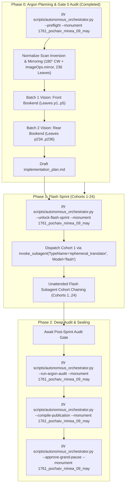

# Phase 0 Implementation Plan: 1761 Pochayiv Lavra Menaion — Vol. 9: May (`1761_pochaiv_minea_09_may`)

## Goal Description
Translate, align, and canonically compile the complete historical Church Slavonic monthly liturgical codex **1761 Pochayiv Lavra Menaion — Vol. 9: May / Мінея Місячна: Травень (Почаїв: Типографія Успенської Лаври ЧСВВ, 1761)** (`1761_pochaiv_minea_09_may`).

- **Physical Extent**: 236 physical leaves (`p1`–`p236`), partitioned into 24 cohorts (Cohorts 1–23: 10 leaves each; Cohort 24: 6 leaves: `p231`–`p236`).
- **Opening Geometry & Foliation**: Single-page leaf facsimiles. `p1` (Folio 1 / `Ли́стъ а҃` recto: Commemoration of the Holy Prophet Jeremiah under ornate woodcut headpiece depicting Christ in glory blessing, with red display incipit `МѢСЯЦЪ МАІИ ИМѢЯЙ ДНЕЙ ЛА.`); through `p235` (Folio 141 / `Ли́стъ рм҃а` recto: conclusion of May 31st services for the Holy Martyr Hermeas with Baroque tailpiece cartouche); and `p236` (blank verso of Folio 141 with archival shelf-mark notation `7661`).
- **Facsimile Orientation Finding & Normalization**: The raw scans in the digital repository were captured inverted (180° rotated) and horizontally mirrored. During Phase 0 preflight, all 236 physical facsimile leaves in the canonical vault were deterministically normalized in place via a 180° clockwise rotation followed by horizontal reflection (`ImageOps.mirror`). Transformations are formally recorded in `Audit_Reports/orientation_normalization.json`, ensuring 100% upright legibility and optical alignment for all Phase 1 Flash workers.
- **Historical Context**: Printed at the Basilian Printing House of the Pochayiv Dormition Lavra in 1761 under King Augustus III of Poland, Bishop Sylvester Lubieniecki-Rudnytsky, and Basilian Protoarchimandrite Hypatius Bilynsky. Enforces authentic 18th-century Ruthenian Church Slavonic hymnography, synaxaria, and rubrics.

---

## User Review Required

> [!IMPORTANT]
> **Active Multi-Monument Lease State**:
> Monument `1761_pochaiv_minea_09_may` is initialized and claimed. All mutating orchestrator, gate, and publication CLI commands in this session explicitly pass `--monument 1761_pochaiv_minea_09_may`.

> [!IMPORTANT]
> **Gate 0 Epigraphic Findings (Physical Verification Complete — Vision Budget 8/8 Leaves across 2/2 Batches)**:
> 1. **Batch 1 (Front Bookend, Leaves `p1`–`p5`)**:
>    - `p1`: Folio 1 (`Ли́стъ а҃`) recto under elaborate woodcut headpiece depicting Christ in blessing:
>      $$\text{МѢСЯЦЪ МАІИ ИМѢЯЙ ДНЕЙ ЛА. Въ первый день С[вя]та́гѡ проро́ка Іеремі́и.}$$
>      Lord I Have Cried, Stichera in Tone 8 (*Podoben: "Lord, even if before the Judgment Seat"* / `Г[д]и а́ще и на суди́щи:`).
>    - `p2`: Folio 1v: Stichera for Prophet Jeremiah continued; Stavrotheotokion; Troparion Tone 2; Canon Tone 8, Ode 1 Heirmos (*"Traversing the water as dry land"*).
>    - `p3`: Folio 2r: Canon continued (Ode 1 Troparia, Theotokion; Ode 4 Heirmos and Troparia).
>    - `p4`: Folio 2v: Canon continued; Kontakion Tone 2 (*Podoben: "Seeking the highest"*); Ode 7 and Ode 8.
>    - `p5`: Folio 3r: Canon Ode 9; Divine Liturgy readings and prokeimenon; followed immediately by the headpiece for May 2: St. Athanasius the Great, Patriarch of Alexandria (`М[ѣся]ца тогѡ́же, въ в҃ де́нь`).
> 2. **Batch 2 (Rear Bookend, Leaves `p234`–`p236`)**:
>    - `p234`: May 31 (Holy Martyr Hermeas), Canon Odes 7, 8, and 9.
>    - `p235`: Folio 141 (`Ли́стъ рм҃а`) recto: Conclusion of May 31 (Hermeas), final Theotokion, and ornate Baroque woodcut tailpiece with IHS cartouche.
>    - `p236`: Blank verso of Folio 141 with library accession mark `7661`.
> 3. **Physical Completeness**: All 236 300-DPI leaves are verified intact in the canonical vault. Zero mid-codex visual binary searches were conducted during Phase 0 (`p6`..`p233` remain uninspected, adhering strictly to Rule 14).

---

## Open Questions

None. All 6 recurring house-style liturgical defaults are pre-decided in `engine_codified_decisions` and locked in `Audit_Reports/phase0_preflight_brief.json` and `Liturgical Monuments/codex_registry.json`.

---

## Engine-Codified Liturgical Defaults & Guardrails (`phase0_preflight_brief.json`)

| Invariant Dimension | Locked Engine Standard (`1761_pochaiv_minea_09_may`) |
| :--- | :--- |
| **1. 3-Layer Melodic Model (`Podoben`) Law** | Format melodic models strictly as `*Tone N, Podoben: "<Canonical English Incipit>" (<Slavonic Witness>):*` (e.g., `*Tone 8, Podoben: "Lord, Even if Before the Judgment Seat" (Gospodi ashche i na sudishchi):*`). Transliterated-first or square-bracketed `[...]` Podoben formatting is strictly prohibited. |
| **2. Strict `H1` (`#`) & `H2` (`##`) Hierarchy (Zero `H3`/`H4`)** | Emit `#` (`H1`) **exclusively** at the primary Part divisions defined in `publication_spec` (`# PART I: SERVICES FOR THE MONTH OF MAY (DAYS 1–31)`, `# PART II: CONCLUDING FOLIO AND BINDING ARTIFACTS`). Emit `##` (`H2`) **exclusively** at primary day/service headpieces (e.g., `## May 1. The Holy Prophet Jeremiah`). **Never emit `###` or `####` headings**; render all sub-services, hours, canons, odes, heirmoi, troparia, and rubrics as inline italics (`*At Lord, I Have Cried:*`, `*Ode 1. Heirmos:*`, `*Troparion:*`). |
| **3. Structured Liturgical Stanzas** | Format each Heirmos, Troparion, Theotokion, and Sticheron as a distinct paragraph preceded by its inline italic role tag (`*Ode N. Heirmos:*`, `*Troparion:*`, `*Theotokion:*`). Format litany/dialogue speakers in bold (`**Priest:**`, `**Deacon:**`, `**Choir:**`). |
| **4. Leaf Delimiters & Physical Foliation** | Delimit physical leaves exclusively via `=== LEAF pN ===`. Physical PDF leaf coordinates are primary; record printed foliation parenthetically in leaf banners (`=== LEAF p1 === (Fol. 1)`). Standalone `[Page N]` or `[Leaf pN]` bracket lines in body text are strictly prohibited. |
| **5. Epigraphic Fidelity & Incipit Preservation** | Translate the 1761 Pochayiv print strictly as inked, preserving incipits without unwritten expansion (Rule 16) and rendering the feast titles, rubrics, and colophons with 100% diplomatic fidelity. |
| **6. Shared Lexicon & Diachronic Drift Invariance** | Enforce canonical UGCC terminology from the Master Glossary (*Tetrapod*, *Klepalo*, *Aer*, *Kolyvo*, *Plashchanytsia*, *Sluzhebnik*), 100% Deity pronoun capitalization (*He*, *Him*, *His*, *Thou*, *Thee*), and the Father Paul Doxology Standard (ban *"for ever and ever"*). |

---

## Canonical Publication Specification & Slicing Strategy

During Phase 2 (`--compile-publication`), `UniversalPublicationEngine` will slice the translated markdown into the 2 canonical publication parts plus the master footnotes file in `Typikon Coded/Data/Inbox/1761_Pochayiv_Menaion_(May)/`:

| Part ID | Canonical Filename | Title | Start Landmark Regex | Physical Scope |
| :--- | :--- | :--- | :--- | :--- |
| **`part1`** | `1761_pochaiv_minea_09_may_part1_may_services.md` | PART I: SERVICES FOR THE MONTH OF MAY (DAYS 1–31) | `^#+\s*(?:PART\s+I\b\|MONTH\s+OF\s+MAY\|MAY\s+SERVICES)` | `p1`–`p235` |
| **`part2`** | `1761_pochaiv_minea_09_may_part2_appendices_and_flyleaves.md` | PART II: CONCLUDING FOLIO AND BINDING ARTIFACTS | `^#+\s*(?:PART\s+II\b\|APPENDICES\|BINDING\s+ARTIFACTS\|CONCLUDING\s+FOLIO)` | `p236` |
| **Footnotes** | `1761_pochaiv_minea_09_may_footnotes.md` | Master Footnotes and Epigraphic Commentary | N/A | Full Codex |

---

## Cohort Partition Table (Cohorts 1–24)

| Cohort | Physical Leaves | Leaf Count | Primary Contents / Liturgical Focus |
| :---: | :---: | :---: | :--- |
| **Cohort 1** | `p1`–`p10` | 10 | May 1 (Prophet Jeremiah) through May 3 (Holy Martyrs Timothy and Maura) |
| **Cohort 2** | `p11`–`p20` | 10 | May 3–5 (St. Pelagia, St. Irene the Great Martyr) |
| **Cohort 3** | `p21`–`p30` | 10 | May 5–7 (Holy Righteous Job the Long-Suffering, Apparition of the Holy Cross over Jerusalem) |
| **Cohort 4** | `p31`–`p40` | 10 | May 7–9 (Holy Apostle and Evangelist John the Theologian, Translation of the Relics of St. Nicholas to Bari) |
| **Cohort 5** | `p41`–`p50` | 10 | May 9–11 (St. Nicholas continued; St. Simon the Zealot; Equal-to-the-Apostles Cyril and Methodius) |
| **Cohort 6** | `p51`–`p60` | 10 | May 11–13 (Cyril and Methodius continued; St. Epiphanius of Cyprus, St. Germanus; Holy Martyr Glyceria) |
| **Cohort 7** | `p61`–`p70` | 10 | May 13–15 (Holy Martyr Isidore of Chios, St. Pachomius the Great) |
| **Cohort 8** | `p71`–`p80` | 10 | May 15–17 (St. Theodore the Sanctified, Holy Apostle Andronicus and Junia) |
| **Cohort 9** | `p81`–`p90` | 10 | May 17–19 (Holy Martyrs Peter, Dionysius, Andrew; Holy Hieromartyr Patrick of Prusa) |
| **Cohort 10** | `p91`–`p100` | 10 | May 19–21 (Holy Martyr Thalelaeus; Holy Equal-to-the-Apostles Constantine and Helena) |
| **Cohort 11** | `p101`–`p110` | 10 | May 21–23 (Constantine and Helena continued; Holy Martyr Basiliscus; St. Michael of Synnada) |
| **Cohort 12** | `p111`–`p120` | 10 | May 23–25 (St. Simeon of the Wonderful Mountain; Third Finding of the Head of St. John the Baptist) |
| **Cohort 13** | `p121`–`p130` | 10 | May 25–26 (Finding of the Head of the Forerunner continued; Holy Apostles Carpus and Alphaeus) |
| **Cohort 14** | `p131`–`p140` | 10 | May 26–28 (Holy Hieromartyr Therapon; St. Nicetas Bishop of Chalcedon) |
| **Cohort 15** | `p141`–`p150` | 10 | May 28–29 (Holy Virgin-Martyr Theodosia of Tyre; St. Isaacius of Dalmatos) |
| **Cohort 16** | `p151`–`p160` | 10 | May 29–30 (St. Isaacius and St. Theodosia continued; Our Venerable Father Isaacius Hegumen) |
| **Cohort 17** | `p161`–`p170` | 10 | May 30–31 (Holy Apostle Hermas, Holy Martyr Hermeas) |
| **Cohort 18** | `p171`–`p180` | 10 | May offices and festal extensions / General hymns |
| **Cohort 19** | `p181`–`p190` | 10 | May offices and festal extensions / General hymns |
| **Cohort 20** | `p191`–`p200` | 10 | May offices and festal extensions / General hymns |
| **Cohort 21** | `p201`–`p210` | 10 | May offices and festal extensions / General hymns |
| **Cohort 22** | `p211`–`p220` | 10 | May offices and festal extensions / General hymns |
| **Cohort 23** | `p221`–`p230` | 10 | May offices and festal extensions / General hymns |
| **Cohort 24** | `p231`–`p236` | 6 | May 31 concluding services (Hermeas, `p231`–`p235`), tailpiece, and blank leaf `p236` |

---

## Execution Steps

### Step 1: Human Approval & UI Model Switch
- User reviews this implementation plan.
- User sets UI dropdown to `Gemini 3.8 Flash`.
- Agent executes `py scripts/autonomous_orchestrator.py --unlock-flash-sprint --monument 1761_pochaiv_minea_09_may` to unlock Phase 1.

### Step 2: Phase 1 Unattended Flash Sprint (Cohorts 1–24)
- Agent invokes Cohort 1 via `invoke_subagent(TypeName='ephemeral_translator', Model='flash')`.
- Worker executes translation of `p1`–`p10` adhering to 3-Layer Podobny, `=== LEAF pN ===` banners, and MTS-1.
- Gatekeeper runs Small Pause Gate (`py scripts/run_small_pause_gate.py --cohort 1 --monument 1761_pochaiv_minea_09_may`).
- Pipeline auto-chains through Cohorts 1..24 unattended.

### Step 3: Phase 2 Argon Deep Audit & Final Sealing
- When `remaining_pages == 0`, pipeline pauses at `AWAITING_ARGON_POST_SPRINT_AUDIT`.
- User switches UI to `Gemini 4 Argon (High)`.
- Agent runs `py scripts/autonomous_orchestrator.py --run-argon-audit --monument 1761_pochaiv_minea_09_may` to resolve any queued leaves.
- Agent runs `py scripts/autonomous_orchestrator.py --compile-publication --monument 1761_pochaiv_minea_09_may` to slice parts and assemble publication edition.
- Grand Pause presented for human approval and automated push to git.
