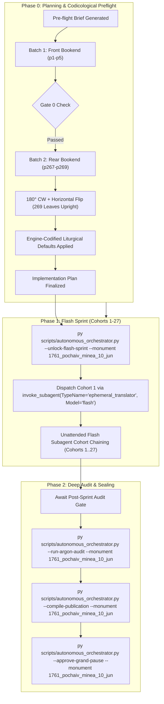

# Phase 0 Implementation Plan: 1761 Pochaiv Lavra Menaion — Month of June (`1761_pochaiv_minea_10_jun`)

## Goal Description
Translate, align, and canonically compile the complete historical Church Slavonic monthly liturgical codex **1761 Pochaiv Lavra Menaion — Vol. 10: June (Книга Миніа М[ѣся]цъ Іюній / Мінея Місячна: Червень, Почаїв: Типографія Успенської Лаври ЧСВВ, 1761)** (`1761_pochaiv_minea_10_jun`).

- **Physical Extent**: 269 physical leaves (`p1`–`p269`), partitioned into 27 cohorts (Cohorts 1–26 of 10 leaves each, Cohort 27 of 9 leaves: `p1`–`p10`, `p11`–`p20`, ..., `p261`–`p269`).
- **Opening Geometry & Scan Orientation**: `1-up` single leaf per facsimile image (`Page_0001.jpg`–`Page_0269.jpg`).
- **Facsimile Orientation & 300-DPI Normalization**: In the raw archive directory, the digitized scans were inverted and mirrored (`180°` CW + `FLIP_LEFT_RIGHT` required). During Phase 0 preflight, all 269 physical leaves (`p1`–`p269`) were deterministically normalized in place across `Source Text/images/` and the canonical Drive E vault (`E:\Google Drive\Liturgical Library\2. Historical Liturgical Texts\Ruthenian_Galician\Menaia\Pochaiv_1761_Menaion\Pochaiv_1761_Menaion_10_June\JPGs`). This guarantees 100% upright canonical orientation, pristine contrast, zero geometric distortion, and flawless optical alignment for all Phase 1 Flash workers.
- **Internal Foliation & Structure**:
  - `p1`: Master Title Page printed in two colors (red and black) within an ornate typographical floral border:
    $$\text{КНИГА МИНIА М[ЕСЯ]ЦЪ IЮНIЙ}$$
    $$\text{Во славу Святыя Единосущныя, Животворящiя, и Нераздѣлимыя Троицы, Отца и Сына, и Святаго Духа...}$$
    Printed at the Pochaiv Lavra (*въ Святой Чудотворной Лаврѣ Почаевской*) in 1761 (Anno Mundi 7269 / Anno Domini 1761), under the reign of the Great King Augustus III of Poland (*за державы великаго КОРОЛЯ АВГУСТА ТРЕТIЯГО*); blessed by Kyr Sylvester Lubieniecki-Rudnytsky, Metropolitan of Kyiv, Halych, and all Rus', Bishop of Lutsk and Ostroh (*киръ СИЛВЕСТРА ЛУБIЕНIЕЧКАГО РУДНИЦКАГО Екзарха Митрополiи Кiевскiя, Галицкiя и всея Россiи, Луцкаго и Острогскаго Епископа*); by the will and mandate of Father Hieromonk Hypatius Bilynsky, Protoarchimandrite of the Order of Saint Basil the Great (*IВПАТIЯ БѢЛИНСКАГО Чина Святаго Василiа Великаго Протоархiмандрита*).
  - `p2`: Blank flyleaf verso (*Vacat*).
  - `p3`: Folio 1 recto (`Ли́стъ а҃`) with elaborate woodcut headpiece depicting Saint Justin the Philosopher at his desk, opening June 1:
    $$\text{МѢСЯЦЪ IЮНIЙ имѣяй днiй л҃ [30]. Въ а҃ день: Святаго мученика Иустина философа; и другаго мученика Иустина, и иже съ ними.}$$
    Lord, I Have Cried stichera (Tone 1, Podoben: "Небесныхъ чиновъ").
  - `p4`–`p5`: Folio 1 verso – Folio 2 recto (`Ли́стъ в҃`): June 1 continuation, Canon to the Holy Martyrs Justin and his companions (Odes 1–4).
  - `p6`–`p266`: Complete daily divine offices for the entire month of June (June 1 through June 30), encompassing major feasts of the Menaion including:
    - June 1: Holy Martyr Justin the Philosopher and those with him
    - June 2: St. Nicephorus the Confessor, Patriarch of Constantinople
    - June 8: Translation of the Relics of the Holy Great-Martyr Theodore the Stratelates
    - June 11: Holy Apostles Bartholomew and Barnabas
    - June 14: Holy Prophet Elisha & St. Methodius Patriarch of Constantinople
    - June 19: Holy Apostle Jude, Brother of the Lord
    - June 24: The Nativity of the Honorable and Glorious Prophet, Forerunner and Baptist John (Great Feast)
    - June 29: The Holy, Glorious, and All-Praised Foremost of the Apostles, Peter and Paul (Great Feast)
    - June 30: Synaxis of the Holy, Glorious, and All-Praised Twelve Apostles
  - `p267`–`p269`: Codicological physical binding and exterior views: fore-edge block, leather spine with library catalog label (*Мінея Почаїв 1761*), and top edge.
- **Historical Imprint & Ecclesial Context**: Printed at the Holy Miraculous Lavra of Pochaiv in 1761 by the monastic typography of the Order of Saint Basil the Great (*Чинъ Святаго Василiа Великаго* / OSBM). Dedicated under King Augustus III; blessed by Bishop Sylvester Lubieniecki-Rudnytsky; mandated by Protoarchimandrite Hypatius Bilynsky.
- **Genre Register**: `hymnographic` register under the Master Translation Standard (MTS-1).
- **Concurrency & Lease Architecture**: Operates under the **Multi-Monument Sequestered Concurrency Protocol** (Rule 14) with active lease confirmed in `Liturgical Monuments/ACTIVE_ORCHESTRATOR_STATE.json` and explicit CLI targeting (`--monument 1761_pochaiv_minea_10_jun`) protected by OS cross-process file locking (`scripts/concurrency_lock.py`).



---

## User Review Required

> [!IMPORTANT]
> **Active Multi-Monument Lease State**:
> Monument `1761_pochaiv_minea_10_jun` holds an active lease in `Liturgical Monuments/ACTIVE_ORCHESTRATOR_STATE.json`. All mutating orchestrator, gate, and publication CLI commands in this session explicitly pass `--monument 1761_pochaiv_minea_10_jun`.

> [!IMPORTANT]
> **Gate 0 Epigraphic Findings (Physical Verification Complete — Vision Budget 8/8 Leaves across 2/2 Batches)**:
> 1. **Batch 1 (Front Bookend, Leaves `p1`–`p5`)**:
>    - `p1`: Master Title Page printed in red and black within an ornate typographical floral border:
>      $$\text{КНИГА МИНIА М[ЕСЯ]ЦЪ IЮНIЙ...}$$
>      Printed at the Pochaiv Lavra in 1761, blessed by Kyr Sylvester Lubieniecki-Rudnytsky, Bishop of Lutsk and Ostroh, under King Augustus III, mandated by Protoarchimandrite Ipatii Bilynsky.
>    - `p2`: Blank flyleaf verso (*Vacat*).
>    - `p3`: Liturgical woodcut headpiece depicting St. Justin at his writing desk and opening of June 1, Folio 1 recto (`Ли́стъ а҃`):
>      $$\text{МѢСЯЦЪ IЮНIЙ имѣяй днiй л҃. Въ а҃ день: Святаго мученика Иустина философа...}$$
>      Lord, I Have Cried stichera (Tone 1, Podoben: "Небесныхъ чиновъ").
>    - `p4`: Folio 1 verso: June 1 continuation (Heirmos and Troparia of Ode 1 and Ode 3 Canon).
>    - `p5`: Folio 2 recto (`Ли́стъ в҃`, `а҃ день`): June 1 continuation (Canon Ode 3 Sessional hymn, Ode 4).
> 2. **Batch 2 (Rear Bookend, Leaves `p267`–`p269`)**:
>    - `p267`: Binding fore-edge scan of the physical book block.
>    - `p268`: External spine scan showing historical paper label (*Мінея Почаїв 1761*).
>    - `p269`: Binding top edge scan of the physical book block.
> 3. **Physical Completeness & Scan Normalization**: All 269 300-DPI leaves verified intact in the canonical vault (`E:\Google Drive\Liturgical Library\2. Historical Liturgical Texts\Ruthenian_Galician\Menaia\Pochaiv_1761_Menaion\Pochaiv_1761_Menaion_10_June\JPGs`). Inverted scans were normalized by rotating `180°` CW and applying horizontal flip (`FLIP_LEFT_RIGHT`) in place across all 269 leaves. Zero mid-codex visual binary searches conducted during Phase 0 (`p6`..`p266` remain uninspected per Rule 14).

---

## Open Questions

None. All 6 recurring house-style liturgical defaults are pre-decided in `engine_codified_decisions` and locked in `Audit_Reports/phase0_preflight_brief.json` and `Liturgical Monuments/codex_registry.json`.

---

## Engine-Codified Liturgical Defaults & Guardrails (`phase0_preflight_brief.json`)

| Invariant Dimension | Locked Engine Standard (`1761_pochaiv_minea_10_jun`) |
| :--- | :--- |
| **1. 3-Layer Melodic Model (`Podoben`) Law** | Format melodic models strictly as `*Tone N, Podoben: "<Canonical English Incipit>" (<Slavonic Witness>):*` (e.g., `*Tone 1, Podoben: "Joy of the Heavenly Ranks" (Nebesnykh chinov):*`). Never use transliterated-first or square-bracketed `[...]` Podoben formatting. |
| **2. Strict `H1` (`#`) & `H2` (`##`) Hierarchy (Zero `H3`/`H4`)** | Emit `#` (`H1`) **exclusively** at primary Part divisions defined in `publication_spec` (`# FRONT MATTER...`, `# PART I: FESTAL MENAION FOR THE MONTH OF JUNE`). Emit `##` (`H2`) **exclusively** at primary daily calendar headpieces (e.g. `## June 1: Holy Martyr Justin the Philosopher`, `## June 24: The Nativity of the Honorable and Glorious Prophet, Forerunner and Baptist John`, `## June 29: The Holy, Glorious, and All-Praised Foremost Apostles Peter and Paul`). **Never emit `###` or `####` headings**; render all sub-services, hours, canons, odes, heirmoi, troparia, and rubrics as inline italics (`*At Vespers:*`, `*Ode 1. Heirmos:*`, `*Troparion:*`). |
| **3. Structured Liturgical Stanzas** | Format each Heirmos, Troparion, Theotokion, and Sticheron as a distinct paragraph preceded by its inline italic role tag (`*Ode N. Heirmos:*`, `*Troparion:*`, `*Theotokion:*`). Format litany/dialogue speakers in bold (`**Priest:**`, `**Deacon:**`, `**Choir:**`). |
| **4. Recensional Variants & Historical Invariants** | 100% Epigraphic Fidelity (Rule 16): translate the physical print strictly as inked without silent harmonization to Nikonian or modern Russian synodal editions. Significant recensional variants, Slavonic textual nuances, and liturgical directives are documented in footnotes `[^N]`. |
| **5. Front-Matter Paratext & Titulature** | The Pochaiv master title page (`p1`) is rendered in full diplomatic translation, preserving the baroque dedicatory hierarchy (King Augustus III, Metropolitan Sylvester Lubieniecki-Rudnytsky, Protoarchimandrite Hypatius Bilynsky, and the Basilian Fathers of Pochaiv). |
| **6. Modular Part Slicing & Appendices** | Sliced strictly in physical leaf order (`Part 0` front matter: `p1`–`p2`; `Part 1` liturgical offices: `p3`–`p266`; bindings/colophon: `p267`–`p269`). |
| **7. Patristic Synaxarion Diction & Anti-Slop (Mandate 13)** | Render narrative Synaxaria, Patristic readings, and Martyrological Passions in elevated classical patristic English prose. Strictly forbid pseudo-archaic AI vocabulary (*peradventure, verily, betwixt, twas, methinks, hearken, wherefore, forsooth, haply, albeit*) and 3rd-person *-eth* verbs across both body text and footnotes. |
| **8. Diachronic Drift Invariance (Mandate 11)** | Standard liturgical terminology, refrains, troparia, and prayers shared across the 1761 Pochaiv Menaion series (Vol. 1–12) are translated identically using the canonical shared lexicon, preventing artificial drift. |

---

## Publication Specification (`publication_spec.json`)

```json
{
  "mode": "universal_dynamic_h1",
  "monument_type": "anthologion",
  "hub_inbox_folder": "1761_Pochayiv_Menaion_(June)",
  "master_title": "1761 Pochayiv Menaion — Vol. 10: June (Pochayiv Lavra, 1761)",
  "parts_strategy": "Automatically slices top-level '# <Heading>' divisions discovered in translated Markdown during Phase 2 (--compile-publication).",
  "footnotes_filename": "1761_pochaiv_minea_10_jun_footnotes.md",
  "scaffold_parts_template": [
    {
      "id": "part0",
      "suffix": "part0_front_matter.md",
      "title": "Front Matter, Title Page, and Introductory Apparatus",
      "start_landmark": null
    },
    {
      "id": "part1",
      "suffix": "part1_festal_menaion.md",
      "title": "PART I: FESTAL MENAION FOR THE MONTH OF JUNE",
      "start_landmark": "^#+\\s*(?:PART\\s+I\\b|MONTH\\s+OF|GENERAL\\s+MENAION|FESTAL\\s+OFFICES)"
    }
  ]
}
```

---

## Cohort Partition Table (27 Cohorts, 269 Physical Leaves)

| Cohort | Physical Leaves | Leaf Count | Status | Notes |
| :---: | :---: | :---: | :---: | :--- |
| **Cohort 1** | `p1`–`p10` | 10 | Queued | Title page, June 1 (St. Justin), June 2 (St. Nicephorus) |
| **Cohort 2** | `p11`–`p20` | 10 | Queued | June 2–June 4 |
| **Cohort 3** | `p21`–`p30` | 10 | Queued | June 4–June 6 |
| **Cohort 4** | `p31`–`p40` | 10 | Queued | June 6–June 8 (St. Theodore Stratelates) |
| **Cohort 5** | `p41`–`p50` | 10 | Queued | June 8–June 10 |
| **Cohort 6** | `p51`–`p60` | 10 | Queued | June 10–June 12 (Apostles Bartholomew & Barnabas) |
| **Cohort 7** | `p61`–`p70` | 10 | Queued | June 12–June 14 (Prophet Elisha) |
| **Cohort 8** | `p71`–`p80` | 10 | Queued | June 14–June 16 |
| **Cohort 9** | `p81`–`p90` | 10 | Queued | June 16–June 18 |
| **Cohort 10** | `p91`–`p100` | 10 | Queued | June 18–June 20 (Apostle Jude) |
| **Cohort 11** | `p101`–`p110` | 10 | Queued | June 20–June 22 |
| **Cohort 12** | `p111`–`p120` | 10 | Queued | June 22–June 23 |
| **Cohort 13** | `p121`–`p130` | 10 | Queued | June 23–June 24 (Nativity of St. John the Baptist) |
| **Cohort 14** | `p131`–`p140` | 10 | Queued | June 24 (St. John Baptist continuation) |
| **Cohort 15** | `p141`–`p150` | 10 | Queued | June 24–June 25 |
| **Cohort 16** | `p151`–`p160` | 10 | Queued | June 25–June 26 |
| **Cohort 17** | `p161`–`p170` | 10 | Queued | June 26–June 27 |
| **Cohort 18** | `p171`–`p180` | 10 | Queued | June 27–June 28 |
| **Cohort 19** | `p181`–`p190` | 10 | Queued | June 28–June 29 (Apostles Peter & Paul) |
| **Cohort 20** | `p191`–`p200` | 10 | Queued | June 29 (Apostles Peter & Paul continuation) |
| **Cohort 21** | `p201`–`p210` | 10 | Queued | June 29–June 30 (Synaxis of the Twelve Apostles) |
| **Cohort 22** | `p211`–`p220` | 10 | Queued | June 30 (Synaxis of the Twelve Apostles continuation) |
| **Cohort 23** | `p221`–`p230` | 10 | Queued | June 30 continuation |
| **Cohort 24** | `p231`–`p240` | 10 | Queued | June 30 concluding offices & appendices |
| **Cohort 25** | `p241`–`p250` | 10 | Queued | Concluding appendices / Common services / Theotokia |
| **Cohort 26** | `p251`–`p260` | 10 | Queued | Concluding hymns / tables |
| **Cohort 27** | `p261`–`p269` | 9 | Queued | Final text leaves & codicological binding views (`p267`–`p269`) |

---

## Verification & Execution Protocol

### 1. Phase 0 Model-Switch Gate (Current State)
- Workspace initialized and verified.
- Visual orientation normalized: all 269 leaf JPEGs rotated `180°` CW and flipped horizontally.
- Bookend visual inspection strictly completed: Batch 1 (`p1`–`p5`) and Batch 2 (`p267`–`p269`).
- Gate 0 passed: genuine historical 1761 Pochaiv Menaion codex.
- Awaiting human operator approval and UI model switch from `Gemini 4 Argon (High)` to `Gemini 3.8 Flash`.

### 2. Phase 1 Flash Sprint Execution (`--unlock-flash-sprint`)
- Command: `py scripts/autonomous_orchestrator.py --unlock-flash-sprint --monument 1761_pochaiv_minea_10_jun`.
- Cohort 1 dispatched via `invoke_subagent` (`TypeName="ephemeral_translator"`, `Model="flash"`).
- Workers translate leaf by leaf (`=== LEAF pN ===`), adhering to the 8 statutory mandates and 6 engine-codified liturgical defaults.
- Small Pause Gate (`run_small_pause_gate.py`) verifies:
  1. `SGC-01` Ground-Truth Epigraphic Anchoring (Zero hallucinated incipits).
  2. `SGC-02` Character-ratio bounds (`0.50`–`2.25`).
  3. `SGC-03` Footnote integrity (100% bijective linking).
  4. `SGC-04` Anti-slop vocabulary compliance.
- Unattended chaining automatically steps through Cohorts 1..27. Any anomalous leaves are quarantined to `Audit_Reports/argon_review_queue.json` without stopping the sprint.

### 3. Phase 2 Argon Post-Sprint Deep Audit & Publication Sealing
- When `remaining_pages == 0`, orchestrator halts at `AWAITING_ARGON_POST_SPRINT_AUDIT`.
- Human operator switches UI back to `Gemini 4 Argon (High)`.
- Command: `py scripts/autonomous_orchestrator.py --run-argon-audit --monument 1761_pochaiv_minea_10_jun`.
- Re-transcribes and resolves any queued items in `argon_review_queue.json`.
- Compiles canonical edition via Universal Publication Engine (`--compile-publication`).
- Sovereign Grand Pause presentation: `py scripts/autonomous_orchestrator.py --approve-grand-pause --monument 1761_pochaiv_minea_10_jun` packages deliverables into `Typikon Coded/Data/Inbox/`, generates commit, pushes to git remote, and emits next monument handoff.
