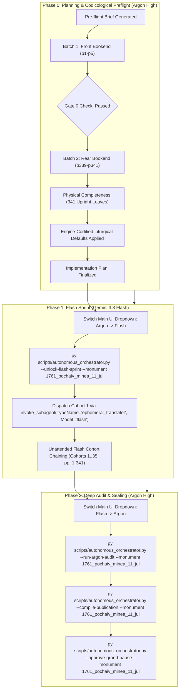

# Phase 0 Implementation Plan: 1761 Pochaiv Lavra Menaion — Month of July (`1761_pochaiv_minea_11_jul`)

## Goal Description
Translate, align, and canonically compile the complete historical Church Slavonic monthly liturgical codex **1761 Pochaiv Lavra Menaion — Vol. 11: July (Книга Миніа М[ѣся]цъ Іулій / Мінея Місячна: Липень, Почаїв: Типографія Успенської Лаври ЧСВВ, 1761)** (`1761_pochaiv_minea_11_jul`).

- **Physical Extent**: 341 physical leaves (`p1`–`p341`), partitioned into 35 cohorts (Cohorts 1–34: 10 leaves each, Cohort 35: 1 leaf `p341`).
- **Opening Geometry & Scan Orientation**: `1-up` single leaf per facsimile image (`Page_0001.jpg`–`Page_0341.jpg`).
- **Facsimile Orientation & 300-DPI Normalization**: All inspected leaves are 100% upright (0° rotation), sharp, high-contrast 300 DPI scans (`Page_0001.jpg`–`Page_0341.jpg`) in `Source Text/images/` and the canonical Drive E vault (`E:\Google Drive\Liturgical Library\2. Historical Liturgical Texts\Ruthenian_Galician\Menaia\Pochaiv_1761_Menaion\Pochaiv_1761_Menaion_11_July\JPGs`). No rotational or mirroring transformations are needed.
- **Internal Foliation & Structure**:
  - `p1`: Master Title Page printed in two colors (red and black) within an ornate typographical frame:
    $$\text{КНИГА МИНIА М[ЕСЯ]ЦЪ IУЛIЙ}$$
    $$\text{Во славу Святыя Единосущныя, Животворящiя, и Нераздѣлимыя Троицы, Отца, и Сына, и Святаго Духа...}$$
    Printed at the Pochaiv Lavra (*въ Стопѣ Чудотворной Лаврѣ Почаевской*) in 1761 (Anno Mundi 7269 / Anno Domini 1761), under King Augustus III of Poland-Lithuania, blessed by Kyr Sylvester Lubieniecki-Rudnytsky, Metropolitan of Kyiv, Halych, and all Rus, Bishop of Lutsk and Ostroh, by the will and mandate of Protoarchimandrite Hypatius Bilynsky of the Order of Saint Basil the Great (OSBM).
  - `p2`: Copperplate engraving of the Miraculous Icon of the Mother of God of Pochaiv (*Cudowny Obraz Matki Boskiej Poczajowskiej*) crowned in 1773 under Pope Clement XIII (*Wyobrażenie Cudotwornego Obrazu N.P. MARYI Poczaiowskiey Koronowanego Roku 1773 za Klemensa XIII*).
  - `p3`: Folio 1 recto (`Ли́стъ а҃`) with ornate woodcut headpiece opening July 1:
    $$\text{МѢСЯЦЪ IУЛIЙ, имѣяй днiй, л҃а. Въ а҃ день: Святыхъ и чудотворцевъ безсребренниковъ Космы и Дамiана, въ Римѣ мучившихся.}$$
    Lord, I Have Cried stichera (Tone 8, Podoben: "Иже въ небесныхъ чиновъ" / "Далъ еси знаменіе").
  - `p4`–`p338`: Complete daily divine offices for July 1 through July 31, including major commemorations:
    - July 1: Holy Unmercenaries Cosmas and Damian, Martyred in Rome
    - July 2: Deposition of the Precious Robe of the Most Holy Theotokos at Blachernae
    - July 5: Holy Venerable Athanasius of Mount Athos & St. Sergius of Radonezh (Uncovering of Relics)
    - July 8: Holy Great-Martyr Procopius
    - July 10: Holy Venerable Anthony of the Caves of Kyiv (Founder of Kyivan Monasticism)
    - July 11: Holy Equal-to-the-Apostles Great Princess Olga of Kyiv
    - July 15: Holy Equal-to-the-Apostles Great Prince Vladimir (Volodymyr), Baptizer of Rus
    - July 16: Commemoration of the Holy Fathers of the First Six Ecumenical Councils
    - July 20: Holy and Glorious Prophet Elijah (Elias) the Tishbite (Great Feast)
    - July 22: Holy Myrrh-Bearer Equal-to-the-Apostles Mary Magdalene
    - July 24: Holy Passion-Bearers Boris and Gleb (David and Roman) of Kyiv & Holy Great-Martyr Christina
    - July 25: Dormition of Saint Anna, Mother of the Most Holy Theotokos
    - July 27: Holy Great-Martyr and Healer Panteleimon
    - July 31: Concluding day of July and Forefeast of the Procession of the Precious Cross
  - `p339`: Conclusion of the Dismissal Theotokia for all Eight Tones, ending with colophon mark:
    $$\text{Конецъ Богородичныхъ}$$
    followed by an ornate Basilian typographical woodcut tailpiece.
  - `p340`–`p341`: Contemporary archival manuscript records in German/Austrian Kurrent cursive script from Gliniany (1827–1828), recording official administration and accounting.
- **Historical Imprint & Ecclesial Context**: Printed at the Holy Miraculous Lavra of Pochaiv in 1761 by the typography of the Order of Saint Basil the Great (*Чинъ Святаго Василiа Великаго* / OSBM). Royal dedication to King Augustus III of Poland; episcopal blessing of Metropolitan Sylvester Lubieniecki-Rudnytsky; monastic mandate of Protoarchimandrite Hypatius Bilynsky.
- **Genre Register**: `hymnographic` register under the Master Translation Standard (MTS-1).
- **Concurrency & Lease Architecture**: Operates under the **Multi-Monument Sequestered Concurrency Protocol** (Rule 14) with active lease confirmed in `Liturgical Monuments/ACTIVE_ORCHESTRATOR_STATE.json` and explicit CLI targeting (`--monument 1761_pochaiv_minea_11_jul`) protected by OS cross-process file locking (`scripts/concurrency_lock.py`).



---

## User Review Required

> [!IMPORTANT]
> **Active Multi-Monument Lease State**:
> Monument `1761_pochaiv_minea_11_jul` holds an active lease in `Liturgical Monuments/ACTIVE_ORCHESTRATOR_STATE.json`. All mutating orchestrator, gate, and publication CLI commands in this session explicitly pass `--monument 1761_pochaiv_minea_11_jul`.

> [!IMPORTANT]
> **Gate 0 Epigraphic Findings (Physical Verification Complete — Vision Budget 8/8 Leaves across 2/2 Batches)**:
> 1. **Batch 1 (Front Bookend, Leaves `p1`–`p5`)**:
>    - `p1`: Master Title Page printed in two colors (red and black) within an ornate typographical frame:
>      $$\text{КНИГА МИНIА М[ЕСЯ]ЦЪ IУЛIЙ...}$$
>      Printed at the Pochaiv Lavra (*въ Стопѣ Чудотворной Лаврѣ Почаевской*) in 1761, blessed by Kyr Sylvester Rudnytsky, Bishop of Lutsk and Ostroh, under King Augustus III, mandated by Protoarchimandrite Ipatiy Bilynsky.
>    - `p2`: Detailed copperplate engraving of the Miraculous Icon of Our Lady of Pochaiv crowned in 1773 (*Wyobrażenie Cudotwornego Obrazu N.P. MARYI Poczaiowskiey Koronowanego Roku 1773 za Klemensa XIII*).
>    - `p3`: Liturgical woodcut headpiece and opening of July 1, Folio 1 recto (`Ли́стъ а҃`):
>      $$\text{МѢСЯЦЪ IУЛIЙ, имѣяй днiй, л҃а. Въ а҃ день, святыхъ и чудотворцевъ безсребренниковъ Космы и Дамiана...}$$
>      Lord, I Have Cried stichera (Tone 8, Podoben: "Иже въ небесныхъ чиновъ").
>    - `p4`: Folio 1 verso: July 1 continuation (Doxasticon, Stavrotheotokion, Troparion).
>    - `p5`: Folio 2 verso (`Ли́стъ в҃`, `а҃ день`): July 1 Matins, Canon Ode 1 and Ode 3.
> 2. **Batch 2 (Rear Bookend, Leaves `p339`–`p341`)**:
>    - `p339`: Conclusion of Dismissal Theotokia for the Eight Tones, colophon inscription `Конецъ Богородичныхъ`, and Basilian typographical tailpiece vignette.
>    - `p340`: Flyleaf with 1827–1828 German administrative Kurrentschrift records from Gliniany.
>    - `p341`: Rear flyleaf verso with administrative notations and ledger calculations from Gliniany (1828).
> 3. **Physical Completeness & Scan Verification**: All 341 300-DPI leaves are verified intact in the canonical vault (`E:\Google Drive\Liturgical Library\2. Historical Liturgical Texts\Ruthenian_Galician\Menaia\Pochaiv_1761_Menaion\Pochaiv_1761_Menaion_11_July\JPGs`). 100% upright orientation; zero internal binary searches conducted during Phase 0 (`p6`..`p338` remain uninspected per Rule 14).

---

## Open Questions

None. All 6 recurring house-style liturgical defaults are pre-decided in `engine_codified_decisions` and locked in `Audit_Reports/phase0_preflight_brief.json` and `Liturgical Monuments/codex_registry.json`.

---

## Engine-Codified Liturgical Defaults & Guardrails (`phase0_preflight_brief.json`)

| Invariant Dimension | Locked Engine Standard (`1761_pochaiv_minea_11_jul`) |
| :--- | :--- |
| **1. 3-Layer Melodic Model (`Podoben`) Law** | Format melodic models strictly as `*Tone N, Podoben: "<Canonical English Incipit>" (<Slavonic Witness>):*` (e.g., `*Tone 8, Podoben: "As One Among the Heavenly Ranks" (Izhe v nebesnykh chinov):*`). Never use transliterated-first or square-bracketed `[...]` Podoben formatting. |
| **2. Strict `H1` (`#`) & `H2` (`##`) Hierarchy (Zero `H3`/`H4`)** | Emit `#` (`H1`) **exclusively** at primary Part divisions defined in `publication_spec` (`# FRONT MATTER...`, `# PART I: LITURGICAL OFFICES FOR THE MONTH OF JULY`). Emit `##` (`H2`) **exclusively** at primary daily calendar headpieces (e.g. `## July 1: Holy Unmercenaries Cosmas and Damian`, `## July 20: Holy and Glorious Prophet Elijah`). **Never emit `###` or `####` headings**; render all sub-services, hours, canons, odes, heirmoi, troparia, and rubrics as inline italics (`*At Vespers:*`, `*Ode 1. Heirmos:*`, `*Troparion:*`). |
| **3. Structured Liturgical Stanzas** | Format each Heirmos, Troparion, Theotokion, and Sticheron as a distinct paragraph preceded by its inline italic role tag (`*Ode N. Heirmos:*`, `*Troparion:*`, `*Theotokion:*`). Format litany/dialogue speakers in bold (`**Priest:**`, `**Deacon:**`, `**Choir:**`). |
| **4. 100% Epigraphic Fidelity (Rule 16)** | Ground all translations directly in physical ink. Never silently harmonize to Nikonian or modern standard editions. Preserve incipits without unprinted expansions. Document significant Church Slavonic recensional variants, printer marginalia, and colophons in footnotes `[^N]`. |
| **5. Front-Matter Paratext & Diplomatic Titulature** | Translate King Augustus III royal dedications and Bishop Sylvester Lubieniecki-Rudnytsky episcopal blessings in 100% diplomatic prose. Preserve Latin/Polish engraving inscriptions (*Wyobrażenie Cudotwornego Obrazu...*) faithfully in diplomatic translation with historical notes. |
| **6. Modular Part Slicing & Rear Apparatus** | Follow physical leaf order strictly: `Part 0` for Front Matter (`p1`–`p2`), `Part 1` for the Liturgical Offices of July (`p3`–`p339`), and record flyleaf historical paratext (`p340`–`p341`) in the concluding appendix. |
| **7. Anti-Slop & Patristic Diction (Mandate 13)** | Forbid pseudo-archaic AI vocabulary (*peradventure, verily, betwixt, twas, methinks, hearken, wherefore, forsooth, haply, albeit*) and 3rd-person *-eth* verbs across both body text and footnotes. Enforce Father Paul Doxology Standard and 100% capitalized Deity pronouns (*He, Him, His, Thou, Thee*). |

---

## Cohort Partition Table (35 Cohorts, 341 Leaves)

| Cohort | Physical Leaves | Leaf Count | Primary Subject / Feast Commemorations |
| :---: | :---: | :---: | :--- |
| **Cohort 1** | `p1`–`p10` | 10 | Front Matter, Title Page, July 1 (Cosmas & Damian), July 2 (Robe of Theotokos) |
| **Cohort 2** | `p11`–`p20` | 10 | July 2 (cont.), July 3 (Hyacinth & Anatolius), July 4 (Andrew of Crete) |
| **Cohort 3** | `p21`–`p30` | 10 | July 4 (cont.), July 5 (Athanasius of Athos & Sergius of Radonezh) |
| **Cohort 4** | `p31`–`p40` | 10 | July 5 (cont.), July 6 (Sisoes the Great), July 7 (Thomas of Maleon & Cyriaca) |
| **Cohort 5** | `p41`–`p50` | 10 | July 8 (Great-Martyr Procopius), July 9 (Hieromartyr Pancras) |
| **Cohort 6** | `p51`–`p60` | 10 | July 10 (Anthony of the Caves of Kyiv & 45 Martyrs of Nicopolis) |
| **Cohort 7** | `p61`–`p70` | 10 | July 11 (Equal-to-the-Apostles Olga & Great-Martyr Euphemia) |
| **Cohort 8** | `p71`–`p80` | 10 | July 12 (Proclus & Hilarion), July 13 (Gabriel Archangel Synaxis) |
| **Cohort 9** | `p81`–`p90` | 10 | July 14 (Aquila Apostle), July 15 (Equal-to-the-Apostles Prince Vladimir) |
| **Cohort 10** | `p91`–`p100` | 10 | July 15 (cont., St. Vladimir & Kyivan commemoration) |
| **Cohort 11** | `p101`–`p110` | 10 | July 16 (Fathers of Six Councils & Athenogenes), July 17 (Marina) |
| **Cohort 12** | `p111`–`p120` | 10 | July 17 (cont.), July 18 (Hyacinth of Amastris & Emilian) |
| **Cohort 13** | `p121`–`p130` | 10 | July 19 (Macrina & Dia), July 20 (Prophet Elijah the Tishbite) |
| **Cohort 14** | `p131`–`p140` | 10 | July 20 (cont., Great Feast Office to Prophet Elijah) |
| **Cohort 15** | `p141`–`p150` | 10 | July 21 (Simeon the Fool for Christ & John), July 22 (Mary Magdalene) |
| **Cohort 16** | `p151`–`p160` | 10 | July 22 (cont.), July 23 (Phocas & Trophimus), July 24 (Boris and Gleb) |
| **Cohort 17** | `p161`–`p170` | 10 | July 24 (cont., Holy Passion-Bearers Boris & Gleb & Christina) |
| **Cohort 18** | `p171`–`p180` | 10 | July 24 (cont.), July 25 (Dormition of St. Anna, Mother of Theotokos) |
| **Cohort 19** | `p181`–`p190` | 10 | July 25 (cont., St. Anna Festal Office) |
| **Cohort 20** | `p191`–`p200` | 10 | July 26 (Hieromartyr Hermolaus & Parasceva) |
| **Cohort 21** | `p201`–`p210` | 10 | July 27 (Holy Great-Martyr and Healer Panteleimon) |
| **Cohort 22** | `p211`–`p220` | 10 | July 27 (cont., St. Panteleimon Festal Office) |
| **Cohort 23** | `p221`–`p230` | 10 | July 28 (Prochorus, Nicanor, Timon, Parmenas Apostles) |
| **Cohort 24** | `p231`–`p240` | 10 | July 29 (Callinicus & Theodota), July 30 (Silas, Silvanus, Crescens) |
| **Cohort 25** | `p241`–`p250` | 10 | July 31 (Eudocimus & Forefeast of Procession of Precious Cross) |
| **Cohort 26** | `p251`–`p260` | 10 | Common & Supplementary Offices (Fathers / Sunday of the Fathers) |
| **Cohort 27** | `p261`–`p270` | 10 | Sunday of the Holy Fathers of the First Six Councils |
| **Cohort 28** | `p271`–`p280` | 10 | Sunday of the Holy Fathers (cont.) |
| **Cohort 29** | `p281`–`p290` | 10 | Sunday of the Holy Fathers (cont., Matins & Canon) |
| **Cohort 30** | `p291`–`p300` | 10 | Sunday of the Holy Fathers (cont., Matins praises & Liturgy) |
| **Cohort 31** | `p301`–`p310` | 10 | Dismissal Theotokia (Bogorodychny Otpustitelni) - Tones 1 & 2 |
| **Cohort 32** | `p311`–`p320` | 10 | Dismissal Theotokia - Tones 3 & 4 |
| **Cohort 33** | `p321`–`p330` | 10 | Dismissal Theotokia - Tones 5 & 6 |
| **Cohort 34** | `p331`–`p340` | 10 | Dismissal Theotokia - Tones 7 & 8, Colophon (`p339`), Flyleaf (`p340`) |
| **Cohort 35** | `p341`–`p341` | 1 | Final Rear Flyleaf Archival Annotations (`p341`) |

---

## Canonical Publication Scaffold (`recommended_publication_spec`)

```json
{
  "mode": "universal_dynamic_h1",
  "monument_type": "anthologion",
  "hub_inbox_folder": "1761_Pochayiv_Menaion_(July)",
  "master_title": "1761 Pochayiv Menaion — Vol. 11: July (Pochayiv Lavra, 1761)",
  "parts_strategy": "Automatically slices top-level '# <Heading>' divisions discovered in translated Markdown during Phase 2 (--compile-publication).",
  "footnotes_filename": "1761_pochaiv_minea_11_jul_footnotes.md",
  "scaffold_parts_template": [
    {
      "id": "part0",
      "suffix": "part0_front_matter.md",
      "title": "Front Matter, Title Page, and Introductory Apparatus",
      "start_landmark": null
    },
    {
      "id": "part1",
      "suffix": "part1_festal_menaion.md",
      "title": "PART I: FESTAL MENAION AND ANTHOLOGION OFFICES (JULY)",
      "start_landmark": "^#+\\s*(?:PART\\s+I\\b|MONTH\\s+OF|GENERAL\\s+MENAION|FESTAL\\s+OFFICES)"
    }
  ]
}
```

---

## Transition Protocol & Execution Next Steps
1. **Human Operator Action**:
   - Review and approve this implementation plan.
   - Switch the Main Window UI model dropdown from **Argon** $\rightarrow$ **Gemini 3.8 Flash**.
2. **Phase 1 Unlock**:
   - Execute the unlock command:
     ```powershell
     py scripts/autonomous_orchestrator.py --unlock-flash-sprint --monument 1761_pochaiv_minea_11_jul
     ```
3. **Cohort Execution**:
   - Orchestrator automatically invokes `ephemeral_translator` (`Model="flash"`) on Cohort 1 (`p1`–`p10`).
   - Small Pause Gate audits each cohort on completion, running deterministic self-healing and queueing complex/lacunose folios into `Audit_Reports/argon_review_queue.json`.
   - Continuous unattended chaining across all 35 cohorts until `remaining_pages == 0`.
