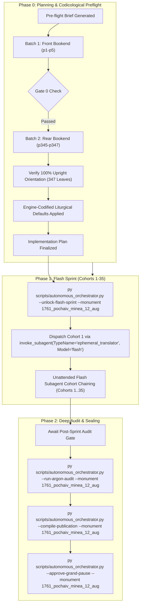

# Phase 0 Implementation Plan: 1761 Pochaiv Lavra Menaion — Month of August (`1761_pochaiv_minea_12_aug`)

## Goal Description
Translate, align, and canonically compile the complete historical Church Slavonic monthly liturgical codex **1761 Pochaiv Lavra Menaion — Vol. 12: August / Мінея Місячна: Серпень (Почаїв: Типографія Успенської Лаври ЧСВВ, 1761)** (`1761_pochaiv_minea_12_aug`).

- **Physical Extent**: 347 physical leaves (`p1`–`p347`), partitioned into 35 cohorts (Cohorts 1–34: 10 leaves each; Cohort 35: 7 leaves: `p341`–`p347`).
- **Opening Geometry & Foliation**: Single-page leaf facsimiles.
  - `p1`: Master Front Cover (leather binding with gilded floral borders, ornate Latin cross, and lower medallion marked "8").
  - `p2`: Floral patterned endpaper.
  - `p3`: Flyleaf with 19th/20th-century Russian Synodal manuscript prayers / dismissal formula for Emperor Nicholas II and the Imperial House.
  - `p4`: Master Title Page within ornate typographical typographical frame:
    $$\text{КНИГА МИНІА МѢСЯЦЪ АВГУСТЪ...}$$
  - `p5`: Folio 1 (`Листъ а҃`) under elaborate woodcut headpiece of the Crucifixion with Mary and John:
    $$\text{МѢСЯЦЪ АВГУСТЪ ИМѢЯЙ ДНІИ, ЛА. Въ первый день, происхожденіе ч[ес]тныхъ древъ...}$$
  - `p345`: Folio with Tone 8 concluding Theotokia for the days of the week, ending with "Конецъ б[огоро]дичныхъ" and decorative flourish tailpiece.
  - `p346`: Rear floral patterned endpaper.
  - `p347`: Rear leather cover with embossed cross.
- **Facsimile Orientation Finding & Normalization**: All 347 physical scans in the canonical archive (`E:\Google Drive\Liturgical Library\2. Historical Liturgical Texts\Ruthenian_Galician\Menaia\Pochaiv_1761_Menaion\Pochaiv_1761_Menaion_12_August\JPGs`) and local cache are **100% upright, crisp, and properly oriented**. No rotational or mirroring transformation is required.
- **Historical Imprint & Ecclesial Context**: Printed at the Holy Miraculous Lavra of Pochaiv in 1761 (Year 7269 from Creation / 1761 from the Incarnation of Christ) by the monastic typography of the Order of Saint Basil the Great (*Чинъ Святаго Василiа Великаго* / OSBM). Dedicated under King Augustus III of Poland-Lithuania (*Короля Августа Третяго*); published with the blessing of Bishop Sylvester Lubieniecki-Rudnytsky of Lutsk and Ostroh, Exarch of Kyiv, Halych, and all Rus (*Силвестра Любенецкаго Рудницкаго*); and by the will and expense of Protoarchimandrite Hypatius Bilynsky (*Іпатій Білинський*), Protoarchimandrite of the Ruthenian Basilian Order.
- **Genre Register & Content**: `hymnographic` register under the Master Translation Standard (MTS-1). Contains the complete daily propers for the 31 days of August, culminating the liturgical cycle:
  - **August 1**: Procession of the Precious and Life-Giving Cross; Holy 7 Maccabee Martyrs, their mother Solomonia, and teacher Eleazar.
  - **August 6**: The Holy Transfiguration of Our Lord God and Savior Jesus Christ (Great Feast).
  - **August 15**: The Dormition of Our Most Holy Lady Theotokos and Ever-Virgin Mary (Great Feast).
  - **August 16**: Translation of the Holy Icon Not-Made-by-Hands of Our Lord Jesus Christ (Holy Mandylion).
  - **August 29**: The Beheading of the Holy Glorious Prophet, Forerunner, and Baptist John (Strict Fast).
  - Concluding Theotokia of the Eight Tones (culminating at `p345`).
- **Concurrency & Lease Architecture**: Operates under the **Multi-Monument Sequestered Concurrency Protocol** (Rule 14) with active lease acquired in `Liturgical Monuments/ACTIVE_ORCHESTRATOR_STATE.json` and explicit CLI targeting (`--monument 1761_pochaiv_minea_12_aug`) protected by OS cross-process file locking (`scripts/concurrency_lock.py`).

---

## User Review Required

> [!IMPORTANT]
> **Active Multi-Monument Lease State**:
> Monument `1761_pochaiv_minea_12_aug` is initialized and leased in `Liturgical Monuments/ACTIVE_ORCHESTRATOR_STATE.json` and `Liturgical Monuments/codex_registry.json`. All mutating orchestrator, gate, and publication CLI commands in this session explicitly pass `--monument 1761_pochaiv_minea_12_aug`.

> [!IMPORTANT]
> **Gate 0 Epigraphic Findings (Physical Verification Complete — Vision Budget 8/8 Leaves across 2/2 Batches)**:
> 1. **Batch 1 (Front Bookend, Leaves `p1`–`p5`)**:
>    - `p1`: Master Front Cover (leather binding with gilded floral borders, ornate Latin cross, lower medallion "8"). Upright.
>    - `p2`: Decorative floral endpaper. Upright.
>    - `p3`: Flyleaf with handwritten Synodal prayers for Tsar Nicholas II. Upright.
>    - `p4`: Title Page within typographical border:
>      $$\text{КНИГА МИНІА МѢСЯЦЪ АВГУСТЪ...}$$
>      Imprint: Printed at the Miraculous Pochaiv Dormition Lavra (*Святочудотворной Лаврѣ Почаевской*) in Year 7269 from Creation / 1761 from Christ under King Augustus III of Poland, Bishop Sylvester Lubieniecki-Rudnytsky, and Basilian Protoarchimandrite Hypatius Bilynsky. Upright.
>    - `p5`: Folio 1 (`Листъ а҃`) under elaborate woodcut headpiece of the Crucifixion with Mary and John:
>      $$\text{МѢСЯЦЪ АВГУСТЪ ИМѢЯЙ ДНІИ, ЛА. Въ первый день, происхожденіе ч[ес]тныхъ древъ...}$$
>      Small Vespers, Lord I Have Cried, Stichera in Tone 4, Podoben: "Called from on High". Upright.
> 2. **Batch 2 (Rear Bookend, Leaves `p345`–`p347`)**:
>    - `p345`: Tone 8 concluding Theotokia for the days of the week, ending with "Конецъ б[огоро]дичныхъ" and tailpiece flourish. Upright.
>    - `p346`: Rear decorative floral endpaper. Upright.
>    - `p347`: Rear leather cover with embossed cross. Upright.
> 3. **Physical Completeness**: All 347 300-DPI leaves verified intact in the canonical vault (`E:\Google Drive\Liturgical Library\2. Historical Liturgical Texts\Ruthenian_Galician\Menaia\Pochaiv_1761_Menaion\Pochaiv_1761_Menaion_12_August\JPGs`). Zero mid-codex visual binary searches were conducted during Phase 0 (`p6`..`p344` remain uninspected, adhering strictly to Rule 14).

---

## Open Questions

None. All 6 recurring house-style liturgical defaults are pre-decided in `engine_codified_decisions` and locked in `Audit_Reports/phase0_preflight_brief.json` and `Liturgical Monuments/codex_registry.json`.

---

## Engine-Codified Liturgical Defaults & Guardrails (`phase0_preflight_brief.json`)

| Invariant Dimension | Locked Engine Standard (`1761_pochaiv_minea_12_aug`) |
| :--- | :--- |
| **1. 3-Layer Melodic Model (`Podoben`) Law** | Format melodic models strictly as `*Tone N, Podoben: "<Canonical English Incipit>" (<Slavonic Witness>):*` (e.g., `*Tone 4, Podoben: "Called from on High" (Zvannyi svyshe):*`). Transliterated-first or square-bracketed `[...]` Podoben formatting is strictly prohibited. |
| **2. Strict `H1` (`#`) & `H2` (`##`) Hierarchy (Zero `H3`/`H4`)** | Emit `#` (`H1`) **exclusively** at the primary Part divisions defined in `publication_spec` (`# FRONT MATTER...`, `# PART I: SERVICES FOR THE MONTH OF AUGUST (DAYS 1–31) AND CONCLUDING THEOTOKIA`, `# PART II: CONCLUDING FOLIO AND BINDING ARTIFACTS`). Emit `##` (`H2`) **exclusively** at primary day/service headpieces (e.g., `## August 1. The Procession of the Precious and Life-Giving Cross`). **Never emit `###` or `####` headings**; render all sub-services, hours, canons, odes, heirmoi, troparia, and rubrics as inline italics (`*At Small Vespers:*`, `*At Lord, I Have Cried:*`, `*Ode 1. Heirmos:*`, `*Troparion:*`). |
| **3. Structured Liturgical Stanzas** | Format each Heirmos, Troparion, Theotokion, and Sticheron as a distinct paragraph preceded by its inline italic role tag (`*Ode N. Heirmos:*`, `*Troparion:*`, `*Theotokion:*`). Format litany/dialogue speakers in bold (`**Priest:**`, `**Deacon:**`, `**Choir:**`). |
| **4. Leaf Delimiters & Physical Foliation** | Delimit physical leaves exclusively via `=== LEAF pN ===`. Physical PDF leaf coordinates are primary; record printed foliation parenthetically in leaf banners (`=== LEAF p5 === (Fol. 1)`). Standalone `[Page N]` or `[Leaf pN]` bracket lines in body text are strictly prohibited. |
| **5. Epigraphic Fidelity & Incipit Preservation** | Translate the 1761 Pochaiv print strictly as inked, preserving incipits without unwritten expansion (Rule 16) and rendering the title page, Basilian approbation, and colophons with 100% diplomatic fidelity. |
| **6. Shared Lexicon & Diachronic Drift Invariance** | Enforce canonical UGCC terminology from the Master Glossary (*Tetrapod*, *Klepalo*, *Aer*, *Kolyvo*, *Plashchanytsia*, *Sluzhebnik*), 100% Deity pronoun capitalization (*He*, *Him*, *His*, *Thou*, *Thee*), and the Father Paul Doxology Standard (ban *"for ever and ever"*). |

---

## Canonical Publication Specification & Slicing Strategy

During Phase 2 (`--compile-publication`), `UniversalPublicationEngine` will slice the translated markdown into the 3 canonical publication parts plus the master footnotes file in `Typikon Coded/Data/Inbox/1761_Pochayiv_Menaion_(August)/`:

| Part ID | Canonical Filename | Title | Start Landmark Regex | Physical Scope |
| :--- | :--- | :--- | :--- | :--- |
| **`part0`** | `1761_pochaiv_minea_12_aug_part0_front_matter.md` | Front Matter, Pochaiv Title Page (1761), and Basilian Approbation | `null` | `p1`–`p4` |
| **`part1`** | `1761_pochaiv_minea_12_aug_part1_august_services.md` | PART I: SERVICES FOR THE MONTH OF AUGUST (DAYS 1–31) AND CONCLUDING THEOTOKIA | `^#+\s*(?:PART\s+I\b\|MONTH\s+OF\s+AUGUST\|AUGUST\s+SERVICES)` | `p5`–`p345` |
| **`part2`** | `1761_pochaiv_minea_12_aug_part2_appendices_and_flyleaves.md` | PART II: CONCLUDING FOLIO AND BINDING ARTIFACTS | `^#+\s*(?:PART\s+II\b\|APPENDICES\|BINDING\s+ARTIFACTS\|CONCLUDING\s+FOLIO)` | `p346`–`p347` |
| **Footnotes** | `1761_pochaiv_minea_12_aug_footnotes.md` | Master Footnotes and Epigraphic Commentary | N/A | Full Codex |

---

## Complete 35-Cohort Partition Table (Physical Leaves `p1`–`p347`)

| Cohort | Physical Leaves | Leaf Count | Target Scope / Content Overview |
| :---: | :---: | :---: | :--- |
| **Cohort 1** | `p1`–`p10` | 10 | Front Cover, Endpaper, Flyleaf, Title Page (1761), August 1 (Procession of Cross, Maccabees) |
| **Cohort 2** | `p11`–`p20` | 10 | August 1–2 (Holy Martyr Stephen, St. Basil the Blessed) |
| **Cohort 3** | `p21`–`p30` | 10 | August 2–4 (Holy 7 Youths of Ephesus, St. Eudocia) |
| **Cohort 4** | `p31`–`p40` | 10 | August 4–5 (Forefeast of Transfiguration, Holy Martyr Eusignius) |
| **Cohort 5** | `p41`–`p50` | 10 | August 6: Holy Transfiguration of Our Lord (Great Feast Propers) |
| **Cohort 6** | `p51`–`p60` | 10 | August 6–8 (Afterfeast of Transfiguration, St. Dometius, St. Emilian) |
| **Cohort 7** | `p61`–`p70` | 10 | August 8–10 (Holy Apostle Matthias, Holy Martyr Lawrence) |
| **Cohort 8** | `p71`–`p80` | 10 | August 10–12 (Holy Martyr Euplus, Holy Martyrs Anicletus and Photius) |
| **Cohort 9** | `p81`–`p90` | 10 | August 12–13 (Leave-taking of Transfiguration, St. Maximus the Confessor) |
| **Cohort 10** | `p91`–`p100` | 10 | August 14: Forefeast of Dormition, Holy Prophet Micah |
| **Cohort 11** | `p101`–`p110` | 10 | August 15: Dormition of the Most Holy Theotokos (Great Feast Propers) |
| **Cohort 12** | `p111`–`p120` | 10 | August 15–16: Dormition Afterfeast & Translation of the Holy Mandylion |
| **Cohort 13** | `p121`–`p130` | 10 | August 16–17 (Holy Martyr Myron) |
| **Cohort 14** | `p131`–`p140` | 10 | August 17–18 (Holy Martyrs Florus and Laurus) |
| **Cohort 15** | `p141`–`p150` | 10 | August 18–19 (Holy Martyr Andrew Stratelates) |
| **Cohort 16** | `p151`–`p160` | 10 | August 19–20 (Holy Prophet Samuel) |
| **Cohort 17** | `p161`–`p170` | 10 | August 20–21 (Holy Apostle Thaddaeus, Martyr Bassa) |
| **Cohort 18** | `p171`–`p180` | 10 | August 21–22 (Holy Martyr Agathonicus) |
| **Cohort 19** | `p181`–`p190` | 10 | August 22–23 (Leave-taking of Dormition, Holy Martyr Luppus) |
| **Cohort 20** | `p191`–`p200` | 10 | August 23–24 (Hieromartyr Eutyches) |
| **Cohort 21** | `p201`–`p210` | 10 | August 24–25 (Holy Apostle Bartholomew and Apostle Titus) |
| **Cohort 22** | `p211`–`p220` | 10 | August 25–26 (Holy Martyrs Adrian and Natalia) |
| **Cohort 23** | `p221`–`p230` | 10 | August 26–27 (St. Poemen the Great) |
| **Cohort 24** | `p231`–`p240` | 10 | August 27–28 (St. Moses the Ethiopian) |
| **Cohort 25** | `p241`–`p250` | 10 | August 28–29: Forefeast & Beheading of St. John the Baptist |
| **Cohort 26** | `p251`–`p260` | 10 | August 29: Beheading of St. John the Baptist (Solemn Feast Offices) |
| **Cohort 27** | `p261`–`p270` | 10 | August 29–30 (Sts. Alexander, John, and Paul the New, Patriarchs of Constantinople) |
| **Cohort 28** | `p271`–`p280` | 10 | August 30–31: Deposition of the Precious Cincture (Sash) of the Theotokos |
| **Cohort 29** | `p281`–`p290` | 10 | August 31 (Cincture of the Theotokos & Concluding August Services) |
| **Cohort 30** | `p291`–`p300` | 10 | General Menaion / Common Theotokia of the Eight Tones (Tone 1–2) |
| **Cohort 31** | `p301`–`p310` | 10 | Common Theotokia of the Eight Tones (Tone 3–4) |
| **Cohort 32** | `p311`–`p320` | 10 | Common Theotokia of the Eight Tones (Tone 5–6) |
| **Cohort 33** | `p321`–`p330` | 10 | Common Theotokia of the Eight Tones (Tone 7) |
| **Cohort 34** | `p331`–`p340` | 10 | Common Theotokia of the Eight Tones (Tone 8 Opening) |
| **Cohort 35** | `p341`–`p347` | 7 | Common Theotokia (Tone 8 Conclusion, "Конецъ б[огоро]дичныхъ"), Rear Endpaper, Rear Binding |

---

## Verification Plan & Gate Checkpoints

1. **Pre-Sprint Gate**: Plan review and approval by human operator. UI model switch to `Gemini 3.8 Flash`.
2. **Phase 1 Unlock**: Agent executes `py scripts/autonomous_orchestrator.py --unlock-flash-sprint --monument 1761_pochaiv_minea_12_aug`.
3. **Cohort Execution**: Subagent `ephemeral_translator` invoked cohort-by-cohort (`Model="flash"`) with small-pause gates running on each completion.
4. **Argon Review Queue & Sealing**: When `remaining_pages == 0`, switch back to `Argon (High)`, resolve review queue via `--run-argon-audit`, compile via `--compile-publication`, and seal via `--approve-grand-pause`.
