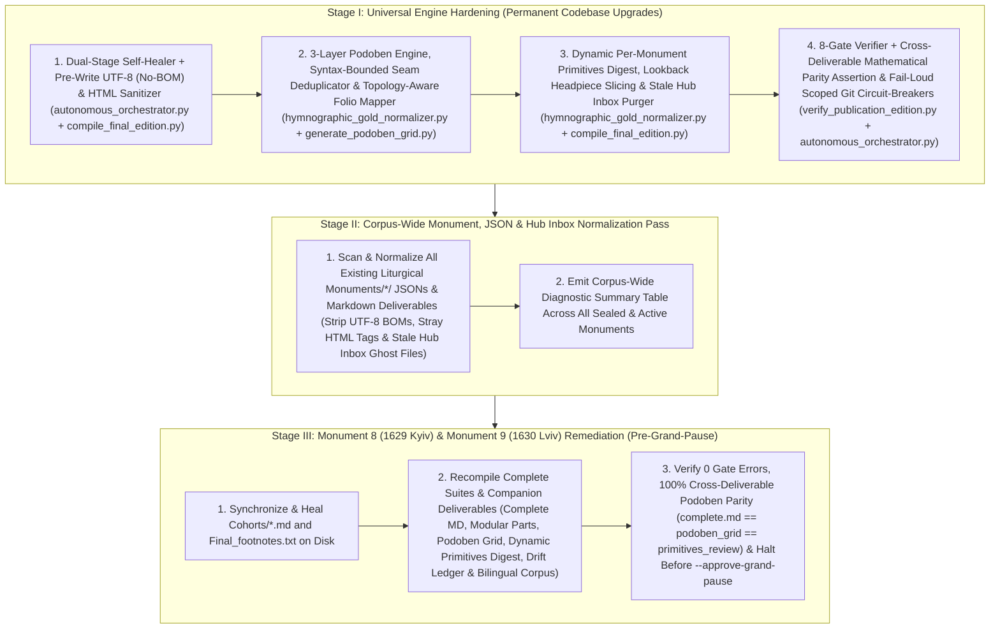

# Universal Engine Hardening, Corpus-Wide Normalization & Penetration Remediation Plan

> [!IMPORTANT]
> **Anti-"One-Off" Systemic Engineering Mandate**: None of the defects uncovered during the forensic audit of **Monument 8 (`1629_kyiv_octoechos`)** and **Monument 9 (`1630_lviv_octoechos`)** are treated as isolated, monument-specific anomalies. Every defect class—unstripped seam ellipses before `[^N]`, mid-phrase bracketed catchwords and paraphrased sub-clause seam overlaps, `SLAV_POD_RE` punctuation/label variants, scribal incipit truncations conflated with AI drift, footnote apparatus vocabulary/slop/`-eth` survival, cross-part woodcut headpiece slicing, static Monument 9 metadata in companion deliverables, unscoped `git add .` / silent exception swallowing in `approve_grand_pause()`, and stale Hub Inbox part files—is remediated **universally in the engine** and audited **corpus-wide across all existing monuments**.

---

## Architecture Overview: Three-Stage Systemic Pipeline



---

## Resolved `/grill-me` & Cross-Spoke (`a03e60c3`) Design Decisions

1. **3-Layer Podoben Reality, Epigraphic Fidelity & Drift Isolation**:
   - **Layer 1 (Liturgical Reality & Epigraphic Fidelity)**: Normalize 100% of real Podoben invocations across any monument. When a scribe explicitly prints a label (`Подо́бенъ:` / `Поⷣ.` / `По́,`), render `*Podoben: "[Canonical English]" (Verbatim Slavonic):*`. When a scribe omits the label before a known model incipit (e.g., `Сѣда̑ гла̑, з҃, И҆́же менера́ди`), mark the supplied label in brackets: `*Podoben: "[Canonical English]" ([Подо́бенъ:] Verbatim Slavonic):*`.
   - **Layer 2 (Scribal/Source Drift Classification)**: Run `classify_slavonic_drift()` on every extracted Slavonic Podoben witness against the registry's `slavonic_canonical`, explicitly classifying scribal incipit truncations (e.g. `По̀, Дв҃аа` vs. `Дв҃а дне́сь`) as source/scribal variants (`SCRIBAL_INCIPIT_TRUNCATION` / `TIER_1`–`TIER_3`) rather than AI errors.
   - **Layer 3 (True AI Translation Drift)**: Flag `is_ai_drift = True` **only** when the translator drifted from what the physical Slavonic leaf actually printed or used a non-MTS-1 rubric label (`Prosomoion:`, `Model melody:`, `Model:`).
2. **Dynamic Per-Monument Attestation, Heirmoi Extraction & Cross-Deliverable Mathematical Parity**:
   - Dynamically compute attested loci, counts, and Slavonic/English witnesses in `_primitives_review.md` from the target monument's actual normalization events and cohorts, extracting Canon Heirmoi dynamically for Section 3 and moving 0-occurrence registry primitives into Section 4 (`Un-Invoked Comparative Models in This Edition`).
   - Enforce a **Cross-Deliverable Mathematical Parity Invariant** in `compile_final_edition.py` and `verify_publication_edition.py`: the number of normalized `*Podoben: "..." (...):*` headers in `{monument_id}_complete.md` MUST strictly equal the total invocation count in `{monument_id}_podoben_grid.md` AND the sum of attested Podoben loci in `{monument_id}_primitives_review.md`.
3. **Syntax-Bounded Sub-Clause Seam Deduplication with Anaphora Guards & Audit Logging**:
   - Inspect the final sub-clause of `prev` (up to 14 words) and the opening sub-clause of `curr` (up to the first comma/semicolon/colon/period), trimming redundant re-translations when they share $\ge 2$ content stems (or $\ge 50\%$ content words) or bracketed catchwords `[...]`.
   - Explicitly exempt liturgical anaphora (`Rejoice`, `Hail`, `Blessed`, canonical Ode 7/8/9 refrains) and log every trimmed overlap in `_drift_ledger.json` as a `SEAM_OVERLAP_DEDUPLICATED` audit event while rescuing 100% of `[^N]` footnotes.
4. **Dual-Stage Deterministic Self-Healing, Pre-Write UTF-8 (No-BOM) / HTML Sanitization & Disk Synchronization**:
   - Execute the unified lexical/slop/`-eth`/Cyrillic-parenthesizing healer + Pre-Write UTF-8 (no BOM) & stray HTML tag sanitizer on **both body text and footnotes** during Phase 1 (`attempt_deterministic_self_healing`) AND Phase 2 (`compile_final_edition.py`), writing healed updates back to `Cohorts/*.md` and `Final_footnotes.txt` on disk so archived cohorts never drift from `Final MD/`.
5. **Topology-Aware Folio-to-Leaf Mapping**:
   - Replace hardcoded `min(267, int(folio) + 6)` in `hymnographic_gold_normalizer.py` (`L1471`) with a topology-aware mapper driven by `codex_registry.json` (`total_physical_pages`, front-matter `folio_offset`, and `1-up` vs. `2-up` page geometry).
6. **Strict 3-Phase Bookend Circuit-Breakers & Fail-Loud Scoped Git Checkpoints**:
   - When `remaining == 0` in `verify_cohort_and_advance()`, unconditionally halt at `small_pause_gate_status = "AWAITING_ARGON_POST_SPRINT_AUDIT"` so the operator can switch from `Flash` back to `Argon` before running `--run-argon-audit` and `--compile-publication`.
   - `approve_grand_pause()` requires `--confirm-human-signoff`, hard-aborts on any `verify_monument_publication()` failure or exception (fixing the `scripts.verify_publication_edition` import), preserves the detailed `handoff_note.md` generated by `compile_final_edition.py`, and scopes `git add` strictly to the active monument workspace, `Liturgical Monuments/codex_registry.json`, `translation_state.json`, and `GLOBAL_ECOSYSTEM_STATE.md` (failing loudly if `git commit` or `git push` exits non-zero).

---

## Stage I: Universal Engine Hardening (Permanent Codebase Upgrades)

### Component 1: Hymnographic Gold Normalizer & 2-Up Seam Engine

#### [MODIFY] [hymnographic_gold_normalizer.py](./scripts/hymnographic_gold_normalizer.py)
Addresses **Findings 2, 3, 4, 7, and 8**:
1. **3-Layer Slavonic & English Podoben/Departed Engine (`L183–414`, `L1067`)**:
   - Upgrade `SLAV_POD_RE` (`L183`) from `\s*:\s*` to `(?:\s*[:\.,]|\s+)` and include superscript titlo `поⷣ`, plus fallback detection in `extract_leaf_slavonic_primitives()` for rubrics where a known Podoben incipit immediately follows `Гла́съ [А-Яа-я]+` without the word `Подо́бенъ` (tagging those witnesses with `scribal_omitted_label = True` so the normalizer renders `([Подо́бенъ:] ...)`).
   - Upgrade `POD_TRIGGER_RE` (`L1067`) and `label_pat` (`L320`) to match `Prosomoion`, `Model\s+melody`, `Nekrosimon`, and `For\s+the\s+Departed`, and allow comma delimiters `(?:^|\*|[\.,;]\s*)` before the label (`Tone 6, model melody:`).
   - Run `classify_slavonic_drift()` inside `normalize_podoben_line()` to record `drift_tier` (`TIER_0_EXACT`..`TIER_3_LEXICAL_RECENSIONAL` or `SCRIBAL_INCIPIT_TRUNCATION`) separately from `is_ai_drift`.
   - Deterministically normalize `*Nekrosimon:*` and standalone `*For the Departed:*` into canonical `*Hymn for the Departed (Поко́инъ):*`.
2. **Hardened 2-Up Seam Stitcher & Syntax-Bounded Sub-Clause Deduplicator (`L628–824`)**:
   - **Ellipsis Stripping Before Footnotes**: Strip trailing `...` on `prev_content` even when followed by `[^N]` (`re.sub(r"\.\.\.(?=\s*(?:\[\^\d+\]\s*)*$)", "", prev_content)`).
   - **Mid-Phrase Bracketed Restoration Deduplication (`L637`)**: Allow 0–6 trailing words after `[...]` in `deduplicate_seam_overlap()` Rule 1 so `[first-enthroned bishop] of the people of Myra [f. 238vA] first-enthroned bishop` strips the duplicate phrase cleanly.
   - **Rule 4 Syntax-Bounded Sub-Clause Overlap Trimmer with Anaphora Guards**: Inspect the final sub-clause of `cleaned_prev` (up to 14 words) and the opening sub-clause of `cleaned_curr` (up to the first `,`/`;`/`:`/`.`/`!`/`?`), trimming redundant re-translations when they share $\ge 2$ content stems or $\ge 50\%$ content words, while exempting liturgical anaphora (`Rejoice`, `Hail`, `Blessed`, Ode refrains), rescuing 100% of `[^N]` markers, and recording a `SEAM_OVERLAP_DEDUPLICATED` event in `_drift_ledger.json`.
   - **Bracketed Paratext & Orphan Milestone Guards (`L760–820`)**:
     - Treat any line ending in `]` (bracketed woodcut/marginalia block) or followed by `[Headpiece` / `[Woodcut` / `[Primary` as `is_mid_sentence = False`.
     - Never append a trailing orphan `pending_milestone` at the end of a stanza when a page/column is empty or followed by a heading.
3. **Per-Section H2 Promotion for Hybrid Monuments (`L887–995`)**:
   - In `format_hymnographic_stanzas_and_headings()`, evaluate `_section_has_enough_explicit_h2()` per Tone/section so hybrid monuments (such as Monument 9 Tones 4–8) promote italicized service rubrics into canonical H2 headings and pass Gate 3B with `0` errors.
4. **Dynamic Monument Metadata, Topology-Aware Folio Mapping & Per-Monument Attestation (`L1288–1585`)**:
   - Load `title`, `publication_year`, `total_physical_pages`, `folio_offset`, and `workspace_dir` dynamically from `Liturgical Monuments/codex_registry.json`, replacing hardcoded `"1630 Lviv Octoechos"`, `"Monument 9"`, and `min(267, int(m_loc.group(2)) + 6)`.
   - In `generate_father_paul_digest()`, compute attested loci and counts dynamically from `events` and `all_stitched_cohorts`, extract the monument's actual Canon Heirmoi dynamically for Section 3, and move 0-occurrence registry primitives into Section 4 (`Un-Invoked Comparative Models in This Edition`).

---

### Component 2: Liturgical Primitives Registry & Podoben Grid Generator

#### [MODIFY] [liturgical_primitives_registry.json](./data/liturgical_primitives_registry.json)
Addresses **Finding 3**:
- Add English aliases and Slavonic patterns for all unnormalized Podoben rubrics:
  - `POD.T1.VSEKHVALNII_MUCHENITSY`: alias `"o most praised martyrs"`
  - `POD.T2.VYSHNIKH_ISHCHA`: alias `"having sought the things on high"`
  - `POD.T2.MILOSERDIA_SUSHCHI`: alias `"being tenderly compassionate"`
  - `POD.T3.VELIA_MUCHENIK_TVOIKH`: alias `"the great martyrs"`
  - `POD.T5.RADUISYA_POSTNIKOV`: alias `"rejoice, thou bearer of the ascetic life"`, Slavonic pattern `"радуися постническии"`
  - `POD.T6.EZHE_O_NAS`: alias `"having fulfilled the dispensation"`
  - `POD.T6.VSE_OTLOZHSHE`: alias `"having placed all their hope"`, Slavonic pattern `"все упование"`
  - `POD.T8.POVELENNOE_TAINSTVENNO`: alias `"that which was commanded secretly"`
  - `POD.T8.GOSPODI_ASHCHE_I_NA_SUDISHCHI`: alias `"o lord, though before the judgment seat"`
  - Add `POD.EXAP.ZHENY_USLYSHITE` (`"Hearken, O ye women"`, alias `"give ear, ye women"`, Slavonic `"жены услышите"`).

#### [MODIFY] [generate_podoben_grid.py](./scripts/generate_podoben_grid.py)
Addresses **Finding 3**:
- Synchronize `SLAV_POD_RE` (`L35`) and unlabeled-incipit fallback with `hymnographic_gold_normalizer.py` so all Slavonic witnesses (`Подо́бенъ,`, `Поⷣ.`, and `[Подо́бенъ:]`) are extracted accurately, and return total invocation counts for cross-deliverable parity verification.

---

### Component 3: Universal Publication Compiler & Dual-Stage Self-Healer

#### [MODIFY] [compile_final_edition.py](./scripts/compile_final_edition.py)
Addresses **Findings 1, 4, 5, and 6**:
1. **Dual-Stage Deterministic Self-Healer, Pre-Write UTF-8 (No-BOM) / HTML Sanitizer & Disk Synchronization (`heal_cohort_and_apparatus_text`)**:
   - Strip any UTF-8 BOM (`\ufeff`) and unauthorized raw HTML tags (`<sup>...</sup>` $\rightarrow$ Unicode superscripts, preserving `<a id="..."></a>` TOC anchors).
   - Apply deterministic MTS-1 lexical replacements (`Sedalen` $\rightarrow$ `Sessional Hymn`, `Irmos` $\rightarrow$ `Heirmos`, `Apolytikion` $\rightarrow$ `Troparion`, `Nekrosimon`/`Nekrosima` $\rightarrow$ `Hymn(s) for the Departed (Поко́инъ)`), AI slop replacements (`'poignant'` $\rightarrow$ `'penitential'`), general 3rd-person `-eth` verb normalization (excluding 2nd-person `art/wast/hast/dost/shalt/wilt`), and raw Cyrillic marginalia parenthesizing across **both** `Cohorts/*.md` and `Final_footnotes.txt`, persisting healed text back to disk in strict UTF-8 (no BOM).
2. **Cross-Part Headpiece & Opening Milestone Lookback (`_slice_parts`, `L748–775`)**:
   - When locating `found_idx` for a part landmark, look back 1–3 non-empty lines: if the immediately preceding paragraph(s) on that same leaf are the opening folio milestone (`[f. XrA]`) and/or woodcut headpiece description (`[Woodcut Headpiece...]` / `[Headpiece...]`), shift `found_idx` backward so the headpiece and opening milestone start the new Part file instead of bleeding into the foot of the previous Part file.
3. **Part 0 Master H1 Title & Preface H2 Hierarchy (`_slice_parts`, `L780–795`)**:
   - Ensure `part0` always begins with `# {master_title} <a id="{master_title_slug}"></a>` on Line 1, and normalize `# PREFACE: TO THE READER` inside `part0` to `## PREFACE: TO THE READER` so the Preface appears as a clickable H2 entry in the Table of Contents.
4. **Hub Inbox Stale Part File Cleanup (`run`, `L603`)**:
   - Extend the `hub_inbox` cleanup loop to unlink any `f"{self.monument_id}_part*.md"` not present in `all_deliverables`.

---

### Component 4: Publication Quality Gate & Autonomous Orchestrator Circuit-Breakers

#### [MODIFY] [verify_publication_edition.py](./scripts/verify_publication_edition.py)
Addresses **Findings 1, 2, 3, 4, and 5**:
- **Gate 1**: Flag any unstripped `...` immediately preceding an inline milestone (`\.\.\.\s*(?:\[\^\d+\]\s*)*\[(?:f\.|p\d+)`) or orphan trailing milestone at end of line (`\[(?:f\.\s*[^\]]+|p\d+[LR][AB])\]\s*$`).
- **Gate 4 & Gate 5**: Run full-text vocabulary (`Sedalen`, `Irmos`, `Apolytikion`, `Nekrosimon`, `Nekrosima`), AI slop (`lint_liturgical_slop.py`), general 3rd-person `-eth` verb, and unparenthesized Cyrillic checks across **both body text and footnotes/paratext**.
- **Gate 7A, 7B & Cross-Deliverable Mathematical Parity**:
  - Check for `Prosomoion:`, `Model melody:`, and `*Nekrosimon:*`, and verify that every line containing `Podoben:` anywhere in the line includes a parenthetical Cyrillic witness.
  - Assert **Cross-Deliverable Mathematical Parity**: the count of normalized `*Podoben: "..." (...):*` lines in `{monument_id}_complete.md` must equal the total invocations in `{monument_id}_podoben_grid.json` and the sum of attested Podoben loci in `{monument_id}_primitives_review.md`.

#### [MODIFY] [autonomous_orchestrator.py](./scripts/autonomous_orchestrator.py)
Addresses **Findings 1, 5, and 9**:
- Upgrade `_heal_slop_and_vocabulary()` in Phase 1 to use the universal `-eth` / vocabulary / slop / Cyrillic-parenthesizing / HTML-tag healer and apply it to **both** `draft_path` and `footnotes_path`.
- In `verify_cohort_and_advance()` (`L1174–1190`), when `remaining == 0`, unconditionally set `state["small_pause_gate_status"] = "AWAITING_ARGON_POST_SPRINT_AUDIT"` and halt so the human operator can switch from `Flash` back to `Argon` per Rule 14.
- In `approve_grand_pause()` (`L1404`):
  1. Require `--confirm-human-signoff` CLI flag and `state["small_pause_gate_status"] == "GRAND_PAUSE_AWAITING_APPROVAL"`.
  2. Fix the `from scripts.verify_publication_edition import verify_monument_publication` import so any failure or exception hard-aborts before Git staging.
  3. Clean stale Hub Inbox files and preserve the compiler's detailed `handoff_note.md`.
  4. Replace unscoped `git add .` with monument-scoped staging (`Liturgical Monuments/<Monument>/`, `Liturgical Monuments/codex_registry.json`, `translation_state.json`, `GLOBAL_ECOSYSTEM_STATE.md`) and fail loudly if `git commit` or `git push` returns a non-zero exit code.

#### [MODIFY] [test_epigraphic_fidelity_and_state_isolation.py](./tests/test_epigraphic_fidelity_and_state_isolation.py)
- Add regression tests for:
  1. Mid-phrase bracketed restoration + syntax-bounded sub-clause seam overlap deduplication (with anaphora guards) and `... [^N]` ellipsis stripping.
  2. 3-Layer Podoben normalization (`Prosomoion:` / `Model melody:` / `[Подо́бенъ:]` bracketed label supply / 3-tier scribal truncation vs. true AI drift) and `*Nekrosimon:*` normalization.
  3. Cross-part woodcut headpiece & milestone lookback slicing in `_slice_parts()`.
  4. Full-text footnote apparatus vocabulary/slop/`-eth` healing and Cross-Deliverable Podoben Parity in `compile_final_edition.py` and `verify_publication_edition.py`.
  5. `approve_grand_pause()` `--confirm-human-signoff` circuit-breaker and `remaining == 0` `AWAITING_ARGON_POST_SPRINT_AUDIT` pause.

---

## Stage II: Corpus-Wide Monument, JSON & Hub Inbox Normalization Pass

1. **Audit & Normalize All Existing `Liturgical Monuments/*/` Deliverables & JSON Caches**:
   - Scan all existing `.json`, `.md`, and `.txt` deliverables across `Liturgical Monuments/*/`, `data/`, and `Typikon Coded/Data/Inbox/*/` to:
     - Strip any UTF-8 BOMs (`\ufeff`) so `json.loads` / `read_text(encoding="utf-8")` is 100% BOM-free across the repository.
     - Replace any stray `<sup>...</sup>` HTML tags with Unicode superscripts.
     - Purge any stale `*part*.md` or `*cohort*.md` ghost files in `Typikon Coded/Data/Inbox/*/` that are not in each monument's canonical `publication_spec`.
2. **Emit Corpus-Wide Diagnostic Summary Table**:
   - Output a diagnostic summary table reporting BOMs stripped, stale Hub Inbox files removed, and gate status across all monuments in the repository.

---

## Stage III: Monument 8 (`1629_kyiv_octoechos`) & Monument 9 (`1630_lviv_octoechos`) Remediation (Pre-Grand-Pause)

1. **Heal & Synchronize `Cohorts/*.md` and `Final_footnotes.txt` on Disk**:
   - Run the upgraded dual-stage healer across Monument 8 and Monument 9 so `Cohorts/*.md` and `Final_footnotes.txt` on disk have `0` vocabulary, slop, `-eth`, or unparenthesized Cyrillic violations.
2. **Recompile Full Publication Suites & Companion Deliverables**:
   ```powershell
   py scripts/autonomous_orchestrator.py --compile-publication --monument 1629_kyiv_octoechos
   py scripts/compile_final_edition.py --monument 1630_lviv_octoechos
   ```
3. **Execute 8-Gate Verifier, Linters & Ecosystem Integrity Check**:
   ```powershell
   py -m pytest tests/ -v
   py scripts/verify_publication_edition.py --monument 1629_kyiv_octoechos
   py scripts/verify_publication_edition.py --monument 1630_lviv_octoechos
   python "../Shared_Lexicon/lint_vocabulary.py" --target "Liturgical Monuments/Monument 8 - 1629 Kyiv Octoechos/Final MD"
   python "../Shared_Lexicon/lint_vocabulary.py" --target "Liturgical Monuments/Monument 9 - 1630 Lviv Octoechos/Final MD"
   python scripts/lint_liturgical_slop.py --target "Liturgical Monuments/Monument 8 - 1629 Kyiv Octoechos/Final MD/1629_kyiv_octoechos_complete.md"
   python "../scripts/verify_ecosystem_integrity.py" --spoke "Translation"
   ```
4. **Halt at Pre-`--approve-grand-pause` Gate for Human Inspection**:
   - Present the verification results, Cross-Deliverable Parity counts, and rebuilt deliverable links for your review before executing `--approve-grand-pause --confirm-human-signoff`.
